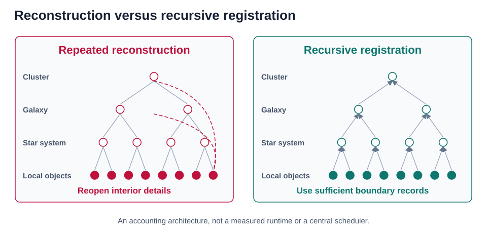
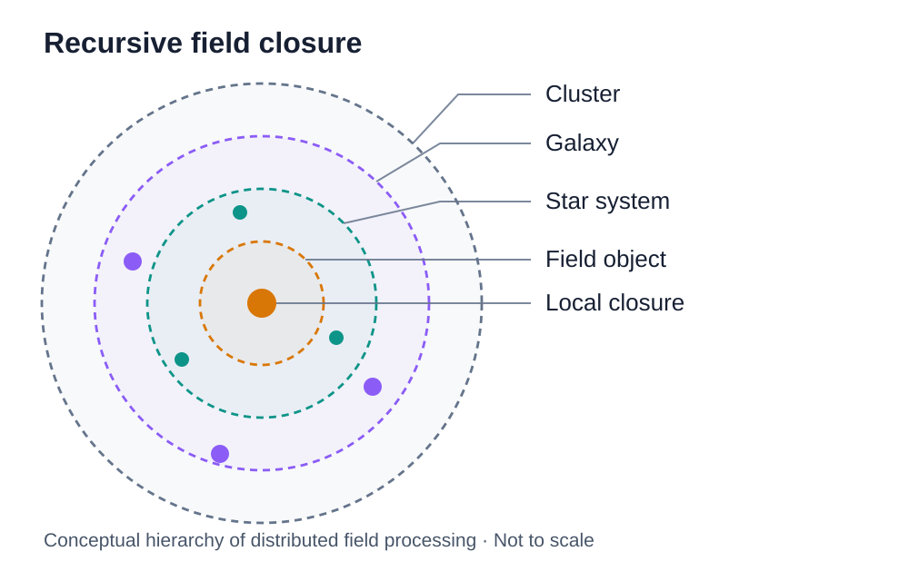
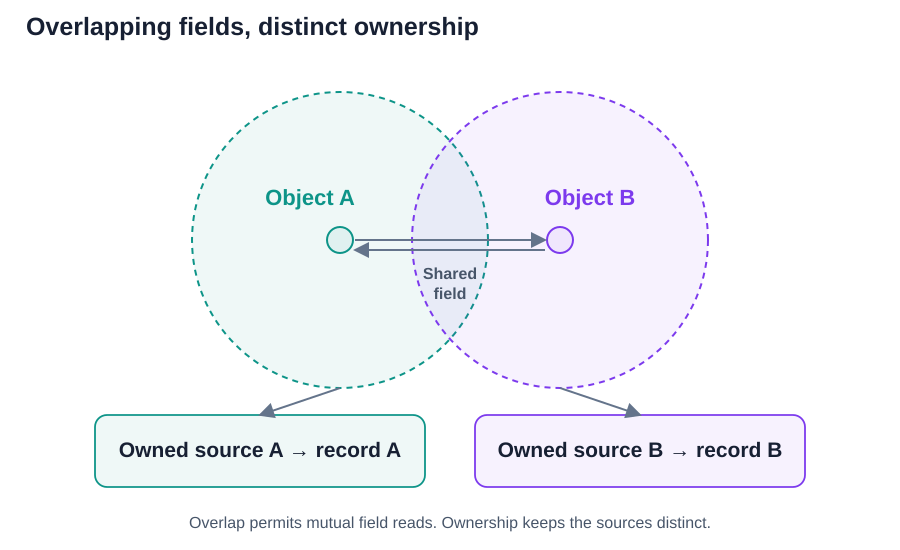
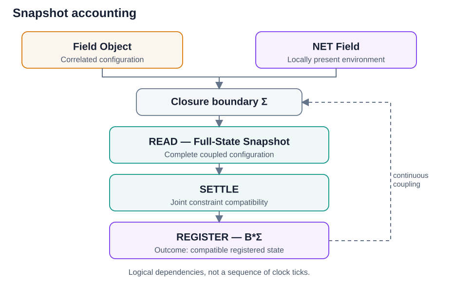
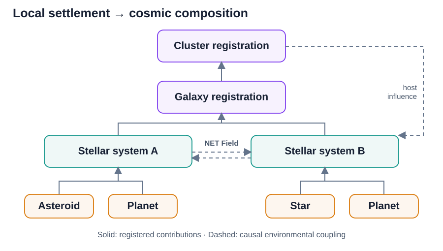
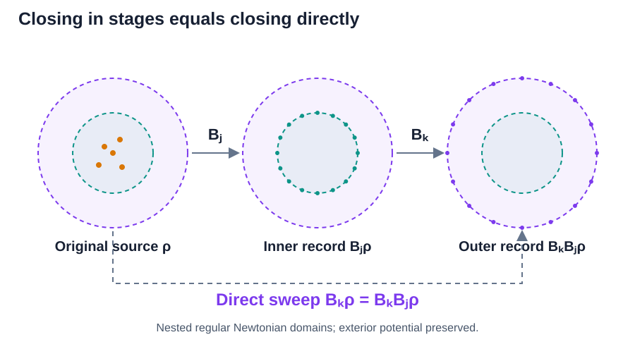
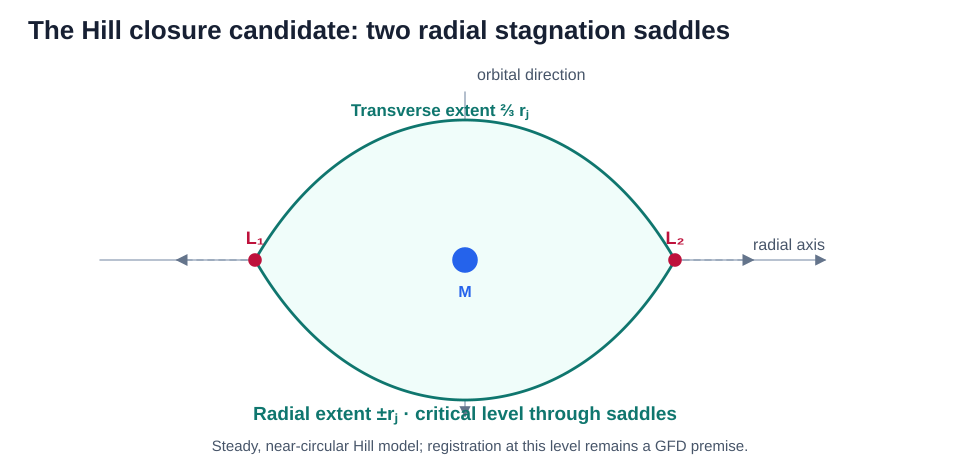

# Closure of Closures

*How can gravity close a universe without recounting every grain of sand in it? Gravity Field Dynamics proposes that nature keeps its books the way a well-run organisation does: locally, as a whole, and by reference.*

**Stephen Nelson** · Field Dynamics Research

---

## The problem: you cannot recount the universe

Stand on a beach and drop a pebble. It falls because the Earth pulls on it. But strictly, according to Newton, the pebble is pulled by everything: the sand beneath your feet, the mountains on the horizon, the Moon, the Sun, the hundred billion stars of the Milky Way, every galaxy out to the edge of what we can see. A direct particle-by-particle calculation of the gravitational force would add the contributions of the sources, one at a time. The observable universe holds something like $10^{80}$ protons and neutrons alone.

Now ask a bigger question. Not what pulls on one pebble, but how the universe as a whole settles its gravity: how every system, from an asteroid to a supercluster of galaxies, comes to a consistent field. Call that cosmic-scale closure.

Here is the problem. Suppose that each time a larger system closed, it had to reopen everything inside it.

A star system would have to recount every planet, every moon, every asteroid and every grain of rock in them. A galaxy, closing over its hundred billion star systems, would then have to recount every one of those, all the way down to the grains. A cluster of a thousand galaxies would recount every galaxy, and therefore every star, every planet and every grain, again. Each level up would carry the full weight of every level below it, with the work repeated at each level. There would be no level at which the description became simpler; each scale would be tangled up in all the ones beneath it.

This is not an objection to Newton's equations or general relativity, which can already be solved as local field equations and admit hierarchical numerical methods. It is a foundational requirement of GFD's physical architecture: if a field closes locally, that closure must remain useful when it becomes part of something larger.

> **For cosmic-scale closure to work in a recursively organised field, a larger system must be able to close over already-closed smaller systems without reopening their internal gravitational accounting.**



*Figure 1 — Repeated reconstruction versus recursive registration. The drawing illustrates the architectural difference, not a measured computational cost of nature or a serial update sequence.*

Otherwise every larger closure would require recalculating every constituent mass, and the proposed framework would not achieve genuine compositional scale invariance.

## Newton's hint

Newton himself found the first way out, though he did not put it in these terms. He proved that a spherically symmetric body, one built of concentric layers of constant density within each layer, pulls on things outside it exactly as if all its mass sat at a single point at its centre. You don't need to know how dense the core is or how the layers are arranged. From outside, the Earth's spherically symmetric component has been settled, and no one outside ever needs to reopen it. The real Earth has higher multipoles; the more general boundary representation introduced below preserves those too.

A large company works the same way. Head office does not audit every receipt from every branch. Each branch closes its own books and sends up its result. Head office works with those results, and the board works with head office's. Nobody reopens a branch's receipts, yet the totals come out right, because each result carries exactly what the level above needs. In gravity the registered result must include whatever boundary information is required, not necessarily one number.

Gravity Field Dynamics, or GFD, proposes that this is not a lucky property of spherical bodies or a convenience of accountants. It is how gravitational field objects are organised at every scale.

## The recursive closure principle

Picture the hierarchy from the top down:

```
Cosmic closure          processes registered group and cluster contributions
  Galaxy closure        processes the stellar systems' registered states
    Stellar closure     processes its planets' and other bodies' states
      Planetary closure internal mass distribution accounted for locally
```



*Figure 2 — The original recursive field-closure diagram. The nested rings denote levels of gravitational accounting, not a claim that the actual boundaries are concentric or disjoint.*

An asteroid settles its own internal field and closes. To the solar system it is no longer a heap of rock but a single entry, a *pointer*: here is a closed object, here is what it presents to the surrounding field. The solar system closes in turn, and to the galaxy it is one pointer. The galaxy closes, and to its cluster it is one pointer. The intention is that no level reaches down to redo the complete internal accounting of the one below.

This is the original DFP principle of **snapshot accounting**. A Field Object and the surrounding NET Field couple locally. The whole correlated configuration participates in the Full-State Snapshot; compatibility is established in settlement; the outcome is Field State Registration. The next level reads the registered contribution, not a random sample of the interior. The local field continues to respond as the object moves or changes.

Written as a proposed rule: if $\mathcal C(D)$ is the closed field description of a region or owned configuration $D$, and $\mathcal M$ joins compatible registered descriptions, then

$$\mathcal C(D_1\cup D_2)=\mathcal M\big(\mathcal C(D_1),\mathcal C(D_2)\big).$$

Here the union denotes the composition of owned configurations with compatible interfaces, not the geometric union of every point lying inside their envelopes. The decisive statement is that **closing over closures is equivalent, for the relevant exterior gravitational observables, to closing over their complete interiors**, without reprocessing those interiors. Call it GFD's recursive closure principle; a general theorem would establish this equivalence. It is a foundational requirement of GFD: the exact nested Newtonian case is proved below, and the general drained case is the work ahead.



*Figure 3 — Two field objects can occupy overlapping envelopes. Each registers only its owned contribution, while the NET Field carries their mutual influence.*

The regions in that rule are not tidy, non-overlapping boxes. Closed fields can overlap. What composition respects is *ownership*, not the absence of overlap. Two closed Field Objects may occupy overlapping regions while keeping distinct registered states, and the larger closure takes in each object's owned contribution exactly once. It neither merges their interiors nor counts their mass twice. Neighbours can also interact through fields across disjoint interfaces; overlap is not the only way to couple.

And the universality belongs to the process of closure, not necessarily to what goes on inside every object. A drainless star system and a galaxy with a drain at its centre may follow different internal field equations, while obeying the same requirement to settle, register and compose. For the drainless, Newtonian case an exact nested construction already exists. Extending it to drained fields is the next mathematical step.

What has to be passed up is not simply a mass. A lumpy comet, a pair of stars or a flattened star system cannot in general be replaced by one number at one point and still produce the right field outside. What a closed system must hand to the level above is its *boundary information*: a compatible representation of the field and flux through its boundary, and, for more general environments, how its boundary responds when the field outside changes. This is what lets a closed system stay coupled when it is not round, when tides pull on it, and when the law governing the larger system differs from Newton's.

Closing does not mean that an object stops responding to its surroundings. Its registered state stays coupled to the surrounding NET Field. As that field changes, the object's boundary response changes with it, and a new compatible state is established. What closure removes is not interaction. It removes the requirement that a larger system reconstruct the object's internal matter to account for its external influence. That matters most where environments change: galaxy encounters, mergers, tidal stripping. A mathematical description of changing ownership and moving boundaries remains to be derived; a static registration is not a model of instantaneous updating.

## Compositional scale invariance

This gives scale invariance a different meaning from the one physicists usually give it.

The usual meaning is that nothing changes under rescaling: zoom in or out and a system or its equations transform according to a scale symmetry. GFD does not require that. A galaxy is not a scaled-up solar system, and the boundary of a closed system does not even grow in proportion to its host in the example analysed in the proofs. At fixed child mass and fixed circular speed in a flat-rotation host, the Jacobi radius grows as the two-thirds power of the host orbital radius. What GFD requires is operational: the same rule of local settlement, registration and composition applies at every level, and each level works with the closed results of the level below and the environment around it. A galaxy need not resemble a solar system. Both must be able to close their own field and present a registered state to the system around them. The proofs call this property scale-universal; compositional scale invariance is the same idea seen from the level of the whole.

The scale-universality of the operation is the proposal; different closure sizes, different interior dynamics and different interface response functions do not contradict it.

## The original idea: distributed field processing

This is where the newest mathematics connects with GFD's oldest architectural idea.

GFD was never meant to calculate gravity by having every mass interact directly with a list of every other mass across the universe. From the start it described gravity as evaluated locally, with the field's structure scaling up through a mesh of interacting domains: a galaxy domain with its own local field and closure, stellar domains inside it with theirs, planetary domains inside those, and boundary information exchanged between them. The framework calls this *Distributed Field Processing* (DFP).



*Figure 4 — The logical sequence in Paper I. The arrows express dependencies in a locally compatible state, not a central scheduler or an instant at which the whole universe is read.*

Seen this way, the recent proofs in the GFD research repository are not separate results. Each one supplies a mechanism that the original principle needed:

- **Distributed processing** is the organising principle: local field domains form a scalable mesh.
- **The closure surface** identifies a candidate interface using the field's stagnation and orbital confinement structure.
- **The mountain-scale construction** says how the internal Newtonian residual and the external constitutive response are separated in the static fixed-ownership model.
- **The net-field rule** says which field enters GFD's constitutive law at each level.

For example, the solar system's detailed internal field is not subjected, piece by piece, to the galaxy's constitutive law. Its influence is communicated through its gravitational registration, and the galaxy's response acts on the resulting mountain field.

The distinction is between gravitational influence and gravitational accounting. Gravity's influence reaches across enormous distances: the Milky Way's pull shapes the outermost comets of our solar system, and our galaxy and Andromeda are falling toward each other across two and a half million light years. But a field can influence distant systems without every distant system having to reconstruct its source. Each object settles its own field, registers what its exterior needs to know, and stays coupled to the surrounding NET Field through that registration. The next level works with those registered contributions and establishes its own closure. The process repeats from asteroids to planets, star systems, galaxies and clusters. Influence is carried by the field, subject to causal propagation; the proposed processing stays local. There is no global synchronization clock and no assumption that all closures take exactly one light-crossing time.



*Figure 5 — The two complementary relationships in DFP. Registered descriptions compose across levels, and changes in the NET Field couple neighbouring objects. The hierarchy is a representation of ownership, not a one-way command structure.*

A deeper consequence follows. A framework like this may not need a universal smoothing length laid over the whole universe to decide where one kind of gravity ends and another begins. It needs a local rule for ownership and interfaces, saying how each domain contributes to the domain around it. As a schematic statement, every domain applies a local prescription to its owned density and its compatible boundary information:

$$\mathcal F_i=\mathcal L\big(\rho_i,\ \Phi|_{\partial D_i},\ \nabla\Phi|_{\partial D_i}\big).$$

The boundary values and fluxes are linked by the field equations; they are not freely prescribed independently. The same closure contract may employ different interior laws. The framework becomes scale-recursive rather than dependent on a globally chosen scale. See [Field Closure and Snapshot Accounting](FIELD_CLOSURE_AND_SNAPSHOT_ACCOUNTING.md) for the original READ → SETTLE → REGISTER vocabulary and the distinction between the complete local state and its exterior gravitational representation.

## What has been shown

Several mathematical pieces of the proposal have now been derived. Their algebraic cores are checked in the Lean proof assistant, and the geometric and numerical claims around them are tested by computation, as reported in the repository. Together they support a recursive construction for drainless systems. They do not yet establish the full closure principle for arbitrary fields.

### Closing in stages gives the same answer as closing all at once

The tool for closing a region is called *balayage*, French for sweeping: you replace the mass inside a closed surface with a mathematical distribution on the surface, arranged so that the Newtonian potential outside is exactly unchanged. The actual matter stays inside; the sweep is a representation of its exterior influence. Newton's round planet is the simplest case. The key property is that sweeping nests. Sweep a planet onto its own boundary, then sweep that onto the star system's boundary, and you get exactly what you would have got by sweeping the planet straight onto the star system's boundary. In symbols, $B_kB_j=B_k$ for nested regular surfaces. The [mountain-scale proof](proofs/sst-mountain-scale/) proves this and checks its algebraic telescope in Lean. It is the requirement above, in mathematical form for Newtonian sources: the larger closure never reopens the smaller one, and the exterior pointer is exact.



*Figure 6 — Nested Newtonian sweeps. At the outer boundary, the direct and staged routes produce the same registered exterior representation. This does not require actual mass transport.*

### What is passed up is boundary information

The sweep keeps the whole distribution on the boundary, not just its total, and reproduces the outside field exactly for any source shape lying inside an admissible closed boundary. There is a natural variational reason for this representation. Given the registered exterior potential, if settlement selects the least positive field-gradient energy of its source-free interior completion compatible with the boundary values, the result is precisely the harmonic completion associated with the sweep. That is the classical Dirichlet principle, put to new use. The physical selection of that least-energy settlement rule from the underlying dynamics remains a premise. The boundary information plays the part of what GFD's first paper calls the object's *registered state* at the gravitational interface.

At leading order the interaction is organised through four channels: one timelike, the object's clock calibration relative to a reference, and three spacelike, the directions in which it falls. These correspond to the four legs of GFD's tetrad, the four active ports of its geometry. Finer tidal and shape information stays encoded in the boundary state. The four ports organise the coupling, but they do not reduce an arbitrary boundary field to four numbers.

### Where the closure surface sits

A [companion proof](proofs/closure-surface/) asks where a closed system's boundary lies. Picture the Sun on its orbit around the galaxy. Close in, the Sun's own pull dominates. Far out, the galaxy's tide, its tendency to stretch things apart, wins. In between, together with the effect of the orbit's turning, there are two places where the effective field cancels: one toward the galactic centre and one away from it. In the frame that turns with the orbit, these are stagnation points of the combined effective field. The critical potential level through them bounds the inner cell. The calculation is for a near-circular orbit in a steady host, with the cell small compared with the galaxy. No externally imposed smoothing length is needed to locate these saddles; they follow from the Sun's mass and the field around it. Registration on this boundary is GFD's remaining geometric premise.



*Figure 7 — Equatorial section of the critical Hill level. The two saddles are the radial doors. The effective field is zero at the saddles, not everywhere on the boundary. The drawing is schematic and uses the radial and transverse ratios of the model.*

That surface does double duty. Defined from the field, it also bounds the connected region that matter with sufficiently low conserved Jacobi energy cannot leave. In this steady model a planet or an inner comet starting in that region stays in the Sun's cell; in a changing galaxy the cell itself changes, and that case is still to be worked out. Matter with more energy may snap to a neighbouring cell through the openings around the two stagnation points when its energy allows; those are the cell's doors. Energy above threshold does not guarantee transition. For the Sun the cell reaches about 1.44 parsecs (about 4.7 light years) toward and away from the galactic centre, about two-thirds of that along its orbit, and about half vertically in the stated model. The proof gives a conservative Oort-cloud orbital bound of about 99,000 Earth–Sun distances for its model; that is not the entire 1.44 pc radial extent. Alpha Centauri, 1.34 parsecs away, sits in its own cell. The envelopes overlap without sharing ownership; each reads the other's field.

### The surroundings hold each cell in place

Turn off the galaxy's radial tide in the calculation and the radial balance points slide away to infinity. The finite Hill boundary is supplied by the host. A water vortex in an imposed strain does something analogous: a separating streamline passes through its stagnation points, dividing the circulating flow from the flow around it. The steady point-vortex model in the proof makes this correspondence precise. It is not a derivation of the galaxy's full gravitational dynamics from hydrodynamics. In GFD the surrounding medium is the lattice of unbound cells (empty TetB) through which bound configurations move, and that mesh anchors each bound cell.

## Why it matters

Galaxies spin faster at their edges than their visible matter can explain. GFD accounts for this with a constitutive law, a rule for how the field responds, that departs strongly from Newton's when the pull in a drained field becomes weak. But the law must not act everywhere. If the simple law acted on the Sun's own field, its absolute residual acceleration would approach $a_0$ even in a strong field, and the Sun-centred external-field quadrupole would distort the planets' orbits. The 2026 analysis of Cassini's data cited by the mountain-scale proof measures the quadrupole, a tiny stretching along the direction of the galactic field, as $(1.6\pm1.8)\times10^{-27}$ per second squared: consistent with zero.

Recursive closure supplies a specific proposed resolution. Inside its closure the solar system's owned interior residual is Newtonian. The galaxy's law acts on the mountain and sees the Sun's registered contribution on its boundary more than a parsec away. The proof shows that the centred idealised spherical shell in a constant linear anisotropic host response produces no anomalous self-quadrupole at the order calculated. What remains includes the ordinary Galactic tide and smaller environmental terms, estimated around three orders of magnitude below the measurement uncertainty in the stated calculation. The exact shape-dependent and higher-order matching remains open. This is different from merely reducing the TetB fraction by a large acceleration.

The cell's boundary is not invisible. The potential is continuous across it, but its normal slope may change there, where the Newtonian residual and galaxy's response combine. In the mountain-scale proof this appears as an effective surface layer in the distributional field equation, the share of the Sun's field that the drained response takes up. It is not a material shell or an additional self-force inserted on the planets; the planets sit deep inside and the calculated environmental terms are small. Its full relativistic matching conditions are still to be derived.

The same rule makes predictions where the law must not act. A star cluster is drainless, so its own field must use the bare $G$: the [net-field rule](proofs/net-field-rule/) shows globular clusters require it at more than $8\sigma$. Two stars orbiting each other thousands of times farther apart than the Earth and Sun can still share one closed cell, and the same proof shows bound wide binaries are then Newtonian to within $(s/r_J)^3$. The [closure-surface proof](proofs/closure-surface/) adds a speed edge, $v/\sqrt{GM/s}<\sqrt{2-3s/r_J}$, fixed by the masses, separation and galactic tide before any velocity is inspected. These tests probe where the law acts, in addition to the galactic response.

## What is not yet shown

The strongest way to put the idea is this: *in GFD, gravitational fields are processed locally on a recursively structured mesh, with locally determined closure surfaces mediating the gravitational description between scales.*

Parts of that are now proved. The rest is the work ahead, and it is worth being plain about it.

Closing in stages is proved exactly for the static Newtonian construction with nested envelopes and the stated ownership premises, relevant to what GFD calls drainless Field Objects: planets, star systems, star clusters, binaries. A galaxy is different. Its interior has an open drain, a central throat through which its field flows, and the constitutive law acts inside its own accounting. A galaxy still closes in the architecture, and to its cluster it is still a pointer, but exactly what boundary information it passes up, including what gravitational mass that information carries, has not been worked out. Conserved constitutive flux and the mass inferred from the ordinary gravitational gradient are not necessarily the same. That is where the composition rule has to be shown to hold when the law is not Newton's.

A possible route is to register not just a field at one boundary condition, but a boundary response: a description of how the child settles as its environment varies. A conditional static variational gluing argument in [Field Closure and Recursive Registration](FIELD_CLOSURE_AND_RECURSIVE_REGISTRATION.md) shows how such responses can compose for compatible non-overlapping subdomains, even with different constitutive energies. That is an intermediate mathematical model, not the general nonlinear ownership theorem; it does not solve the drained galaxy's matching or overlapping domains. It clarifies what the general proof must accomplish.

What remains to be demonstrated is that the recursive construction follows from GFD's full nonlinear and relativistic field equations, not only from the Newtonian cases established so far. The deepest step is also still to come: showing that GFD's underlying dual-tetrad dynamics guarantee that closure information is sufficient and composable, select least-energy settlement and make a closed system register at the balance-point surface rather than assuming those rules. The [Read-Settle-Register bridge](research/read-settle-register-bridge/READ_SETTLE_REGISTER_BRIDGE.md) is a first conditional construction of that step. The moment of snapping, when matter leaves one cell for the next, still has to be described with consistent transfer of ownership and energy. The constructions discussed here are static weak-field results on fixed slices; the causal relativistic version with moving boundaries is ahead.

If those steps hold, cosmic-scale closure can follow recursively, without requiring a larger domain to reconstruct every smaller one's constituents. And the pebble on the beach would be telling us something true: gravity does not recount the universe. It closes it, one domain at a time.

---

*The proofs referred to here are in the GFD research repository: the [mountain-scale proof](proofs/sst-mountain-scale/) (closing in stages, boundary information, four channels, Cassini quadrupole) and the [closure-surface proof](proofs/closure-surface/) (the candidate boundary, its doors and its anchoring). The geometric and physical argument appears in [Einstein's TetA Partition](EINSTEIN_TETA_PARTITION.md). For the story of why galaxies spin as they do, see [The Other Root](THE_MISSING_MASS.md). For the full DFP architecture, continue with [Field Closure and Snapshot Accounting](FIELD_CLOSURE_AND_SNAPSHOT_ACCOUNTING.md), then [Field Closure and Recursive Registration](FIELD_CLOSURE_AND_RECURSIVE_REGISTRATION.md).*
