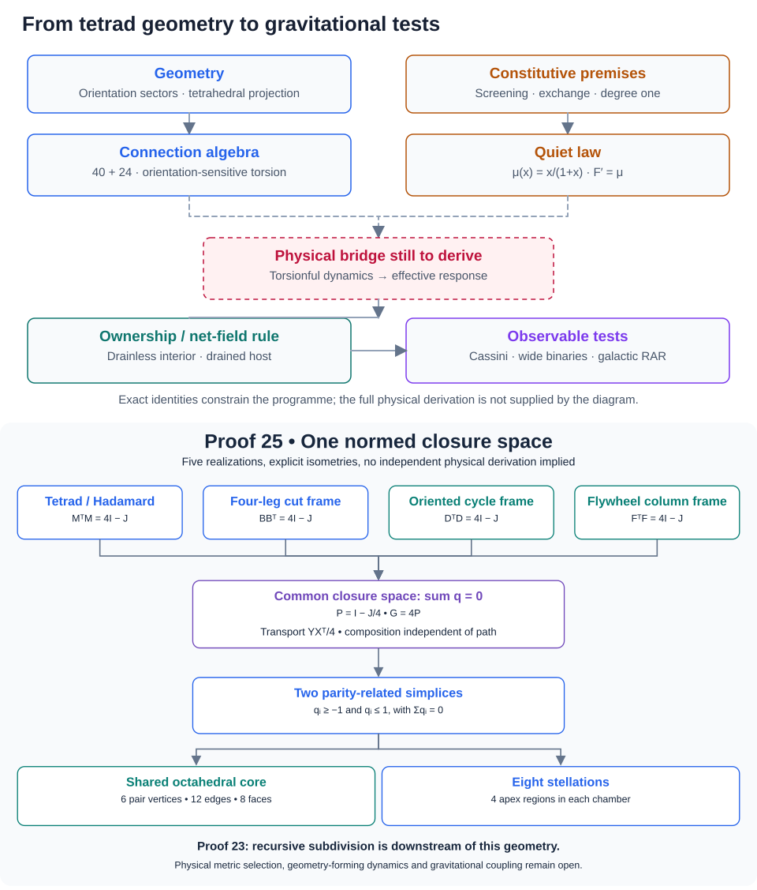
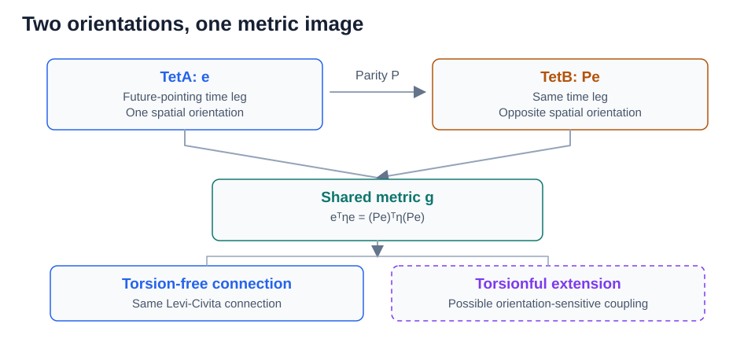
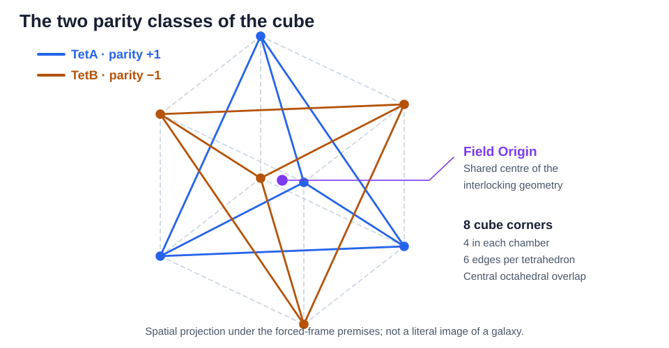
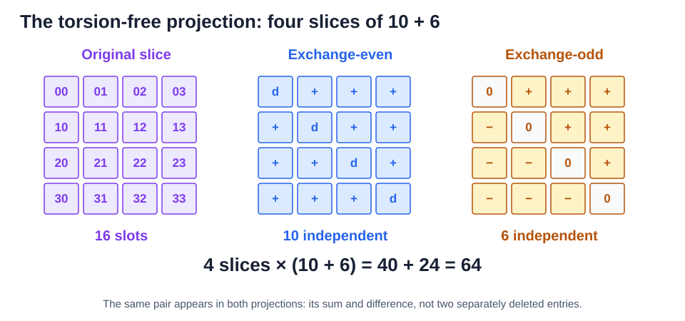
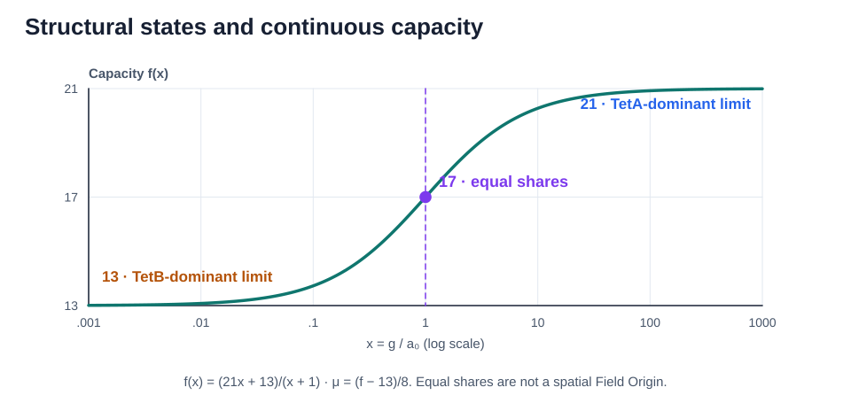
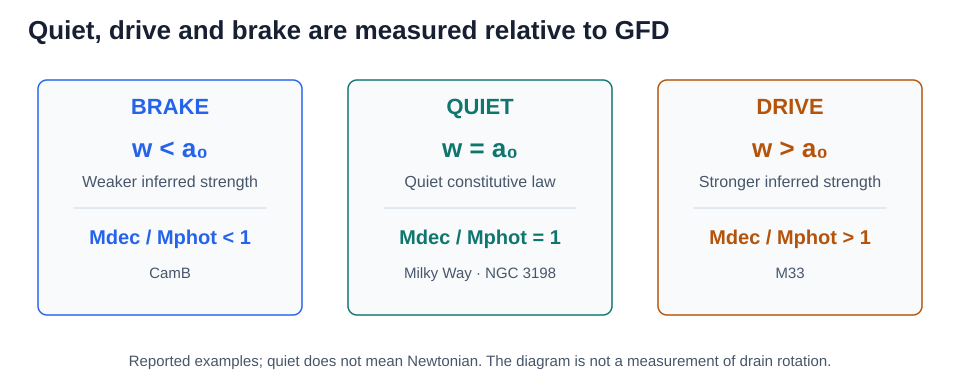
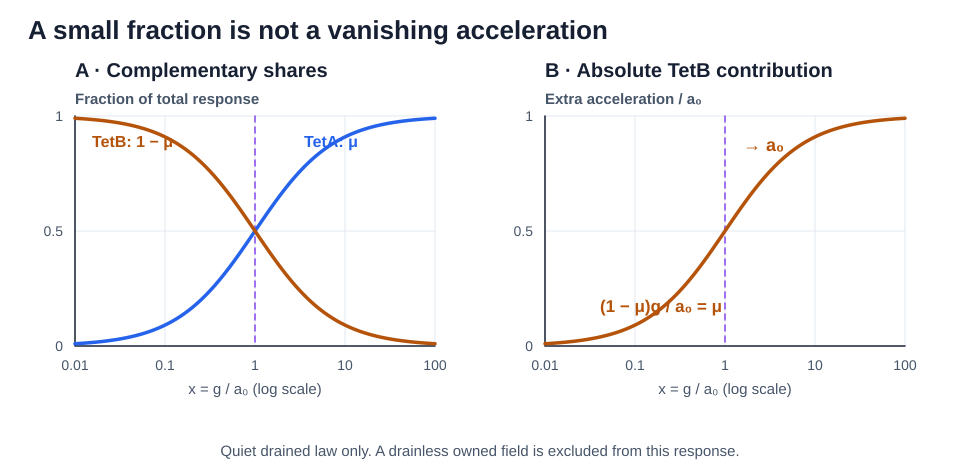
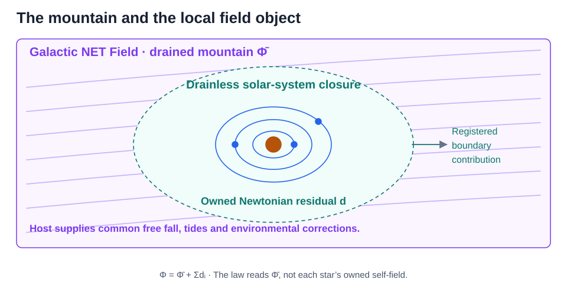
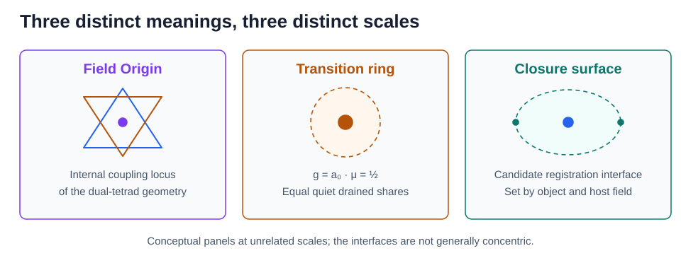
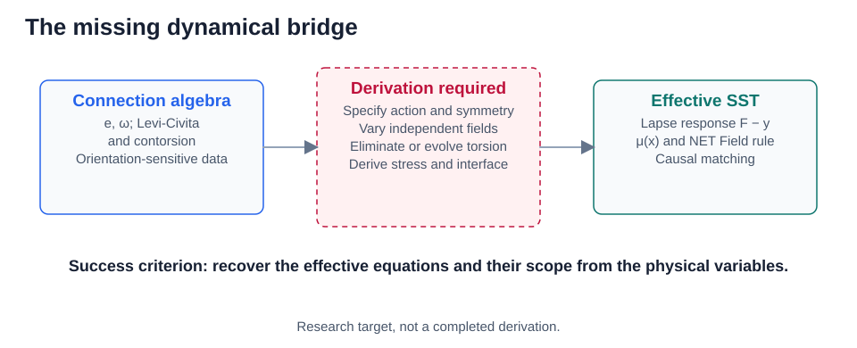

# Einstein's Equation as the TetA Partition

*Why general relativity works locally, why galaxies reveal a larger field structure, and how distributed field closure connects the two.*

**A summary and technical reading of Letter 3: S. Nelson, *Gravity Field Dynamics: Field Closure of the Tetrad Frame* (Field Dynamics Research, 2026, preprint).** Paper, sources and supplementary material: [`papers/letter-3-field-closure-of-tetrad-frame/`](papers/letter-3-field-closure-of-tetrad-frame/) ([PDF](papers/letter-3-field-closure-of-tetrad-frame/letter.pdf)).

---

Gravity Field Dynamics (GFD) does not begin by assuming that Einstein's description is wrong. It begins by asking whether the metric contains the complete information of the tetrad from which it is constructed. The tetrad equation admits two parity-related spatial orientation sectors producing the same metric. The torsion-free metric connection cannot distinguish them. GFD proposes that the dual-tetrad topology — TetA, TetB and their shared Field Origin — gives that distinction a physical gravitational role.

The question is not merely why gravity changes at low acceleration. It is **why different gravitational systems expose different parts of the same proposed underlying field structure**. In GFD, every Field Object closes through local snapshot accounting. Drainless systems have a TetA internal gravitational response; a drained galactic NET Field exhibits the full constitutive partition. Einstein's equation is recovered in the former at the orders established by the ownership construction, rather than discarded.

*Figure 1 — The argument's dependencies. Solid links denote mathematical constructions under stated assumptions; the dashed bridge between geometry and physical constitutive dynamics is a research objective, not a theorem supplied by a count.*

### The figure that motivates the article

*Figure 2 — Original Letter 3 figure. Baryonic source acceleration $g_s$ versus observed acceleration $g_t$, both in units of $a_0$. Panel A: $g_s=g_t$ and $g_s=\mu g_t$ coincide with $\mu=1$. Panel B: in a quiet drained spherical field, $g_s=g_t^2/(g_t+a_0)$. The shaded vertical difference $(1-\mu)g_t$ is GFD's TetB acceleration contribution, expressed at fixed observed acceleration. The curves approach one another in fractional terms as $g_t/a_0$ increases, not by eliminating their absolute difference. The plot compares weak-field equations, not the full Einstein tensor equation.*

*Generated by [`plot_both_panels.py`](papers/letter-3-field-closure-of-tetrad-frame/Einstiens%20tetA%20gap/plot_both_panels.py).*

## 1. In plain terms: a galaxy is a vortex

Picture water swirling down a drain. Leaves on the surface trace the flow. The drain helps determine the shape and strength of the vortex; the leaves are tracers. In GFD's physical interpretation, the visible stars orbit in TetA, while the galaxy's occupied TetB is the throat interior, reached through the Field Origin. The stars trace the total NET Field and their mass also contributes to its source.

The quiet field has two complementary shares. TetA carries the source part and TetB carries the response that would otherwise be interpreted as a missing mass. A tug of war is a useful picture: TetA pulls with the total local field $g$, TetB with a fixed strength $a_0$. Each chamber's share is its strength divided by the combined strength. A galaxy may also drive or brake relative to this quiet law; co-rotation or counter-rotation of the drain is a candidate mechanism, while the observable mass-decoding ratio measures an inferred strength, not the drain's actual direction of rotation. M33 (drive), CamB (brake), the Milky Way and NGC 3198 (near quiet) are examples reported in the decoding research.

Why does the solar system not exhibit that same self-field response? A solar system is itself a Field Object with its own drainless closure. It rides the larger galactic field like a pebble in a mountain stream: locally the stream's slope is nearly constant, so its uniform acceleration is common to the bodies, while its curvature produces a small tide. A body may have an enclosed TetB contribution already included in its measured $GM$. Its mutual field is not a separate drained vortex. The net-field and mountain-scale proofs make this distinction quantitative in the weak-field construction. The geometry and dynamics behind this statement are developed below.

For a nontechnical entry see [The Other Root](THE_MISSING_MASS.md). For the scaling argument see [Closure of Closures](CLOSURE_OF_CLOSURES.md).

## 2. What the tetrad equation does and does not distinguish

### 2.1 A root cannot simply be removed from the full solution set

Take the parabola $y=x^2$. Solving for $x$ gives $x=\pm\sqrt y$. The right-hand branch is exact on its own domain, but cannot represent the left-hand branch. The identity $\sqrt{x^2}=|x|$, rather than $x$, makes the distinction transparent. For $x^2-a=0$ with $a>0$, Vieta's identities for the pair are $r_1+r_2=0$ and $r_1r_2=-a$. Substituting only the positive root for both would give the wrong pair relations. A linear equation selecting one root is a different solution problem, even though its solution satisfies the quadratic. A legitimate domain condition (such as a positive length) can select a branch without inconsistency.

The algebraic-geometric point is to consider the full solution scheme of the equation rather than assume one preferred component. The simple quadratic has two distinct points for $a>0$; the tetrad's solution scheme has continuous components. Selecting an orientation is therefore a restriction, not a consequence of the equation: restricting to $SO^+(1,3)$ keeps one root by convention. The other root is not an added hypothesis. The [scheme proof](proofs/tetrad-scheme-two-bounded-regions/) shows the equation has exactly two components, one over each root, exchanged by spatial parity. The [half-space proof](proofs/half-space-two-bounded-regions/) shows exactly two of the sixteen sign selections are bounded: TetA and TetB. The [Gram-matrix proof](proofs/gram-matrix-tetrad-equation/) shows the metric and the 40 torsion-free connection components cannot tell the roots apart, while the 24 torsion components are the only place a metric connection can, and [Letter 2](papers/letter-2-other-half-of-gravity-torsion/) identifies those 24 as TetB's carrier. **TetB is the second root.** What remains to be derived is not whether it exists but how strongly it responds in each field.

A precedent worth remembering is Dirac's investigation of the additional solutions of relativistic quantum theory. The energy equation $E^2=p^2c^2+m^2c^4$ has positive and negative roots; the Dirac theory ultimately predicted the positron, observed by Anderson in 1932. That history motivates investigating an apparent redundancy; it is not a mathematical argument that a parity partner of a tetrad is a new particle or physical field.

### 2.2 The determinant roots of the tetrad equation

Let $e^a{}_{\mu}$ be a non-degenerate tetrad, $\eta$ the Minkowski frame metric, and $g=e^T\eta e$. Taking determinants gives

$$ (\det e)^2=\frac{\det g}{\det\eta}. $$

The determinant has two signs. If $e$ solves the metric equation, $\Lambda e$ also solves it for every $\Lambda\in O(1,3)$. The complete set of real tetrads for a fixed non-degenerate Lorentz metric is a Lorentz orbit. Its four real components are distinguished by determinant and time orientation; the revised [scheme proof](proofs/tetrad-scheme-two-bounded-regions/) identifies two algebraic components over the determinant roots. Spatial parity $P=\operatorname{diag}(1,-1,-1,-1)$ and time reversal each flip the determinant; their product does not. With one observer's time leg held fixed and future-pointing, the residual group is $O(3)$, with components $SO(3)$ and its parity coset. Then the determinant root labels the spatial orientation sector.

$$ (Pe)^T\eta(Pe)=e^T\eta e=g,\qquad \det(Pe)=-\det e. $$

Neither operation changes the metric signature. TetA and TetB are not the two conventions $(-,+,+,+)$ and $(+,-,-,-)$; TetB is not reversed time. The labels A and B are relative to an orientation convention. The important physical question is whether a field theory includes a coupling that retains their relative distinction.

*Figure 3 — The metric is insensitive to the determinant sign. Frame orientation, relative cross-coupling and torsion are distinct information channels.*

### 2.3 The two independent geometric routes

Letter 1's four half-space construction classifies the $2^4=16$ sign selections of four tetrahedral directions. Exactly two yield bounded regions: TetA and TetB. The [half-space proof](proofs/half-space-two-bounded-regions/) gives the boundedness criterion and explicit rays for the fourteen open selections. The [scheme proof](proofs/tetrad-scheme-two-bounded-regions/) instead identifies the determinant sectors and uses spatial parity to relate the tetrahedral projections. It does not enumerate half-spaces. The two routes identify the same paired geometry under their projection premises.

The [forced-frame proof](proofs/forced-tetrahedral-frame/) states those premises precisely: a spatial realisation that preserves equal leg magnitudes, equal pair relations, distinct legs and the three spatial dimensions yields a regular tetrahedral frame. Without those premises the standard spatial projection of an observer's tetrad is an alternative and does not produce this tetrahedron. The compound of the two spatial orientations in the cube is the stellated octahedron; their overlap is an octahedron. In GFD the Field Origin is the central coupling locus. Both tetrahedra have a 3+1 face labelling in the construction; that labelling is not a reversal of metric signature.

*Figure 4 — The geometric closure: the two tetrahedral parity classes use all eight corners. The central overlap is octahedral; the Field Origin names the centre/coupling throat in GFD.*

### 2.4 Self-coupling, cross-coupling and orientation

The [Gram-matrix proof](proofs/gram-matrix-tetrad-equation/) makes the analogy with a quadratic exact at the level of the spatial projection. Write its two labelled spatial representatives $M_A=M$ and $M_B=-M$. Define $\mathsf G=M^TM$, the spatial Gram matrix (not the four-dimensional Lorentz metric itself).

| Quadratic analogy | Spatial Gram statement | Information |
|---|---|---|
| $(-x)^2=x^2$ | $M_B^TM_B=M_A^TM_A=\mathsf G$ | Shared geometry; self-coupling is root-blind. |
| Product of opposite roots is negative | $M_A^TM_B=M_B^TM_A=-\mathsf G$ | Same-root versus cross-root pairing; unchanged by exchanging both labels. |
| Sign of a representative | $\det e$ (or orientation of a labelled spatial basis) | Absolute orientation relative to the chosen convention. |

The cross-coupling resolves a *relative* root, not which root a single frame is. This is why the complete two-root description can carry relational information that the metric does not separately record. It does not follow that the metric equation is false or that a root-sensitive interaction must exist. Such an interaction requires a dynamical law.

## 3. The connection: what the torsion-free projection sets aside

### 3.1 The 40/24 split

A general affine connection in four dimensions has $K^3=64$ coordinate slots, with $K=4$. For a fixed upper index $\lambda$, the two lower indices form a $4\times4$ slice. Its four diagonal entries and six symmetric combinations constitute ten independent symmetric slots; six antisymmetric combinations remain. Across all four slices:

$$64=4(10+6)=40+24.$$

Define $\tau$ by lower-index exchange and the projections

$$\Pi_+=\tfrac12(I+\tau),\qquad \Pi_-=\tfrac12(I-\tau).$$

In a coordinate basis, $T^\lambda{}_{\mu\nu}=\Gamma^\lambda{}_{\mu\nu}-\Gamma^\lambda{}_{\nu\mu}=2(\Pi_-\Gamma)^\lambda{}_{\mu\nu}$ (using the convention of the source proof). Torsion-free means $\Pi_-\Gamma=0$. This is a projection, not an invertible map on the space of all affine connection slots. The Christoffel symbols are those of the torsion-free *metric-compatible* connection; a generic symmetric affine connection need not be Levi-Civita. The 64 and 24 counts are not counts of physical propagating degrees of freedom.

*Figure 5 — Each off-diagonal pair contributes its sum to one projection and difference to the other. The literal upper and lower triangular entries are only a choice of bookkeeping coordinates. The original Letter 3 matrix is retained in [Figure 1 of the paper](papers/letter-3-field-closure-of-tetrad-frame/fig1_matrix.png).*

### 3.2 The coupling polynomial and the character count

Letter 3 connects the split to the GFD structural polynomial

$$f(K,s)=1+sK+K^2,\qquad f(4,+1)=21,\ f(4,0)=17,\ f(4,-1)=13.$$

Its three terms count the scalar closure condition, frame template and bilinear coupling template in GFD's graded structural reading. These are structural counts, not independent dynamical degrees of freedom. In the exchange calculation on a slice, the trace of the transposition $\tau$ is $K$ because only its $K$ diagonal basis entries are fixed. Since $\tau^2=I$, the dimensions of its eigenspaces are

$$\dim\operatorname{im}\Pi_s=\frac{K^2+sK}{2}=\frac{f(K,s)-1}{2},\quad s=\pm1.$$

The two values 10 and 6 are exactly the kept and discarded combinations in the torsion-free count. The difference is $K$ per slice, $K^2=16$ in total. The additional structural $1$ is the field-origin/existence term in the polynomial, not an extra connection slot. Thus the algebraic counting identity is exact. In the grid notation, $24+16+24=64$ represents two off-diagonal triangles and the shared diagonal; the equivalent bookkeeping picture $40+40-16=64$ is described in [`synthesis_einstein_gram_matrix.md`](papers/letter-3-field-closure-of-tetrad-frame/Einstiens%20tetA%20gap/synthesis_einstein_gram_matrix.md). Neither count alone identifies the two 40-slot drawings with separate metric connections or assigns physical dynamics to them.

### 3.3 Where the orientation-sensitive information can reside

The latest Gram-matrix result is stronger than a count. A metric-compatible connection is determined by the metric and its torsion:

$$\Gamma=\{g\}+\mathcal K(T),$$

where $\mathcal K$ denotes the contorsion, a linear pointwise reconstruction from torsion. The difference space of metric-compatible connections for the same metric has dimension 24 and is isomorphic to the torsion space. Therefore **if two connections on the two tetrad orientations are metric-compatible with the same $g$, any difference between them must be carried by torsion**. Their torsion-free limits are the same Levi-Civita connection.

The proof also states an important caution. Under a constant, consistently transformed spatial parity pair $(e,\omega)\mapsto(Pe,P\omega P)$, with $\omega$ the Lorentz connection, the coordinate connection and coordinate torsion are unchanged. The frame components of torsion transform with $P$. Its orientation-dependent Hodge dual, defined using the volume form of the frame, changes sign:

$$\star T\longmapsto-\star T.$$

The axial vector constructed from the torsion similarly changes sign (and can be zero for some nonzero torsions). If instead the spin connection is held fixed while the frame is changed, the coordinate connections can differ by contorsion. This establishes the torsion sector as the carrier of root-sensitive information; reading it requires a choice of physical orientation or relative coupling. It does not establish that coordinate torsion is universally parity-odd, nor that a change of frame alone creates gravitational energy. The proof's [Lean audit](proofs/gram-matrix-tetrad-equation/LEAN_AUDIT.md) notes the narrower formal results for Hodge injectivity, normal coordinates and general derivative-level compatibility.

### 3.4 Three different symmetries, not one

The [torsion regular-representation proof](proofs/torsion-regular-representation/) adds a separate structural result. Under the permutation action of the four frame labels, the 24-dimensional torsion space is the regular representation of $S_4$. A generating tensor can be chosen as

$$\xi=f_0\otimes(f_0\wedge f_1+f_2\wedge f_3).$$

Its 24 permuted copies form a basis. The sign representation occurs exactly once in this space and not in the symmetric connection sector. Its incident/non-incident decomposition gives 12 slots each; in the magnitude reading $|\eta|=I$, the vector trace occupies four incident slots, the axial part four non-incident slots and the remaining tensor part eight of each. The Lorentzian signature must be retained when interpreting actual physical tensor components; the full permutation group is not a local Lorentz group.

| Operation | Acts on | Exact statement |
|---|---|---|
| Spatial parity $P$ | Oriented tetrad | Changes determinant root with fixed time leg; preserves metric. |
| Lower-index exchange $\tau$ | Connection slots | Splits the 64 slots into symmetric 40 and antisymmetric 24. |
| Frame-label permutations $S_4$ | Index representation | Torsion carries a sign representation absent from the symmetric sector in the specified permutation model. |

These are distinct operations, but they meet in one result: the root the metric discards is carried by the orientation-sensitive torsion sector, and Letter 2 identifies that sector as TetB. The remaining dynamical step is the quantitative bridge from a torsionful action to TetB's acceleration-dependent response; the [Read-Settle-Register bridge](research/read-settle-register-bridge/READ_SETTLE_REGISTER_BRIDGE.md) gives a conditional route from the Hadamard read to the SST's scalar sector.

## 4. The field partition: from two chambers to one law

### 4.1 Exchange symmetry and the degree-one strength premise

In a quiet drained field, set $x=g_t/a_0$. GFD assigns complementary fractions

$$\mu(x)=\frac{x}{1+x},\qquad 1-\mu(x)=\frac1{1+x}.$$

The [exchange-symmetry proof](proofs/constitutive-law-exchange-symmetry/) selects the simple law under its stated degree-one/rational-bijection conditions. The later [tug-of-war proof](proofs/constitutive-law-tug-of-war/) makes the dependencies explicit. Start with the screening-balance class $x^n(1-\mu)^m=\mu^p$ with positive exponents. The exchange condition $\mu(1/x)=1-\mu(x)$ implies $m=p$ in that class, so the odds obey $\mu/(1-\mu)=x^k$. Degree one, or equivalently the flat isolated deep-field circular-speed limit within this class, selects $k=1$. If exchange, the screening restriction, or the exponent constraint is removed, other laws are possible. The proof gives counterexamples. This is a conditional selection rather than an assertion that the orientation symmetry alone uniquely determines a gravitational action.

The quiet strengths are $g_t$ for TetA and $a_0$ for TetB. Allocating their shares gives the identity

$$g_t=\underbrace{\mu g_t}_{g_s}+\underbrace{\mu a_0}_{g_{\rm TetB}},\qquad (1-\mu)g_t=\mu a_0.$$

The fractions sum to one. This is a partition of the *total response*; relative to the same baryonic source, the predicted drained-field acceleration is enhanced. TetB is the occupied throat interior in the GFD interpretation, not the outer deep-field region itself. A large TetB *fraction* at galactic radii indicates the response attributed to that chamber, not a literal displacement of the chamber to those radii.

### 4.2 The continuous capacity function

The structural polynomial's discrete states $s=+1,0,-1$ give 21, 17, 13. Define the continuous share difference $\sigma(x)=2\mu(x)-1=(x-1)/(x+1)$. The capacity form in the [SST quasi-static proof](proofs/sst-quasi-static-limit/) is then

$$f(x)=17+4\sigma(x)=\frac{21x+13}{x+1},\qquad \mu(x)=\frac{f(x)-13}{8}.$$

*Figure 6 — The discrete polynomial states and the continuous capacity read share numerical values. The structural Field Origin ($s=0$) is not identical to a galaxy's transition radius ($\sigma=0$).*

The rate of partition shift is the logistic identity $x\,d\mu/dx=\mu(1-\mu)$, maximised at $x=1$. The equal-share ring occurs where $g_t=a_0$. For the isolated spherical exterior of mass $M$, it is at $r=\sqrt{2GM/a_0}$, not simply $\sqrt{GM/a_0}$. General mass profiles need not have a single ring or a central high-acceleration region. The scalar fraction surfaces in Letter 3 illustrate an inner and outer response; deriving actual disc-and-bulge morphology requires solving the matter and field dynamics.

### 4.3 Quiet, drive and brake

If the inferred strength is $w$ rather than $a_0$, the same local dictionary is $g_s=g_t^2/(g_t+w)$ and

$$ w=\frac{g_t(g_t-g_s)}{g_s},\qquad \frac{M_{\rm dec}}{M_{\rm phot}}=\frac{g_t+w}{g_t+a_0}. $$

For the mass ratio use the same acceleration-to-mass conversion on each side (exact for spherical enclosed mass; interpret disc-derived values with the geometry assumptions of the decoding analysis). Then quiet means $w=a_0$, not $g_t=g_s$; drive means $w>a_0$, and brake $w<a_0$. The allocated acceleration is $g_t-g_s=g_t w/(g_t+w)$, which equals $\mu a_0$ for the quiet law. The shift in the decoded ratio is $(w-a_0)/(g_t+a_0)$: a given change in $w$ has more effect at low $g_t$. The physical drain picture and observational dictionary must not be conflated.

*Figure 7 — Schematic states; the diagnostic is relative to the quiet GFD law, not to Newtonian gravity.*

The framework's aim is to explain departures from the baryonic rotation curve without assuming a dark halo. Mass-to-light uncertainties, noncircular motions, geometry, distance and inclination can also affect the inferred $w$. A stacked, errors-aware test across galaxies is needed to distinguish a common constitutive-law error from object-specific drive/brake. See [The Other Root](THE_MISSING_MASS.md) and the [decoding-mass letter](papers/letter-decoding-mass-from-rotation-curves/).

## 5. Why Einstein works locally: the law must know which field it reads

### 5.1 The strong-field explanation is not sufficient

The original plot's two lines approach one another at high $x$ in fractional terms. The absolute difference is

$$g_t-g_s=\frac{a_0g_t}{g_t+a_0}\xrightarrow[g_t/a_0\to\infty]{}a_0.$$

Thus the statement that $1-\mu$ is one part in $10^8$ for a sufficiently strong field does not eliminate a residual acceleration. At Saturn the [time-leg proof](proofs/sst-covariant-time-leg/) identifies the pointwise tail as almost $a_0$. A pointwise simple-function AQUAL reading also produces an anomalous external-field quadrupole incompatible with solar-system constraints as analysed by the [net-field rule](proofs/net-field-rule/). The current GFD explanation is not to make this self-field fraction small; it is to remove the owned drainless field from the constitutive response.

*Figure 8 — Applying the quiet drained law to an individual star's own field would leave an absolute tail. Its small fractional size does not rescue that application.*

### 5.2 The Field Object and its NET Field

Every Field Object closes, drained or not. The term *drainless* describes the mutual field of a bound object or system in the current net-field proposal; it does not imply the disappearance of its microscopic TetB. An asteroid registers with the solar system, the solar system registers with the galaxy, the galaxy registers with its cluster. Each retains its own internal accounting; the parent reads the child's gravitational registration. The operation is continuous, not a once-for-all calculation or an instantaneous global transaction.

The original DFP vocabulary of Paper I is

$$ (\text{Field Object},\text{NET Field})\xrightarrow{\Sigma}\mathrm{FC}_{\Sigma}(\mathrm{READ}\to\mathrm{SETTLE})\longrightarrow B^*_{\Sigma}. $$

Full-State Snapshot concerns complete local configuration accounting; settlement is the compatibility operation; registration is the resulting state. The exterior-equivalent gravitational pointer is sufficient for the parent's coupling, not a claim that all microscopic information is encoded in a mass and position. Arbitrary shapes have higher multipoles. The [snapshot-accounting architecture](FIELD_CLOSURE_AND_SNAPSHOT_ACCOUNTING.md) and [recursive-registration companion](FIELD_CLOSURE_AND_RECURSIVE_REGISTRATION.md) develop this distinction in detail.

*Figure 9 — The mountain stream analogy made explicit. A neighbouring field remains part of the environment; removing a child's own residual from the drained law is not removing its gravitational influence.*

### 5.3 The mathematical mechanism: ownership and the mountain

The [mountain-scale proof](proofs/sst-mountain-scale/) constructs the following exact static split for fixed ownership and specified closure surfaces. For each drainless child $i$, sweep only its owned density $\rho_i$ onto its boundary with the Newtonian balayage operator $B_i$. The sweep preserves its exterior potential, including shape information. Define its owned interior residual by

$$\nabla^2 d_i=4\pi G(\rho_i-B_i\rho_i),\qquad d_i=0\ \text{outside its closure}.$$

Here $G$ is the measured Newtonian constant $G_N$ (called the bare measured constant in the local-field discussion; Paper VII distinguishes a more microscopic $G_{\rm bare}$). Write

$$\Phi=\bar\Phi+\sum_i d_i,\qquad \bar\rho=\rho_{\rm diffuse}+\sum_iB_i\rho_i.$$

The drained mountain obeys

$$\nabla\cdot\left[\mu\!\left(\frac{|\nabla\bar\Phi|}{a_0}\right)\nabla\bar\Phi\right]=4\pi G\bar\rho.$$

The internal residual of each drainless object is Newtonian independently of the host's constitutive law. In particular the galaxy's TetB share is not a uniform change to the Sun's own $G$. Neighbour contributions are retained; the environment provides common free fall, tides and smaller response corrections from the matter variation. A local host acceleration can be nearly uniform without being exactly flat. Across the solar system its variation is small, of order parts in $10^8$ for representative planetary separations compared with the Galactic field; the Galactic tide is around $10^{-12}$ of the Sun's pull at Neptune in the estimate used in the earlier article. The exact numerical ratio depends on direction and host model. This explains local Newtonian recovery in scope, and the weak-field metric and preferred-frame results are supplied by their own proofs, not by the split alone.

At nested Newtonian envelopes $B_kB_j=B_k$ for a source inside the inner envelope and the inner envelope inside the outer one. Fields can overlap spatially; ownership, not union of envelopes, decides which density is swept. The larger system need not reconstruct the child's internal field. General nonlinear composition for a drained galaxy registering in a cluster is still open. The proof does not permit arbitrary nonlinear superposition.

The [net-field rule](proofs/net-field-rule/) expresses the drainless case through equivalent conditions on the constitutive response, linear guest-field behaviour and absence of flux growth across empty shells under its stated model. It analyses Palomar 14 and Palomar 4 globular cluster dispersions as supporting the local Newtonian $G$ rather than $G/\mu$ (the observational literature is divided). It also gives testable wide-binary predictions. The physical drain classification remains a premise requiring an independent observable criterion.

### 5.4 Three scales answer three different questions

| Term | What it means |
|---|---|
| Field Origin | The dual-tetrad coupling throat/central locus in GFD's internal field geometry. |
| Constitutive transition ring | Equal shares $g_t=a_0$ in the drained law; for an isolated spherical exterior $r=\sqrt{2GM/a_0}$. |
| Closure surface $\Sigma$ | Interface for a Field Object's registered gravitational state; proposed to be its stagnation/confinement surface. |

*Figure 10 — The three concepts are not interchangeable or necessarily concentric. The illustrated shapes are schematic.*

In the [closure-surface proof](proofs/closure-surface/) a small bound object on a nearly circular orbit in a steady host has radial stagnation saddles at $\pm r_J$, where

$$r_J^3=\frac{GM}{4\Omega^2-\kappa^2}.$$

The critical effective-potential level through the saddles is the Jacobi confinement boundary. Below the critical Jacobi energy in its inner component, matter stays in the cell. Above threshold it may snap to a neighbouring cell through the two necks; transition is not automatic. The Sun's illustrative radial extent is 1.44 pc; the true Hill surface is anisotropic. The stagnation points anchor the candidate closure surface to the host. This is a fixed-point consistency result given ownership there, not a derivation that the microscopic field registers at that surface. The full relativistic matching conditions and dynamic ownership remain open.

## 6. From partition to the effective action and gravitational equation

### 6.1 The constitutive energy

The standard AQUAL derivative relation $F'(y)=\mu(\sqrt y)$ gives, fixing $F(0)=0$,

$$F(y)=y-2\sqrt y+2\ln(1+\sqrt y).$$

Polynomial long division of the integrand gives the three terms. Letter 3 reads them in correspondence with the coupling polynomial: the $K^2$ face-coupling level, the parity-dependent $sK$ level and the $K^0$ field-origin level (the logarithm involves the reciprocal $1/(1+\sqrt y)$). The integration is exact; assigning its terms to geometric structures is the framework's interpretation, not independently derived from the rank counts.

The [SST covariant time-leg proof](proofs/sst-covariant-time-leg/) defines the variable using the acceleration of a unit time leg $u$ normal to the preferred foliation:

$$a^\mu=u^\nu\nabla_\nu u^\mu,\qquad y=\frac{c^4a_\mu a^\mu}{a_0^2}\ge0.$$

For a static lapse $N=e^{\Phi/c^2}$, $c^2a_i=\partial_i\Phi$. The potential is the lapse potential of the metric, not an independent scalar in this reading. In the static weak field, $y=|\nabla\Phi|^2/a_0^2$. The curvature term already supplies the Newtonian part $y$ of the energy; hence the [quasi-static proof](proofs/sst-quasi-static-limit/) uses the correction $F-y$ rather than double-counting the curvature contribution. The mountain-scale construction places that correction on the owned-residual-subtracted mountain. The effective action has curvature, constitutive correction, electromagnetic and matter terms; the repository's preferred-foliation interpretation and its limitations should be stated when referring to the full SST. Higher-order relativistic junction conditions, the full matter variation and the origin of the electromagnetic coupling are not all settled.

In the static drained weak field, the stated variational reading gives

$$\nabla\cdot[\mu(|\nabla\Phi|/a_0)\nabla\Phi]=4\pi G\rho.$$

The spatial metric equation gives $\Psi=\Phi$ at leading order with compatible boundary data, hence $\gamma=1$ in that limit and the same potential governs dynamics and leading lensing. The scalar constitutive function is fixed under the stated derivation premises; that does not independently derive all terms or constants of the full action. The time-leg and khronon analyses relate the effective source to the TetB/phantom-density share. They do not yet derive that term by eliminating the 24 torsion slots of an explicit dual-tetrad torsionful action.

### 6.2 What Einstein's equation as the TetA partition means

In spherical symmetry, the drained flux equation integrates to

$$\mu(g_t/a_0)g_t=\frac{GM(r)}{r^2}=g_s,$$

$$g_s=\frac{g_t^2}{g_t+a_0},\qquad g_t=\frac{g_s+\sqrt{g_s^2+4g_sa_0}}2.$$

With $\mu=1$, the corresponding weak-field source equation is Newtonian, $g_t=g_s=GM(r)/r^2$. This is the precise equivalence shown in Panel A. Panel B is the quiet drained response. For an isolated exterior finite mass, the deep limit gives $g_t\simeq\sqrt{g_sa_0}$ and $v^4\to GMa_0$; the high-acceleration relative limit is Newtonian. In a drainless object it is the ownership rule that excludes the absolute tail. The spherical formula does not replace the tensor Einstein equations, or the full nonspherical AQUAL boundary-value problem. SST names the full action, not the quadratic field equation.

The acceleration bound $0\le g_{\rm TetB}<a_0$ in the quiet law is exact for $g_t\ge0$. It does not alone bound the effective density, which involves spatial derivatives; a spherical point-source extrapolation can give an inner $1/r$ effective-density behaviour even when the acceleration is finite. The claimed absence of a central density cusp needs a regular source and field profile analysis. The disc-and-bulge rendering and central-density interpretation in Letter 3 are therefore retained as proposed consequences to test, rather than promoted to universal theorems.

| Description | Connection or effective structure | Source of the discrepancy | Parameter statement |
|---|---|---|---|
| GR with ordinary matter | Torsion-free metric connection | No extra source assumed | Uses measured constants and specified matter distribution. |
| GR with cold dark matter | Same metric connection | Additional gravitating matter | Halo/cosmological parameters depend on the model. |
| GFD | Both tetrad roots: the 40 torsion-free components plus TetB's 24; effective constitutive action | TetB response in drained fields | Quiet RAR uses a shared $a_0$ and no per-galaxy fitted constitutive function; baryonic inputs still matter. |

The hypothesis is a completion on the geometric side instead of adding a new halo particle on the matter side. The 24 torsion components are where the second root lives (Letter 2). What remains to be established dynamically is how the action drives their acceleration-dependent response.

## 7. The experimental distinction

| Test | What the current framework says | Scope |
|---|---|---|
| Galactic radial acceleration relation | SPARC letter reports 0.181 dex scatter, bias −0.027 dex for 164 galaxies, 3,284 bins, common empirical $a_0$, fixed mass-to-light ratios | Statistically indistinguishable from the empirical RAR at this precision; not evidence against simple-function MOND by itself. |
| Cassini | Mountain-scale calculation predicts no anomalous self-quadrupole at the order computed for a centred spherical swept shell in constant linear anisotropic response | Residual scale at or below $10^{-30}\,\mathrm{s}^{-2}$; cited 2026 measurement $(1.6\pm1.8)\times10^{-27}\,\mathrm{s}^{-2}$. Non-spherical interface and higher-order effects remain to be derived. |
| Bound wide binaries | Newtonian own mutual field with host tide; Hill-model speed edge determined by mass, separation and tide | Requires shared drainless closure; projection, contamination, orbital selection and time-dependence matter. |
| Globular clusters | Bare measured $G_N$ rather than a host-rescaled $G_N/\mu$ | Net-field paper reports supporting comparisons; literature not settled. |
| Preferred-frame effects | Leading local effects vanish in the stated drainless/time-leg approximation | Not a full general post-Newtonian and moving-interface analysis. |
| Root-sensitive connection | Torsion and orientation-dependent duals provide the candidate carrier | Physical torsion coupling and independent observable still required. |

These tests do different jobs. Rotation curves probe the drained constitutive law. Cassini and wide binaries probe the decision about which field the law reads. The latter are especially important because the architecture, rather than the functional form alone, differentiates GFD from pointwise simple-function MOND.

## 8. Technical foundations and verification

The original article presented three Gram-matrix/polynomial arguments. They are retained here as a reference for the earlier sections, with the newer proof packages added.

### 8.1 The forced Gram matrix

In the supplementary note [*The Spatial Geometry of the Lorentz Tetrad*](papers/letter-radial-acceleration-relation-sparc/supplementary/supplementary_spatial_geometry_of_the_lorentz_tetrad.tex), let $V=(v_0,v_1,v_2,v_3)$ in $\mathbb R^3$. F1: common norm $|v_a|=c$ (here $c$ is the vector norm, not the speed of light). F2: balanced closure $\sum v_a=0$. F3: $S_4$-invariance of the Gram matrix under permutations. The commutant of that permutation action on the four labels is spanned by $I,J$ (two-transitivity), so the ten independent entries of a generic symmetric matrix reduce to two coefficients. F1 and F2 fix them:

$$\mathsf G=c^2I-\frac{c^2}{3}(J-I).$$

Its spectrum is $0,4c^2/3,4c^2/3,4c^2/3$. Rank three and the null vector of all ones give the regular tetrahedron, unique up to $O(3)$, with parity completion on the cube. The newer forced-frame proof derives balanced closure from equal magnitudes, equal pair relations, distinctness and spatial dimension, rather than assuming it as F2. It also exhibits counterexamples on removal of each premise.

### 8.2 The Gram products and their relation to the structural polynomial

The original [Gram-matrix paper](papers/gram-matrix-of-tetrad-equation/) and the newer [formal proof](proofs/gram-matrix-tetrad-equation/) give, with the unnormalised sign-vector convention, $\mathsf G=4I-J$, $\mathsf G\mathbf1=0$ and eigenvalues $0,4,4,4$. Border the spatial sign matrix by a row of ones to obtain a Hadamard matrix, yielding $I=\mathsf G/4+J/4$. All Gram products are invariant under a common orthogonal transformation; they do not distinguish an absolute orientation. $M_A$ and $M_B$ exhaust the eight cube corners. A labelled frame's orientation distinguishes the parity representatives; the unlabelled solids are congruent. In GFD's structural dictionary $K^2$ counts the Gram template, $sK$ labels the orientation-sensitive part, and $K^0$ the closure condition associated with the null eigenvector. The exact character identity for index exchange is given in §3.2.

The torsion-free projection is $16+24=40\ne64=24+16+24$ in the grid notation. The actual invariant decomposition is into symmetric and antisymmetric combinations, not literal fixed upper versus lower triangles. See the [Gram audit](proofs/gram-matrix-tetrad-equation/LEAN_AUDIT.md) and the orientation-sensitive torsion proposition (§3.3 above).

### 8.3 The polynomial generates the component split

The Letter 3 [supplementary proof](papers/letter-3-field-closure-of-tetrad-frame/Supplementary/proof_polynomial_40_24.tex) derives $(f(K,\pm1)-1)/2=10,6$ per slice; four slices give 40 and 24. The trace of exchange equals $K$; the two eigenspace dimensions differ by $K$ and sum to $K^2$. The 16 diagonals are shared in the grid representation. Restoring the complementary independent combinations returns the full connection space. The identification with two physically active Field Chambers is GFD's further step.

### Verification map

The counts below record the repository's reported checks, not a new independent run. Historical validation suites overlap; totals do not count independent physical predictions.

| Historical script | Reported claims | Covers |
|---|---:|---|
| [Letter 1 validation](papers/letter-1-tetrad-frame-geometry/Supplementary/run_all_validations.py) | 29/29 | Four tetrahedral normals, closure, two bounded regions, central octahedron and compound. |
| [Letter 2 validation](papers/letter-2-other-half-of-gravity-torsion/v2/Supplementary/run_all_validations.py) | 52/52 | Geometry, metric parity invariance, torsion/TetB interpretation and constitutive residual identities. |
| [Letter 3 validation](papers/letter-3-field-closure-of-tetrad-frame/Supplementary/run_all_validations.py) | 52/52 | 64 slots, 10+6, 40+24, polynomial identity, partition and RAR. |
| [Original Gram validation](papers/gram-matrix-of-tetrad-equation/verify_gram_theorems.py) | 32/32 | Commutant, spectrum, rigidity, cube completion, self/cross Gram identities and exchange eigenspaces. |

The original article records 165 passing checks across these four scripts and notes 168 exploratory tests in `test_grothendieck_frame.py`, `test_tetA_carries_mu.py`, `test_polynomial_is_matrix.py` that were not committed. Those historical claims are retained as provenance; consult the current proof folders for updated tests and precise scope.

| Current proof package | What to consult |
|---|---|
| [Forced frame](proofs/forced-tetrahedral-frame/), [half-space](proofs/half-space-two-bounded-regions/), [scheme](proofs/tetrad-scheme-two-bounded-regions/) | Geometry assumptions, boundedness and orientation components. |
| [Gram matrix](proofs/gram-matrix-tetrad-equation/), [Hadamard frame](proofs/hadamard-cube-frame/), [torsion representation](proofs/torsion-regular-representation/) | Relative versus absolute orientation, connection projection and representation. |
| [Exchange](proofs/constitutive-law-exchange-symmetry/), [tug of war](proofs/constitutive-law-tug-of-war/), [Walsh modes](proofs/walsh-eigenmodes-of-the-cube/) | Conditional constitutive selection, strength dictionary and dual readout. |
| [SST quasi-static](proofs/sst-quasi-static-limit/), [time leg](proofs/sst-covariant-time-leg/), [khronon](proofs/sst-khronon-preferred-frame/) | Variational reading, metric/lapse potential and perturbative scope. |
| [Net-field rule](proofs/net-field-rule/), [mountain scale](proofs/sst-mountain-scale/), [closure surface](proofs/closure-surface/) | Field selection, owned residuals, nested composition, local tests and candidate boundary. |

## 9. The standard view, GFD's reply and the remaining bridge

The standard view restricts an oriented, time-oriented tetrad to the proper orthochronous local Lorentz group. Parity is outside that connected group, but whether disconnected transformations represent distinct physical sectors or a frame equivalence depends on the theory and its matter coupling. The metric's inability to distinguish orientation does not require both sectors to propagate independently. Standard GR has a well-defined torsion-free connection, and its physical success is not an algebraic inconsistency.

GFD's reply is a research proposition: the full tetrad solution set supplies two orientation sectors; the metric alone does not encode their distinction; torsion is the complementary sector of a metric connection where differences can reside; and nature does exhibit parity-sensitive physics, for example in the weak interaction (Wu et al., 1957). The last observation motivates investigation but does not prove a gravitational parity interaction. Einstein–Cartan gravity already allows torsion; its standard spin-sourced torsion is algebraic and vanishes in spinless vacuum. GFD instead proposes an acceleration-dependent TetB contribution in the drained field, so it requires its own dynamics.

The exact algebraic structure and the effective SST response are currently two established-in-scope sides of the research. Connecting them is the critical outstanding step.

*Figure 11 — Research target: derive the effective constitutive response, its sign, strength, physical field-selection rule and matching conditions from an explicit torsionful dual-tetrad action. A count or a parity sign is not sufficient to fix that dynamics.*

A convincing derivation would specify the independent tetrads and connections, symmetry and matter coupling, vary the action in those variables, derive the contorsion equation or propagating sector and its stress, then recover $F(y)-y$, $\mu(x)$ and the ownership-dependent mountain prescription in the appropriate limit. It must establish which modes are physical and stable, how registration selects its interface, and how a drained galaxy contributes to a parent. The [bimetric-lock proof](proofs/bimetric-lock-constitutive-law/) is especially relevant: its palindromic/even potential lock supplies structure but does not by itself supply the needed acceleration odds. A dynamical derivation should account for that negative result rather than assume it away.

The original Letter 3 consequences remain the programme: a field partition able to generate inner and extended outer gravitational response, an absolutely bounded quiet TetB acceleration, and a baryon-sourced description without a new dark halo particle. Their geometric identities and spherical consequences are precise; actual galaxy morphology, effective density, the torsion dynamics and cosmic closure require further verification. The local and galactic observations test different links in the programme.

> Einstein's equation is the TetA response of a drainless closed field at the established order. GFD proposes the complete dual-tetrad architecture and distributed closure mechanism that determines where the full constitutive response is read.

---

### References and reading path

S. Nelson, *Gravity Field Dynamics: Field Closure of the Tetrad Frame*, Field Dynamics Research (2026), preprint. [Letter 3 sources](papers/letter-3-field-closure-of-tetrad-frame/), companion to [Letter 1 — The Coordinate-Space Geometry of the Tetrad Frame](papers/letter-1-tetrad-frame-geometry/) and [Letter 2 — The Other Half of Gravity: Torsion and the Two-Chamber Structure of the Tetrad Frame](papers/letter-2-other-half-of-gravity-torsion/).

- Grothendieck, A. and Dieudonné, J. (1960). *Éléments de géométrie algébrique I*. Publ. Math. IHÉS 4.
- Dirac, P. A. M. (1931). Quantised singularities in the electromagnetic field. *Proc. R. Soc. Lond. A* 133, 60.
- Anderson, C. D. (1933). The positive electron. *Phys. Rev.* 43, 491.
- Wu, C. S., Ambler, E., Hayward, R. W., Hoppes, D. D. and Hudson, R. P. (1957). Experimental test of parity conservation in beta decay. *Phys. Rev.* 105, 1413.
- Original Letter 1 [scheme supplement](papers/letter-1-tetrad-frame-geometry/Supplementary/supplementary_scheme_proof.tex); revised proof linked in §2.2.
- [GFD Coles Notes](GFD_COLES_NOTES.md) · [llms.txt](llms.txt) · [proof index](proofs/README.md) · [published papers](README.md#published-papers-zenodo) · [documentation](docs/README.md) · [SPARC letter](papers/letter-radial-acceleration-relation-sparc/).
- [The Other Root](THE_MISSING_MASS.md) — observational narrative; [Closure of Closures](CLOSURE_OF_CLOSURES.md) — recursive intuition; [Field Closure and Snapshot Accounting](FIELD_CLOSURE_AND_SNAPSHOT_ACCOUNTING.md) — DFP architecture; [Field Closure and Recursive Registration](FIELD_CLOSURE_AND_RECURSIVE_REGISTRATION.md) — technical boundary contract.
