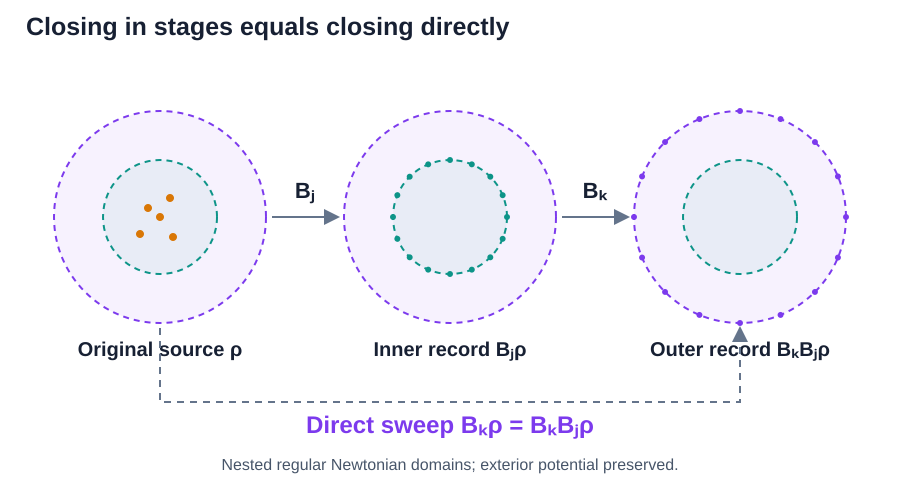
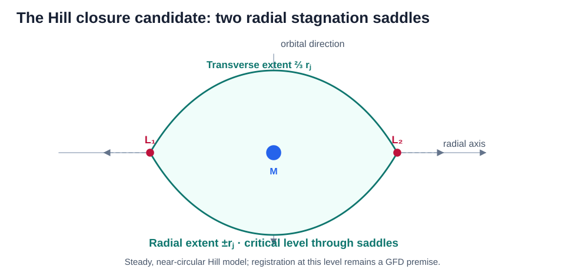
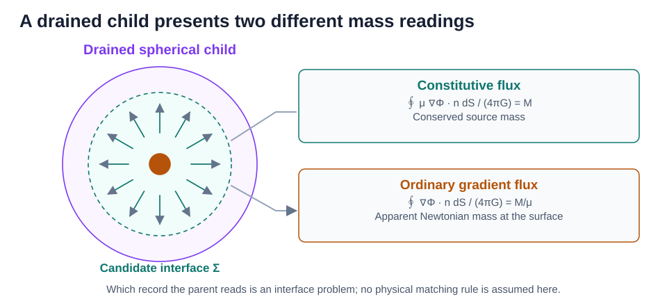
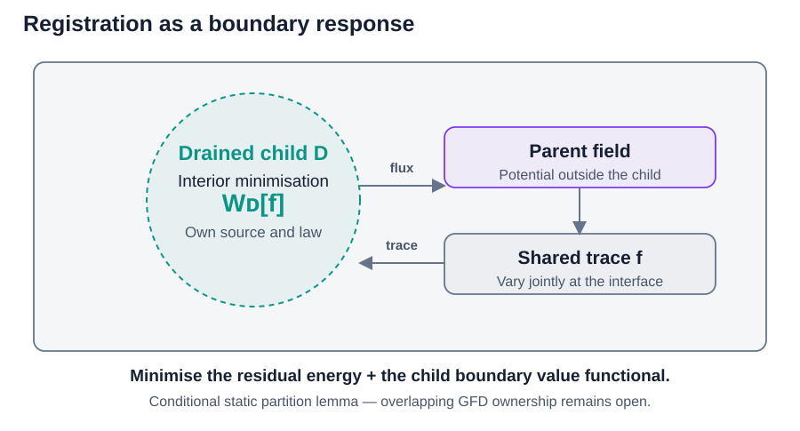
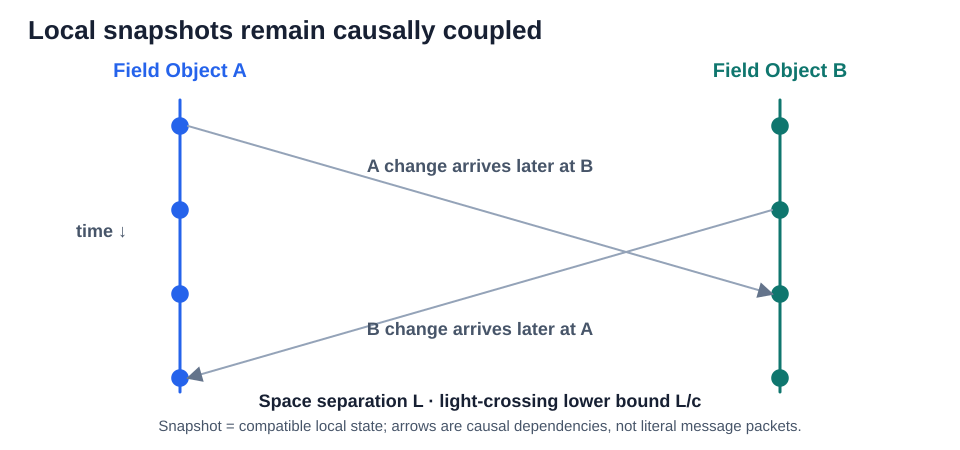

# Field Closure and Recursive Registration

*The mathematical architecture of Distributed Field Processing: from local state compatibility to composition across gravitational regimes.*

**Gravity Field Dynamics (GFD) · Field Dynamics Research**  
Part II — Mathematical architecture · November 2026  
[Part I — Field Closure and Snapshot Accounting](FIELD_CLOSURE_AND_SNAPSHOT_ACCOUNTING.md) · [Einstein’s TetA Partition](EINSTEIN_TETA_PARTITION.md) · [Closure of Closures](CLOSURE_OF_CLOSURES.md)

---

## Abstract

The architectural requirement of Distributed Field Processing (DFP) is that a Field Object settles with its NET Field locally and registers a state sufficient for the next level of gravitational accounting. This document distinguishes complete local Full-State Snapshot (FSS), exterior-equivalent registration, and composition of registered states. The fixed-ownership Newtonian construction in the mountain-scale proof supplies a concrete realisation: harmonic balayage preserves exterior potentials, nested sweeps telescope, and interior residuals are excluded from the drained host's constitutive response. The Hill closure-surface proof independently identifies a dynamically distinguished confinement surface. The dual-tetrad geometry supplies a candidate local coupling structure, including the four-port read and its orientation completion. The remaining objective is to derive the registration interface from the full dynamics and extend composition to a drained Field Object, such as a galaxy registering in its cluster. We propose a boundary-energy formulation as a precise intermediate mathematical target. A conditional static gluing lemma is given for non-overlapping variational subdomains; it is not a proof of general GFD ownership, physical FSS or relativistic closure.

**Status:** technical synthesis and proposed research programme, not a new peer-reviewed proof package. [T] theorem under its stated assumptions; [D] conditional derivation; [E] exploratory or proposed physical identification; [O] observational comparison. Where a mathematical argument is added here rather than quoted from a repository proof, it is explicitly identified.

## 1. The mathematical problem: what must a registered state preserve?

Paper I's canonical chain is

$$
(X_i,N_i)\xrightarrow{\Sigma_i}\mathrm{FC}_{\Sigma_i}(\mathrm{READ}\to\mathrm{SETTLE})\longrightarrow B_{\Sigma_i}^*.
$$

Here $X_i$ denotes the Field Object's local configuration, $N_i$ its NET Field data, and $\Sigma_i$ the closure interface. READ is FSS: both inputs participate as correlated states, not as arbitrary lists of independent parts. SETTLE enforces compatibility. $B_{\Sigma_i}^*$ is the outcome. The symbols $X_i,N_i$ are introduced for this synthesis; a complete GFD state space and microscopic evolution operator are not yet specified.

A useful separation is to denote the settled state by $S_i$ and its exterior gravitational registration by $R_i=\mathcal R_i(S_i)$. The latter is the pointer in the next level's accounting. This notation distinguishes the whole local physical state from the part of the registered state needed for exterior coupling; it does not redefine Paper I's $B^*_{\Sigma_i}$ as a lossy snapshot.

### 1.1 Registration as exterior equivalence

For a given admissible environment $b$, let $\mathcal O_{\rm ext}(S_i;b)$ be the gravitational exterior observables of the coupled state (for example, potential and force in a static problem). Define exterior equivalence relative to an explicitly stated observation class:

$$S_i\sim_b S'_i\quad\Longleftrightarrow\quad \mathcal O_{\rm ext}(S_i;b)=\mathcal O_{\rm ext}(S'_i;b).$$

A registration is **sufficient** when its equality implies this equivalence. It is **response-sufficient** when it retains enough information to establish the correct compatible state under all environments in a specified admissible class, not just under the one environment in which it was registered.

This is a proposed mathematical definition [E] for the general architecture. Static Newtonian balayage establishes a precise special case of exterior sufficiency. It is generally not invertible: two spherically symmetric densities of equal total mass produce the same exterior Newtonian potential. FSS, which is local and concerns correlations, cannot be proved by that exterior equivalence alone. Nor should boundary data from one fixed snapshot be confused with a response law for a changing environment.

### 1.2 The composition contract

Let a parent $P$ have directly owned source or matter $q_P$ and children $i\in I_P$. Let $b_P$ specify its environment. The research objective is a closure law $\mathcal C_P$ and a composition operation $\mathcal M_P$ such that

$$
\mathcal R_P\!\left[\mathcal C_P(q_P,\{S_i\};b_P)\right]
=\mathcal M_P(q_P,\{\mathcal R_i(S_i)\};b_P).
$$

The equality concerns the specified parent registration, not equality of microscopic interior states. Child states on the left must themselves be compatible with the resulting environment; on the right, response-sufficient registrations must permit that compatibility without reopening their interiors at the parent level. A single precomputed record need not suffice in a changing nonlinear field.

The contract requires:

| Requirement | Mathematical meaning |
|---|---|
| Ownership | Each material contribution enters once at a given accounting level, even if fields overlap. |
| Interface compatibility | Traces, fluxes and any surface terms satisfy the appropriate field equations and matching conditions. |
| Exterior sufficiency | The registration reproduces the designated exterior observables. |
| Composition | Replacing children by sufficient registrations preserves the parent's registered result. |
| Causality | Changes to registrations are governed by local dynamics, not instantaneous nonlocal recomputation. |
| Scope | Boundary shape, field regime, data class, gauge/foliation and approximations are stated. |

This is compositional scale invariance, not a claim of dilation symmetry. It does not assert universal finite-dimensional records, linear addition of nonlinear fields, or convergence of an infinite hierarchy. Each would require additional hypotheses.

## 2. The established static case: ownership, balayage and the mountain

The primary source for this section is [The Mountain Scale in the SST](proofs/sst-mountain-scale/sst_mountain_scale.tex), particularly Theorems 1, 7 and 8. Its assumptions include fixed ownership, given closure surfaces and static weak-field slices of the preferred foliation. $G$ here is measured Newtonian $G_N$ (the proof distinguishes it from Paper VII's $G_{\rm bare}$).

### 2.1 Exterior equivalence for any owned source

Let $D$ be a bounded regular domain with boundary $\Sigma$, containing an owned mass measure $\rho$. Write the Newtonian potential with the convention $\Delta U_\rho=4\pi G\rho$ and $U_\rho\to0$ at infinity. Harmonic balayage defines a boundary measure $B_D\rho$ such that

$$U_{B_D\rho}(x)=U_\rho(x),\qquad x\notin\overline D.$$

For a point mass $M$ at $a$ inside a sphere of radius $R$, the density of its swept measure with respect to surface area at $z\in\Sigma$ is the Poisson kernel

$$\sigma(z)=\frac{M(R^2-|a|^2)}{4\pi R|z-a|^3}.$$

It integrates to $M$ and reproduces the original exterior potential. The mass is not physically relocated; the sweep is an equivalent representation. By linearity one can sweep an arbitrary finite interior mass distribution. The multipoles are retained, not discarded in a monopole approximation. This is the precise gravitational meaning of a pointer for this case.

### 2.2 Nesting and residual telescoping

If $D_j\Subset D_k$ are appropriately nested regular domains, harmonic measure's composition property gives [T]

$$B_k B_j\rho=B_k\rho.$$

One proof uses harmonic test functions: for every function $h$ harmonic on the larger domain and continuous to its boundary, sweeping preserves $\int h\,d\rho$. Sweeping first to the inner boundary and then to the outer boundary therefore produces the same integrals as sweeping directly to the outer boundary. Taking harmonic extensions of all continuous outer-boundary functions identifies the two measures. This proof assumes the usual existence and uniqueness of the harmonic Dirichlet solution and balayage measures.

An elementary non-invertibility check is useful here. Two spherical mass profiles of equal total mass but different radial density produce the same exterior Newtonian potential. Their balayage registrations on the same concentric outer sphere coincide. Their interior potentials and stresses need not coincide. This counterexample separates local FSS from exterior sufficiency without contradicting either; it also shows why a proof of the latter cannot establish microscopic losslessness.

The source residual telescopes exactly:

$$\rho-B_k\rho=(\rho-B_j\rho)+(B_j\rho-B_k B_j\rho).$$

Under Newtonian potential theory, the same decomposition holds for the associated interior residual fields. Inductively, any finite nested chain gives the same outer registration as a direct sweep. The parent can process a shell-to-shell field without recomputing the child's original volume source. This is the precise scope of closing in stages. It is not an identity for arbitrary overlapping boundaries or an arbitrary nonlinear potential operator.

*Figure 1 — The proven Newtonian composition case. Different representations of the interior yield the same outer registration.*

### 2.3 Registration plus least-energy settlement gives the sweep

Let $U$ be the original Newtonian own potential and prescribe its trace $f=U|_\Sigma$. The mountain-scale proof (Theorem 8) assumes the registered completion minimises the field energy

$$E[v]=\frac{1}{8\pi G}\int_D |\nabla v|^2\,d^3x,\qquad v|_\Sigma=f.$$

Its harmonic minimiser $h$ is unique in the finite-energy Dirichlet class. Let $d=U-h$ inside $D$, extended as zero outside. With $d|_\Sigma=0$, integration by parts gives $\int_D\nabla h\cdot\nabla d=0$, hence

$$E[U]=E[h]+E[d].$$

The exterior of $h$ is completed by $U$ itself. The resulting potential agrees with that of the swept measure; the normal-derivative jump at $\Sigma$ defines the swept source. The registered potential is harmonic **inside the mathematical completion**, not a statement that the original matter-filled interior obeys Laplace rather than Poisson. The own residual carries the difference.

This is a conditional bridge: **least-energy settlement + a prescribed registered trace → sweep → ownership split**. The physical selection of least-energy settlement and the location of the registering surface remain independent premises. The elliptic minimum alone does not prove a causal physical mechanism that converges to it.

### 2.4 Fixed ownership and the drained host

Let $\rho=\rho_{\rm diffuse}+\sum_i\rho_i$, with each $\rho_i$ owned by one child at this host level. For each child define

$$\Delta d_i=4\pi G(\rho_i-B_i\rho_i),\qquad d_i=0\ \text{outside }D_i.$$

The domains may overlap. What must not overlap in the accounting is ownership of a source contribution. Define the mountain (host field) by

$$\bar\Phi=\Phi-\sum_i d_i,\qquad \bar\rho=\rho_{\rm diffuse}+\sum_i B_i\rho_i.$$

The mountain-scale action places the constitutive correction on $\bar\Phi$ while retaining the ordinary curvature/Newtonian term everywhere. For fixed $d_i$ and closure surfaces the static equation is

$$\Delta\Phi+\nabla\cdot[(\bar\mu-1)\nabla\bar\Phi]=4\pi G\rho,$$

where $\bar\mu=\mu(|\nabla\bar\Phi|/a_0)$. Substitute the residual equations to obtain [T]

$$\boxed{\nabla\cdot(\bar\mu\nabla\bar\Phi)=4\pi G\bar\rho,\qquad \Phi=\bar\Phi+\sum_i d_i.}$$

The mountain reads the registered sources, and each own residual is Newtonian with the measured $G$, independently of the constitutive law. Neither a pointwise per-star tail nor a merging of overlapping envelopes is required. Other objects' fields and the host tide remain in the environment; full matter variation gives environmental corrections discussed in the source proof. This is an exact static field split under fixed ownership and specified interfaces, not a derivation of those interfaces or of all matter dynamics.

### 2.5 Flux matching is an accounting condition, not optional bookkeeping

Use $n$ pointing out of a child and the jump convention $[q]=q_{\rm out}-q_{\rm in}$. Across a regular swept surface of density $\sigma$ (away from coincident interfaces), Theorem 9(d) gives

$$[n\cdot\nabla d]=-4\pi G\sigma,\qquad [n\cdot\bar\mu\nabla\bar\Phi]=4\pi G\sigma.$$

Thus the total potential is continuous, while its normal derivative may kink:

$$[n\cdot\nabla\Phi]=[n\cdot(1-\bar\mu)\nabla\bar\Phi].$$

The effective surface layer is already represented in the static distributional field equation. It is not an extra material shell inserted into the physical source. A covariant surface stress and its junction conditions, including moving-surface energy accounting, remain to be derived. Cassini suppression in the proof applies to a centred spherical swept shell in a constant linear anisotropic response at the order calculated; general shapes and relativistic corrections are not covered by that calculation.

## 3. The interface geometry: where registration might occur

[The closure-surface proof](proofs/closure-surface/closure_surface.tex) works with a small bound system on a nearly circular orbit in a steady host. In rotating Cartesian coordinates $(X,Y,Z)$, take

$$\Phi_{\rm eff}=-\frac{GM}{r}-\tfrac12 T X^2+\tfrac12\nu^2 Z^2,\quad T=4\Omega^2-\kappa^2>0.$$

This has stagnation saddles at $(\pm r_J,0,0)$, with

$$r_J=(GM/T)^{1/3},\qquad E_c=-3GM/(2r_J).$$

Since the Coriolis force does no work, $E_J=\tfrac12|v|^2+\Phi_{\rm eff}$ is conserved in the steady model. The connected inner sublevel component below $E_c$ is inaccessible from the outside at that energy; a particle initially there cannot leave it. The critical level has two saddle necks, permitting snapping to neighbouring cells above threshold without implying that every above-threshold trajectory transitions.

*Figure 2 — The candidate closure surface in the static Hill model, drawn from the dimensionless equatorial equation. A critical equipotential is not a surface of zero field; its two stagnation saddles are special points.*

The surface is generally anisotropic. In the limit $T\to0^+$ its radial extent diverges, so this finite closure surface is anchored by the host. At fixed mass and flat host circular speed, scaling the host radius by $\lambda$ gives $r_J\to\lambda^{2/3}r_J$. Thus operational scale-universality does not mean self-similar geometry.

**Logical status:** the proof shows that the field-defined saddle level is the confinement boundary in this approximation. It further shows a consistency fixed point when ownership is assigned there and the internal motion is Newtonian. It does not derive the physical rule that FSS registration occurs at this surface. The mountain action's centred-sphere energy result does not select a finite radius. Registration at the stagnation surface, and its drained-system and dynamical generalisations, are open.

## 4. How the tetrad can read the local state

### 4.1 Geometric closure and structural ledgers

For a non-degenerate tetrad, $g=e^T\eta e$ and $(\det e)^2=\det g/\det\eta$. With a fixed future time orientation the two spatial orientation sectors are related by parity. The metric is root-blind in this sense; this does not imply that the tetrad solution set contains literally only two frames. See the [two-region proof](proofs/tetrad-scheme-two-bounded-regions/) and the [forced-frame proof](proofs/forced-tetrahedral-frame/) for the scope of the geometry. Under the equal-norm and equal-pair-relation projection premises the four unit spatial vectors form a regular tetrahedron, with $\sum_f n_f=0$, $n_f\cdot n_{f'}=-1/3$ for distinct faces. Their negatives complete the parity pair, the stellated octahedron. In GFD these are the two Field Chambers TetA and TetB, coupled at the Field Origin. The physical two-chamber interpretation is a premise beyond the algebraic identities.

The geometry research [derivation chain](research/field-closure/derivation_chain_coupling_polynomial.md) and the later formal proofs distinguish structural counts from dynamical degrees of freedom. On the stated graded space the weighted count is

$$f(K,s)=1+sK+K^2,\qquad K=4,\quad s\in\{-1,0,1\}.$$

Its values $13,17,21$ are equally spaced; $s=0$ is the even read, not a third parity eigenvalue. The affine-connection slot count is

$$K^3=64=K\frac{K(K+1)}2+K\frac{K(K-1)}2=40+24.$$

This is a symmetric/antisymmetric split in the two lower indices (torsion in a coordinate basis). The 24 antisymmetric slots are removed by the torsion-free condition. Identifying those slots with physical TetB dynamics requires the framework's connection interpretation. They are not automatically 24 additional propagating degrees of freedom. These are geometric and algebraic closure ledgers, not a dynamical proof of snapshot accounting.

### 4.2 Four ports and the actual dual read

In local coordinates centred on an object's centre of mass, expand the NET Field to quadratic order:

$$\bar\Phi(x)=c_0+b\cdot x+\tfrac12 x^T H x.$$

Here $H$ is the host Hessian (not the Hill scalar $T$), and $Q_{ij}=\int\rho x_i x_j\,d^3x$. The interaction energy to this order is $M c_0+\tfrac12 H:Q$, because the centre-of-mass dipole vanishes. Common free fall is $-b$. This gives one temporal and three spatial leading reads. In the weak-field metric $c_0/c^2$ contributes to the lapse relative to a specified reference; the potential offset itself is not an absolute gauge-independent clock observable. The 1+3 Taylor count is generic, not proof of a tetrahedral physical lattice.

The geometry adds a more specific statement. Theorem 7(c) of the mountain-scale proof uses face directions $n_f=(\pm1,\pm1,\pm1)/\sqrt3$ of fixed parity. Then

$$\sum_f\bar\Phi(R n_f)=4c_0+\tfrac23 R^2\operatorname{tr}H,$$

$$\sum_f n_f\bar\Phi(Rn_f)=\tfrac43Rb\ \pm\ \tfrac{4R^2}{3\sqrt3}(H_{23},H_{13},H_{12}).$$

The second term flips under the dual orientation. Summing both chambers gives

$$\sum_{f\in A\cup B} n_f\bar\Phi(R n_f)=\tfrac83Rb,$$

$$\sum_{f\in A\cup B}\bar\Phi(R n_f)=8c_0+\tfrac43R^2\operatorname{tr}H.$$

The dual read cancels the chiral leakage of off-diagonal tides from the spatial ports. The scalar trace term remains when the environment contains diffuse or effective TetB density. Higher-order Taylor contributions must be controlled for non-quadratic fields. The flux of the own Newtonian field integrates to $4\pi GM$ over the closed surface; equal flux $\pi GM$ per face is only the centred monopole case. Thus four ports are a coupling structure, not four universal storage slots.

### 4.3 Walsh readout as a possible link to FSS

The [Walsh-eigenmode proof](proofs/walsh-eigenmodes-of-the-cube/) describes the eight vertex modes $1,x,y,z,yz,xz,xy,xyz$. In the symmetry-respecting linear read class, one chamber reads four independent combinations, while both orientations distinguish all eight. The scalar chamber sums read the constant and parity sign modes; the two frames read the six vector/bivector modes. The proof also calculates pair mixing when chamber couplings differ. This is stronger than a port-count analogy: it establishes completeness of a specified finite-dimensional local readout.

What is not yet shown is a map from the full physical field state and its correlations to these eight amplitudes that is dynamically complete, respects the action and induces the macroscopic registered boundary response. A finite readout theorem for a corner model is not a theorem that all gravitational or quantum state information is stored in eight scalars. This is a concrete place to seek the microscopic-to-operational bridge.

## 5. Drained fields: the mathematical gap that matters most

Every object closes. The drain determines what law acts inside its accounting, never whether it registers. The current [net-field rule](proofs/net-field-rule/) classifies the galaxy as drained and stellar systems as drainless. The mountain-scale proof explicitly does **not** solve registration of a galaxy in its group or cluster.

For a drained static field define $A(p)=\mu(|p|/a_0)p$ and

$$\mu(x)=\frac{x}{1+x},\qquad \nabla\cdot A(\nabla\Phi)=4\pi G\rho.$$

This is the weak-field static constitutive equation; SST denotes the full covariant action, not this equation. In spherical symmetry it gives $g_s=\mu(g_t/a_0)g_t=g_t^2/(a_0+g_t)$.

### 5.1 Two fluxes, one unresolved interface

For a surface enclosing the source,

$$M_{\rm const}=\frac{1}{4\pi G}\int_\Sigma A(\nabla\Phi)\cdot n\,dS=\int_D\rho\,dV,$$

while a Newtonian interpretation of the gravitational potential gives

$$M_{\rm grav}(\Sigma)=\frac{1}{4\pi G}\int_\Sigma\nabla\Phi\cdot n\,dS.$$

*Figure 3 — The two mass readings coincide only when the response becomes Newtonian. The required parent interface rule cannot be inferred from the word pointer.*

In a spherical drained exterior, $M_{\rm grav}(r)=M_{\rm const}/\mu(g_t/a_0)$. In the deep regime it behaves as $r\sqrt{M_{\rm const}a_0/G}$ rather than a fixed monopole mass. The two integrals need not coincide. The finite registering surface and the surrounding field matter. This explicitly identifies why passing only baryonic mass, or only an apparent mass inferred at a chosen radius, does not establish drained-to-parent registration. One must derive what the parent reads and how the corresponding interface flux is balanced, including the TetB contribution.

### 5.2 Why a direct nonlinear sweep is insufficient

The map $A$ is nonlinear. For example, in units $a_0=1$ and parallel unit vectors $p=q$, $A(p+q)=\tfrac43p$, whereas $A(p)+A(q)=p$. Consequently summing the Newtonian-style residual fields of arbitrary drained objects and then treating their sources as independently superposable is not an exact construction. A new response-sufficient interface must handle the joint boundary conditions. It may still preserve the architectural rule of local settlement and recursive registration.

## 6. A proposed route: registration as a boundary response functional

This section is a **new synthesis**, not a result imported from the GFD proof index. It uses classical variational domain decomposition to give a restricted, mathematically testable intermediate target for GFD's drained closure. It deliberately does not claim to solve the overlapping ownership case, gravity's microscopic FSS, or the full relativistic action.

### 6.1 The interior value functional

Use the current primitive

$$F(y)=y-2\sqrt y+2\ln(1+\sqrt y),\quad F'(y)=\mu(\sqrt y).$$

In a fixed bounded interior $D$, for prescribed owned density $\rho$ and trace $f$, consider

$$\mathscr E_D[v]=\int_D\left[\frac{a_0^2}{8\pi G}F(|\nabla v|^2/a_0^2)+\rho v\right]dV,$$

$$W_D[f]=\inf_{v:\ v|_{\partial D}=f}\mathscr E_D[v].$$

The sign of the source term gives $\nabla\cdot A(\nabla v)=4\pi G\rho$. For a drainless static domain replace $F(y)$ by $y$. In a drained domain $F$ supplies the positive convex gradient density; the [AQUAL energy proof](proofs/aqual-energy-functional/) gives its derivative and monotonicity properties. Assume the trace and source are admissible and the interior minimum exists uniquely (with gauge fixed where necessary); these are hypotheses of the proposed formulation, not a global existence theorem for GFD.

The record $W_D$ is a function of the boundary trace, not a single scalar evaluated at one environment. Where differentiable, its first variation is the outward constitutive flux in weak duality:

$$\delta W_D[f](\delta f)=\frac{1}{4\pi G}\int_{\partial D} (n\cdot A(\nabla v_f))\,\delta f\,dS.$$

This follows by varying the minimiser and integrating by parts using its Euler–Lagrange equation. More generally use the boundary functional's subgradient or weak conormal flux, with the necessary trace-space assumptions. The functional encodes the Dirichlet-to-Neumann response. It is a candidate **gravitational registration interface**, not an identification with the microscopic FSS record. The child is responsible for its own response; the parent's equations consume the trace/flux interface.

### 6.2 Conditional static gluing lemma [D; new argument]

Let a bounded parent be divided into a residual region $D_0$ and finitely many Lipschitz child interiors $D_i$ with disjoint interiors. Assume a common scalar potential with continuous traces, an additive piecewise-local static variational functional, fixed sources and interfaces, compatible outer boundary conditions, and attained minima (or work with infima and approximating traces). Surface energies, if specified, are included once. In this restricted model,

$$\inf_{v\in\mathcal A}\sum_{i=0}^m\mathscr E_{D_i}[v|_{D_i}]
=\inf_{v_0\in\mathcal A_0}\left(\mathscr E_{D_0}[v_0]+\sum_{i=1}^m W_{D_i}[v_0|_{\partial D_i}]\right),$$

for children whose entire interfaces border $D_0$. For adjacent children instead optimise over a common admissible interface trace on every shared interface, with consistent exterior data.

**Argument.** For any admissible global $v$, replacing each child term by its minimum at the induced trace can only decrease the energy; this gives one inequality. Conversely, for any admissible residual field and interface trace, join it to the corresponding interior minimisers. Matching traces on Lipschitz interfaces yield an admissible global field in the appropriate Sobolev class, giving the opposite inequality. Variation of the reduced functional on a free shared trace enforces the sum of outward fluxes from both sides to vanish (or equal the specified surface source term with the sign dictated by the action). Repeating this elimination on a finite partition tree leaves the same outer value functional, because the order of partial minimisation over compatible internal variables does not alter the joint infimum.

The lemma is a conditional static **composition of boundary response functionals**, not superposition of nonlinear solutions. It works for different convex constitutive laws in different spatial subdomains, under the stated interface prescription. A child may be drained internally and the parent region Newtonian. This demonstrates a possible mathematical bridge across differing internal laws, without determining that GFD physically selects that bridge. In particular, it does not derive the TetB surface contribution or the correct shared variables in the GFD action.

*Figure 4 — Proposed static boundary response. The interface is solved jointly; it is not a one-way export of an apparent mass.*

### 6.3 Why this is not yet the drained ownership theorem

The existing GFD domains overlap, while the gluing lemma partitions spatial energy. Simply using the lemma for overlapping physical domains would count gradient energy and sources more than once. A GFD generalisation must explicitly decide which degrees of freedom or energy terms each object owns, define compatible registrations for shared fields, and derive cross-interface terms from the SST action. It must also identify which fluxes the parent law reads. The existing linear residual construction solves an important overlap case, but its decomposition cannot be silently assumed for nonlinear interiors.

A response functional may be infinite dimensional; computing it can require solving the child's interior when its environment changes. Its existence alone does not prove finite local processing cost or literal precomputation by nature. The architectural target is that the parent need not reconstruct the child's internal configuration to interact with its response.

### 6.4 A staged drained-system test

Start with a finite radial drained interior, a Newtonian exterior and fixed interface radius $R$. Fix a common reference potential at a finite outer radius; isolated deep-field potentials need not decay to zero at infinity. Solve the interior with boundary trace $f$. For this scalar, spherically symmetric model the outward constitutive flux is $4\pi GM_{\rm const}$. If the proposed variational gluing is imposed **without** a surface action, matching the normal flux gives exterior Newtonian mass $M_{\rm const}$. A continuous potential with a derivative kink is generally permitted by that prescription.

This is an instructive conditional result, not a GFD prediction of the galaxy's registered mass: the parent would read the baryonic source in this no-surface-term model, whereas the child has enhanced internal gravitational acceleration. A surface term or additional TetB interface variable could change the matching, but it must be derived, not selected to obtain an intended mass. The test exposes exactly what information is missing.

A useful refinement of this test is a direct accounting identity for the boundary source. Take a spherical interface at $R$ with outward radial normal pointing from the child to the parent. Write $J_{\rm in}=\mu(g_{\rm in}/a_0)g_{\rm in}$ and $J_{\rm out}=g_{\rm out}$ for the normal constitutive flux per unit area, using a Newtonian exterior. If a specified interface law permits an effective surface density $\sigma_\Sigma$, integrating its distributional equation across the interface gives

$$J_{\rm out}-J_{\rm in}=4\pi G\sigma_\Sigma.$$

Consequently, in this model,

$$M_{\rm out}=M_{\rm const}+4\pi R^2\sigma_\Sigma.$$

For example, forcing continuity of the ordinary radial gradient would require $\sigma_\Sigma=(1-\mu)g_{\rm in}/(4\pi G)$ and would pass the inner apparent mass to the exterior. Conversely, no interface source passes the conserved constitutive mass and permits a gradient kink. These are **two mathematically distinct possible interface prescriptions**, not two interchangeable descriptions of GFD. The comparison exposes what the physical matching derivation must fix. It is not a derivation that a drained galaxy contributes either mass in its actual host. A proper action-derived surface term may depend on the boundary fields, the environment, and geometry.

Next steps: derive the interface from the action; include a non-uniform host and perturb the sphere with angular harmonics; compare full-domain and reduced solutions; then attempt two overlapping ownership domains. Compare traces, fluxes, force, effective mass, energy variation and the effect of moving the surface. The goal is a falsifiable construction, not an analogy about galaxies as pointers.

## 7. Causality: from compatible snapshots to a physical field

The static equations above are elliptic. Solving them on one slice does not show how the field propagates between slices. Paper I's local and lossless requirements motivate a causal closure dynamics. The later [SST time-leg](proofs/sst-covariant-time-leg/) and [khronon](proofs/sst-khronon-preferred-frame/) proofs propose the preferred temporal direction and examine particular perturbative stability and preferred-frame limits. Neither supplies a general moving-boundary registration law.

A covariant or preferred-foliation construction must specify the following [E]:

1. Physical variables, constraints, gauge/foliation and the characteristic propagation speeds of all relevant modes. The speed of light is the causal ceiling sought for the architecture, not a derived universal rate of settlement.
2. An interface worldtube and its admissible data, including matching of induced geometry and the action's surface momenta/stresses. Static potential and flux matching alone are insufficient.
3. A conserved matter ownership rule and compatible energy/momentum exchange at moving interfaces. Matter that snaps to a neighbouring cell must leave one account and enter the other without double counting; emitted radiation or flux must also be accounted for.
4. Constraint propagation and stability: compatible initial data must remain compatible under evolution. A registered state may change as new information arrives; no global simultaneity is required.
5. A retarded response or local state evolution for dynamic registration. A static value functional cannot simply be treated as instantaneous physical communication.

*Figure 5 — Static compatibility on a slice is a separate requirement from causally evolving registrations. The figure does not assert that the full SST has a proved characteristic or retarded interface law.*

A useful test is a perturbed binary in a slowly varying host, with a breathing interface. Begin in the static limit, then check adiabatic corrections, energy flux and ownership transfer near the two Hill saddles. A later merger test must remove the assumption of fixed ownership. These are separate milestones from proving the static nonlinear lemma.

The original terminology is preserved: **Full-State Snapshot → settlement → Field State Registration**. A quantitative identification of registration load, accounting time or time-lensing with a specific dynamical variable has not been established by the reviewed sources. It should be introduced only with an explicit definition, governing equation and distinct experimental consequence, rather than inferred from the temporal port or the lapse alone.

## 8. Microscopic architecture: what the closure walk may add

The [field-closure research archive](research/field-closure/) studies the eight parity-labelled cube vertices, their 64 ordered transitions and walks that cover the resulting graph. It reports that a cumulative base-eight digit walk driven by $\pi$ covers the 64 transitions by step 332. Its [six-constraint derivation](research/field-closure/why_pi_formal_derivation.md) assembles the BBP identity

$$\pi=\sum_{n=0}^\infty16^{-n}\left(\frac4{8n+1}-\frac2{8n+4}-\frac1{8n+5}-\frac1{8n+6}\right).$$

The coefficient identity and graph traversal are arithmetic results conditional on the specified walk and weight rules. The later [BBP ladder proof](proofs/bbp-coupling-polynomial-ladder/) gives a more detailed algebraic construction. The signed numerator sum $4-2-1-1=0$ is exact. It does not by itself prove physical energy conservation, a preferred microscopic update order or the uniqueness of those weights as physical laws. The graph's 64 transitions and the connection's 64 slots are distinct mathematical objects unless a structure-preserving identification is supplied.

To connect the walk to operational FSS, a future proof should map its state variables to the tetrad/Walsh read, specify an evolution rule from the physical action, demonstrate conservation and completeness within a stated physical code subspace, and recover the static boundary response in an appropriate limit. Step 332 is not a measurement of physical clock ticks. This work is a candidate implementation branch [E], not a prerequisite of the demonstrated macroscopic composition theorem.

Paper III's proposed saturation scale $a_0=K^2Gm_e/r_e^2$ and electron-scale length are a separate physical-scale hypothesis. Paper II's proposed cosmological scaling involves overlapping geometry and additional assumptions. Neither is needed for static balayage or the conditional gluing lemma. This separation lets the research test the composition architecture without depending on unresolved microscopic or cosmological interpretations.

## 9. Proof programme and verification gates

The research programme should close the weakest interfaces first, rather than attempt a single all-scale theorem with every premise hidden inside it.

| Gate | Required deliverable | Acceptance test |
|---|---|---|
| A — Newtonian registration | Exterior equivalence, nesting, energy decomposition and fixed-ownership split | Existing mountain-scale proof; reproduce checks and audit their formal scope. |
| B — Physical interface | Derive selection of least-energy settlement and registration at the stagnation surface | Obtain both from explicit field dynamics; recover Hill confinement and distinguish it from the constitutive crossover. |
| C — Drained registration | Derive scalar/tetrad interface data and response from the action | Radial drained child with Newtonian parent; distinguish conserved flux from apparent mass and derive surface contribution. |
| D — Nonlinear composition | Prove registration sufficiency for changed environments and compatible child composition | Full vs reduced solutions for multiple shapes and overlapping ownership; no source or field-energy double count. |
| E — Causal evolution | Derive characteristic, constraint and junction evolution | Retarded perturbations, breathing cells, snapping, mergers and energy/momentum conservation. |
| F — Microscopic completion | Derive FSS and port completeness from dual-tetrad dynamics | Map the complete physical state to the readout, demonstrate conservation, recover the registration interface in a controlled limit. |
| G — Cosmic closure | Establish finite recursive composition across drained and drainless levels; address any infinite-scale limit separately | Compare independent partition paths, test boundary response, recover lower-level proofs; state convergence assumptions where needed. |

Gates B and F can proceed in parallel with C and D; the conditional mathematical gluing route need not wait for a microscopic derivation. Gates C–E are the critical path from the existing static mountain proof to a galaxy registering in a cluster. Observational comparisons [O] such as Cassini, wide binaries, galactic dynamics and cluster fields test particular consequences, not the complete theorem.

### 9.1 Counterexamples a robust closure theorem must survive

- Equal total mass, different quadrupole: a mass-only pointer is insufficient in general.
- Overlapping Jacobi envelopes: partitioning physical space into exclusive cells would contradict the ownership construction.
- Different environments at fixed child source: a single frozen boundary trace may not encode the required response.
- Drained plus drainless interfaces: conserved constitutive flux need not equal the inferred Newtonian flux of the child.
- Moving ownership: static telescoping does not itself account for radiation or work at an interface.
- Nonlinear field sums: linear balayage composition is not a proof of nonlinear superposition.
- A degenerating tetrad: local non-degeneracy is a necessary geometry condition, not sufficient evidence of macroscopic registration.

The eventual theorem should state the admissible state class, interface law, ownership rule and exterior observables. Its composition property should be expressed as exterior equivalence (Section 1), not equality of unlike objects or unqualified $\mathcal C(\mathcal C(A),\mathcal C(B))=\mathcal C(A\cup B)$.

## 10. Conclusion

The mathematical architecture of DFP has three distinct layers. Dual-tetrad geometry supplies a candidate complete coupling structure. Full-State Snapshot and settlement specify the operational local closure contract. Boundary registration and composition specify how a larger Field Object accounts for already closed constituents. The existing static Newtonian results establish a particularly strong realisation of the third layer and a conditional link from settlement to registration.

The critical next result is **a drained Field Object's response-sufficient registration in a parent with a possibly different constitutive law**. A variational boundary response offers a precise static route, but GFD's physical interface, overlapping ownership and time evolution still need to be derived. Successful completion would turn the general closure-of-closures principle into a theorem with explicit hypotheses rather than a global accounting metaphor.

---

## Source map

Companion context: [Einstein’s Equation as the TetA Partition](EINSTEIN_TETA_PARTITION.md) discusses the orientation-sensitive connection and the still-open torsion-to-effective-action bridge. [Closure of Closures](CLOSURE_OF_CLOSURES.md) presents the scaling intuition without technical notation.

- [Paper I, v6](papers/01-gravitational-constitutive-law/v6/Nelson_DFP_Gravitational_Constitutive_Law_v6.html), §§2, 5–6, 8.8–8.9: DFP terminology, canonical chain and FSS.
- [Paper II, v4](papers/02-covariant-theory-without-dark-matter/v4/Nelson_DFPII_A_Covariant_Theory_Without_Dark_Matter_v4.html) and [Paper III, v5](papers/03-unit-of-gravity/v5/Nelson_DFPIII_The_Unit_Of_Gravity_v5.html): historical extension and proposed scale.
- [llms.txt](llms.txt), [GFD Coles Notes](GFD_COLES_NOTES.md), [formal proof index](proofs/README.md): terminology and current status.
- [Mountain-scale source](proofs/sst-mountain-scale/sst_mountain_scale.tex), Theorems 1–9: static split, ports, nesting, least-energy premise, flux matching and scope.
- [Closure-surface source](proofs/closure-surface/closure_surface.tex), Theorems 1–5: Hill model, confinement and fixed-point consistency.
- [Net-field rule](proofs/net-field-rule/), [constitutive-law tug of war](proofs/constitutive-law-tug-of-war/), [covariant completion](docs/02-gravitation/06-covariant-completion.md): constitutive law and regimes.
- [Field closure research](research/field-closure/), [forced tetrahedral frame](proofs/forced-tetrahedral-frame/), [Walsh read](proofs/walsh-eigenmodes-of-the-cube/), [BBP ladder](proofs/bbp-coupling-polynomial-ladder/): structural and microscopic research.

*The newly proposed definitions, gluing argument, radial interface test and milestone plan are authoring contributions of this synthesis. They have not been added to the formal proof index, independently peer reviewed or machine checked. The existing verification claims remain those reported in their source packages.*
