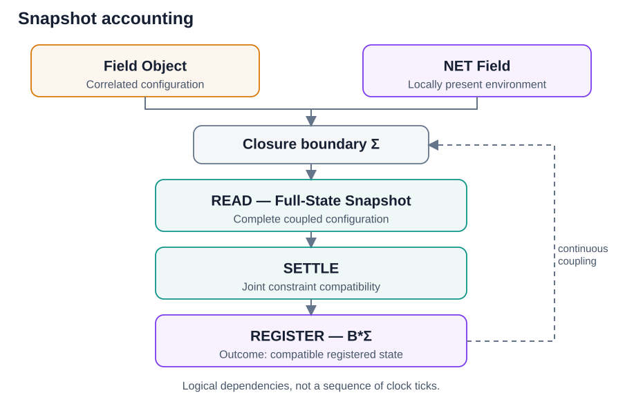
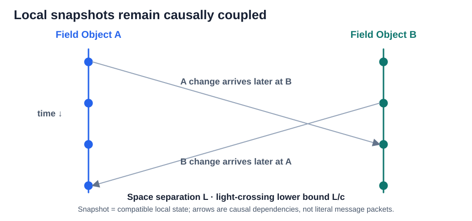
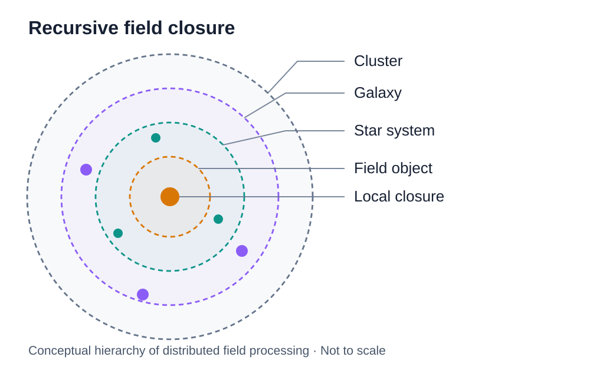
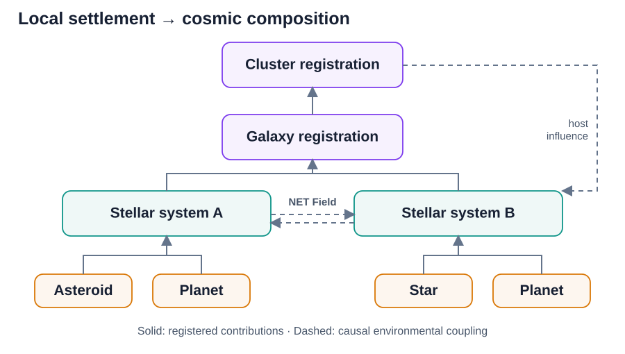
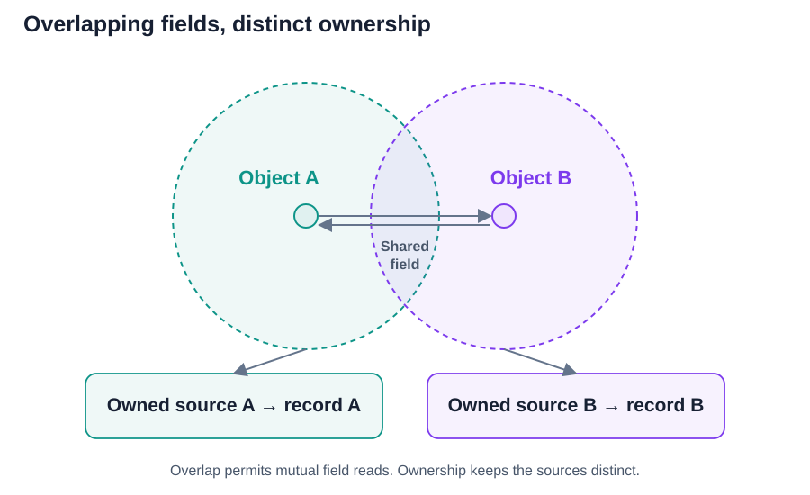
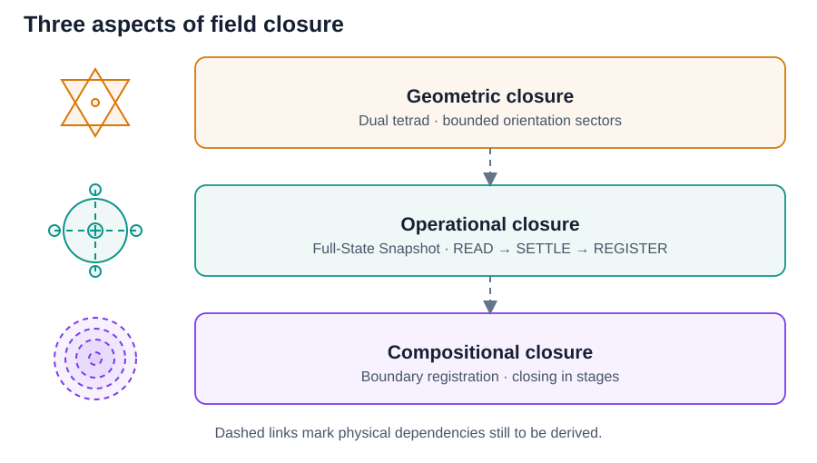
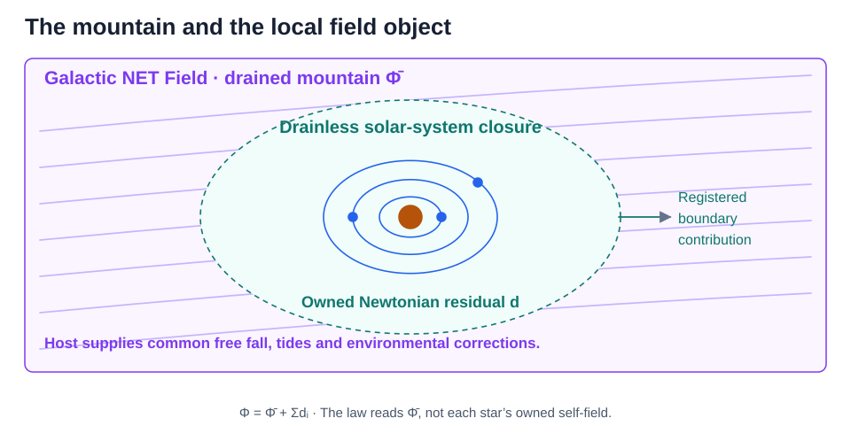
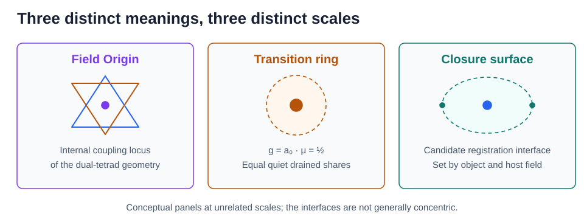

# Field Closure and Snapshot Accounting

*Distributed Field Processing: how gravity closes locally and scales through registered field objects.*

**Gravity Field Dynamics (GFD) · Field Dynamics Research**  
Part I — Architecture · November 2026  
[Part II — Mathematical architecture and recursive registration](FIELD_CLOSURE_AND_RECURSIVE_REGISTRATION.md) · [Einstein’s TetA Partition](EINSTEIN_TETA_PARTITION.md) · [Closure of Closures](CLOSURE_OF_CLOSURES.md)

---

## 1. The asteroid: one object, one local accounting

Imagine an asteroid moving through the Solar System. Its nickel and iron atoms, crystalline structure, binding energies and internal stresses form a single correlated configuration. The asteroid is not merely a list of independent particles. The relationships between those particles help define what the asteroid is.

The gravitational environment at its location is likewise one configuration: the **NET Field**. The Sun, planets, neighbouring stars and more distant structures contribute to it. The asteroid does not need to interact separately with a list of every remote source. Their influence is present through the local field.

Paper I of Distributed Field Processing (DFP) asks how these two configurations become one consistent gravitational state. Its answer is **field closure**. The Field Object and NET Field meet at a closure boundary; the entire coupled configuration participates in settlement; the outcome is a registered field state.

The distinction is like the soap film and bubble in the [field-closure research introduction](research/field-closure/README.md). A film can exist without enclosing anything. A bubble has a closed surface, an inside and an outside. Closure is a condition of the configuration, not an additional substance. In DFP, closure is the ongoing enforcement of compatibility, not a material membrane.

> **Every Field Object closes locally, continuously and as a whole. Its registered state participates in the next level of accounting without requiring that level to reconstruct its interior.**

This is the proposed architecture of Gravity Field Dynamics. The static Newtonian mechanism for closing in stages is established under stated premises; the full nonlinear and relativistic architecture remains a research programme.

## 2. Snapshot accounting: READ, SETTLE, REGISTER

*Figure 1 — Logical dependencies in local snapshot accounting. The arrows do not represent physical clock ticks or instructions sent by a central processor.*

The canonical chain in [Paper I, §§2, 5–6, 8.8–8.9](papers/01-gravitational-constitutive-law/v6/Nelson_DFP_Gravitational_Constitutive_Law_v6.html) is

$$
(\text{Field Object},\text{NET Field})\xrightarrow{\Sigma}
\mathrm{FC}_\Sigma(\mathrm{READ}\to\mathrm{SETTLE})\longrightarrow B_\Sigma^*.
$$

| DFP term | Architectural role |
|---|---|
| Field Object | Unified configuration, including its internal relationships; both a source and a participant in the NET Field. |
| NET Field | Combined gravitational environment present locally. |
| Closure boundary $\Sigma$ | Locus of coupling and compatibility between object and environment. |
| Field Closure Function $\mathrm{FC}_\Sigma$ | Functional role of READ and SETTLE. |
| Full-State Snapshot (FSS) | Complete read of the relevant coupled configuration within its physical code subspace; not a surface sample. |
| Settlement | Joint enforcement of the coupled constraints. |
| Field State Registration $B_\Sigma^*$ | Result of settlement; the compatible state at the interface. |
| Coupling Ports | One temporal and three spatial channels, organising the local read. |
| Pointer | The registered contribution of a closed object as read at a larger level. |

**READ** is full-state accounting. Paper I compares the Field Object to a chord: its identity includes relationships between its notes. The field cannot account for an arbitrary subset of the asteroid and treat that subset as the whole.

**SETTLE** reconciles the constraints together. Paper I calls this atomic settlement: an incompatible partial state is not a completed registration. Atomicity concerns consistency, not simultaneous signals at separated locations. All coupling channels must participate in the same compatible state.

**REGISTER** names the result, not another independent physical mechanism after settlement. Registration is the state through which the object participates in its NET Field. In the static Newtonian construction, an exterior-equivalent boundary potential is a concrete gravitational representation of this state. It is not yet a proof of encoding the object's complete microscopic quantum state.

Three requirements keep the terminology precise:

- **Lossless:** the closure mechanism must not introduce spurious wakes, drag or hysteresis in its static limit. FSS concerns the relevant whole configuration; exterior equivalence concerns only what the exterior gravitational description needs. Ordinary radiation and physical dissipation are not excluded.
- **Local:** coupling is evaluated where object and NET Field meet. Changes propagate causally; a snapshot is not an instantaneous global read.
- **Continuous:** the field remains coupled as the object moves or changes. Snapshot names a state; snapshot accounting names the ongoing enforcement of closure. No universal microscopic clock, batch interval or discrete update frequency is assumed.

### 2.1 A registration is not a frozen copy

Return to the asteroid. Imagine it rotating so that a different face is directed toward the Sun. Its constituent matter and correlations remain part of its own Full-State Snapshot. Its changing orientation can alter the multipoles through which it interacts with the surrounding field. Settlement establishes a new compatible local state; registration is that state's gravitational contribution. The host need not identify or rearrange individual atoms to read the changing multipoles.

The distinction is important in two directions: **an object is not simplified before local settlement**, and **the parent does not reconstruct the object after settlement**. An exterior record can be exact for a specified gravitational observation while being non-invertible as a description of the microscopic interior. That is why a boundary-equivalent field is compatible with the original lossless local-accounting requirement rather than a substitute for it.

The first critical separation is therefore **full local accounting versus sufficient exterior registration**. Lossless accounting inside the object does not require the next level to receive an invertible copy of the microscopic interior. The next level requires a gravitational representation sufficient for its own interaction. Part II makes that distinction mathematical.

## 3. How Distributed Field Processing works locally

### 3.1 A mesh, not a global ledger

A differential field law relates a field to its neighbouring values. The Laplacian illustrates this:

$$
\partial_x^2\Phi(x)=\lim_{\epsilon\to0}
\frac{\Phi(x+\epsilon)-2\Phi(x)+\Phi(x-\epsilon)}{\epsilon^2}.
$$

Paper I uses this locality, together with gravitational-wave propagation, to motivate a distributed architecture. Local differential laws are not unique to GFD; the additional GFD proposal is that fields organise into interacting, locally closed configurations with registered boundaries.

The mesh has two complementary relationships. Neighbours couple laterally through the NET Field. Closed objects also compose at larger scales through their registered contributions. These are two descriptions of the same field, not two independent forces. In later GFD terminology, unbound field envelopes (empty TetB) form the surrounding mesh; bound configurations move and couple through it. This picture is a proposed physical interpretation, not a demonstrated discrete lattice.

### 3.2 Four ports: one temporal, three spatial

For a small Field Object embedded in a smoothly varying NET Field, the leading local environmental information is the potential and its three spatial derivatives. The potential contributes to clock calibration in the weak-field metric; the gradient determines common free fall. The next term describes differential tidal acceleration and depends on the object's extent.

The [mountain-scale proof, Theorems 2 and 7](proofs/sst-mountain-scale/) shows that the four leading channels correspond to the four tetrad legs and calculates how the two tetrahedral orientations read them. The dual read cancels an orientation-dependent tidal contribution to the spatial ports. The trace of the tidal tensor is retained in the temporal read when the host is not harmonic.

**Four ports do not mean four numbers are sufficient to describe an arbitrary object.** Shape, multipoles and boundary response remain part of the registered gravitational state. The ports organise the coupling, rather than replacing the full state.

### 3.3 The speed of light is the causal threshold

For two locations separated by distance $L$ in a local inertial approximation, a change cannot communicate between them faster than $L/c$. Thus a larger closure cannot demand instantaneous replies from every constituent at every level. Its local NET Field already carries the effects that have causally reached it. Registration must remain compatible as those effects arrive.

*Figure 2 — Causal local accounting: each state can depend on the changes that have reached its neighbourhood. The time axis illustrates the propagation requirement, not a discrete field-clock model.*

The speed of light is the limiting propagation speed required of the closure architecture, not a claim that every settlement completes exactly in $L/c$. Establishing characteristic speeds, constraint preservation and moving-boundary evolution for GFD's full dynamics is an outstanding task. Static field equations describe compatible snapshots, not the time evolution connecting them.

## 4. From local settlement to cosmic closure

*Figure 3 — Original recursive closure illustration. The rings represent accounting levels, not literal concentric or exclusive spatial boundaries.*

The asteroid closes as a Field Object. To the Solar System it is a registered contribution, not a new obligation to resolve every atom. The Solar System settles its own field and presents its registered state to the galaxy. The galaxy also closes, and its cluster accounts for it as a Field Object. The same operation repeats.

*Figure 4 — Composition upward and environmental coupling laterally and across levels. No level is a controller and the hierarchy is not a serial batch job.*

This is **encapsulation without isolation**. A pointer is a gravitational boundary representation of a closed object, not a frozen mass token. If the asteroid changes shape, its registration may change. If its NET Field changes, it may settle to a different compatible state. Its parent interacts with that state without reconstructing the object's internal matter.

A useful accounting example is a branch of an organisation. The branch settles its own transactions, head office accounts for the branch's reconciled result, and a larger organisation accounts for head office. The analogy is limited: gravitational fields do not send database messages or wait for a central authority, and a gravitational registration is generally richer than a financial total. What carries over is the separation of local settlement from higher-level composition.

### 4.1 Overlap does not imply double accounting

*Figure 5 — Field domains overlap, but ownership is single-valued at each accounting level. The example is schematic.*

Paper II introduced overlapping closure geometry. The newer mountain-scale proof makes the distinction precise: fields may occupy the same space and read one another without merging their interiors. Each object sweeps only its owned source. A parent counts its directly owned diffuse matter and its children's registered contributions once, not the children's matter a second time.

For the Sun and Alpha Centauri, the model's Jacobi envelopes overlap. Both remain distinct Field Objects. Overlap is necessary for environmental coupling and is not a reason to declare the entire galactic disc one Newtonian domain.

### 4.2 Closing in stages: the mathematical bridge

For static Newtonian gravity, a suitable boundary can carry a distribution whose potential outside the domain is identical to that of the original owned mass. This is **balayage**, or sweeping. It retains shape-dependent multipoles: an oblong asteroid is generally not equivalent to a single mass at its centre.

Let $B_j$ sweep a source onto an inner boundary and $B_k$ sweep onto an enclosing boundary. The nested-sweep theorem gives

$$B_kB_j=B_k.$$

The larger closure can therefore use the smaller registered boundary distribution without reopening its interior. This is an exact exterior-equivalence theorem for suitable nested Newtonian domains. For overlaps the ownership construction handles each source separately; the nested identity is not a general identity for arbitrary overlapping domains.

The broader GFD objective is to establish this compositional property when the interior is drained and when spacetime and interfaces evolve. The mathematical details, including a proposed nonlinear boundary-energy route, are in [Part II](FIELD_CLOSURE_AND_RECURSIVE_REGISTRATION.md).

### 4.3 Compositional scale invariance

GFD's architecture is scale-universal: the same **READ → SETTLE → REGISTER → compose** rule applies at every level. It does not require that an asteroid and galaxy have the same shape, internal law, boundary radius or computational record size. It is not Weyl invariance.

The advantage is eliminating redundant reconstruction of settled interiors. This is not a numerical runtime claim. Exact boundary descriptions may be complex, neighbours must still interact, and changing conditions must still be reconciled. The requirement for cosmic closure is that the larger level can use sufficient local registrations instead of reconstructing all microscopic constituents.

## 5. What makes closure gravitational in GFD?

The original DFP architecture is operational. The later research asks what physical structure implements it. The answer proposed by GFD is the dual-tetrad topology.

*Figure 6 — Geometric, operational and compositional closure are distinct aspects of the research programme. The physical links between them must be derived, not inferred from the diagram.*

### 5.1 Geometric closure

The tetrad equation is $g_{\mu\nu}=\eta_{ab}e^a{}_\mu e^b{}_\nu$. A non-degenerate tetrad is needed for a non-degenerate metric. The [forced-frame proof](proofs/forced-tetrahedral-frame/) establishes a regular tetrahedral spatial projection under equal-magnitude, equal-pair-relation and distinct-leg premises. Four faces give the minimal polyhedral enclosure in three spatial dimensions ($K=D+1=4$).

The two orientation sectors, read with a future-pointing time leg and the stated projection, give TetA and TetB. They form the interlocking tetrahedra of the stellated octahedron, coupled at the Field Origin in GFD's interpretation. The metric is insensitive to the choice of orientation sector. This does not establish that two physically independent fields must exist; it is the starting point of the GFD physical construction.

The [field-closure research](research/field-closure/) records several exact structural identities. They include eight cube corners divided by parity, the graded coupling polynomial $f(K,s)=1+sK+K^2$ with values $21,17,13$, and the connection's symmetric/antisymmetric $40+24=64$ split. Those ledgers organise the proposed mechanism; they are not interchangeable with a complete macroscopic boundary registration.

### 5.2 Drain determines response, not whether an object closes

In GFD, a galaxy is a **drained** Field Object: its own NET Field is described as a vortex with TetB carrying a complementary share. Under the stated screening and acceleration-strength premises the constitutive law is

$$\mu(x)=\frac{x}{1+x},\qquad 1-\mu(x)=\frac{1}{1+x},\qquad x=\frac{g_t}{a_0}.$$

The same law must not be applied independently to every constituent's own gravitational field. The [net-field rule](proofs/net-field-rule/) and [mountain-scale construction](proofs/sst-mountain-scale/) distinguish the drainless interior from the drained host's mountain. Within their static ownership construction the drainless own field is Newtonian with measured $G$; the environmental field still supplies common free fall, tides and smaller corrections. An object's enclosed TetB may already contribute to its measured $GM$.

| Object | Accounting rule |
|---|---|
| Asteroid, planet, star, binary or stellar system | Registers and settles; drainless mutual gravity is TetA in the current construction. |
| Galaxy | Registers and settles; the constitutive law acts inside its own drained accounting. |
| Cluster | Registers and settles; classified as drainless in the current net-field proposal, with drained galaxies among its children. |

**Every object closes, including a galaxy.** A galaxy is not an unbound envelope. The current formal sweep construction treats drainless objects in a drained host. It does not yet establish the galaxy-to-cluster boundary record or the effective mass registered there. The drain criterion itself remains a framework premise.

*Figure 7 — The field-selection rule in operational language: the child has its own Newtonian residual while its boundary registration contributes to the host response.*

This supersedes the older explanation that local gravity is Newtonian simply because $1-\mu$ is tiny when a planet's own acceleration is high. The current framework excludes the drainless own field from the constitutive response rather than suppressing it by a numerical approximation.

## 6. Where the field closes

In the static, near-circular Hill approximation, a bound object has two stagnation points where its own pull, host tide and rotating-frame terms balance. Their radial distance is the Jacobi radius

$$r_J^3=\frac{GM}{4\Omega^2-\kappa^2}.$$

The effective potential's critical level through the two points defines the inner confinement surface. Matter below the critical Jacobi energy in the inner component cannot cross that level in the steady model. Higher energy opens necks through which matter can **snap to a neighbouring cell**; transition is possible, not inevitable. The surface is not generally spherical, and the field is not zero over its entire surface.

Without the host tide this finite Hill boundary recedes to infinity. The surroundings therefore anchor the cell. The [closure-surface proof](proofs/closure-surface/) establishes the field/confinement correspondence under its premises. **That registration occurs on this surface is the remaining physical premise**, not a theorem of the tetrad dynamics.

*Figure 8 — A dictionary, not a nested geometric model. A Field Origin is not the host-scale transition ring or the Field Object's registration surface.*

The Jacobi extent is not Paper I's constitutive crossover scale and not Paper III's proposed electron-scale tile. These quantities answer different questions: where a bound configuration meets its host; where a drained field changes constitutive regime; and what might set the microscopic field unit.

## 7. How Papers I–III fit the architecture

| Paper | Contribution and scope |
|---|---|
| [I — The Gravitational Constitutive Law](papers/01-gravitational-constitutive-law/v6/Nelson_DFP_Gravitational_Constitutive_Law_v6.html) | Defines the canonical FSS chain, local closure and the conditional constitutive-law derivation. Its early pointwise applications are superseded by the current net-field rule. |
| [II — A Covariant Theory Without Dark Matter](papers/02-covariant-theory-without-dark-matter/v4/Nelson_DFPII_A_Covariant_Theory_Without_Dark_Matter_v4.html) | Extends DFP to a proposed covariant action, overlapping closure tiling and cosmological acceleration-scale dependence. A full CMB spectrum is not established. |
| [III — The Unit of Gravity](papers/03-unit-of-gravity/v5/Nelson_DFPIII_The_Unit_Of_Gravity_v5.html) | Asks what sets the size of the dimensionless four-port topology. The relation $r_e=K\sqrt{Gm_e/a_0}$, given its saturation premise and measured inputs, is close to the classical electron radius. It does not establish a universal physical lattice spacing. |

These papers motivate the progression from local coupling to interacting closure geometry and a proposed microscopic scale. The subsequent formal results supply a concrete mechanism for static recursive closure. Neither the electron-scale correspondence nor the proposed cosmological scaling law is required for the nested Newtonian theorem.

The closure-walk and BBP research asks a further question: whether the dual-tetrad geometry traverses its own structure through an intrinsic read. Its arithmetic identities are distinct from a demonstrated causal mechanism for FSS. The advanced companion treats that research in a separate section so it does not become an unsupported premise of recursive gravitational accounting.

## 8. What has been established, and what would complete the architecture?

Status follows [llms.txt](llms.txt) and [GFD Coles Notes](GFD_COLES_NOTES.md): [T] theorem in scope, [D] conditional derivation, [E] exploratory, [O] observational comparison. The labels are not claims of independent peer review.

| Status | Result |
|---|---|
| [T] | Nested Newtonian boundary sweeps compose exactly; the fixed-ownership static mountain split is exact under its premises. |
| [T] | The 1+3 leading reads and Hill stagnation/confinement results hold under their specified approximations. |
| [D] | Given least-energy settlement and the boundary identification, registration supplies the Newtonian sweep. |
| [E] | Derive registration at the stagnation surface and least-energy settlement from the underlying dual-tetrad dynamics. |
| [E] | Formulate drained-to-parent registration, effective mass, and ownership-compatible nonlinear composition. |
| [E] | Derive causal evolution, moving interfaces, energy/momentum and changing ownership from the full dynamics. |
| [O] | Rotation curves, Cassini and wide binaries probe the distinction between pointwise application and ownership-based GFD; these are not all decisive validations. |

The architecture has a concrete static example and a precise remaining problem: **does the physical field implement a registered boundary response that remains sufficient when the next level has a different constitutive law?** That question is the centre of Part II.

> Gravity's influence can extend over enormous distances without every distant system reopening its source. The proposed DFP architecture is continuous, local snapshot accounting, with cosmic closure emerging through composition of compatible registered states.

---

### Reading path

- Geometric and dynamical bridge: [Einstein’s Equation as the TetA Partition](EINSTEIN_TETA_PARTITION.md).
- Observational narrative: [The Other Root](THE_MISSING_MASS.md).
- General-reader entry: [Closure of Closures](CLOSURE_OF_CLOSURES.md).
- Technical companion: [Field Closure and Recursive Registration](FIELD_CLOSURE_AND_RECURSIVE_REGISTRATION.md).
- Original DFP definitions: [Paper I](papers/01-gravitational-constitutive-law/v6/Nelson_DFP_Gravitational_Constitutive_Law_v6.html), §§2, 5–6, 8.8–8.9.
- Current nomenclature: [llms.txt](llms.txt), [GFD Coles Notes](GFD_COLES_NOTES.md).
- Research foundations: [Field Closure](research/field-closure/), [formal proof index](proofs/README.md).

*Editorial note: this article distinguishes source terminology, proved mathematical cases and new explanatory illustrations. It does not report an independent rerun of the repository's verification scripts.*
