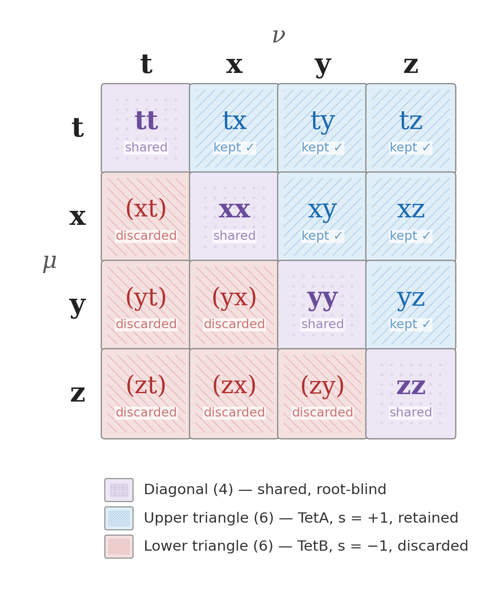
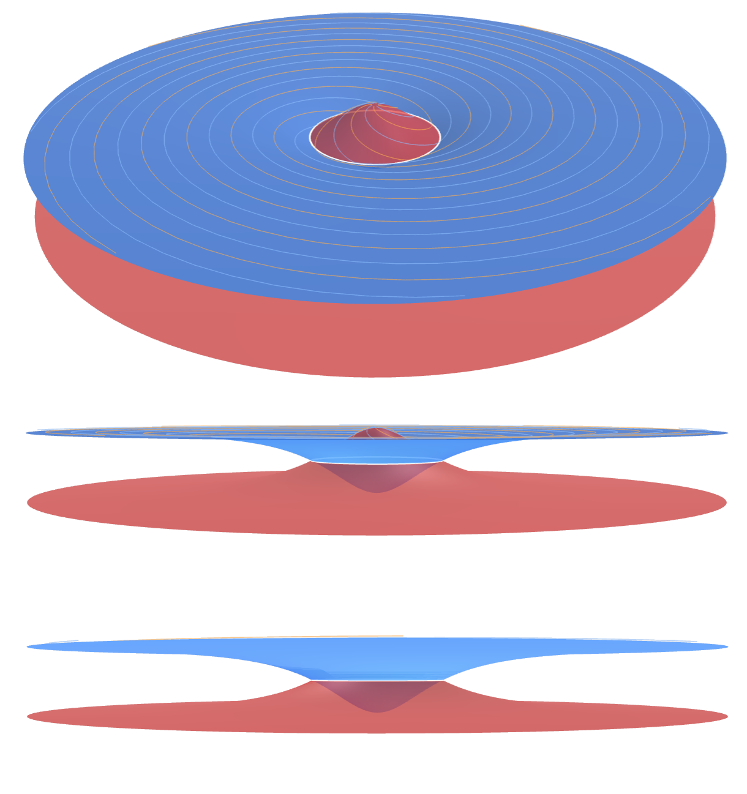

# Field Closure of the Tetrad Frame, in Two Pictures

**A reader's guide to Letter 3: S. Nelson, *Gravity Field Dynamics: Field Closure of the Tetrad Frame* (Field Dynamics Research, 2026, preprint).**
Paper, sources and supplementary material: [`papers/letter-3-field-closure-of-tetrad-frame/`](papers/letter-3-field-closure-of-tetrad-frame/) ([PDF](papers/letter-3-field-closure-of-tetrad-frame/letter.pdf)). Companion document: [Einstein's Equation as the TetA Partition](EINSTEIN_TETA_PARTITION.md), which sets out why the tetrad equation's second root cannot be removed.

---

In 1915 general relativity made a quiet bookkeeping decision. The connection, the part of the theory that says how directions are carried from one point of spacetime to the next, has 64 components. Einstein's theory sets 24 of them to zero by requiring the connection to be torsion-free. The choice has served physics well for more than a century, and in most places it costs nothing.

Letter 3 asks what those 24 components were, and where in the universe they would matter if they were restored. It answers with two figures. The first shows *which* components are removed. The second shows *where* they carry the field. This guide walks through both.

---

## Picture one: the sixty-four



*Figure 1 of Letter 3. The lower index pair $(\mu, \nu)$ of the connection for one value of the upper index $\lambda$.*

### How to read the grid

The connection is written $\Gamma^\lambda_{\mu\nu}$: three indices, each running over the four directions $t, x, y, z$. That is $4 \times 4 \times 4 = 64$ numbers. Fix the first index $\lambda$, one of four "observation faces", and the remaining pair $(\mu, \nu)$ fills the 16 cells of the grid above. The same grid repeats four times.

The cells fall into three groups:

- **The diagonal (purple, 4 cells).** Entries such as $tt$ and $xx$ have no mirror partner. Swapping the two indices leaves them unchanged.
- **The mirror pairs (12 cells, 6 pairs).** Every off-diagonal cell has a twin across the diagonal: $tx$ and $xt$, $xy$ and $yx$, and so on.
- **The torsion-free condition** acts on the pairs. It demands $\Gamma^\lambda_{\mu\nu} = \Gamma^\lambda_{\nu\mu}$, so each pair keeps its symmetric combination (the sum) and loses its antisymmetric combination (the difference). The figure shows this by colouring one cell of each pair blue (kept) and its twin red (discarded). Strictly, every pair contributes one kept and one discarded combination; the colouring is the count made visible.

Per face that leaves 4 + 6 = **10 kept** and **6 discarded**. Across the four faces, **40 kept and 24 discarded**. The 40 are the Christoffel symbols of every textbook. The 24 are the torsion.

### The same count, read from the coupling polynomial

Gravity Field Dynamics builds everything from one polynomial, $f(K, s) = 1 + sK + K^2$ with $K = 4$. It takes the value 21 at $s = +1$ (TetA), 17 at $s = 0$ (the Field Origin) and 13 at $s = -1$ (TetB). Letter 3 notices that the grid's count is this polynomial:

$$\text{kept per face} = \frac{f(K, +1) - 1}{2} = \frac{20}{2} = 10, \qquad \text{discarded per face} = \frac{f(K, -1) - 1}{2} = \frac{12}{2} = 6 .$$

Subtract the 1 (the diagonal, shared by both), halve for the mirror pairs, and the two states of the polynomial give the two halves of the grid. What separates 10 from 6 is the $\pm K$ term, the only term in the polynomial that changes sign between the two chambers.

### Why the discarded half belongs to TetB

The tetrad equation, which builds the metric from the frame, is quadratic. It has two roots, related by spatial parity, and Letters 1 and 2 identify them with the two tetrahedra of the stellated octahedron: TetA ($s = +1$) and TetB ($s = -1$). Both roots give exactly the same metric. A torsion-free connection is built from the metric alone, so it cannot tell the roots apart. Only the antisymmetric part, the torsion, can.

That is the claim of Picture one: **the 24 components removed in 1915 are the components that carry the second root.** Restoring them returns all 16 cells per face and all 64 components. Letter 3 calls the restored connection *field closure*: both roots active, and nothing set to zero by constraint.

---

## Picture two: where the second root lives



*Figure 2 of Letter 3. The constitutive law $\mu(x) = x/(x+1)$, rendered over radius. Blue: the TetA share $\mu$, retained by general relativity. Red: the TetB share $1 - \mu$, removed by the torsion-free condition. An interactive version you can rotate is [`figure2_tetrad_partition.html`](papers/letter-3-field-closure-of-tetrad-frame/Supplementary/figure2_tetrad_partition.html).*

### How the surfaces are built

Each disc is a **surface of revolution**: a single curve, spun one full turn about a vertical axis, the way a lathe or a potter's wheel turns a profile into a solid shape. The figure is built in four steps.

1. **Choose a system and a unit of distance.** Take a single central mass $M$, and measure distance in units of its *transition radius*, $r_M = \sqrt{GM/a_0}$: the distance at which the mass's own pull falls to $a_0$. For the Sun, $r_M$ is about 7,000 AU. In these units the Newtonian acceleration, $g = GM/r^2$, becomes simply

   $$x = \frac{g}{a_0} = \frac{1}{r^2} .$$

2. **Compute the two shares at each radius.** Substituting $x = 1/r^2$ into the constitutive law gives two curves with a very simple form:

   $$\text{blue (TetA)}: \; \mu = \frac{1}{1 + r^2}, \qquad \text{red (TetB)}: \; 1 - \mu = \frac{r^2}{1 + r^2} .$$

   The height of each surface is the share of the field that root carries at that radius:

   | Radius $r$ (units of $r_M$) | 0 | 0.5 | 1 | 2 | 5 |
   |---|---|---|---|---|---|
   | Blue height $\mu$ | 1 | 0.80 | 0.5 | 0.20 | 0.04 |
   | Red height $1-\mu$ | 0 | 0.20 | 0.5 | 0.80 | 0.96 |

   The blue curve starts at full height in the centre and falls away outward, a dome. The red curve starts at zero in the centre and rises toward full height at the rim, a bowl. At every radius the two heights add to one.

3. **Spin each curve about the vertical axis.** The constitutive law depends only on how strong the acceleration is, not on its direction, so the curve is the same along every direction out from the centre. Sweeping it through 360° turns the blue curve into a dome-shaped surface and the red curve into a bowl-shaped one. The figure draws both out to five transition radii.

4. **Mark where they cross.** The two curves meet at $r = 1$, at height $\tfrac12$. Spun around the axis, that crossing point becomes a circle of radius $r_M$: the white ring. Inside it the blue dome is higher, and outside it the red bowl is higher.

**Two sheets of one quadratic, but not a Riemann surface.** A picture of two roots drawn as two sheets invites comparison with a Riemann surface, the object complex analysis uses for a multi-valued function such as $\sqrt{z}$. The comparison is closer than it looks. The two heights are the two roots of a single quadratic,

$$t^2 - t + \mu(1-\mu) = 0, \qquad t = \mu \;\text{ or }\; 1 - \mu ,$$

whose roots sum to one and multiply to $\mu(1-\mu)$, the core activity that peaks on the ring. Its discriminant is

$$1 - 4\mu(1-\mu) = (1 - 2\mu)^2 = \left(\frac{x - 1}{x + 1}\right)^2 ,$$

which vanishes only at $x = 1$: the roots coincide exactly on the white ring. On a Riemann surface, a point where the discriminant vanishes is a *branch point*, where the two sheets join and exchange. Here the discriminant is a perfect square, so there is no branching: the two roots remain separate single-valued functions, $x/(x+1)$ and $1/(x+1)$, and the two sheets cross on the ring without merging. The figure is therefore two surfaces of revolution, one per root, meeting along the circle where the quadratic has a double root.

The spiral lines drawn on the surfaces are visual guides that help the eye follow their curvature in three dimensions. They are not derived from the constitutive law. Only the heights of the surfaces carry physical content.

The figure shows the simplest case, a single central mass. For a real galaxy, with its mass spread through a bulge and a disk, the acceleration profile $g(r)$ comes from that mass distribution instead of $GM/r^2$. The shares at each radius are then $\mu(x)$ and $1 - \mu(x)$ with the galaxy's own $x(r)$. The shapes stretch or sharpen, but the dome, the bowl and the ring at $x = 1$ remain.

### How to read the surfaces

Picture one says which components belong to which root. Picture two says how much of the field each root carries, and where.

The radius runs outward from the centre of a bound system. Along it, the gravitational acceleration $g$ falls, and so does $x = g/a_0$, the acceleration in units of the transition scale $a_0 \approx 1.2 \times 10^{-10}$ m/s². At every radius the field is shared between the two roots:

$$\text{TetA (blue)}: \; \mu(x) = \frac{x}{x+1}, \qquad \text{TetB (red)}: \; 1 - \mu(x) = \frac{1}{x+1} .$$

The two shares always add to one. The field is not enhanced; it is divided. Three features follow, and all three are visible in the figure:

- **The surfaces are exact mirrors.** Wherever blue rises, red falls by the same amount.
- **They cross on the white ring**, at $x = 1$, where each carries half the field. This is the transition scale of galaxy dynamics, found empirically by Milgrom in 1983. Here it is not fitted. It is the midpoint of the partition.
- **Inside the ring, blue dominates; outside, red does.** A theory restricted to the 40 Christoffel components sees only the blue surface.

### A tour from the Sun outward

The partition becomes concrete if you follow the field outward from somewhere familiar. Each row uses the same two formulas:

| Location | $x = g/a_0$ | TetA share $\mu$ | TetB share $1-\mu$ | Observed ÷ baryonic acceleration |
|---|---|---|---|---|
| Mercury's orbit | $3 \times 10^{8}$ | 0.999 999 997 | $3 \times 10^{-9}$ | 1.000 000 003 |
| Earth's orbit | $5 \times 10^{7}$ | 0.999 999 98 | $2 \times 10^{-8}$ | 1.000 000 02 |
| Neptune's orbit | $5.5 \times 10^{4}$ | 0.999 98 | $1.8 \times 10^{-5}$ | 1.000 02 |
| The Sun's own ring, about 7,000 AU out | 1 | 0.5 | 0.5 | 2 |
| The Sun's orbit in the Milky Way | about 1.7 | 0.64 | 0.36 | 1.6 |
| A galaxy's outer disk | 0.1 | 0.09 | 0.91 | 11 |
| A faint galaxy's edge | 0.01 | 0.01 | 0.99 | 101 |

The table is the reason general relativity has passed every test in the solar system. Inside Neptune's orbit, the second root carries less than two parts in a hundred thousand of the field, and at Earth two parts in a hundred million. Every planetary test of general relativity sits on the blue surface, far inside the ring.

Galaxies are different. A galaxy spans the whole figure, from a core where the blue surface carries nearly everything, through the ring, to an outer disk where the red surface carries most of the field. There the observed acceleration exceeds what the visible matter supplies by a factor of 10 or 100, and a theory that keeps only the blue surface must attribute the difference to unseen mass.

Two notes keep the tour honest. First, the Sun does not sit in empty space: the Milky Way's own field at the Sun's position is already about $1.7\,a_0$, so the solar system's outskirts are never isolated, a point Paper I treats as the external field effect. Second, the region beyond a few thousand AU is being tested now, with wide binary stars observed by Gaia, and the published analyses currently disagree (Chae 2023; Banik et al. 2024).

### The galaxy profile comes by default

Nothing in Figure 2 was shaped to resemble a galaxy. The profile is what the split of $\mu(x)$ between TetA and TetB produces on its own, for any bound system.

Every bound system has its strongest acceleration at the centre and weaker acceleration outward; for any concentrated mass this follows from Gauss's law. Because $\mu$ rises monotonically with $x$, the partition then sorts every system the same way: a concentrated interior where TetA carries the field, an extended exterior where TetB carries it, and a boundary between them on the ring at $x = 1$, whatever the system's mass. The round symmetry needs no assumption either. The law depends only on the strength of the acceleration, not its direction, so each share is the same at every angle around the centre. Neither surface produces the structure alone: TetA alone is a steady decline, and TetB alone is a flat plateau. The interior, the exterior and the ring between them are the closed partition $\mu + (1 - \mu) = 1$ made visible.

This is the structure astronomers find in real galaxies. Visible matter accounts for the motions of stars and gas in the inner regions, where the acceleration exceeds $a_0$, and falls short in the outer regions, where it is below $a_0$ (McGaugh 2004). When rotation curves are split into a disk contribution and a dark-halo contribution, the two trade dominance smoothly, with no visible seam between them. Van Albada and Sancisi (1986) named this the *disk–halo conspiracy*. In a dark-matter picture it is a coincidence that each galaxy's halo must reproduce. In the partition it is no coincidence: the inner and outer shares are two halves of one closed quantity, so they cannot fail to hand over smoothly, and the handover is centred on $x = 1$ in every galaxy.

The ring sits where the acceleration equals $a_0$. In the Milky Way, whose rotation speed is about 230 km/s, that is near 14 kpc from the centre, beyond the Sun's orbit at 8 kpc. The TetA-dominated interior therefore contains the bulge and most of the stellar disk, and the TetB-dominated exterior is the outer disk and beyond, the region conventionally assigned to the dark halo.

The same formula settles the behaviour at the very centre. The TetB share $1/(x+1)$ never exceeds one, so the acceleration it carries, $(1-\mu)\,g = a_0\,x/(x+1)$, never exceeds $a_0$. Cold-dark-matter halos of the standard Navarro–Frenk–White form have densities that rise without limit toward the centre, a long-standing tension with the flat cores observed in many galaxies. The partition has no such divergence, and it needs no extra physics to avoid one.

How fast does the field change hands between the roots? The partition obeys a logistic law,

$$x\,\frac{d\mu}{dx} = \mu(1 - \mu),$$

the same equation that describes any two-way transition. The rate $\mu(1 - \mu)$ is largest, at $\tfrac14$, exactly on the ring, where both chambers are equally present. The ring is where the handover happens.

### The radial acceleration relation

Writing the partition as an equation between the acceleration supplied by visible matter and the acceleration observed gives

$$g_{\text{bar}} = \mu\, g_{\text{obs}} = \frac{g_{\text{obs}}^2}{g_{\text{obs}} + a_0} .$$

At high acceleration this is Newton and Einstein; at low acceleration it gives flat rotation curves. It is the radial acceleration relation that McGaugh, Lelli and Schombert measured in 2016 across 175 galaxies, with a scatter of 0.057 dex, here with no free parameter.

---

## From the pictures to an action

A physical theory needs more than a partition. It needs an action, from which the field equations follow. Letter 3 gets there in one step, using the identity Bekenstein and Milgrom introduced in 1984: the response function is the derivative of an energy functional. Integrating $\mu$ gives

$$F(y) = y - 2\sqrt{y} + 2\ln\!\left(1 + \sqrt{y}\right), \qquad y = x^2 .$$

Polynomial long division shows where the three terms come from. With $u = \sqrt{t}$, the integrand becomes

$$\frac{u^2}{u+1} = u - 1 + \frac{1}{u+1} .$$

Each piece of the division integrates to one term of $F$, and each matches one level of the coupling polynomial: $u$ gives the $y$ term (the $K^2$ face level), $-1$ gives the $-2\sqrt{y}$ term (the $sK$ level, the one that changes sign between the chambers), and $1/(u+1)$ gives the logarithm (the $K^0$ Field Origin). The last piece, $1/(u+1)$, is exactly $1 - \mu$, the red surface. The logarithm in the action is the TetB share, integrated.

The two limits of $F$ recover the two regimes of the tour. At high acceleration, $F \to y$, and the action reduces to general relativity. At low acceleration, $F \to \tfrac23 y^{3/2}$, which gives the baryonic Tully–Fisher relation, $v^4 = GMa_0$. In the full covariant action, $F$ fixes the scalar sector with no free function. The light-bending parameter is $\gamma = 1$, as the Cassini spacecraft requires, and gravitational waves travel at the speed of light, as GW170817 confirmed.

---

## How this differs from other ideas

| Approach | What it changes | Torsion |
|---|---|---|
| General relativity | Nothing: 40 of 64 connection components | Set to zero |
| Einstein–Cartan theory | Restores torsion and ties it to the spin of matter | Present only inside spinning matter; zero in vacuum |
| Cold dark matter | Adds an unseen mass component to every galaxy | Set to zero |
| AeST (Skordis and Złośnik 2021) | Adds new vector and scalar fields to reproduce MOND | Set to zero |
| Gravity Field Dynamics | Restores the 24 components as the second root, shared by $1-\mu(x)$ | Present wherever $x$ is finite, including in vacuum |

The distinction GFD draws is between adding something and restoring something. Dark matter adds mass, and AeST adds fields. Letter 3 adds nothing to the matter sector. It returns 24 components that were in the connection all along.

---

## What is established, and what is claimed

| Statement | Status |
|---|---|
| The connection has 64 components; the torsion-free condition keeps 40 and removes 24 | Standard differential geometry |
| The per-face count 10 + 6 equals $(f(K,\pm1) - 1)/2$ | Exact identity, verified |
| The tetrad equation has two roots that give the same metric, so a torsion-free connection cannot distinguish them | Exact algebra (Letter 2, Gram-matrix note) |
| The partition $\mu = x/(x+1)$ reproduces the radial acceleration relation and gives $F(y)$, GR at high acceleration and Tully–Fisher at low | Exact consequences of the law, verified |
| The 24 removed components are the second root, and they carry the field share $1 - \mu$ attributed elsewhere to dark matter | The GFD claim of Letter 3 |
| A TetA-dominated interior, a TetB-dominated exterior and a seamless handover at $x = 1$ follow from the closed partition, as observed in the disk–halo transition of real galaxies; centres stay cored | Consequence of the partition; the GFD-specific reading is the claim of Letter 3 |

---

## Run it yourself

```bash
python papers/letter-3-field-closure-of-tetrad-frame/Supplementary/run_all_validations.py
```

The script checks every numerical claim in Letter 3 (52 of 52 pass): the 64 = 40 + 24 count, the polynomial identity, the partition and its logistic law, the radial acceleration relation and both limits of $F(y)$. The polynomial identity is proved step by step in [`proof_polynomial_40_24.tex`](papers/letter-3-field-closure-of-tetrad-frame/Supplementary/proof_polynomial_40_24.tex), and the full covariant action in [`supplementary_covariant_completion.tex`](papers/letter-3-field-closure-of-tetrad-frame/Supplementary/supplementary_covariant_completion.tex).

---

## References

- S. Nelson, *Gravity Field Dynamics: Field Closure of the Tetrad Frame*, Field Dynamics Research (2026), preprint. Letter 3 of the tetrad series, with Letter 1, *The Coordinate-Space Geometry of the Tetrad Frame*, and Letter 2, *The Other Half of Gravity*.
- Banik, I. et al. (2024). Strong constraints on the gravitational law from Gaia DR3 wide binaries. *Mon. Not. R. Astron. Soc.* 527, 4573.
- Bekenstein, J. and Milgrom, M. (1984). Does the missing mass problem signal the breakdown of Newtonian gravity? *Astrophys. J.* 286, 7.
- Chae, K.-H. (2023). Breakdown of the Newton–Einstein standard gravity at low acceleration in internal dynamics of wide binary stars. *Astrophys. J.* 952, 128.
- Hehl, F. W., von der Heyde, P., Kerlick, G. D. and Nester, J. M. (1976). General relativity with spin and torsion: foundations and prospects. *Rev. Mod. Phys.* 48, 393.
- McGaugh, S. S. (2004). The mass discrepancy–acceleration relation: disk mass and the dark matter distribution. *Astrophys. J.* 609, 652.
- McGaugh, S. S., Lelli, F. and Schombert, J. M. (2016). Radial acceleration relation in rotationally supported galaxies. *Phys. Rev. Lett.* 117, 201101.
- Milgrom, M. (1983). A modification of the Newtonian dynamics as a possible alternative to the hidden mass hypothesis. *Astrophys. J.* 270, 365.
- Navarro, J. F., Frenk, C. S. and White, S. D. M. (1996). The structure of cold dark matter halos. *Astrophys. J.* 462, 563.
- Skordis, C. and Złośnik, T. (2021). New relativistic theory for modified Newtonian dynamics. *Phys. Rev. Lett.* 127, 161302.
- van Albada, T. S. and Sancisi, R. (1986). Dark matter in spiral galaxies. *Phil. Trans. R. Soc. Lond. A* 320, 447.

Related: [Einstein's Equation as the TetA Partition](EINSTEIN_TETA_PARTITION.md) · [the published papers and letters](README.md#published-papers-zenodo)
