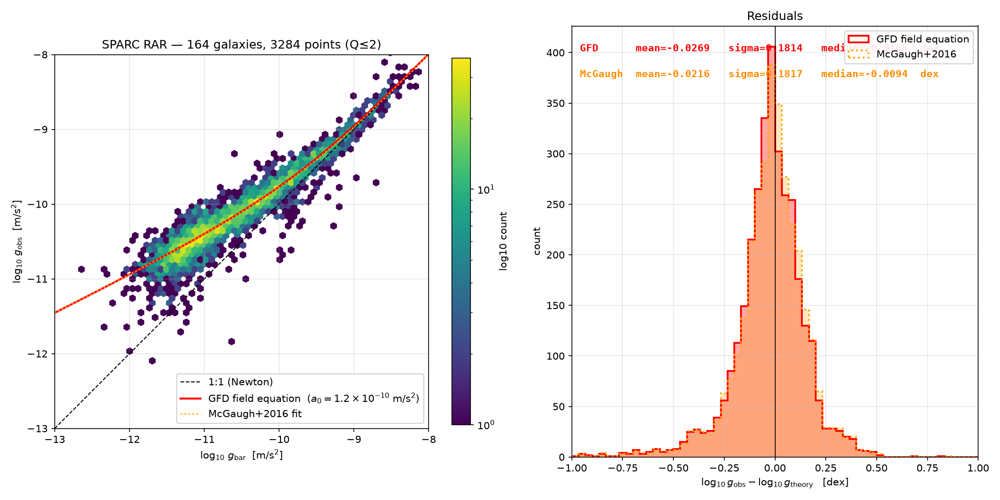

# Gravity Field Dynamics

**A covariant theory of gravity whose interpolating function is derived from the tetrad**

Stephen Nelson · [Field Dynamics Research](https://fielddynamics.org) · [ORCID 0009-0008-6190-3269](https://orcid.org/0009-0008-6190-3269) · stephen@fielddynamics.org

[](LICENSE) [](proofs/README.md) [](#status-and-known-limitations)

On the radial acceleration relation of the SPARC database (3284 rotation-curve points in 164 galaxies), the covariant action of Gravity Field Dynamics (GFD) gives a scatter of σ = 0.181 dex, within 0.0003 dex of the one-parameter empirical fit of McGaugh, Lelli & Schombert (2016). No parameter is fitted to any galaxy. The only empirical constant is the acceleration scale a₀ = 1.2 × 10⁻¹⁰ m/s², taken at its conventional value.

The interpolating function in the action is μ(x) = x/(x + 1), MOND's "simple" function, so on this relation GFD coincides with that variant of MOND. What is new is the status of the function. In GFD it is not chosen: it is the unique law consistent with the exchange symmetry between the two parity-related roots of the tetrad equation, which together form a stellated octahedron. It also sits inside a covariant action whose other consequences (the torsion sector, the constants, the Hubble scale) can be tested separately.



***Figure.** Left: observed against baryonic gravitational acceleration for 3284 rotation-curve points in 164 SPARC galaxies (quality Q ≤ 2). Dashed: the Newtonian expectation. Solid red: the GFD covariant action in its weak-field, static, spherical limit, g<sub>obs</sub> = ½[g<sub>bar</sub> + √(g<sub>bar</sub>² + 4a₀g<sub>bar</sub>)]. Dotted orange, almost indistinguishable: the one-parameter empirical fit of McGaugh, Lelli & Schombert (2016). Right: residuals. GFD: mean −0.027 dex, σ = 0.181 dex. Empirical fit: mean −0.022 dex, σ = 0.182 dex. From [The Radial Acceleration Relation from a Zero-Parameter Covariant Action](papers/letter-radial-acceleration-relation-sparc/).*

**Inputs.** The SPARC baryonic rotation-curve components at the survey's standard stellar mass-to-light ratios (Υ<sub>disk</sub> = 0.5, Υ<sub>bulge</sub> = 0.7 at 3.6 μm), and a₀. Nothing is adjusted per galaxy: no halo profiles, no concentrations, no fitted interpolating function.

**Reproduce the figure in one command** (offline, from the bundled data table):

```bash
cd papers/letter-radial-acceleration-relation-sparc
python sparc_rar.py --from-csv supplementary/sparc_rar.csv
```

---

## Results and their status

Each claim is graded by what supports it. **Theorem**: proved, with a script that checks every step. **Derived**: follows from the framework's stated assumptions, with validation code. **Exploratory**: a numerical correspondence or extension that is not yet a derivation.

| Claim | Status | How to check |
|---|---|---|
| The radial acceleration relation follows from the covariant action, with no parameter fitted to galaxies | Derived; tested on SPARC | [`sparc_rar.py`](papers/letter-radial-acceleration-relation-sparc/sparc_rar.py) |
| Under common norm, closure and S₄ symmetry, the regular tetrahedron, and hence the stellated octahedron, is the unique spatial realisation of the tetrad | Theorem | [forced tetrahedral frame](proofs/forced-tetrahedral-frame/) (27 checks); [`verify_gram_theorems.py`](papers/gram-matrix-of-tetrad-equation/verify_gram_theorems.py) (32 checks) |
| The spatial sector of a single tetrad bounds exactly two parity-related regions | Theorem | [two bounded regions](proofs/tetrad-scheme-two-bounded-regions/) (39 checks) |
| μ(x) = x/(x + 1) is the unique law with exchange symmetry between those regions | Theorem, within the stated class of maps | [exchange symmetry](proofs/constitutive-law-exchange-symmetry/) (34 checks) |
| The kinetic functional has the closed form F(y) = y − 2√y + 2 ln(1 + √y), so the action can be written explicitly | Theorem | [AQUAL energy functional](proofs/aqual-energy-functional/) (24 checks) |
| In bimetric MOND (BIMOND) the second metric must enter with the opposite sign for the Newtonian potential to stay Newtonian, and μ then fixes Milgrom's free interaction function in closed form, the Legendre dual of F | Theorem (nonrelativistic limit); the sign from the second tetrad root rests on a stated premise | [bimetric two-potential energy](proofs/bimetric-two-potential-energy/) (39 checks); [`research/bimond-gfd/`](research/bimond-gfd/) |
| Transport round the eight null directions closes on vectors and gives −1 on spinors when read root-blind. Keeping TetB, it never closes, with exact angles that differ between the two directions of travel (a chirality), and relabelling the chambers equals reversing the direction | Theorem (discrete transport); the TetB step as a transpose is the Gram index grid's reading | [chiral holonomy](proofs/chiral-holonomy-closed-frame/) (32 checks) |
| The torsion sector carries the regular representation of S₄; the torsion-free condition keeps 40 and discards 24 of the 64 connection components, a split generated by the coupling polynomial | Theorem (counting); the identification of the 24 with TetB is the claim of Letter 3 | [torsion representation](proofs/torsion-regular-representation/) (36 checks); [Letter 3 validation](papers/letter-3-field-closure-of-tetrad-frame/Supplementary/run_all_validations.py) (52 claims) |
| The BBP formula for π lies on the coupling polynomial's cyclotomic ladder: its denominator is the Field Origin column (Φ₂, Φ₄, Φ₈; 5, 17, 257 at K = 4), every formula for π of its type drops the coupling row's Φ₄ (the prime 3), and π is read from Φ₈, the Field Origin one level up; read at BBP's point the rungs carry the Fermat numbers 3, 5, 17, 257, the Field Origin column, and climbing to periods 16–64 adds no formula for π; BBP follows from the octahedral lattice: its π poles are the core octahedron's neighbouring octahedra, π is the 45° they subtend, and one doubling plus closure gives BBP | Theorem (algebra); the type of formula is an input, and the GFD reading of the ladder is interpretive | [BBP and the coupling polynomial](proofs/bbp-coupling-polynomial-ladder/) (61 checks; blind lattice test, 9) |
| G's graded operator, drawn as Sierpiński blocks, is a null rotation at TetA: G reads only its diagonal (1 + 4 + 16 = 21), the blocks are the Sierpiński factors of the Walsh–Hadamard read (a rotation by π), and K = 4 is the null rotation's character, so f(K, s) = 1 + sχ + χ²; the chains split 16 = (5+3+1+1) + (3+3), a metric and a 2-form; the tetrad frame is the same 4-block read, and its legs are a Newman–Penrose null tetrad; TetB composes the null rotation with the total inversion, not spatial parity | Theorem (algebra); identifies the operator, does not derive G or K | [G's Sierpiński blocks are a null rotation](proofs/g-null-rotation/) (41 checks) |
| The SST (four-term covariant action), read with Φ the metric's Newtonian potential, gives in the quasi-static weak field ∇·[μ∇Φ] = 4πGρ, the exact spherical field equation g_s = g_t²/(a₀+g_t) with its solver and decoder, v⁴ = GMa₀, and γ = 1 (Ψ = Φ from the curvature term) with lensing mass = dynamical mass | Theorem (algebra) at leading order, with the framework's reading stated exactly (Lemma 1); metric equations beyond leading order open | [The SST covariant completion in its quasi-static limit](proofs/sst-quasi-static-limit/) (26 checks) |
| The SST's y is covariant: y = c⁴a·a/a₀² with a the acceleration of the tetrad's time leg, so y ≥ 0; c²a_i = ∂_iΦ exactly in a static metric (Φ is the lapse); the SST as written, varied as in Lemma 1, has the field equations of Blanchet–Marsat's preferred-foliation theory with f = a₀²(F − y), giving μ = x/(x+1) exactly, γ = 1, and a GR cosmological background. f does not tend to a constant at large a, so on each mass's own time leg the action leaves a TetB tail → a₀ (excluded in the solar system); the net-field rule is stated covariantly | Theorem (algebra); the net-field mechanism, PPN α₁, α₂, stability and signal speeds open | [The SST covariant completion: y from the time leg](proofs/sst-covariant-time-leg/) (16 checks) |
| General relativity is the TetA partition, μ = 1; releasing μ opens the gap conventionally attributed to dark matter | Derived (Letter 3) | [`EINSTEIN_TETA_PARTITION.md`](EINSTEIN_TETA_PARTITION.md); [`FIELD_CLOSURE_OF_THE_TETRAD_FRAME.md`](FIELD_CLOSURE_OF_THE_TETRAD_FRAME.md) |
| Tully–Fisher velocities rise with redshift as [H(z)/H₀]^0.17 | Derived; compared with nine IFU measurements to z = 3 | [Paper X](papers/10-two-scale-kinematics-tully-fisher-h0/); [`tully-fisher-velocity-evolution/`](papers/tully-fisher-velocity-evolution/) (64 claims) |
| G, mₑ, α and H₀ follow from the integers {13, 17, 21} of the coupling polynomial | Exploratory | [`docs/03-fundamental-constants/`](docs/03-fundamental-constants/); [Paper VI validation](papers/06-gravitational-constant-from-topology/validation/run_all_validations.py); [look-elsewhere test](research/g_from_topology/) |
| Nuclear magic numbers and binding energies from the bound form of the constitutive law | Exploratory | [Paper XI](papers/11-nuclear-shells-tetrahedral-packing/); [Paper XIII](papers/13-nuclear-binding-bidirectional-sst/) |

**The argument in four lines** (the machine-readable chain is in [`llms.txt`](llms.txt); a condensed digest of every paper with its algebra is in [`GFD_COLES_NOTES.md`](GFD_COLES_NOTES.md)):

```text
Uniqueness:        2(D + 1) = 2^D        ⇒  D = 3, K = 4
Polynomial:        f(K, s) = 1 + sK + K²  →  {21, 17, 13}  (TetA, Field Origin, TetB)
Constitutive law:  μ(x) = x/(x + 1)          derived from exchange symmetry, not fitted
Action prefactors: 16 = K², 8 = 2^D, 4 = K
```

---

## Relation to prior work

GFD builds directly on existing work, and the galactic result should be read against it.

- **MOND** (Milgrom 1983, *ApJ* 270, 365) introduced the acceleration scale a₀ and an interpolating function chosen to fit rotation curves. GFD keeps a₀ and the simple function, and replaces the choice with a derivation.
- **AQUAL** (Bekenstein & Milgrom 1984, *ApJ* 286, 7) wrote MOND as a field theory with a kinetic function F. GFD's scalar sector is AQUAL with the simple μ; the [closed form of F](proofs/aqual-energy-functional/) makes it explicit.
- **The simple interpolating function** was found to fit Milky Way and galaxy data well by Famaey & Binney (2005, *MNRAS* 363, 603). GFD's agreement on the radial acceleration relation is therefore expected; the derivation, not the fit, is the contribution.
- **The radial acceleration relation** and **SPARC**: McGaugh, Lelli & Schombert (2016, *PRL* 117, 201101); Lelli, McGaugh & Schombert (2016, *AJ* 152, 157). A review of the field is Famaey & McGaugh (2012, *Living Rev. Relativ.* 15, 10).
- **Ghost-free bimetric gravity** (Hassan & Rosen 2012, *JHEP* 02, 126). Papers VIII and XII fix its five interaction coefficients to {1, 0, 16, 0, 1} from the same polynomial.
- **Torsion and the tetrad connection.** Letters 2 and 3 work in the tetrad formalism of general relativity and its torsionful extensions, and locate the second tetrahedron in the 24 torsion components that the torsion-free condition removes.

---

## Status and known limitations

The work is independent and has not yet been peer reviewed. The papers are preprints on Zenodo. The open problems below are stated so that readers can test the framework where it is weakest.

- **The radial acceleration relation alone cannot separate GFD from MOND's simple function.** They are the same curve. Distinguishing tests have to come from the parts of the action MOND lacks: the redshift evolution of Tully–Fisher, the torsion sector and the constants.
- **a₀ is empirical in the galactic test.** Its link to the Hubble rate is one relation, a₀ = (cH/2π)√(4/π), where H is the measured rate. The plain a₀ = cH/2π applies to the flat-space rate H_flat = H√(4/π) (78.9 km/s/Mpc), so the two are different frames of one relation, not rival relations. The frame factor √(4/π) = 1.128 rests on a dimensional argument (Paper IV) and still needs a derivation.
- **H₀ is quoted at three values from one formula,** H = 2πa₀/(c√(4/π)), evaluated with different inputs. 69.92 km/s/Mpc uses the empirical a₀ = 1.220 × 10⁻¹⁰ m/s². 70.21 uses a₀ = 16 G mₑ/rₑ² = 1.225 × 10⁻¹⁰. 70.29 is 70.21 with the one-loop factor (1 + α/2π) carried through G. Some letters mix these inputs in one place. The ±6% band contains both the Planck and SH0ES values, so it does not yet discriminate between them.
- **The bimetric bridge is not computed.** The locked Hassan–Rosen coefficients {1, 0, 16, 0, 1} fix the Galileon sector, but nobody has yet shown that its quasi-static limit gives μ(x) = x/(x+1). Papers VIII and IX state this matching as open.
- **Lensing and the electromagnetic term.** γ = 1 is argued from a single-potential weak-field metric; the metric field equations of the full action are not yet solved. As written, the term −¼e^(−2Φ/c²)F² makes the fine-structure constant vary with the gravitational potential, and the papers do not yet confront this with clock and spectroscopy bounds.
- **Galaxy clusters and lensing.** Clusters, including the Bullet Cluster, are discussed qualitatively in Paper VII. There is no quantitative lensing or cluster mass reconstruction yet.
- **The CMB.** Paper II computes a single enhancement factor at recombination (6.46 against the ≈ 6.4 required). The full temperature power spectrum has not been computed.
- **Matter coupling.** The action leaves 𝓛<sub>matter</sub> unspecified. Its source term, how matter couples to the scalar Φ, needs to be stated explicitly ([`research/aqual/`](research/aqual/) shows what each choice gives).
- **The constants.** The numerical routes to G, mₑ and α are exploratory. A [look-elsewhere test](research/g_from_topology/) is included, and the correspondences should be weighed against how many formulas could be built from the same integers.

Criticism of any of these, or of anything else here, is welcome: open an issue or write to stephen@fielddynamics.org.

---

## The framework in one page

GFD proposes that the local gravitational frame has a definite interior geometry: the **stellated octahedron**, two interpenetrating tetrahedra of opposite orientation (**TetA** and **TetB**) sharing a common centre (the **Field Origin**). TetA is the exterior, where baryonic tracers orbit; TetB is the throat interior, reached only through the Field Origin. From that geometry GFD derives a covariant theory of gravity with no free function, and follows the same structure into constants, nuclei and atoms.

| Object | Statement |
|---|---|
| Dimension selection | `2(D + 1) = 2^D  ⇒  D = 3`, `K = D + 1 = 4` |
| Tetrad | `g_μν = η_ab e^a_μ e^b_ν` — the 2⁴ sign combinations of the spatial frame give exactly two bounded regions (TetA, TetB) |
| Coupling polynomial | `f(K, s) = 1 + sK + K²` → at K = 4: **21** (TetA, s = +1), **17** (Field Origin, s = 0), **13** (TetB, s = −1) |
| Constitutive law | `μ(x) = x/(x + 1)`, with `x = g_t / a₀` — the "simple" AQUAL/MOND interpolating function, derived rather than fitted |
| Covariant action (the SST) | `S = ∫ d⁴x √−g [ R/16πG − (a₀²/8πG) F(y) − ¼ e^{−2Φ/c²} F_μν F^μν + L_m ]` — prefactors 16 = K², 8 = 2^D, 4 = K |
| Kinetic functional | `F(y) = y − 2√y + 2 ln(1 + √y)`, with `dF/dy = μ(√y)` |
| Spherical field equation | `g_s = g_t² / (a₀ + g_t)`, the spherical, static limit of the action; inverted as `g_t = (g_s + √(g_s² + 4 g_s a₀))/2` |
| Connection split | `K³ = 64 = 40 + 24`: GR's torsion-free condition keeps 40 Christoffel components and discards the 24 torsion components, which GFD identifies with TetB |
| Gravitational constant (exploratory) | `G = (17/13) α²¹ ħc / m_e²` |

For a guided explanation of each step, start with the [documentation](docs/README.md): Foundations, Gravitation, Fundamental Constants and Galactic Dynamics. Two plain-language summaries of the tetrad letters are at the top level: [Einstein's equation as the TetA partition](EINSTEIN_TETA_PARTITION.md) and [The twenty-four that were set aside](FIELD_CLOSURE_OF_THE_TETRAD_FRAME.md).

---

## Verification

The scripts are standalone research code, not an installable package. Most need only Python 3 and NumPy.

```bash
pip install numpy scipy sympy mpmath matplotlib
```

**Canonical suite.** These check the curated claims. Each runs from its own folder and prints PASS/FAIL.

| Script | Checks |
|---|---|
| [`papers/letter-radial-acceleration-relation-sparc/sparc_rar.py`](papers/letter-radial-acceleration-relation-sparc/sparc_rar.py) `--from-csv supplementary/sparc_rar.csv` | SPARC radial acceleration relation: figure, mean and scatter |
| [`proofs/*/verify_*.py`](proofs/README.md) | The twelve formal proofs: 24 + 34 + 27 + 25 + 39 + 36 + 39 + 32 + 61 + 41 + 26 + 16 = 400 checks |
| [`papers/letter-1-tetrad-frame-geometry/Supplementary/run_all_validations.py`](papers/letter-1-tetrad-frame-geometry/Supplementary/run_all_validations.py) | Letter 1: tetrad frame geometry (29 claims) |
| [`papers/letter-2-other-half-of-gravity-torsion/v2/Supplementary/run_all_validations.py`](papers/letter-2-other-half-of-gravity-torsion/v2/Supplementary/run_all_validations.py) | Letters 1–2: geometry, torsion = TetB (52 claims) |
| [`papers/letter-3-field-closure-of-tetrad-frame/Supplementary/run_all_validations.py`](papers/letter-3-field-closure-of-tetrad-frame/Supplementary/run_all_validations.py) | Letter 3: 40/24 split, polynomial identity, partition (52 claims) |
| [`papers/gram-matrix-of-tetrad-equation/verify_gram_theorems.py`](papers/gram-matrix-of-tetrad-equation/verify_gram_theorems.py) | Gram-matrix and forced-Gram theorems (32 checks) |
| [`papers/null-cone-boolean-operator/verify_null_cone_boolean.py`](papers/null-cone-boolean-operator/verify_null_cone_boolean.py) | Boolean universality and the null cone of the frame (26 checks) |

Framework-wide checks, from the repository root:

```bash
python research/gfd_algebra.py                        # algebra self-checks
python research/gfd_enterprise_validation-v2.py       # end-to-end framework validation (92 checks)
python research/gfd_fundamental_constants.py          # constants from {K, D} (exploratory)
```

The computational model, with 989 further tests, is in the companion repository [fielddynamics/dfp-gravity-field-model](https://github.com/fielddynamics/dfp-gravity-field-model). Its physics groups cover field theory, emergent constants, stellar mechanics, particle physics and black holes; it also contains exploratory groups that are not part of the claims above.

---


## Papers

Paper PDFs and their LaTeX sources live in [`papers/`](papers/). Two series were published: the numbered **Distributed Field Processing / GFD papers I–XIII** (January–March 2026) and the shorter **tetrad letters** (March 2026 onward). Each description below summarises the paper's own claim. DOIs are given where a Zenodo record exists.

### Numbered series — Papers I–XIII (January–March 2026)

Each paper has its own numbered folder, `papers/01-…` to `papers/13-…`, holding its PDFs, sources, revisions and, where they exist, validation scripts and supplementary material. For Papers I–V several dated PDF revisions are kept, and the latest date is the final version.

**I — The Gravitational Constitutive Law (No Dark Matter Required)**
[`papers/01-gravitational-constitutive-law/`](papers/01-gravitational-constitutive-law/) · final version [`2026-01_28_Nelson_DFP_Gravitational_Constitutive_Law.pdf`](papers/01-gravitational-constitutive-law/2026-01_28_Nelson_DFP_Gravitational_Constitutive_Law.pdf) — [doi:10.5281/zenodo.18332595](https://doi.org/10.5281/zenodo.18332595)
Asks why MOND's interpolating function has the form it does. From the requirement that gravitational field coupling be lossless and locally evaluable, it derives μ(x) = x/(1 + x) as the unique equilibrium solution instead of a curve-fit choice.

**II — A Covariant Theory Without Dark Matter**
[`papers/02-covariant-theory-without-dark-matter/`](papers/02-covariant-theory-without-dark-matter/) · final version [`2026-01_28_Nelson_DFPII_A_Covariant_Theory_Without_Dark_Matter.pdf`](papers/02-covariant-theory-without-dark-matter/2026-01_28_Nelson_DFPII_A_Covariant_Theory_Without_Dark_Matter.pdf) — [doi:10.5281/zenodo.18360354](https://doi.org/10.5281/zenodo.18360354)
Extends Paper I to cosmological scales. Using a₀ = cH₀/2π and the geometry of tetrahedral closure packing, it derives a gravitational enhancement of 6.46 at recombination against the ≈ 6.4 that Planck's CMB peaks require, without cold dark matter.

**III — The Unit of Gravity**
[`papers/03-unit-of-gravity/`](papers/03-unit-of-gravity/) · final version [`2026-01_28_Nelson_DFPIII_The_Unit_Of_Gravity.pdf`](papers/03-unit-of-gravity/2026-01_28_Nelson_DFPIII_The_Unit_Of_Gravity.pdf) — [doi:10.5281/zenodo.18362768](https://doi.org/10.5281/zenodo.18362768)
Asks what sets the size of the gravitational field tile. An electromagnetic route and a gravitational-topology route both land on ≈ 2.82 fm, the classical electron radius, which the paper identifies as the unit of gravity.

**IV — Resolving the Hubble Tension Through Tetrad Topology**
[`papers/04-hubble-tension-through-tetrad-topology/`](papers/04-hubble-tension-through-tetrad-topology/) · final version [`2026-01_28_Nelson_DFPIV_Resolving_The_Hubble_Tension_Through_Tetrad_Topology.pdf`](papers/04-hubble-tension-through-tetrad-topology/2026-01_28_Nelson_DFPIV_Resolving_The_Hubble_Tension_Through_Tetrad_Topology.pdf) — [doi:10.5281/zenodo.18371849](https://doi.org/10.5281/zenodo.18371849)
Projects the flat-space MOND value H₀ = 78.9 km/s/Mpc through the k = 4 tetrad topology to obtain 69.92 km/s/Mpc, and runs the same chain in reverse to derive the electron mass from the measured Hubble constant.

**V — Field Closure and the Topology of Gravity**
[`papers/05-field-closure-and-topology-of-gravity/`](papers/05-field-closure-and-topology-of-gravity/) · final version [`2026-01_29_Nelson_DFPV_Field_Closure_And_The_Topology_Of_Gravity.pdf`](papers/05-field-closure-and-topology-of-gravity/2026-01_29_Nelson_DFPV_Field_Closure_And_The_Topology_Of_Gravity.pdf) — [doi:10.5281/zenodo.18419531](https://doi.org/10.5281/zenodo.18419531)
Explains why the number four recurs across ADM, tetrad gravity, Loop Quantum Gravity, Regge calculus and LIGO's two polarizations, via the simplex theorem, and connects the tetrahedron of those formalisms to the Field Chamber of this framework.

**VI — Deriving the Gravitational Constant from Spacetime Topology**
[`papers/06-gravitational-constant-from-topology/`](papers/06-gravitational-constant-from-topology/) — [doi:10.5281/zenodo.18463038](https://doi.org/10.5281/zenodo.18463038)
Argues that spinor theory, chiral gravity, ghost-free bimetric gravity and stability analysis all require two oppositely oriented tetrahedra, and from that dual-chamber structure derives Newton's constant with no adjustable parameters. Includes an arXiv-format build and `validation/run_all_validations.py`.

**VII — Dual Tetrad Topology and the Field Origin: From Nuclear Decay to Galactic Dynamics**
[`papers/07-dual-tetrad-topology-field-origin/`](papers/07-dual-tetrad-topology-field-origin/)
Derives the stellated octahedron as the minimal closure topology in 3+1 dimensions and builds the covariant action (the SST) from it, testing predictions from the neutron-lifetime beam–bottle discrepancy to Milky Way rotation. Revisions `v2`–`v7` are kept; `v7` is the latest.

**VIII — Gravity Field Dynamics and Bimetric Gravity**
[`papers/08-gfd-and-bimetric-gravity/`](papers/08-gfd-and-bimetric-gravity/)
Shows how the coupling polynomial fixes the five free Hassan–Rosen bimetric coefficients to {1, 0, 16, 0, 1}, while its continuous form, normalised, gives the constitutive law μ(x) = x/(x + 1).

**IX — Complete Field Closure from Stellated Octahedron Topology**
[`papers/09-complete-field-closure/`](papers/09-complete-field-closure/)
Derives both the topology and the closure condition of gravity from the single equation 2(d + 1) = 2^d, whose only solution d = 3 fixes K = 4 and produces the stellated octahedron and the 3+1 split. Comes with the largest test collection (`Tests/`, `supplementary/`).

**X — Two-Scale Kinematics from a Single Field Equation**
[`papers/10-two-scale-kinematics-tully-fisher-h0/`](papers/10-two-scale-kinematics-tully-fisher-h0/)
Applies the same spherical field equation, `g_s = g_t² / (a₀ + g_t)`, at galactic and cosmological scales to predict the redshift evolution of the baryonic Tully–Fisher relation to z = 3 and H₀ = 70.21 km/s/Mpc, with a ±6% band containing both the Planck and SH0ES values.

**XI — Nuclear Shell Structure and Binding Energies from Tetrahedral Packing at K = 4**
[`papers/11-nuclear-shells-tetrahedral-packing/`](papers/11-nuclear-shells-tetrahedral-packing/)
Gives a one-line binding-energy formula from the coupling polynomial, tested across the stable elements from hydrogen to bismuth, and a tetrahedral packing algebra that produces all seven nuclear magic numbers.

**XII — Dual Tetrad Covariance: The GFD Action and the Hassan–Rosen Potential as Two Projections of a Single Geometry**
[`papers/12-dual-tetrad-covariance-hassan-rosen/`](papers/12-dual-tetrad-covariance-hassan-rosen/) (source only)
Develops Paper VIII into a term-by-term correspondence between the two actions, locks the bimetric coefficients through three theorems and three axioms, and checks the result against six concordance tests (expansion history, BBN, CMB, Vainshtein screening, Galileon hierarchy, mixing angle).

**XIII — Nuclear Binding Energy from the Bidirectional Constitutive Law**
[`papers/13-nuclear-binding-bidirectional-sst/`](papers/13-nuclear-binding-bidirectional-sst/)
Uses the self-consistent (bound) form of the constitutive law, $x(1-\mu)^2 = \mu$, the bidirectional counterpart of the law used for galaxy rotation curves, evaluated along a 64-step walk to reproduce the seven magic numbers (including the 20 → 28 gap without spin–orbit coupling) and binding energy per nucleon from helium to lead. The earlier draft is in `working-draft/`.

**Companion — Topological Field Closure: A Bidirectional Derivation of the Hubble Constant and the Electron Mass**
[`2026-01-26-Topological_Field_Closure_…pdf`](papers/2026-01-26-Topological_Field_Closure_A_Bidirectional_Derivation_of_the_Hubble_Constant_and_the_Electron_Mass.pdf)
A short paper presenting the Hubble-constant ↔ electron-mass link from Papers III–IV as a bidirectional test: forward from electron properties to H₀, and in reverse from H₀ to the electron mass.

### Tetrad letters — March 2026 onward

Short, self-contained letters that rebuild the framework from the tetrad equation alone. Each folder holds `letter.tex` / `letter.pdf`, a cover letter, supplementary proofs and, in most cases, a `run_all_validations.py` that checks every number in the letter.

**Letter 1 — The Coordinate-Space Geometry of the Tetrad Frame**
[`papers/letter-1-tetrad-frame-geometry/`](papers/letter-1-tetrad-frame-geometry/)
Takes the four half-space inequalities of a single orthonormal tetrad and shows that their 16 sign combinations give exactly two bounded regions, which together form a stellated octahedron. No second frame is assumed; every structural constant reduces to K = 4 and D = 3.

**Letter — The Gravitational Constitutive Law from the Tetrad Frame Geometry**
[`papers/letter-constitutive-law-tetrad-geometry/`](papers/letter-constitutive-law-tetrad-geometry/)
Derives the AQUAL interpolating function μ(x) = x/(x + 1) by three independent routes: the rank structure of the metric, equilibrium field closure, and the exchange symmetry between the tetrad's two bounded regions.

**Letter 2 — The Other Half of Gravity: Torsion and the Two-Chamber Structure of the Tetrad Frame**
[`papers/letter-2-other-half-of-gravity-torsion/`](papers/letter-2-other-half-of-gravity-torsion/) (`v1`, `v2`)
Proves that a torsion-free connection cannot tell the two tetrahedral chambers apart, so the 24 torsion components that general relativity discards are what carry the TetA/TetB distinction. The TetB field fraction comes out as 1/(x + 1).

**Letter 3 — Gravity Field Dynamics: Field Closure of the Tetrad Frame**
[`papers/letter-3-field-closure-of-tetrad-frame/`](papers/letter-3-field-closure-of-tetrad-frame/)
Shows that the torsion-free condition keeps the s = +1 projection of the coupling polynomial (40 components) and discards the s = −1 projection (24 components). Restoring them gives the full 64-component connection, which the constitutive law partitions spatially.

**Letter — The Radial Acceleration Relation from a Zero-Parameter Covariant Action**
[`papers/letter-radial-acceleration-relation-sparc/`](papers/letter-radial-acceleration-relation-sparc/)
Shows that the radial acceleration relation follows kinematically from the covariant action with F(y) written out explicitly, and tests it against the SPARC database (164 galaxies, 3284 points), reaching 0.181 dex scatter with no fitted parameters.

**Letter — Decoding Mass from Observed Rotation Curves**
[`papers/letter-decoding-mass-from-rotation-curves/`](papers/letter-decoding-mass-from-rotation-curves/) — [doi:10.5281/zenodo.18721752](https://doi.org/10.5281/zenodo.18721752)
Runs the field equations in reverse: the same algebraically invertible relations that give rotation velocity from mass give enclosed mass from observed velocity. Applied to the Milky Way and M33, with no fitted gravitational parameters (only G and a₀), the decoded mass profiles match independently inferred baryonic mass to within a factor of order unity, with no dark-matter halo. Includes an arXiv build, Supplemental Material with the uniqueness argument, and `run_all_validations.py`.

### Manuscripts in preparation (sources only)

**The Gram Matrix of the Tetrad Equation** — [`papers/gram-matrix-of-tetrad-equation/`](papers/gram-matrix-of-tetrad-equation/)
Treats the tetrad equation as a Gram matrix, $G = M^TM$. Its two sign-related solutions give root-blind self-coupling and sign-reversing cross-coupling; their columns form a tetrahedron, its inverse and their stellated-octahedron compound. The affine connection splits canonically as 24 + 16 + 24 = 64, and the torsion-free projection retains 40 and discards the TetB sector. The companion *forced Gram-matrix theorem* (supplement to the radial acceleration relation letter) proves the regular tetrahedron, and hence the stellated octahedron, is the unique spatial realisation of the Lorentz tetrad under common norm, closure and $S_4$-invariance. A third proof, [*The Coupling Polynomial Generates the 40/24 Split*](papers/letter-3-field-closure-of-tetrad-frame/Supplementary/proof_polynomial_40_24.tex) (Letter 3 supplement), shows that the torsion-free split is the coupling polynomial at its two opposite states: $(f(K,+1)-1)/2 = 10$ retained and $(f(K,-1)-1)/2 = 6$ discarded per face, restoring $K^3 = 64$ when both are active. The counting and polynomial results are checked by the letters' `run_all_validations.py` scripts (Letter 3: 52/52), and the Gram products and forced-Gram theorem by [`verify_gram_theorems.py`](papers/gram-matrix-of-tetrad-equation/verify_gram_theorems.py) (32/32).

**Tully–Fisher Velocity Evolution from Dual-Tetrad Gravity: A Zero-Parameter Prediction Compared to IFU Survey Data** — [`papers/tully-fisher-velocity-evolution/`](papers/tully-fisher-velocity-evolution/)
Because a₀ = (cH/2π)√(K/π) tracks the Hubble parameter, galaxies should rotate faster in the past: v(z)/v(0) = [H(z)/H₀]^0.17, with the exponent derived from the scalar–tensor action rather than fitted. All nine IFU measurements from z = 0 to z = 3 fall within the predicted band, against a flat ΛCDM expectation of 1.0, and the same K = 4 topology gives H₀ = 70.29 km/s/Mpc. A focused companion to Paper X; `run_all_validations.py` checks 64 claims.

**GFD Essentials: Tetrads, Field Closure, and the Inverse Pipeline** — [`papers/gfd-essentials-tetrads-field-closure-inverse-pipeline/`](papers/gfd-essentials-tetrads-field-closure-inverse-pipeline/)
A short primer for relativists. It walks from tetrads and non-degeneracy to tetrahedral field chambers with four active channels, then to field closure, the constitutive law and the scalar–tensor action, and ends with the inverse pipeline that decodes observed velocity into effective mass M_dec(r). A good first read before the decoding-mass letter.

**Boolean Universality and the Null Cone of the Tetrad Frame** — [`papers/null-cone-boolean-operator/`](papers/null-cone-boolean-operator/)
Makes precise the archive's claim that the null cone of the frame is a universal Boolean operator. The eight null directions are the eight 3-bit words. Parity gates, including the TetA/TetB split, are not universal (Post). The Walsh read factors as H₈ = S·D·Sᵀ, an AND table and a half-turn per bit. On the two-bit block, read as spinor indices, the light rays are exactly the separable gates, which are universal (NOR alone suffices), while parity lies off the cone.

**Papers A, B and C** — [`papers/algebraic-papers-a-b-c/`](papers/algebraic-papers-a-b-c/)
- *A — An Algebraic Origin for the Simple AQUAL Interpolation Function* (`gfd_phase1_letter_final.tex`): derives μ(x) = x/(1 + x) from the reciprocal ℤ₂ structure of the tetrad-frame sector algebra, whose parity-weighted trace is f(K, s).
- *B — The Torsion Sector of the Tetrad Connection as the Regular Representation of S₄* (`gfd_paper_b_torsion_S4.tex`): shows that at K = 4 the 24-dimensional torsion sector carries the regular representation of S₄, and so contains the sign (parity) representation that the Christoffel sector lacks.
- *C — The Hadamard Sign Kernel of the Tetrahedral Frame* (`gfd_paper_c_hadamard_tetrad.tex`): identifies the 4 × 4 Hadamard matrix of signal processing, the sign skeleton of the isotropic tetrad and the axis structure of the stellated octahedron as one object.

**Closed-Form Energy Functional for the Simple Interpolating Function in AQUAL** — [`papers/closed-form-aqual-energy-functional/`](papers/closed-form-aqual-energy-functional/)
Gives the closed form F(y) = y − 2√y + 2 ln(1 + √y) for μ(x) = x/(x + 1), so the AQUAL action can be written explicitly instead of only through its derivative.

---

## Repository map

This is a working research archive. The [papers](papers/), the [proofs](proofs/README.md) and the [documentation](docs/README.md) are the curated statements of the framework; [`research/`](research/) is the trail that led there, kept as it was left at the end of each session, with some files in several versions. The repository has four top-level folders:

| Folder | Contents |
|---|---|
| [`papers/`](papers/) | The published and in-preparation papers (above) |
| [`proofs/`](proofs/README.md) | Formal proofs, each with a plain-language summary and a verification script |
| [`docs/`](docs/README.md) | The framework documentation: 28 completed pages copied from the documentation site, as readable Markdown. The full site is available as a Flask app in the [fielddynamics/docs](https://github.com/fielddynamics/docs) repository |
| [`research/`](research/) | Every research thread, described in the tables below |

Most research folders follow the same pattern: a **`*_synthesis.md`** that explains the result in prose, and a **Python suite** (often named `*_20.py`, `*_enterprise_*.py` or `*_validation.py`) that checks every claim numerically and prints PASS/FAIL. Read the synthesis first, then run the suite.

### Framework core ([`research/`](research/))

| File | What it is |
|---|---|
| [`llms.txt`](llms.txt) | Machine-readable specification of the framework: equations, dependency chain, glossary |
| [`gfd_algebra.py`](research/gfd_algebra.py) | Every algebraic object used in the RAR letter and its supplementary proofs, with self-checks |
| [`gfd_enterprise_validation-v2.py`](research/gfd_enterprise_validation-v2.py) | The main end-to-end validation: stellated octahedron from `2(D+1) = 2^D`, coupling polynomial, constitutive law, gauge structure (v1 kept for reference) |
| [`gfd_fundamental_constants.py`](research/gfd_fundamental_constants.py) | Capstone suite: G, α, θ_W, H₀ and field-equation prefactors derived from {K, D} |

### Gravity, galaxies and cosmology

| Folder | Contents |
|---|---|
| [`constitutive-law-u(x)/`](<research/constitutive-law-u(x)/>) | Constitutive law suites and TetA/TetB roulette visualisations |
| [`aqual/`](research/aqual/) | The scalar sector as AQUAL: a map of the archive's AQUAL material, the algebra carried further (bound law as the exchange image of the source form, QUMOND dual, hyperbolic point mass), and two verification suites |
| [`galaxy-rotation/`](research/galaxy-rotation/) | Rotation-curve pipeline, interior/exterior synthesis, mass decoding, vortex viewers |
| [`cdm/`](research/cdm/) | Translation of the cold-dark-matter halo into the TetB share of the field |
| [`cmb/`](research/cmb/) | The oldest light: the recombination enhancement of 6.46 from packed closure boundaries, one law across two epochs, and the 0.17 velocity exponent |
| [`g_from_topology/`](research/g_from_topology/) | G as a matrix read; one-loop (Schwinger) correction to G; look-elsewhere test; *What Is Gravity?*, an open question |
| [`field-closure/`](research/field-closure/) | Where the research began: why a gravitational field must close, the accounting closure demands, the field closure pipeline, and the closure walk |
| [`bbp and pi field closure stepping/`](<research/bbp and pi field closure stepping/>) | The BBP π formula read as field closure; BBP and the coupling polynomial as one cyclotomic family (shared Φ₄), and how much the slot-to-vertex labelling matters |
| [`bound-gravity-and-packing/`](research/bound-gravity-and-packing/) | How a gravity field becomes matter: one field, two states, driven by stellar compression |
| [`quantum gravity/`](<research/quantum gravity/>) | Contact with Regge / LQG / spin-foam programs; two-state Hilbert space of the octahedral core |
| [`deep-structure/`](research/deep-structure/) | Number-theoretic and topological structure of K = 4 |
| [`polynomial coupling fn/`](<research/polynomial coupling fn/>) | Structural analysis of `f(K, s)`, Sierpiński structure, prime sieve |
| [`faces/`](research/faces/) | "Enterprise Triforce" 40-test face-structure suite |
| [`hawking/`](research/hawking/) | Singularities, information and holography: where black holes sit on the TetA/TetB partition, the Raychaudhuri equation for the full 64-component connection, and the information, renormalisation and holography identities; with a verification script (16 checks) |
| [`universe-is-pixelated/`](research/universe-is-pixelated/) | The universe is pixelated: the stellated octahedron as the Walsh spectrum of the binary cube, the tetrad as a Hadamard matrix, the octahedron bounded by the eight null directions, and G as an operator read; reality as a photonic matrix of light; Letters 1–3 read on the cube; the octahedral resonance node, a coupled oscillator that computes on the null cone; with a verification script (52 checks) |

### Particles, nuclei and atoms

| Folder | Contents |
|---|---|
| [`em/`](research/em/) | Electromagnetic sector: gauge structure S₄ → A₄ → V₄, coupling constants |
| [`mass-spectrum-particle-physics/`](research/mass-spectrum-particle-physics/) | Particle mass spectrum from A₄ → V₄ × Z₃ |
| [`proton/`](research/proton/) | Proton–electron mass ratio proof chain |
| [`photonic/`](research/photonic/) | Photon equations, "light substrate" suites and teaching notes |
| [`nuclear/`](research/nuclear/), [`nuclear-triforce/`](research/nuclear-triforce/) | Nuclear binding from the constitutive law; intersection with the face suite |
| [`matter/`](research/matter/) | Nuclear binding (Bethe–Weizsäcker coefficients, 3-scale model, Sierpiński walk), electron configurations, particle properties |
| [`electron-configurations/`](research/electron-configurations/) | Electron configurations: sub-shell capacities, Madelung order and the transition-metal exceptions from the coupling polynomial |
| [`atomic-properties/`](research/atomic-properties/), [`atom-vortex-horizon/`](research/atom-vortex-horizon/) | Overdetermined atomic predictions; the vortex horizon picture of the atom |

### Computation and signal processing

| Folder | Contents |
|---|---|
| [`quantum compute/`](<research/quantum compute/>) | The oscillator Ising machine: the GFD oscillator as a D-Wave-compatible solver for Ising and QUBO problems, benchmarked against D-Wave's classical solvers. Also the original graph solver (Max-Cut, colouring, TSP, community detection), the t-bit algebra and earlier oscillator versions. Start with its README |
| [`spectral/`](research/spectral/) | Walsh–Hadamard spectral kernel (PyTorch) |
| [`3 sweep understanding/`](<research/3 sweep understanding/>) | Closure-algebra pipeline and Walsh-spectral compute primitive syntheses |
| [`antenna theory/`](<research/antenna theory/>) | Resonant coupling through the Field Origin |

### Exploratory work — [`research/exploratory/`](research/exploratory/)

Programmes that carry the framework's structures into other domains: historical systems (the I Ching) and architecture (the Great Pyramid). They are kept with the research record and are not part of the claims above; each folder states its own results.

### Other notes

| Folder | Contents |
|---|---|
| [`earth-365-days/`](research/earth-365-days/) | Note on the 365/360 relation |
| [`formalisms-tetrad/`](research/formalisms-tetrad/) | The dual-chamber structure across tetrad, bimetric, loop-quantum, spinor and stability formalisms, read against GFD |
| [`trash-bin/`](research/trash-bin/) | Superseded material kept to track the course of the research; not reliable and not to be cited |

### External reference material

[`stellated octahedron geometry/On the 14-Octahedron Backbone of the Bimetric.pdf`](<research/stellated octahedron geometry/On the 14-Octahedron Backbone of the Bimetric.pdf>) is a third-party paper by Bruno R. Galeffi, kept as background reading. It is not part of the GFD work.

Notes on running research scripts: many paths contain spaces and parentheses, so quote them in the shell; scripts are meant to be run from their own folder; a few files under `research/exploratory/` and `papers/09-complete-field-closure/Tests/` import `gravity_field_model` from the companion repository.

---

## About the author

I'm an engineer who has spent his career building enterprise and government systems, including encryption systems, and GFD grew from one idea from that world: a field, like a transaction, must close, with nothing left unaccounted for. The papers follow what that requirement implies, from the constitutive law that shapes galaxy rotation to the value of Newton's constant. The full account of where the idea came from is in [`ABOUT.md`](ABOUT.md).

## Citing

Cite the relevant Zenodo preprint for any result taken from this archive. For the framework as a whole, cite this repository; GitHub's "Cite this repository" button uses [`CITATION.cff`](CITATION.cff).

## Licence

Released under the [MIT License](LICENSE) © 2026 Stephen Nelson, Field Dynamics Research. The code, notes and paper sources may be used, modified and redistributed, provided the copyright and licence notice are retained. Papers deposited on Zenodo also carry the licence shown on their Zenodo records.

## Contact

Stephen Nelson — Field Dynamics Research
[fielddynamics.org](https://fielddynamics.org) · [documentation](docs/README.md) · stephen@fielddynamics.org · or open an issue on this repository
