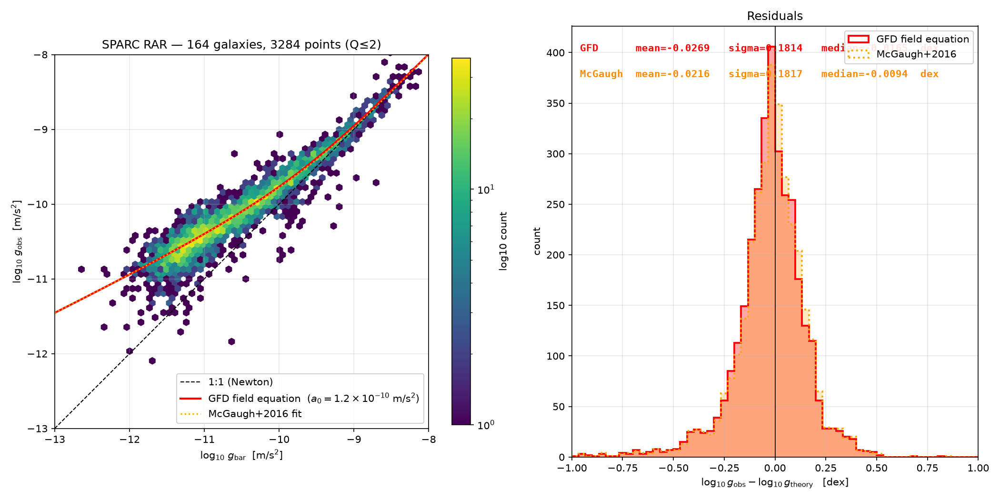

# Field Dynamics — Research Framework

**Gravity Field Dynamics (GFD)** · Stephen Nelson · [Field Dynamics Research](https://fielddynamics.org) · stephen@fielddynamics.org

`gravity` `theoretical-physics` `general-relativity` `modified-gravity` `astrophysics` `cosmology` `galaxy-rotation-curves` `dark-matter` `tetrad` `scientific-computing` `open-science` `sparc`

**One covariant action, with no parameter fitted to galaxies, reproduces the radial acceleration relation of the SPARC database: 3284 rotation-curve points in 164 galaxies, with a scatter of σ = 0.181 dex, within 0.0003 dex of the best one-parameter empirical fit.** Its interpolating function, μ(x) = x/(x + 1), is not chosen. It follows from the exchange symmetry between the two parity-related roots of the tetrad equation, which together form a stellated octahedron.



***Figure.** Left: observed against baryonic gravitational acceleration for 3284 rotation-curve points in 164 SPARC galaxies (quality Q ≤ 2). Dashed: the Newtonian expectation. Solid red: the GFD covariant action in its weak-field, static, spherical limit, g<sub>obs</sub> = ½[g<sub>bar</sub> + √(g<sub>bar</sub>² + 4a₀g<sub>bar</sub>)]. Dotted orange, almost indistinguishable: the one-parameter empirical fit of McGaugh, Lelli & Schombert (2016). Right: residuals. GFD: mean −0.027 dex, σ = 0.181 dex. Empirical fit: mean −0.022 dex, σ = 0.182 dex. From [The Radial Acceleration Relation from a Zero-Parameter Covariant Action](papers/letter-radial-acceleration-relation-sparc/).*

**What is not adjusted.** No galaxy-by-galaxy parameters, no halo profiles or concentrations, no fitted interpolating function. The only inputs are the SPARC baryonic rotation-curve components at the survey's standard stellar mass-to-light ratios (Υ<sub>disk</sub> = 0.5, Υ<sub>bulge</sub> = 0.7 at 3.6 μm) and the acceleration scale a₀ = 1.2 × 10⁻¹⁰ m/s² at its conventional value.

**Reproduce the figure in one command** (offline, from the bundled data table):

```bash
cd papers/letter-radial-acceleration-relation-sparc
python sparc_rar.py --from-csv supplementary/sparc_rar.csv
```

## Why this is worth a look

| Claim | Status | How to check |
|---|---|---|
| The radial acceleration relation follows from a covariant action with no parameter fitted to galaxies | Primary result | [`sparc_rar.py`](papers/letter-radial-acceleration-relation-sparc/sparc_rar.py) |
| The geometry is forced: under common norm, closure and S₄ symmetry the stellated octahedron is the unique spatial realisation of the tetrad, and μ(x) = x/(x + 1) is the unique law with exchange symmetry | Formal proofs | [`verify_gram_theorems.py`](papers/gram-matrix-of-tetrad-equation/verify_gram_theorems.py); [exchange-symmetry proof](<papers/letter-radial-acceleration-relation-sparc/supplementary/supplementary_constitutive_law_exchange_symmetry (1).tex>) |
| Einstein's equation is the TetA partition (μ = 1): the torsion-free condition keeps 40 and discards 24 of the 64 connection components, a split generated by f(K, ±1) | Letter 3 and supplementary proofs | [`EINSTEIN_TETA_PARTITION.md`](EINSTEIN_TETA_PARTITION.md); [`FIELD_CLOSURE_OF_THE_TETRAD_FRAME.md`](FIELD_CLOSURE_OF_THE_TETRAD_FRAME.md); [Letter 3 validation](papers/letter-3-field-closure-of-tetrad-frame/Supplementary/run_all_validations.py) |
| G, mₑ, α and H₀ follow from the same integers {13, 17, 21} | Derived; more exploratory | [`docs/03-fundamental-constants/`](docs/03-fundamental-constants/); [Paper VI validation](papers/06-gravitational-constant-from-topology/validation/run_all_validations.py) |

**The argument in four lines** (full table in [The framework in one page](#the-framework-in-one-page); machine-readable chain in [`llms.txt`](llms.txt)):

```text
Uniqueness:        2(D + 1) = 2^D        ⇒  D = 3, K = 4
Polynomial:        f(K, s) = 1 + sK + K²  →  {21, 17, 13}  (TetA, Field Origin, TetB)
Constitutive law:  μ(x) = x/(x + 1)          derived from exchange symmetry, not fitted
Action prefactors: 16 = K², 8 = 2^D, 4 = K
```

**For readers coming from MOND.** μ(x) = x/(x + 1) is MOND's "simple" interpolating function, so on the radial acceleration relation GFD's prediction coincides with that variant. The difference lies in the status of the function and in what surrounds it. Here μ is derived rather than selected, and it sits inside a covariant action whose further consequences (the torsion sector, the constants, the Hubble scale) can be tested independently.

## Context

The radial acceleration relation is one of the sharpest regularities in extragalactic astronomy. In the standard cosmological model it must emerge from the assembly of dark-matter haloes. In modified-gravity approaches it is reproduced by an interpolating function whose form has, since Milgrom's 1983 proposal, been chosen to fit the data. GFD proposes that the form is fixed by the tetrad, the local orthonormal frame through which general relativity couples to matter. The spatial sector of a single tetrad bounds exactly two parity-related regions, and the exchange symmetry between them leaves one admissible function.

The same structure is then followed further: to the gravitational constant, the electron mass and the Hubble constant; to nuclear binding energies and the magic numbers; and to the relation between GFD and ghost-free bimetric gravity. These extensions are more exploratory than the galactic result. They are presented with their derivations and validation code so that each can be examined on its own merits.

> **Featured: [Einstein's equation as the TetA partition](EINSTEIN_TETA_PARTITION.md).** A summary of Letter 3, *Field Closure of the Tetrad Frame*. The torsion-free condition retains 40 and discards 24 of the 64 connection components, a split generated by the same coupling polynomial. General relativity is the GFD field equation with μ fixed at 1, and the gap opened by releasing μ is the TetB share of the field, conventionally attributed to dark matter.
>
> **Companion: [The twenty-four that were set aside](FIELD_CLOSURE_OF_THE_TETRAD_FRAME.md).** A reader's guide to Letter 3 through its two figures: which 24 connection components general relativity removes, and where in a galaxy they carry the field, from Mercury's orbit to a galaxy's edge.

This repository holds the working research behind the Gravity Field Dynamics framework and the preprints published on Zenodo. It is published **as is**: derivation notes, synthesis documents, validation scripts, paper sources, interactive visualisations and exploratory experiments, in the state they were left at the end of each research session.

> **Read this first.** This is a lab notebook, not a software package. Folders were created as research threads opened, so naming is informal, some files exist in several versions (`(1)`, `-1`, `- Copy`, `v1`/`v2`), and a few threads were later superseded or abandoned. The published papers in [`papers/`](papers/) and the documentation in [`docs/`](docs/README.md) are the curated statements of the framework. Everything else is the trail that led there. The work is independent and has not been peer reviewed.

---

## A note from the author

I'm a tech engineer with an interest in theoretical physics, and this whole body of work grew from one idea: **field closure**.

My working life has been spent building enterprise systems, including encryption systems for government. In that world, state has to close. A transaction either settles or it does not; there is no half-committed balance, and nothing is allowed to go unaccounted for. When I began thinking about gravity, I kept returning to the same question: if reality is informational at bottom, how could it keep its books any other way?

The requirement that a field must close is not my invention. Most tetrad formalisms carry it already, and general relativity enforces it: the tetrad must be non-degenerate, $\det(e) \neq 0$, with four independent directions defined at every point, and the constraint equations must hold on every slice before the field can evolve. Paper VII sets this out in its section *Field Closure: The Requirement GR Already Enforces*. What I have tried to do is take that requirement seriously as a process and follow where it leads.

That process is my answer to the question. Every part of a field has neighbours, and before the field can move on, each part must read its neighbours and settle with them into one consistent state, much as accounts settle in a transaction. The whole configuration is read as a snapshot, reconciled, and recorded. I call this snapshot accounting, and it is the only way I can see an informational reality being managed. The papers here follow what that requirement implies, from the constitutive law that shapes galaxy rotation to the value of Newton's constant.

What you will find in this repository is as far as I have taken it, and I present it humbly. I am one person working independently, and the work has not been peer reviewed. I have made everything open, the papers, the code, the working notes and the dead ends, so that other researchers who find the idea interesting can use it, look at it closely, and critique it.

If you do, I would be glad to hear from you. Checks of the derivations, re-analyses of the data, errors found, assumptions questioned, or ideas for taking it further are all welcome, and a well-founded criticism is as valuable to me as a confirmation. You can reach me at stephen@fielddynamics.org, or open an issue on this repository.

— Stephen Nelson

---

## The framework in one page

GFD proposes that the local gravitational frame has a definite interior geometry: the **stellated octahedron**, two interpenetrating tetrahedra of opposite orientation (**TetA** and **TetB**) sharing a common centre (the **Field Origin**). From that geometry it derives a covariant, zero-free-parameter theory of gravity that reproduces galactic rotation curves without dark matter, and it then follows the same structure into constants, particle masses, nuclear binding and atomic structure.

| Object | Statement |
|---|---|
| Dimension selection | `2(D + 1) = 2^D  ⇒  D = 3`, `K = D + 1 = 4` |
| Tetrad | `g_μν = η_ab e^a_μ e^b_ν` — the 2⁴ sign combinations of the spatial frame give exactly two bounded regions (TetA, TetB) |
| Coupling polynomial | `f(K, s) = 1 + sK + K²` → at K = 4: **21** (TetA, s = +1), **17** (origin, s = 0), **13** (TetB, s = −1) |
| Constitutive law | `μ(x) = x/(x + 1)`, with `x = g_t / a₀` — the "simple" AQUAL/MOND interpolating function, derived rather than fitted |
| Scalar–tensor transition (SST) | `g_s = g_t² / (a₀ + g_t)`, inverted as `g_t = (g_s + √(g_s² + 4 g_s a₀))/2` |
| Kinetic functional | `F(y) = y − 2√y + 2 ln(1 + √y)`, with `dF/dy = μ(√y)` |
| Covariant action | `S = ∫ d⁴x √−g [ R/16πG − (a₀²/8πG) F(y) − ¼ e^{−2Φ/c²} F_μν F^μν + L_m ]` — prefactors 16 = K², 8 = 2^D, 4 = K |
| Connection split | `K³ = 64 = 40 + 24`: GR's torsion-free condition keeps 40 Christoffel components and discards the 24 torsion components, which GFD identifies with TetB |
| Gravitational constant | `G = (17/13) α²¹ ħc / m_e²` |

For a guided explanation of each step, start with the [documentation](docs/README.md): Foundations, Gravitation, Fundamental Constants and Galactic Dynamics. [`llms.txt`](llms.txt) contains the full machine-readable derivation chain, symbol glossary and interpretation rules, and is the best single-file summary of the framework.

---

## Published papers (Zenodo)

Paper PDFs and their LaTeX sources live in [`papers/`](papers/). Two series were published: the numbered **Distributed Field Processing / GFD papers I–XIII** (January–March 2026) and the shorter **tetrad letters** (March 2026 onward). Each description below summarises the paper's own claim.

### Numbered series — Papers I–XIII (January–March 2026)

Each paper has its own numbered folder, `papers/01-…` to `papers/13-…`, holding its PDFs, sources, revisions and, where they exist, validation scripts and supplementary material. For Papers I–V several dated PDF revisions are kept, and the latest date is the final version.

**I — The Gravitational Constitutive Law (No Dark Matter Required)**
[`papers/01-gravitational-constitutive-law/`](papers/01-gravitational-constitutive-law/) · final version [`2026-01_28_Nelson_DFP_Gravitational_Constitutive_Law.pdf`](papers/01-gravitational-constitutive-law/2026-01_28_Nelson_DFP_Gravitational_Constitutive_Law.pdf) — [doi:10.5281/zenodo.18332595](https://doi.org/10.5281/zenodo.18332595)
Asks why MOND's interpolating function has the form it does. From the requirement that gravitational field coupling be lossless and locally evaluable, it derives μ(x) = x/(1 + x) as the unique equilibrium solution instead of a curve-fit choice.

**II — A Covariant Theory Without Dark Matter**
[`papers/02-covariant-theory-without-dark-matter/`](papers/02-covariant-theory-without-dark-matter/) · final version [`2026-01_28_Nelson_DFPII_A_Covariant_Theory_Without_Dark_Matter.pdf`](papers/02-covariant-theory-without-dark-matter/2026-01_28_Nelson_DFPII_A_Covariant_Theory_Without_Dark_Matter.pdf) — [doi:10.5281/zenodo.18360354](https://doi.org/10.5281/zenodo.18360354)
Extends Paper I to cosmological scales. Using a₀ = cH₀/2π and the geometry of tetrahedral closure packing, it derives a gravitational enhancement of 6.46 at recombination against the ≈ 6.4 that Planck's CMB peaks require, without cold dark matter.

**III — The Unit of Gravity**
[`papers/03-unit-of-gravity/`](papers/03-unit-of-gravity/) · final version [`2026-01_28_Nelson_DFPIII_The_Unit_Of_Gravity.pdf`](papers/03-unit-of-gravity/2026-01_28_Nelson_DFPIII_The_Unit_Of_Gravity.pdf) — [doi:10.5281/zenodo.18362768](https://doi.org/10.5281/zenodo.18362768)
Asks what sets the size of the gravitational field tile. An electromagnetic route and a gravitational-topology route both land on ≈ 2.82 fm, the classical electron radius, which the paper identifies as the unit of gravity.

**IV — Resolving the Hubble Tension Through Tetrad Topology**
[`papers/04-hubble-tension-through-tetrad-topology/`](papers/04-hubble-tension-through-tetrad-topology/) · final version [`2026-01_28_Nelson_DFPIV_Resolving_The_Hubble_Tension_Through_Tetrad_Topology.pdf`](papers/04-hubble-tension-through-tetrad-topology/2026-01_28_Nelson_DFPIV_Resolving_The_Hubble_Tension_Through_Tetrad_Topology.pdf) — [doi:10.5281/zenodo.18371849](https://doi.org/10.5281/zenodo.18371849)
Projects the flat-space MOND value H₀ = 78.9 km/s/Mpc through the k = 4 tetrad topology to obtain 69.92 km/s/Mpc, and runs the same chain in reverse to derive the electron mass from the measured Hubble constant.

**V — Field Closure and the Topology of Gravity**
[`papers/05-field-closure-and-topology-of-gravity/`](papers/05-field-closure-and-topology-of-gravity/) · final version [`2026-01_29_Nelson_DFPV_Field_Closure_And_The_Topology_Of_Gravity.pdf`](papers/05-field-closure-and-topology-of-gravity/2026-01_29_Nelson_DFPV_Field_Closure_And_The_Topology_Of_Gravity.pdf) — [doi:10.5281/zenodo.18419531](https://doi.org/10.5281/zenodo.18419531)
Explains why the number four recurs across ADM, tetrad gravity, Loop Quantum Gravity, Regge calculus and LIGO's two polarizations, via the simplex theorem, and connects the tetrahedron of those formalisms to the Field Chamber of this framework.

**VI — Deriving the Gravitational Constant from Spacetime Topology**
[`papers/06-gravitational-constant-from-topology/`](papers/06-gravitational-constant-from-topology/) — [doi:10.5281/zenodo.18463038](https://doi.org/10.5281/zenodo.18463038)
Argues that spinor theory, chiral gravity, ghost-free bimetric gravity and stability analysis all require two oppositely oriented tetrahedra, and from that dual-chamber structure derives Newton's constant with no adjustable parameters. Includes an arXiv-format build and `validation/run_all_validations.py`.

**VII — Dual Tetrad Topology and the Field Origin: From Nuclear Decay to Galactic Dynamics**
[`papers/07-dual-tetrad-topology-field-origin/`](papers/07-dual-tetrad-topology-field-origin/) <!-- Zenodo DOI -->
Derives the stellated octahedron as the minimal closure topology in 3+1 dimensions and builds a covariant scalar-tensor action from it, testing predictions from the neutron-lifetime beam–bottle discrepancy to Milky Way rotation. Revisions `v2`–`v7` are kept; `v7` is the latest.

**VIII — Gravity Field Dynamics and Bimetric Gravity**
[`papers/08-gfd-and-bimetric-gravity/`](papers/08-gfd-and-bimetric-gravity/) <!-- Zenodo DOI -->
Shows how the coupling polynomial fixes the five free Hassan–Rosen bimetric coefficients to {1, 0, 16, 0, 1}, while its continuous form, normalised, gives the constitutive law μ(x) = x/(x + 1).

**IX — Complete Field Closure from Stellated Octahedron Topology**
[`papers/09-complete-field-closure/`](papers/09-complete-field-closure/) <!-- Zenodo DOI -->
Derives both the topology and the closure condition of gravity from the single equation 2(d + 1) = 2^d, whose only solution d = 3 fixes K = 4 and produces the stellated octahedron and the 3+1 split. Comes with the largest test collection (`Tests/`, `supplementary/`).

**X — Two-Scale Kinematics from a Single Scalar-Tensor Transition**
[`papers/10-two-scale-kinematics-tully-fisher-h0/`](papers/10-two-scale-kinematics-tully-fisher-h0/) <!-- Zenodo DOI -->
Applies the same SST equation at galactic and cosmological scales to predict the redshift evolution of the baryonic Tully–Fisher relation to z = 3 and H₀ = 70.21 km/s/Mpc, with a ±6% band containing both the Planck and SH0ES values.

**XI — Nuclear Shell Structure and Binding Energies from Tetrahedral Packing at K = 4**
[`papers/11-nuclear-shells-tetrahedral-packing/`](papers/11-nuclear-shells-tetrahedral-packing/) <!-- Zenodo DOI -->
Gives a one-line binding-energy formula from the coupling polynomial, tested across the stable elements from hydrogen to bismuth, and a tetrahedral packing algebra that produces all seven nuclear magic numbers.

**XII — Dual Tetrad Covariance: The GFD Action and the Hassan–Rosen Potential as Two Projections of a Single Geometry**
[`papers/12-dual-tetrad-covariance-hassan-rosen/`](papers/12-dual-tetrad-covariance-hassan-rosen/) (source only) <!-- Zenodo DOI -->
Develops Paper VIII into a term-by-term correspondence between the two actions, locks the bimetric coefficients through three theorems and three axioms, and checks the result against six concordance tests (expansion history, BBN, CMB, Vainshtein screening, Galileon hierarchy, mixing angle).

**XIII — Nuclear Binding Energy from the Bidirectional Scalar-Tensor Transition**
[`papers/13-nuclear-binding-bidirectional-sst/`](papers/13-nuclear-binding-bidirectional-sst/) <!-- Zenodo DOI -->
Uses the SST quadratic, the same equation used for galaxy rotation curves, evaluated along a 64-step walk to reproduce the seven magic numbers (including the 20 → 28 gap without spin–orbit coupling) and binding energy per nucleon from helium to lead. The earlier draft is in `working-draft/`.

**Companion — Topological Field Closure: A Bidirectional Derivation of the Hubble Constant and the Electron Mass**
[`2026-01-26-Topological_Field_Closure_…pdf`](papers/2026-01-26-Topological_Field_Closure_A_Bidirectional_Derivation_of_the_Hubble_Constant_and_the_Electron_Mass.pdf) <!-- Zenodo DOI -->
A short paper presenting the Hubble-constant ↔ electron-mass link from Papers III–IV as a bidirectional test: forward from electron properties to H₀, and in reverse from H₀ to the electron mass.

### Tetrad letters — March 2026 onward

Short, self-contained letters that rebuild the framework from the tetrad equation alone. Each folder holds `letter.tex` / `letter.pdf`, a cover letter, supplementary proofs and, in most cases, a `run_all_validations.py` that checks every number in the letter.

**Letter 1 — The Coordinate-Space Geometry of the Tetrad Frame**
[`papers/letter-1-tetrad-frame-geometry/`](papers/letter-1-tetrad-frame-geometry/) <!-- Zenodo DOI -->
Takes the four half-space inequalities of a single orthonormal tetrad and shows that their 16 sign combinations give exactly two bounded regions, which together form a stellated octahedron. No second frame is assumed; every structural constant reduces to K = 4 and D = 3.

**Letter — The Gravitational Constitutive Law from the Tetrad Frame Geometry**
[`papers/letter-constitutive-law-tetrad-geometry/`](papers/letter-constitutive-law-tetrad-geometry/) <!-- Zenodo DOI -->
Derives the AQUAL interpolating function μ(x) = x/(x + 1) by three independent routes: the rank structure of the metric, equilibrium field closure, and the exchange symmetry between the tetrad's two bounded regions.

**Letter 2 — The Other Half of Gravity: Torsion and the Two-Chamber Structure of the Tetrad Frame**
[`papers/letter-2-other-half-of-gravity-torsion/`](papers/letter-2-other-half-of-gravity-torsion/) (`v1`, `v2`) <!-- Zenodo DOI -->
Proves that a torsion-free connection cannot tell the two tetrahedral chambers apart, so the 24 torsion components that general relativity discards are what carry the TetA/TetB distinction. The TetB field fraction comes out as 1/(x + 1).

**Letter 3 — Gravity Field Dynamics: Field Closure of the Tetrad Frame**
[`papers/letter-3-field-closure-of-tetrad-frame/`](papers/letter-3-field-closure-of-tetrad-frame/) <!-- Zenodo DOI -->
Shows that the torsion-free condition keeps the s = +1 projection of the coupling polynomial (40 components) and discards the s = −1 projection (24 components). Restoring them gives the full 64-component connection, which the constitutive law partitions spatially.

**Letter — The Radial Acceleration Relation from a Zero-Parameter Covariant Action**
[`papers/letter-radial-acceleration-relation-sparc/`](papers/letter-radial-acceleration-relation-sparc/) <!-- Zenodo DOI -->
Shows that the radial acceleration relation follows kinematically from the covariant action with F(y) written out explicitly, and tests it against the SPARC database (164 galaxies, 3284 points), reaching 0.181 dex scatter with no fitted parameters.

**Letter — Decoding Mass from Observed Rotation Curves**
[`papers/letter-decoding-mass-from-rotation-curves/`](papers/letter-decoding-mass-from-rotation-curves/) — [doi:10.5281/zenodo.18721752](https://doi.org/10.5281/zenodo.18721752)
Runs the field equations in reverse: the same algebraically invertible relations that give rotation velocity from mass give enclosed mass from observed velocity. Applied to the Milky Way and M33, with no fitted gravitational parameters (only G and a₀), the decoded mass profiles match independently inferred baryonic mass to within a factor of order unity, with no dark-matter halo. Includes an arXiv build, Supplemental Material with the uniqueness argument, and `run_all_validations.py`.

### Manuscripts in preparation (sources only)

**The Gram Matrix of the Tetrad Equation** — [`papers/gram-matrix-of-tetrad-equation/`](papers/gram-matrix-of-tetrad-equation/)
Treats the tetrad equation as a Gram matrix, $G = M^TM$. Its two sign-related solutions give root-blind self-coupling and sign-reversing cross-coupling; their columns form a tetrahedron, its inverse and their stellated-octahedron compound. The affine connection splits canonically as 24 + 16 + 24 = 64, and the torsion-free projection retains 40 and discards the TetB sector. The companion *forced Gram-matrix theorem* (supplement to the radial acceleration relation letter) proves the regular tetrahedron, and hence the stellated octahedron, is the unique spatial realisation of the Lorentz tetrad under common norm, closure and $S_4$-invariance. A third proof, [*The Coupling Polynomial Generates the 40/24 Split*](papers/letter-3-field-closure-of-tetrad-frame/Supplementary/proof_polynomial_40_24.tex) (Letter 3 supplement), shows that the torsion-free split is the coupling polynomial at its two opposite states: $(f(K,+1)-1)/2 = 10$ retained and $(f(K,-1)-1)/2 = 6$ discarded per face, restoring $K^3 = 64$ when both are active. The counting and polynomial results are checked by the letters' `run_all_validations.py` scripts (Letter 3: 52/52), and the Gram products and forced-Gram theorem by [`verify_gram_theorems.py`](papers/gram-matrix-of-tetrad-equation/verify_gram_theorems.py) (32/32).

**Tully–Fisher Velocity Evolution from Dual-Tetrad Gravity: A Zero-Parameter Prediction Compared to IFU Survey Data** — [`papers/tully-fisher-velocity-evolution/`](papers/tully-fisher-velocity-evolution/)
Because a₀ = (cH/2π)√(K/π) tracks the Hubble parameter, galaxies should rotate faster in the past: v(z)/v(0) = [H(z)/H₀]^0.17, with the exponent derived from the scalar–tensor action rather than fitted. All nine IFU measurements from z = 0 to z = 3 fall within the predicted band, against a flat ΛCDM expectation of 1.0, and the same K = 4 topology gives H₀ = 70.29 km/s/Mpc. A focused companion to Paper X; `run_all_validations.py` checks 64 claims.

**GFD Essentials: Tetrads, Field Closure, and the Inverse Pipeline** — [`papers/gfd-essentials-tetrads-field-closure-inverse-pipeline/`](papers/gfd-essentials-tetrads-field-closure-inverse-pipeline/)
A short primer for relativists. It walks from tetrads and non-degeneracy to tetrahedral field chambers with four active channels, then to field closure, the constitutive law and the scalar–tensor action, and ends with the inverse pipeline that decodes observed velocity into effective mass M_dec(r). A good first read before the decoding-mass letter.

**Papers A, B and C** — [`papers/algebraic-papers-a-b-c/`](papers/algebraic-papers-a-b-c/)
- *A — An Algebraic Origin for the Simple AQUAL Interpolation Function* (`gfd_phase1_letter_final.tex`): derives μ(x) = x/(1 + x) from the reciprocal ℤ₂ structure of the tetrad-frame sector algebra, whose parity-weighted trace is f(K, s).
- *B — The Torsion Sector of the Tetrad Connection as the Regular Representation of S₄* (`gfd_paper_b_torsion_S4.tex`): shows that at K = 4 the 24-dimensional torsion sector carries the regular representation of S₄, and so contains the sign (parity) representation that the Christoffel sector lacks.
- *C — The Hadamard Sign Kernel of the Tetrahedral Frame* (`gfd_paper_c_hadamard_tetrad.tex`): identifies the 4 × 4 Hadamard matrix of signal processing, the sign skeleton of the isotropic tetrad and the axis structure of the stellated octahedron as one object.

**Closed-Form Energy Functional for the Simple Interpolating Function in AQUAL** — [`papers/closed-form-aqual-energy-functional/`](papers/closed-form-aqual-energy-functional/)
Gives the closed form F(y) = y − 2√y + 2 ln(1 + √y) for μ(x) = x/(x + 1), so the AQUAL action can be written explicitly instead of only through its derivative.

---

## Repository map

The repository has three top-level folders:

| Folder | Contents |
|---|---|
| [`papers/`](papers/) | The published and in-preparation papers (above) |
| [`docs/`](docs/README.md) | The framework documentation: 28 completed pages copied from the documentation site, as readable Markdown. The full site is available as a Flask app in the [fielddynamics/docs](https://github.com/fielddynamics/docs) repository |
| [`research/`](research/) | Every research thread, described in the tables below |

Most research folders follow the same pattern: a **`*_synthesis.md`** that explains the result in prose, and a **Python suite** (often named `*_20.py`, `*_enterprise_*.py` or `*_validation.py`) that checks every claim numerically and prints PASS/FAIL. Read the synthesis first, then run the suite.

### Framework core ([`research/`](research/))

| File | What it is |
|---|---|
| [`llms.txt`](llms.txt) | Machine-readable specification of the framework: equations, dependency chain, glossary |
| [`gfd_algebra.py`](research/gfd_algebra.py) | Every algebraic object used in the RAR letter and its supplementary proofs, with self-checks |
| [`gfd_enterprise_validation-v2.py`](research/gfd_enterprise_validation-v2.py) | The main end-to-end validation: stellated octahedron from `2(D+1) = 2^D`, coupling polynomial, constitutive law, gauge structure (v1 kept for reference) |
| [`gfd_fundamental_constants.py`](research/gfd_fundamental_constants.py) | Capstone suite: G, α, θ_W, H₀ and field-equation prefactors derived from {K, D} |

### Gravity, galaxies and cosmology

| Folder | Contents |
|---|---|
| [`constitutive-law-u(x)/`](<research/constitutive-law-u(x)/>) | Constitutive law suites and TetA/TetB roulette visualisations |
| [`galaxy-rotation/`](research/galaxy-rotation/) | Rotation-curve pipeline, interior/exterior synthesis, mass decoding, vortex viewers |
| [`cdm/`](research/cdm/) | Translation of the cold-dark-matter halo into the TetB interior of the field |
| [`cmb/`](research/cmb/) | The oldest light: the recombination enhancement of 6.46 from packed closure boundaries, one law across two epochs, and the 0.17 velocity exponent |
| [`g_from_topology/`](research/g_from_topology/) | G as a matrix read; one-loop (Schwinger) correction to G; look-elsewhere test; *What Is Gravity?*, an open question |
| [`field-closure/`](research/field-closure/) | Where the research began: why a gravitational field must close, the accounting closure demands, the field closure pipeline, and the closure walk |
| [`bbp and pi field closure stepping/`](<research/bbp and pi field closure stepping/>) | The BBP π formula read as field closure |
| [`bound-gravity-and-packing/`](research/bound-gravity-and-packing/) | How a gravity field becomes matter: one field, two states, driven by stellar compression |
| [`quantum gravity/`](<research/quantum gravity/>) | Contact with Regge / LQG / spin-foam programs; two-state Hilbert space of the octahedral core |
| [`deep-structure/`](research/deep-structure/) | Number-theoretic and topological structure of K = 4 |
| [`polynomial coupling fn/`](<research/polynomial coupling fn/>) | Structural analysis of `f(K, s)`, Sierpiński structure, prime sieve |
| [`faces/`](research/faces/) | "Enterprise Triforce" 40-test face-structure suite |
| [`hawking/`](research/hawking/) | Singularities, information and holography: where black holes sit on the TetA/TetB partition, the Raychaudhuri equation for the full 64-component connection, and the information, renormalisation and holography identities; with a verification script (16 checks) |
| [`universe-is-pixelated/`](research/universe-is-pixelated/) | The universe is pixelated: the stellated octahedron as the Walsh spectrum of the binary cube, the tetrad as a Hadamard matrix, the octahedron bounded by the eight null directions, and G as an operator read; reality as a photonic matrix of light; Letters 1–3 read on the cube; the octahedral resonance node, a coupled oscillator that computes on the null cone; with a verification script (52 checks) |

### Particles, nuclei and atoms

| Folder | Contents |
|---|---|
| [`em/`](research/em/) | Electromagnetic sector: gauge structure S₄ → A₄ → V₄, coupling constants |
| [`mass-spectrum-particle-physics/`](research/mass-spectrum-particle-physics/) | Particle mass spectrum from A₄ → V₄ × Z₃ |
| [`proton/`](research/proton/) | Proton–electron mass ratio proof chain |
| [`photonic/`](research/photonic/) | Photon equations, "light substrate" suites and teaching notes |
| [`nuclear/`](research/nuclear/), [`nuclear-triforce/`](research/nuclear-triforce/) | Nuclear binding from the constitutive law; intersection with the face suite |
| [`matter/`](research/matter/) | Nuclear binding (Bethe–Weizsäcker coefficients, 3-scale model, Sierpiński walk), electron configurations, particle properties |
| [`electron-configurations/`](research/electron-configurations/) | Electron configurations: sub-shell capacities, Madelung order and the transition-metal exceptions from the coupling polynomial |
| [`atomic-properties/`](research/atomic-properties/), [`atom-vortex-horizon/`](research/atom-vortex-horizon/) | Overdetermined atomic predictions; the vortex horizon picture of the atom |

### Computation and signal processing

| Folder | Contents |
|---|---|
| [`quantum compute/`](<research/quantum compute/>) | The GFD oscillator (Kuramoto-type phase + amplitude dynamics) applied to Max-Cut, colouring, TSP, community detection and mazes; t-bit algebra; Walsh-bridge gate recognition; oscillator-based unsupervised learning. Subfolders `GFD oscillator v2/` and `Oscillator learning/` have their own READMEs |
| [`spectral/`](research/spectral/) | Walsh–Hadamard spectral kernel (PyTorch) |
| [`3 sweep understanding/`](<research/3 sweep understanding/>) | Closure-algebra pipeline and Walsh-spectral compute primitive syntheses |
| [`antenna theory/`](<research/antenna theory/>) | Resonant coupling through the Field Origin |

### Exploratory work — [`research/exploratory/`](research/exploratory/)

These programmes carry the framework's structures into new domains. They are kept alongside the main research record as exploratory work, and each states its own results and open measurements.

| Folder | Contents |
|---|---|
| [`great-pyramid/`](research/exploratory/great-pyramid/) | **The Giza Field-Resonator Programme.** It applies GFD's scale invariance to the Great Pyramid: an apex body's local Field Origin lies at z*/h = 1 − 1/√2, and the King's Chamber floor sits on it to 0.8 in (Petrie's measurements; derived from the GFD action and confirmed by a field model). Start with the [findings](research/exploratory/great-pyramid/pyramid_portal_research/README.md#key-findings) and the [programme definition](research/exploratory/great-pyramid/pyramid_portal_research/PROGRAMME.md); a compendium, working notes and a tested Python package follow |
| [`i-ching/`](research/exploratory/i-ching/) | The I Ching and the stellated octahedron: trigrams as cube vertices, the trigram family as the TetA/TetB partition, Fu Xi opposites as body diagonals; the π base-8 hexagram walk and the BBP bridge |

### Other notes

| Folder | Contents |
|---|---|
| [`earth-365-days/`](research/earth-365-days/) | Note on the 365/360 relation |
| [`formalisms-tetrad/`](research/formalisms-tetrad/) | The dual-chamber structure across tetrad, bimetric, loop-quantum, spinor and stability formalisms, read against GFD |
| [`trash-bin/`](research/trash-bin/) | Material kept only to track the course of the research and flagged as likely not reliable; not to be cited (the early neural-network binding experiments and the former `temp/` scratch folder) |

### External reference material

[`stellated octahedron geometry/On the 14-Octahedron Backbone of the Bimetric.pdf`](<research/stellated octahedron geometry/On the 14-Octahedron Backbone of the Bimetric.pdf>) is a third-party paper by Bruno R. Galeffi, kept as background reading. It is not part of the GFD work.

---

## Running the code

The scripts are standalone research code, not an installable package. Most need only Python 3 and NumPy; some use the extras below.

```bash
pip install numpy scipy mpmath matplotlib pytest
pip install torch        # spectral kernel, neural-network experiments, some oscillator work
```

**Canonical validation suite.** These scripts check the curated claims, and each runs standalone from its own folder:

| Script | Checks |
|---|---|
| [`papers/letter-radial-acceleration-relation-sparc/sparc_rar.py`](papers/letter-radial-acceleration-relation-sparc/sparc_rar.py) `--from-csv supplementary/sparc_rar.csv` | SPARC radial acceleration relation: figure, mean and scatter |
| [`papers/letter-1-tetrad-frame-geometry/Supplementary/run_all_validations.py`](papers/letter-1-tetrad-frame-geometry/Supplementary/run_all_validations.py) | Letter 1: tetrad frame geometry (29 claims) |
| [`papers/letter-2-other-half-of-gravity-torsion/v2/Supplementary/run_all_validations.py`](papers/letter-2-other-half-of-gravity-torsion/v2/Supplementary/run_all_validations.py) | Letters 1–2: geometry, torsion = TetB (52 claims) |
| [`papers/letter-3-field-closure-of-tetrad-frame/Supplementary/run_all_validations.py`](papers/letter-3-field-closure-of-tetrad-frame/Supplementary/run_all_validations.py) | Letter 3: 40/24 split, polynomial identity, partition (52 claims) |
| [`papers/gram-matrix-of-tetrad-equation/verify_gram_theorems.py`](papers/gram-matrix-of-tetrad-equation/verify_gram_theorems.py) | Gram-matrix and forced-Gram theorems (32 checks) |

Everything under [`research/`](research/), and in particular [`research/exploratory/`](research/exploratory/), is working material rather than part of the canonical suite.

Other entry points:

```bash
python research/gfd_enterprise_validation-v2.py           # core framework validation
python research/gfd_fundamental_constants.py            # constants from {K, D}
python research/gfd_algebra.py                      # algebra self-checks (silent = pass)
python papers/letter-1-tetrad-frame-geometry/Supplementary/run_all_validations.py
python papers/letter-3-field-closure-of-tetrad-frame/Supplementary/run_all_validations.py
python papers/gram-matrix-of-tetrad-equation/verify_gram_theorems.py
python "research/quantum compute/GFD oscillator v2/run_all.py"
```

Notes:

- Many paths contain spaces and parentheses; quote them in the shell.
- Scripts are generally meant to be run from their own folder.
- A few files under `research/exploratory/great-pyramid/field_origin_geometry/`, `research/exploratory/i-ching/` and `papers/09-complete-field-closure/Tests/` import `gravity_field_model` from the companion model repository (`dfp-gravity-field-model`) and will not run without it.
- Trained model weights (`*.pt`), zipped code bundles and LaTeX build artefacts (`.aux`, `.log`, `.out`) are committed as they were produced.

---

## Citing

Please cite the relevant Zenodo preprint for any result taken from this archive. For the framework as a whole, cite the latest letters above or the [documentation](docs/README.md).

## Licence

This repository is released under the [MIT License](LICENSE) © 2026 Stephen Nelson, Field Dynamics Research. The code, notes and paper sources may be used, modified and redistributed, provided the copyright and licence notice are retained. Papers deposited on Zenodo also carry the licence shown on their Zenodo records.

## Contact

Stephen Nelson — Field Dynamics Research
[fielddynamics.org](https://fielddynamics.org) · [documentation](docs/README.md) · stephen@fielddynamics.org
