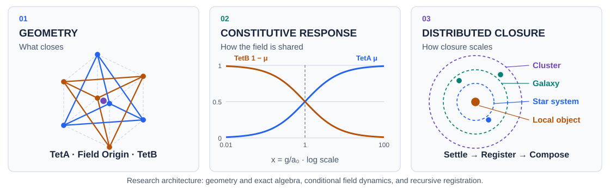
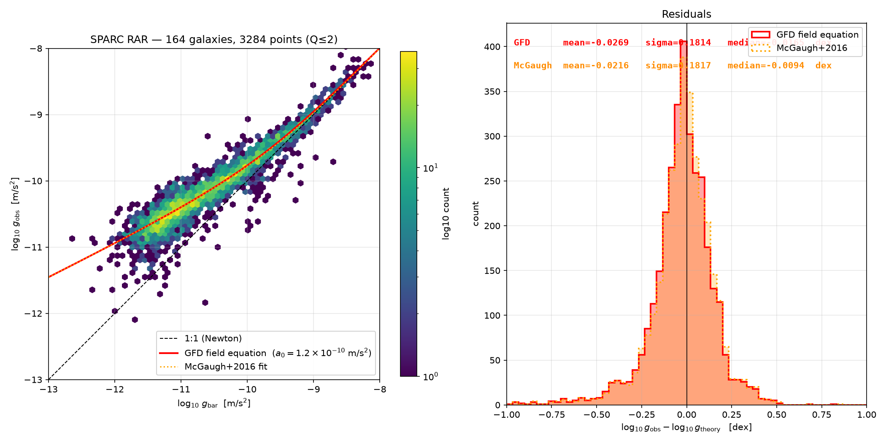
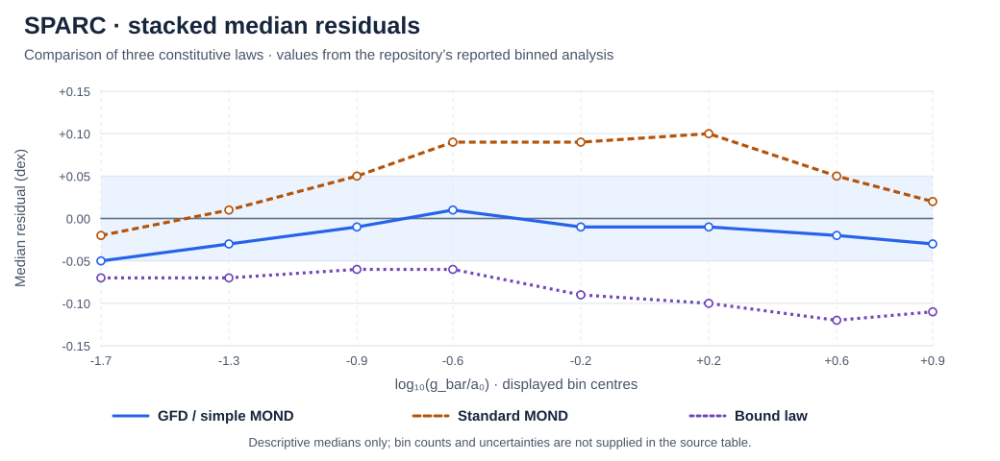
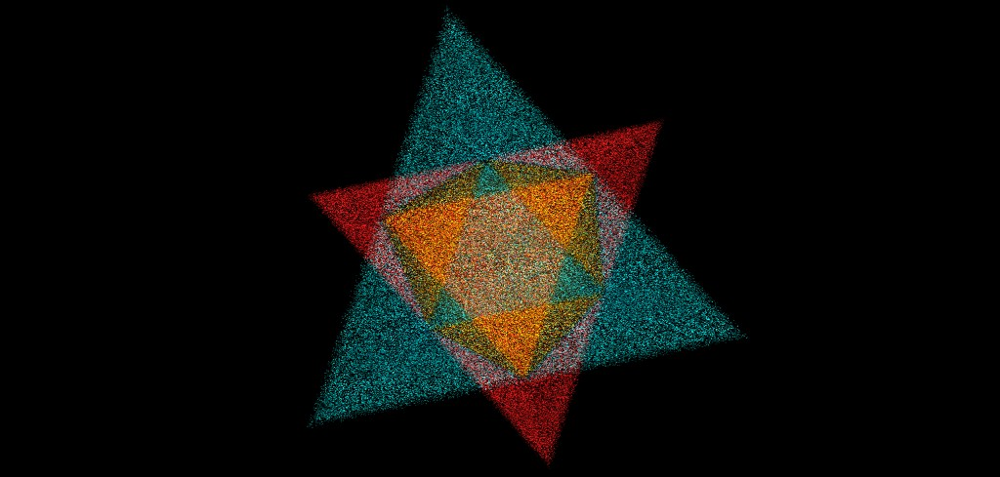
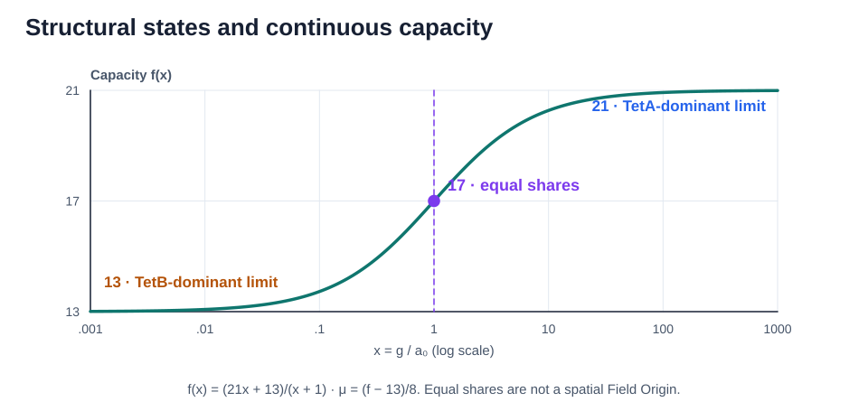
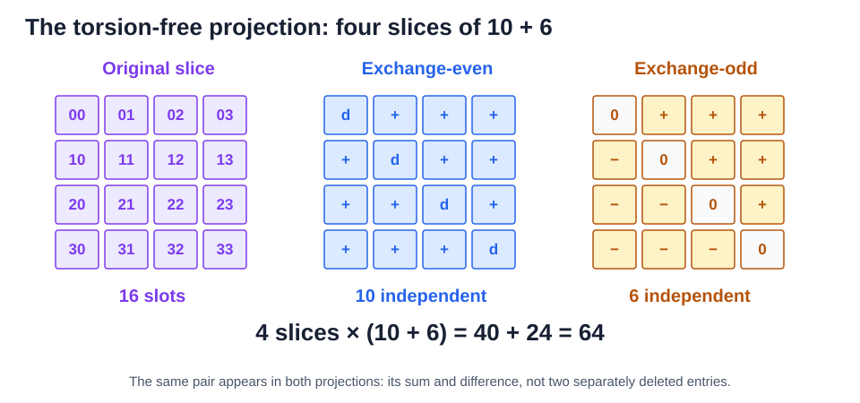
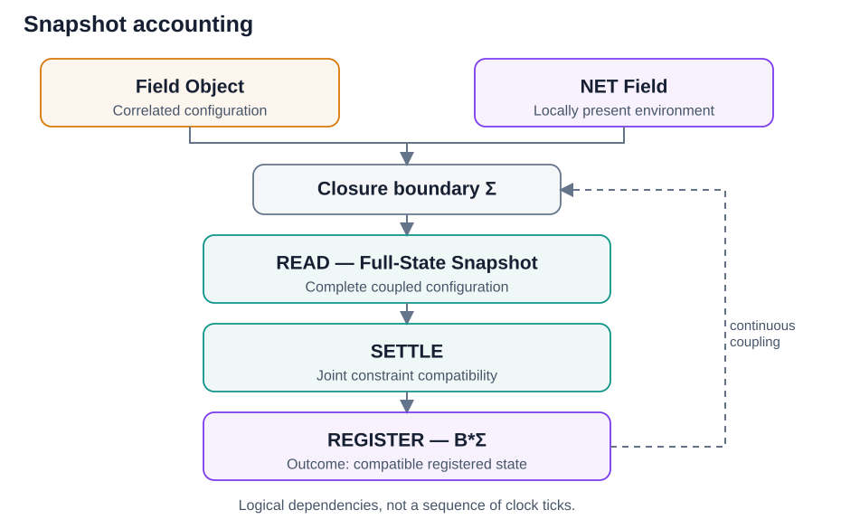
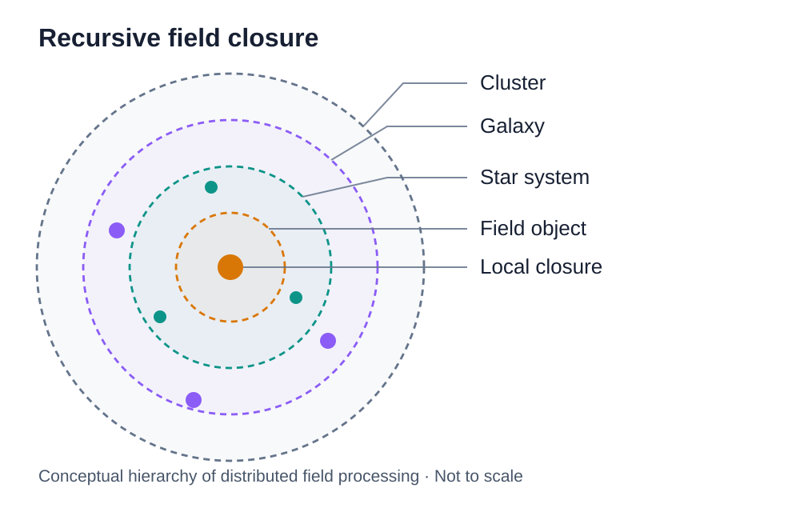
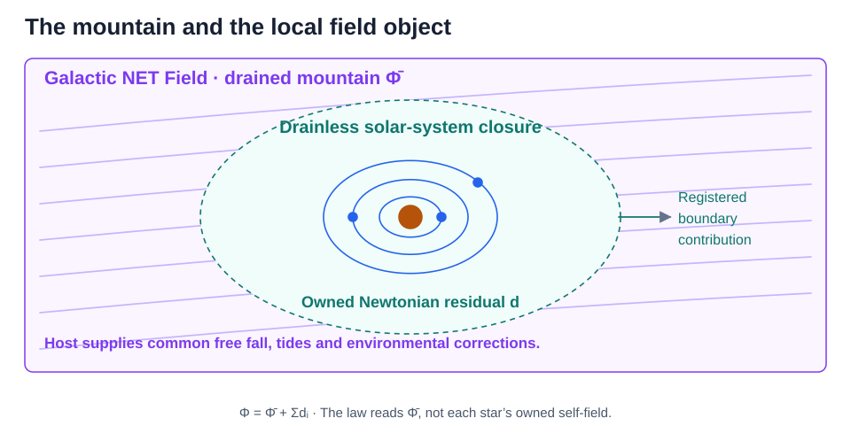
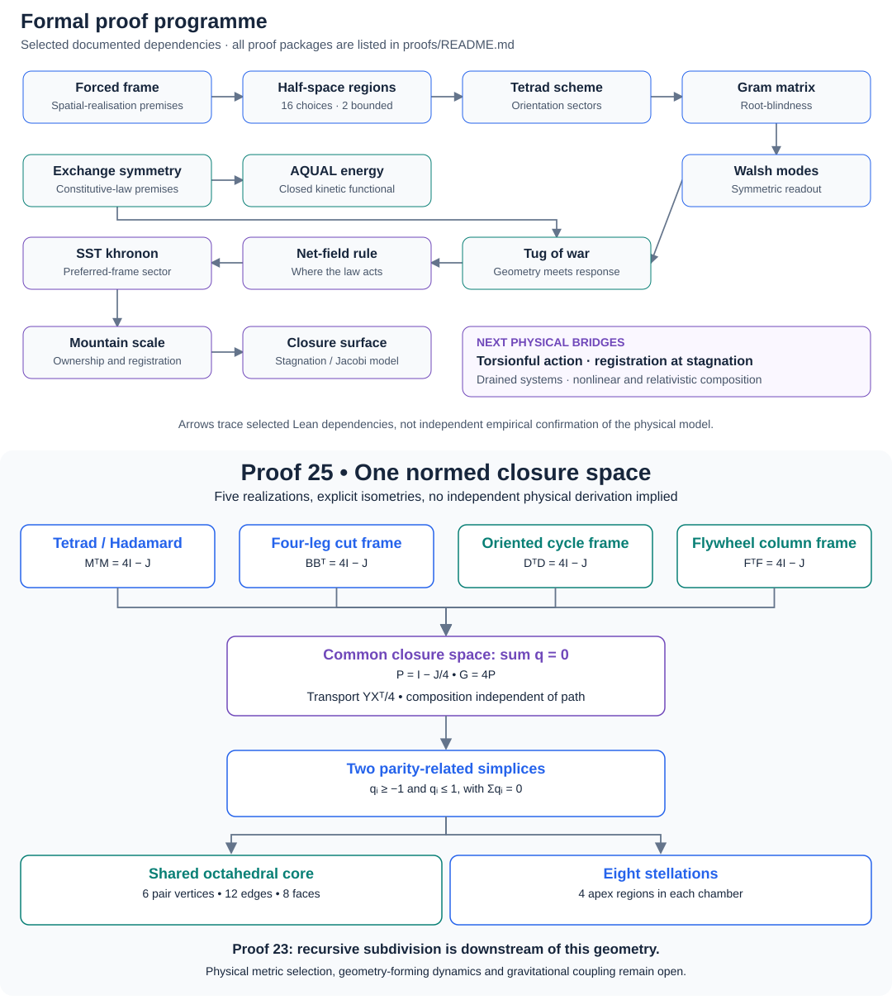

<div align="center">

# Gravity Field Dynamics

### Dual-tetrad geometry · Distributed Field Processing · Recursive field closure

**A research framework investigating gravity as a locally settled, geometrically closed field.**

[Field Dynamics Research](https://fielddynamics.org) · [Documentation](docs/README.md) · [Formal proofs](proofs/README.md) · [Research index](RESEARCH_INDEX.md)

[](LICENSE) [](proofs/README.md) [](proofs/README.md) [](#status-and-known-limitations)

Stephen Nelson · [ORCID 0009-0008-6190-3269](https://orcid.org/0009-0008-6190-3269) · stephen@fielddynamics.org

</div>

---

Gravity Field Dynamics (GFD) begins with a question: **does the metric describe the entire gravitational structure of the tetrad from which it is constructed?**

The tetrad equation admits parity-related orientation sectors that produce the same metric. Under the spatial-realisation premises established in the repository, they form two interlocking tetrahedra: **TetA**, the observable spacetime sector, and **TetB**, the dual chamber, coupled through the **Field Origin**. GFD proposes that both participate in the gravitational field and that field objects settle their own internal accounting before registering with the surrounding NET Field.

This joins three research directions: the geometry of the tetrad, a constitutive law selected within a stated class of exchange-symmetric laws, and a distributed architecture for gravitational closure. Its most developed observational application is galactic dynamics, where it reproduces the SPARC radial acceleration relation without galaxy-specific gravitational fits.



> **Research status:** Independent open research. The repository reports 22 proof packages, 954 scripted checks and 14 Lean 4 formalisations. These establish mathematical results within specified premises; they do not by themselves establish the physical theory. The papers are preprints, not yet peer reviewed.

## Results on SPARC

| Galaxies | Rotation-curve points | GFD residual scatter | Galaxy-specific gravitational fit parameters |
| :---: | :---: | :---: | :---: |
| **164** | **3,284** | **0.181 dex** | **0** |



The figure compares the GFD spherical, static weak-field relation with the radial acceleration relation of McGaugh, Lelli & Schombert (2016). The dataset includes SPARC galaxies with quality flag Q ≤ 2. The baryonic inputs use the standard fixed stellar mass-to-light ratios of 0.5 for disks and 0.7 for bulges at 3.6 μm, and the shared empirical acceleration scale $a_0 \approx 1.2\times10^{-10}\ \mathrm{m\,s^{-2}}$.

| Relation | Mean residual | Scatter |
|---|---:|---:|
| GFD | −0.027 dex | 0.181 dex |
| McGaugh et al. empirical fit | −0.022 dex | 0.182 dex |

The GFD prediction uses the positive root of its spherical field equation:

$$g_{\rm obs}=\frac{g_{\rm bar}+\sqrt{g_{\rm bar}^2+4a_0g_{\rm bar}}}{2}.$$

The formula is exact in spherical symmetry; applying the algebraic relation to disk-galaxy rotation-curve components is the approximation used in this observational test, not a full three-dimensional solution for each galaxy.



The stacked median residuals of the simple law remain within ±0.05 dex over the displayed bins. The standard MOND function and the bound law exhibit different residual shapes. Because $a_0$ is empirical in this comparison, the shape of the residuals, not their overall normalization, is the relevant comparison. **GFD and simple-function MOND predict the same algebraic RAR; this result does not discriminate between them.** The distinctive GFD research concerns the origin of the law, the connection sector and where the law acts.

[Read the SPARC letter](papers/letter-radial-acceleration-relation-sparc/) · [Reproduce the figure](#verification) · [Full results and references](RESEARCH_INDEX.md#results-on-sparc)

---

## Start here

| Reading path | Entry point | Continue with |
|---|---|---|
| **The observational puzzle** | [The Other Root](THE_MISSING_MASS.md) | [SPARC results](#results-on-sparc) and [mass decoding](papers/letter-decoding-mass-from-rotation-curves/) |
| **Geometry and Einstein's equation** | [Einstein's Equation as the TetA Partition](EINSTEIN_TETA_PARTITION.md) | [The Twenty-Four That Were Set Aside](FIELD_CLOSURE_OF_THE_TETRAD_FRAME.md) |
| **Local to cosmic closure** | [Closure of Closures](CLOSURE_OF_CLOSURES.md) | [Field Closure and Snapshot Accounting](FIELD_CLOSURE_AND_SNAPSHOT_ACCOUNTING.md) |
| **Mathematical architecture** | [Field Closure and Recursive Registration](FIELD_CLOSURE_AND_RECURSIVE_REGISTRATION.md) | [Formal proof index](proofs/README.md) |
| **Full technical reference** | [GFD Coles Notes](GFD_COLES_NOTES.md) | [Machine-readable specification](llms.txt) and [complete research index](RESEARCH_INDEX.md) |

## What is GFD?

### 01 · The geometry: two chambers, one metric



The tetrad equation is quadratic in the frame:

$$g_{\mu\nu}=\eta_{ab}e^a{}_{\mu}e^b{}_{\nu}.$$

It fixes $(\det e)^2$, not the orientation sign. With a fixed future-pointing time leg, two spatial orientation sectors remain. The [forced-frame theorem](proofs/forced-tetrahedral-frame/) derives the regular tetrahedron under equal magnitude, equal relation, distinctness and three spatial dimensions. The [half-space proof](proofs/half-space-two-bounded-regions/) then establishes that exactly two of sixteen sign selections are bounded. Their compound is the stellated octahedron; the [scheme proof](proofs/tetrad-scheme-two-bounded-regions/) supplies a second route to the parity pair.

In the GFD physical dictionary, TetA is the observable exterior, TetB is the dual throat interior, and the Field Origin is their coupling region. TetB is not reverse time, and the galactic deep field is not TetB itself.

<br clear="right">

The structural parameters are $K=4$ (faces) and $D=3$ (spatial dimensions). The coupling polynomial organizes the three structural states:

$$f(K,s)=1+sK+K^2.$$

| TetA | Field Origin | TetB |
|:---:|:---:|:---:|
| $s=+1$ | $s=0$ | $s=-1$ |
| **21** | **17** | **13** |

The values count structural coupling channels in the framework; they are not particle counts. See the [geometry documentation](docs/README.md) and the [tetrad letters](#papers).

### 02 · The constitutive response: a closed partition



The [exchange-symmetry](proofs/constitutive-law-exchange-symmetry/) and [tug-of-war](proofs/constitutive-law-tug-of-war/) proofs select the simple constitutive law from exchange symmetry and the stated screening and degree-one conditions (equivalently, within the screening family, flat asymptotic rotation curves):

$$\mu(x)=\frac{x}{1+x},\qquad x=\frac{g_t}{a_0}.$$

$$\mu(1/x)=1-\mu(x).$$

In a quiet drained field, TetA's share is $\mu$ and TetB's is $1-\mu$. The field splits into $g_t=\mu g_t+\mu a_0$. At $x=1$ the shares are equal; the continuous capacity $f(x)=17+4(2\mu-1)=(21x+13)/(x+1)$ connects the polynomial states with the constitutive response.

<br clear="right">

This selects the form of the law, not the numerical value of $a_0$. A separate research programme relates that scale to the electron and the cosmological horizon under additional premises.

### 03 · The connection: what the metric cannot distinguish



The affine connection has $4^3=64$ components. Lower-index exchange decomposes it into 40 symmetric and 24 antisymmetric components. For a fixed metric, a metric-compatible connection differs from the Levi-Civita connection through its contorsion. The [Gram-matrix theorem](proofs/gram-matrix-tetrad-equation/) establishes root-blind self-coupling and relative-root cross-coupling; the orientation-dependent dual of torsion can distinguish orientation sectors. The [torsion representation](proofs/torsion-regular-representation/) identifies the regular representation of $S_4$ under the specified permutation action.

GFD interprets the 40/24 split as the structural TetA/TetB partition. The algebraic split is exact; deriving the proposed acceleration-dependent physical response from a torsionful dual-tetrad action is a further dynamical objective.

### 04 · Distributed Field Processing: how the field closes

Every **Field Object** participates in its local **NET Field** as a correlated whole. Paper I calls the complete read a **Full-State Snapshot**. Settlement establishes compatibility; **Field State Registration** records the result at the closure interface. A larger field processes the registered contributions of its constituent objects rather than reconstructing their settled interiors.



The proposed process is continuous and local, not a universe-wide clock or a sequence of global calculations. Fields may overlap, while ownership of each material contribution remains single-valued.



This is **compositional scale invariance** (scale universality in the proofs): the same settlement, registration and composition principle applies at each level, not geometric self-similarity. The [mountain-scale proof](proofs/sst-mountain-scale/) establishes exterior-preserving Newtonian registration by balayage and the nesting identity $B_kB_j=B_k$ under its assumptions. General nonlinear composition of drained fields and relativistic moving interfaces remain open.

[Architecture: Snapshot Accounting](FIELD_CLOSURE_AND_SNAPSHOT_ACCOUNTING.md) · [Mathematics: Recursive Registration](FIELD_CLOSURE_AND_RECURSIVE_REGISTRATION.md)

### 05 · The net-field rule: where Einstein's description applies



GFD's proposed distinction is not merely a different interpolation function. **The drain belongs to a field, not to a body.** Every Field Object closes; the drain determines the internal response, not whether closure occurs. Drainless star systems retain the bare $G$ internally in the established static construction. A galaxy's drained NET Field follows the constitutive law on its own level. A galaxy also registers with its parent system.

Applying the simple law to a star's own field would instead leave an anomalous acceleration approaching $a_0$, even at high acceleration. The [net-field rule](proofs/net-field-rule/) and [mountain-scale construction](proofs/sst-mountain-scale/) address this by separating owned interior residuals from the host field. The [closure-surface proof](proofs/closure-surface/) identifies the stagnation/Jacobi surface in the stated Hill model; the physical selection of that surface for registration is still a premise.

---

## The framework in one page

| Object | Equation or result |
|---|---|
| Dimension selection under the vertex-count premise | $2(D+1)=2^D\Rightarrow D=3$, $K=4$ for positive integral $D$ |
| Geometric closure | $g=e^T\eta e$, $\sum_a v_a=0$ |
| Coupling polynomial | $f(K,s)=1+sK+K^2$ |
| Connection partition | $K^3=64=40+24$ |
| Constitutive law | $\mu(x)=x/(x+1)$ |
| Continuous capacity | $f(x)=(21x+13)/(x+1)$ |
| Kinetic functional | $F(y)=y-2\sqrt y+2\ln(1+\sqrt y)$; $F'(y)=\mu(\sqrt y)$ |
| Covariant time-leg variable | $y=c^4a_\mu a^\mu/a_0^2$, $a^\mu=u^\nu\nabla_\nu u^\mu$ |
| Quasi-static drained field | $\nabla\cdot[\mu(|\nabla\Phi|/a_0)\nabla\Phi]=4\pi G\rho$ |
| Spherical field equation | $g_s=g_t^2/(a_0+g_t)$ |
| Baryonic Tully–Fisher | $v^4\to GMa_0$ in the isolated deep-field limit |
| Spherical mass decoder | $M_{\rm dec}=rv^4/[G(a_0r+v^2)]$ |
| Drive, quiet, brake | $M_{\rm dec}/M_{\rm phot}=(g_t+w)/(g_t+a_0)$; $w$ compared with $a_0$ |
| Recursive registration | $B_kB_j=B_k$ for nested Newtonian balayage |
| Jacobi radius | $r_J^3=GM/(4\Omega^2-\kappa^2)$ in the Hill model |

The **SST** names the four-term covariant action, not its spherical field equation. In the archive's notation it is presented as

$$S=\int d^4x\,\sqrt{-g}\left[\frac{R}{16\pi G}-\frac{a_0^2}{8\pi G}F(y)-\frac14e^{-2\Phi/c^2}\mathcal F_{\mu\nu}\mathcal F^{\mu\nu}+\mathcal L_{\rm matter}\right].$$

Here $\mathcal F_{\mu\nu}$ denotes the electromagnetic field tensor, distinct from the kinetic function $F(y)$. The [quasi-static](proofs/sst-quasi-static-limit/) and [covariant time-leg](proofs/sst-covariant-time-leg/) proofs specify the effective scalar correction $F-y$ when the Einstein curvature term supplies the Newtonian contribution. The [mountain-scale proof](proofs/sst-mountain-scale/) develops the ownership-based static extension. See the [full action and equation dictionary](GFD_COLES_NOTES.md#3-the-covariant-action-the-sst) for the action as stated in the papers and the premises required for its reduction.

## Formal research programme



<a id="all-results-and-their-status"></a>

The [proof index](proofs/README.md) links each theorem to its LaTeX source, PDF, verification script and, where present, Lean audit. Formally established mathematical results are distinguished from physical identifications, derived consequences and observations.

| Research pillar | Representative proof packages | Status and scope |
|---|---|---|
| Tetrad geometry | [Forced frame](proofs/forced-tetrahedral-frame/), [Half-spaces](proofs/half-space-two-bounded-regions/), [Scheme](proofs/tetrad-scheme-two-bounded-regions/), [Hadamard frame](proofs/hadamard-cube-frame/) | [T+L] under stated spatial-realisation premises |
| Connection & orientation | [Gram matrix](proofs/gram-matrix-tetrad-equation/), [Torsion representation](proofs/torsion-regular-representation/), [Chiral holonomy](proofs/chiral-holonomy-closed-frame/) | [T] algebra; physical interpretation is a further hypothesis |
| Constitutive response | [Exchange](proofs/constitutive-law-exchange-symmetry/), [Tug of war](proofs/constitutive-law-tug-of-war/), [AQUAL energy](proofs/aqual-energy-functional/) | [T+L] within specified classes |
| Local state readout | [Walsh modes](proofs/walsh-eigenmodes-of-the-cube/), [Vortices](proofs/vortices-of-the-stellated-octahedron/) | [T] finite-dimensional symmetric models; physical realization open |
| Field equations | [Quasi-static SST](proofs/sst-quasi-static-limit/), [Time leg](proofs/sst-covariant-time-leg/), [Preferred frame](proofs/sst-khronon-preferred-frame/) | [T/D] specified effective action and approximations |
| Distributed closure | [Net field](proofs/net-field-rule/), [Mountain scale](proofs/sst-mountain-scale/), [Closure surface](proofs/closure-surface/) | [T+L/D] static ownership, nesting and Hill-model results; general dynamics open |
| Extensions & structural algebra | [Bimetric energy](proofs/bimetric-two-potential-energy/), [Bimetric lock](proofs/bimetric-lock-constitutive-law/), [BBP ladder](proofs/bbp-coupling-polynomial-ladder/), [Null rotation](proofs/g-null-rotation/) | [T] scoped algebra; broader physical interpretations vary in status |

**Status key:** [T] mathematical theorem · [L] Lean formalisation · [D] derived under stated physical premises · [O] observational comparison · [E] exploratory research. The complete result-by-result status inventory is preserved in the [research index](RESEARCH_INDEX.md#all-results-and-their-status) and [Coles Notes](GFD_COLES_NOTES.md).

## Observational programme

| Test | Result or research target |
|---|---|
| Galactic RAR [O] | 164 SPARC galaxies, 0.181 dex scatter; not a discriminator against simple-function MOND. |
| Mass decoding [D/O] | Compare masses inferred from velocities with baryonic photometry; quiet, drive and brake are model-dependent residual diagnostics. [Letter](papers/letter-decoding-mass-from-rotation-curves/) |
| Solar-system quadrupole [D/O] | Ownership model predicts no anomalous $Q_2$ at the calculated order for a centered spherical sweep in constant linear response. The true non-spherical interface and relativistic junction remain to be established. [Proof](proofs/sst-mountain-scale/) |
| Wide binaries [D/O] | Test the Newtonian internal motion and predicted confinement edge for systems sharing a drainless cell. [Proof](proofs/closure-surface/) |
| Globular clusters [O] | The net-field analysis compares bare-$G$ and enhanced-$G$ dispersions; observational interpretation is contested. [Analysis](proofs/net-field-rule/) |
| Lensing [D] | Leading weak-field equality of metric potentials under the stated SST reading; quantitative cluster lensing remains open. [Proof](proofs/sst-quasi-static-limit/) |
| Redshift evolution [D/O] | Tully–Fisher evolution from the proposed acceleration-scale relation. [Manuscript](papers/tully-fisher-velocity-evolution/) |

## Beyond galactic dynamics

The archive also develops the same geometric structures in other domains. These are distinct research programmes, not evidence of equal maturity.

| Programme | Entry point |
|---|---|
| Fundamental constants and the electron scale | [Newton's constant from topology](research/g_from_topology/), [Paper III](papers/03-unit-of-gravity/), [Paper VI](papers/06-gravitational-constant-from-topology/) |
| Cosmology and the horizon relation | [Paper II](papers/02-covariant-theory-without-dark-matter/), [Paper X](papers/10-two-scale-kinematics-tully-fisher-h0/) |
| Bimetric correspondence | [Bimetric lock and its limitations](proofs/bimetric-lock-constitutive-law/), [Bimetric research](research/bimond-gfd/) |
| Nuclear and atomic structure | [Paper XI](papers/11-nuclear-shells-tetrahedral-packing/), [Paper XIII](papers/13-nuclear-binding-bidirectional-sst/), [Atomic properties](research/atomic-properties/) |
| Spectral computation and photonic analogues | [Spectral kernel](research/spectral/), [Quantum compute](<research/quantum compute/>), [Research index](RESEARCH_INDEX.md#computation-and-signal-processing) |

The proposed relation $G=(17/13)\alpha^{21}\hbar c/m_e^2(1+\alpha/2\pi)$ is reported within 12 ppm of the measured value, given the stated combination-rule premises. The electron-scale relation and the derived $a_0$ are likewise conditional. The structural reading of $\alpha$, the Hubble-scale extensions and nuclear work are not established empirical predictions of the core gravitational framework. See the [full limitations](RESEARCH_INDEX.md#status-and-known-limitations).

---

## Verification

The repository is designed for independent examination. No proprietary solver is required for the core Python checks. The proof folders contain reproducible scripts, exact algebra where applicable and explicit Lean audits where available.

```bash
python -m pip install numpy scipy sympy mpmath matplotlib

# Reproduce the SPARC figure from the bundled data table.
cd papers/letter-radial-acceleration-relation-sparc
python sparc_rar.py --from-csv supplementary/sparc_rar.csv
```

For formal verification, select a proof marked **+ Lean** in the [proof index](proofs/README.md), follow its `README.md` and inspect its `LEAN_AUDIT.md`. A successful Lean build verifies the encoded statements, not the empirical validity of their physical premises.

| Repository-reported coverage | Count |
|---|---:|
| Formal proof packages | 22 |
| Scripted checks in those packages | 954 |
| Lean 4 formalisations | 14 |

[All verification commands and validation suites](RESEARCH_INDEX.md#verification) · [Companion computational model](https://github.com/fielddynamics/dfp-gravity-field-model)

## Status and known limitations

The programme is open to independent review. Its strongest testable claims should be distinguished from the assumptions required to derive them. In particular:

- **Geometry to dynamics:** the existence of parity-related frames and an orientation-sensitive torsion sector does not alone imply the proposed physical dual-chamber response. The derivation from a torsionful action remains a key objective.
- **Closure:** the Newtonian registration theorem holds under specified ownership and settlement assumptions. The drain criterion, physical selection of the stagnation interface, drained-galaxy registration, moving interfaces and causal relativistic composition require further work.
- **Galactic tests:** SPARC does not distinguish GFD from simple-function MOND. The common scale $a_0$ is empirical in that test, and photometric inputs carry uncertainties.
- **Covariant completion:** the full metric and matter dynamics beyond the established leading orders, the electromagnetic coupling and clock/spectroscopy constraints remain to be resolved.
- **Bimetric bridge:** the locked derivative-free Hassan–Rosen potential does not supply the required acceleration dependence; the negative result is documented, not concealed.
- **Cosmology and clusters:** quantitative cluster lensing and a full CMB power spectrum have not yet been computed. Horizon-scale and constants relations depend on additional premises and do not yet resolve the Hubble tension decisively.

[Complete original limitations and status ledger](RESEARCH_INDEX.md#status-and-known-limitations) · [Open problems in Coles Notes](GFD_COLES_NOTES.md#12-open-problems-and-issues)

## Relation to prior work

GFD builds on MOND (Milgrom 1983), AQUAL (Bekenstein & Milgrom 1984), the simple function studied by Famaey & Binney (2005), the SPARC/RAR studies of Lelli, McGaugh & Schombert (2016), tetrad and torsion geometry, and the preferred-foliation dynamics of Blanchet & Marsat. The bimetric programme engages Hassan & Rosen (2012). Its intended contribution is a geometric selection of the response and a distributed field-closure architecture, not the discovery of the simple interpolation function itself.

[Prior work and bibliography](RESEARCH_INDEX.md#relation-to-prior-work)

## Papers

<a id="published-papers-zenodo"></a>

| Series | Focus | Sources |
|---|---|---|
| Papers I–III | Original DFP architecture, constitutive law, covariant extension and gravity unit | [I](papers/01-gravitational-constitutive-law/) · [II](papers/02-covariant-theory-without-dark-matter/) · [III](papers/03-unit-of-gravity/) |
| Papers IV–XIII | Topology, constants, closure, bimetric gravity, cosmology and nuclear extensions | [Complete numbered series](RESEARCH_INDEX.md#papers) |
| Tetrad Letters 1–3 | Geometry, orientation, torsion and the 40/24 connection split | [L1](papers/letter-1-tetrad-frame-geometry/) · [L2](papers/letter-2-other-half-of-gravity-torsion/) · [L3](papers/letter-3-field-closure-of-tetrad-frame/) |
| Constitutive-law letter | Independent algebraic and geometric routes | [Source](papers/letter-constitutive-law-tetrad-geometry/) |
| Observational letters | SPARC and mass decoding | [RAR](papers/letter-radial-acceleration-relation-sparc/) · [DEC](papers/letter-decoding-mass-from-rotation-curves/) |
| Technical manuscripts | Gram matrix, algebraic papers A/B/C, AQUAL, null cone and Tully–Fisher | [Manuscript inventory](RESEARCH_INDEX.md#manuscripts-in-preparation-sources-only) |

The [complete publication catalogue](RESEARCH_INDEX.md#papers) retains all paper descriptions, revision links and DOI references from the previous README. The [original README at the source commit](https://github.com/fielddynamics/research/blob/d8c2a2ef0e70d8fe9523e51f16fc81bff91245f8/README.md) is also available as a permanent reference.

## Repository map

| Location | Purpose |
|---|---|
| [`papers/`](papers/) | Preprints, LaTeX sources, supplementary material and revisions |
| [`proofs/`](proofs/README.md) | Curated mathematical proof packages and Lean audits |
| [`docs/`](docs/README.md) | Guided framework documentation |
| [`research/`](research/) | Research trail, numerical investigations, exploratory work and superseded approaches |
| [`diagrams/`](diagrams/) | Visual explanations of the framework and closure architecture |
| [`GFD_COLES_NOTES.md`](GFD_COLES_NOTES.md) | Condensed technical reference organized by topic and paper |
| [`llms.txt`](llms.txt) | Machine-readable ontology, terminology and dependency chain |
| [`RESEARCH_INDEX.md`](RESEARCH_INDEX.md) | Detailed catalogue and original README, preserved in full |

## About the author

Stephen Nelson is an engineer whose work in enterprise and government systems, including encryption, motivated the original Distributed Field Processing question: how can a field close locally without leaving its configuration unaccounted for? Read [ABOUT.md](ABOUT.md) for the background to the research.

## Citing

Use the relevant Zenodo preprint for a specific result, or the repository's [CITATION.cff](CITATION.cff) for the framework as a whole. The [publication catalogue](RESEARCH_INDEX.md#papers) preserves the available DOI records.

## Licence

[MIT License](LICENSE) © 2026 Stephen Nelson, Field Dynamics Research. Zenodo papers also carry the licence recorded on their respective records.

## Contact

[Field Dynamics Research](https://fielddynamics.org) · [Documentation](docs/README.md) · stephen@fielddynamics.org · [Open an issue](https://github.com/fielddynamics/research/issues)

**Geometry establishes what closes. Snapshot accounting describes how it closes. Recursive registration describes how closure scales.**
