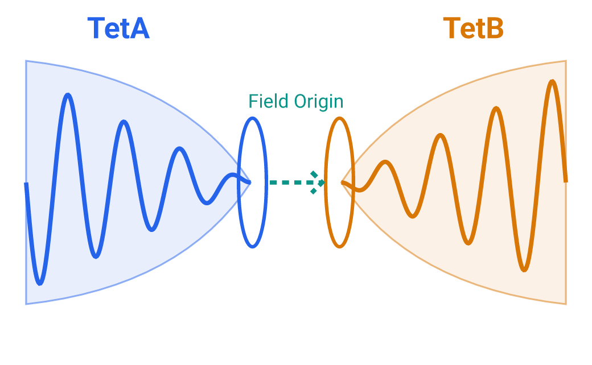

# TetB Is the Subspace: Why 3+1 Spacetime Is TetA
*A synthesis of what the repository already proves about the second root, and the framework positions that follow from it · Gravity Field Dynamics (GFD) · Field Dynamics Research · November 2026*

`tetrad` `TetA` `TetB` `Field Origin` `torsion` `root-blindness` `time faces` `synthesis`

---

**In one paragraph.** The tetrad equation has two roots. The 3+1 spacetime of general relativity is built from the metric, and the metric cannot see which root it came from, so everything spacetime contains (distances, light cones, proper time, geodesics, curvature, Einstein's equation) is one root-blind image. Restricting the frame to the proper orthochronous Lorentz group keeps one root by convention, and that kept root is TetA: GR is the TetA partition. The second root, TetB, is not discarded by the equation; it is discarded by the convention. It has no Christoffel sector of its own, no edge, face or vertex shared with TetA, and no spatial path to it. Its only contact with TetA is the Field Origin, the nonlinear interaction vertex where the two time faces couple. TetB is therefore a subspace of the full field: present in the solution set and in the connection, but not a region of observable spacetime.

**How to read this note.** Each step is graded. **[T]** is a theorem proved in the repository (with the proof linked). **[F]** is a framework position built on those theorems: the GFD reading, stated plainly, not a further theorem.

---

## 1. TetB is the second root, not an addition [T]

Taking determinants of $g = e^{T}\eta\,e$ gives $(\det e)^2 = \det g/\det\eta$: two signs. Spatial parity $P = \mathrm{diag}(1,-1,-1,-1)$ preserves the metric and flips the determinant,

$$ (Pe)^{T}\eta\,(Pe) = e^{T}\eta\,e = g, \qquad \det(Pe) = -\det e. $$

The [scheme proof](proofs/tetrad-scheme-two-bounded-regions/) (+ Lean) shows the solution set has exactly two components, one over each root, exchanged by parity. Under the spatial-realisation premises of [Letter 1](papers/letter-1-tetrad-frame-geometry/) and the [forced frame](proofs/forced-tetrahedral-frame/) (+ Lean), each root realises as a regular tetrahedron and the pair forms the stellated octahedron.

Two consequences matter here:

- **TetB is not reversed time.** Parity leaves the signature and the time leg alone; TetA and TetB are not the conventions $(-,+,+,+)$ and $(+,-,-,-)$.
- **Dropping TetB is a choice.** GR restricts to $SO^{+}(1,3)$ and so keeps one root. The equation itself keeps both, as $x^2 = a$ keeps $\pm\sqrt a$ ([Einstein's equation as the TetA partition](EINSTEIN_TETA_PARTITION.md), §2).

## 2. Spacetime is root-blind, so it is one root's image [T]

The metric is bilinear in the frame, so it is identical on both roots. The [Gram proof](proofs/gram-matrix-tetrad-equation/) (+ Lean) makes this exact for the spatial frame: the self-Gram $M^{T}M = 4I - J$ is the same for $M$ and $-M$, the Gram fixes the frame up to a unique orthogonal map, and for the two roots that map is the reflection $-I$. No rotation-invariant quantity can tell them apart; only orientation can.

Everything general relativity is made of is built from the metric. So the 3+1 spacetime of GR carries no information about which root it came from: it is one structure, not two. With the orientation fixed by the observer's convention, that structure is TetA's.

## 3. TetB lives only where the metric cannot reach: the 24 torsion components [T]

The affine connection has $4^3 = 64$ components: 40 symmetric in the lower pair (Christoffel) and 24 antisymmetric (torsion). [Letter 2](papers/letter-2-other-half-of-gravity-torsion/) and Part IV of the [Gram proof](proofs/gram-matrix-tetrad-equation/) prove:

1. A torsion-free metric connection is fixed by the metric, so it is the same on both roots.
2. Two metric connections differ by a 24-dimensional freedom, mapped one-to-one onto the torsion.
3. Hence the torsion is the **only** place a connection can tell the roots apart. In frame form $T^{a} = De^{a}$ reverses with the spatial legs, exactly as the frame does.

GR sets the torsion to zero, and with it the only room the distinction has. In the index grid, $64 = 16 + 24 + 24$: the torsion-free condition keeps the diagonal and one triangle (shared plus TetA, 40) and discards the other (TetB, 24). TetB has no Christoffel sector of its own, so it never appears as a geodesic, a curvature or a distance in 3+1 spacetime. That is the precise sense of *subspace*: a sector of the full connection outside the metric's image.

## 4. TetB shares no edge, face or vertex with TetA [T]

On the cube, the two roots are the odd- and even-parity corners. Within each class every pair is at the same distance, so each is a regular tetrahedron, and the two are vertex-, edge- and face-disjoint ([Coles notes](GFD_COLES_NOTES.md), "Topology"). The [half-space proof](proofs/half-space-two-bounded-regions/) (+ Lean) shows that of the sixteen half-space selections exactly two are bounded, the two tetrahedra, and their intersection is the octahedron; [Proof 25](proofs/tetrad-flywheel-convergence/) (+ Lean), Theorem 4, shows the other fourteen are unbounded rays.

So there is no spatial bond from TetA to TetB: no shared edge to travel along, no shared face to cross. The octahedral core they share is established inside a common mathematical realisation of the geometry. Physically the two are best read as disjoint domains, $\mathcal X=\mathcal X_A\sqcup\mathcal X_B$, each mapped into that common geometry: their images overlap, the domains do not. The shared octahedron is therefore the common **interaction structure**, not a volume both chambers can reach, which is consistent with the proofs but not established by them.

## 5. The two time faces meet at the Field Origin [F, on T geometry]

*TetA (spacetime) and TetB (subspace): one coupled vortex structure across two distinct domains, coupled only through the Field Origin. Transfer without spatial continuity.*

Each tetrahedron has three faces that look outward and one that looks inward. The inward face is the **time face**; the three outward faces are spatial. That is $1+3$ per tetrahedron ([Coles notes](GFD_COLES_NOTES.md), "(3+1) from faces"). TetA's 3+1 is complete in itself: three spatial faces and its own time face. TetB has its own $1+3$, and its time face also looks inward.

The two time faces are therefore the only faces that point at each other, and they point at the Field Origin. In GFD this is the interaction vertex: the one place the chambers couple. It is **nonlinear**. The coupling is not a sum of linear bonds but a partition: TetA carries $\mu = x/(x+1)$ and TetB carries $1-\mu = 1/(x+1)$ ([Letter 2](papers/letter-2-other-half-of-gravity-torsion/), from exchange symmetry and the odds ratio $\Omega = \mu/(1-\mu) = x$). Two domains can interact in three ways: by spatial transport through the space between them, by resonance through frequency and phase, or by vertex-mediated transfer, leaving one domain and entering the other without crossing space. Spatial transport is ruled out by step 4. The Field Origin permits the other two, through the time faces ([nuclear synthesis](research/nuclear/gfd_nuclear_synthesis.md)): resonance alone in a drainless field, and transfer where a drain is open, as in a galaxy feeding its TetB. Nonlinearity is what makes this possible: the simplest linear coupling between the chambers is exactly a spatial bond, while the lowest nonlinear term transfers occupation with no bond at all ([Field Origin vertex](research/hadamard-null-cone-vortex-flywheel/FIELD_ORIGIN_VERTEX.md)). Anything beyond the Field Origin vertex, and TetB itself, is quantum.

## 6. How TetB shows up in TetA: as response, never as geometry [T + F]

Because TetB has no metric or Christoffel image, it cannot appear in spacetime as matter or curvature of its own. It appears only through the vertex, as the TetB share of the field: at fixed observed acceleration the TetB part is $(1-\mu)g_t = \mu a_0$, the response otherwise read as missing mass ([Letter 3](papers/letter-3-field-closure-of-tetrad-frame/), [The other root](THE_MISSING_MASS.md)). Its state is read from TetA as drive or brake: decoded mass above or below the photometric mass ([decoding-mass letter](papers/letter-decoding-mass-from-rotation-curves/)).

Where a field has no drain, as in a solar system, TetB's share is zero locally and GR holds exactly ([net-field rule](proofs/net-field-rule/) + Lean). That is the same statement from the other side: 3+1 spacetime alone is TetA.

## 7. What this means for the vortex models

Any model that links TetA and TetB sites by direct linear bonds treats TetB as part of TetA's spatial graph. Steps 3–5 say it is not.

- **Proofs 24 and 25 stand unchanged.** Their intrinsic tetrahedral geometry, common Gram matrix, eight-vortex architecture, collective circulation algebra and exact convergence of the representations are exact results, and their Lean formalisations are unaffected. Their circulation currents are exact within the stated [Stage VII model](research/hadamard-null-cone-vortex-flywheel/SUSTAINED_TRIFORCE_FLYWHEEL.md).
- **Stage VII's cross-chamber bonds are an effective model.** Its 48 linear bonds between the chambers stand in for the vertex. Whether they emerge as the linearisation of the nonlinear Field Origin is the open question of the [vertex research](research/hadamard-null-cone-vortex-flywheel/FIELD_ORIGIN_VERTEX.md). If they do, both proofs gain a physical foundation without any change to their mathematics.

## Summary

| Step | Statement | Grade | Where |
|---|---|---|---|
| 1 | TetB is the tetrad equation's second root, exchanged with TetA by parity; not reversed time | T | Scheme proof, Letter 1, forced frame |
| 2 | The metric, and so all of 3+1 spacetime, is root-blind; with the orientation fixed it is TetA's | T | Gram proof, Letter 3 |
| 3 | TetB's only connection-level carrier is the 24 torsion components; it has no Christoffel sector | T | Letter 2, Gram proof Part IV |
| 4 | The two tetrahedra share no vertex, edge or face; their common core is interaction structure, not a shared volume | T (+ F reading) | Half-space proof, Proof 25 |
| 5 | The two time faces meet at the Field Origin, the nonlinear vertex; resonance and nonspatial transfer, no spatial transport; quantum beyond it | F | Coles notes, Letter 2, vertex research |
| 6 | TetB appears in TetA only as the $1-\mu$ response, read as drive or brake; zero where there is no drain | T + F | Letter 3, decoding-mass letter, net-field rule |

**Open:** the vertex law itself, one law with a resonant (drainless) and a transfer (draining) regime, is not yet derived. Its candidate form, exact symmetry properties and the tests it must pass are in the [Field Origin vertex](research/hadamard-null-cone-vortex-flywheel/FIELD_ORIGIN_VERTEX.md) note; the first test is that the drainless regime reproduces the net-field rule.
