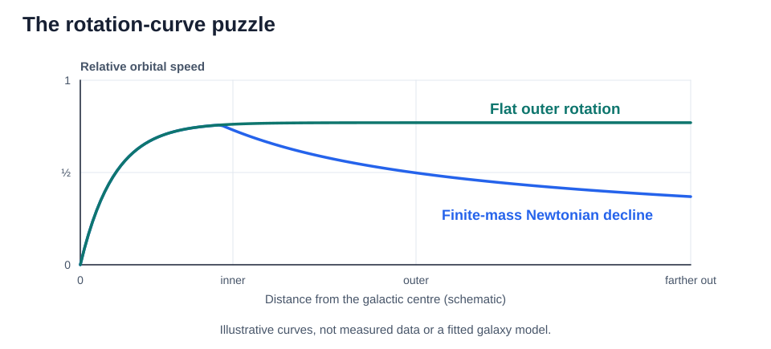
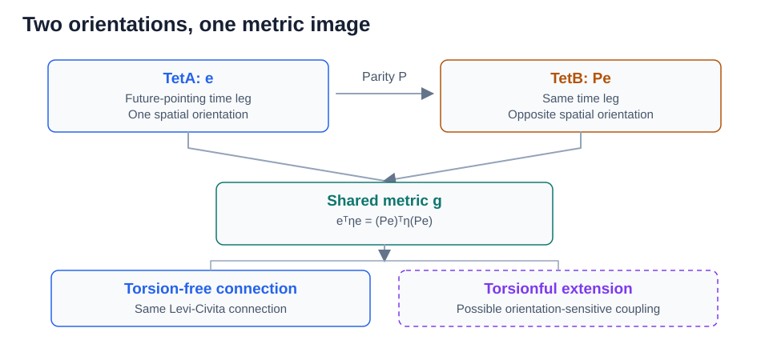
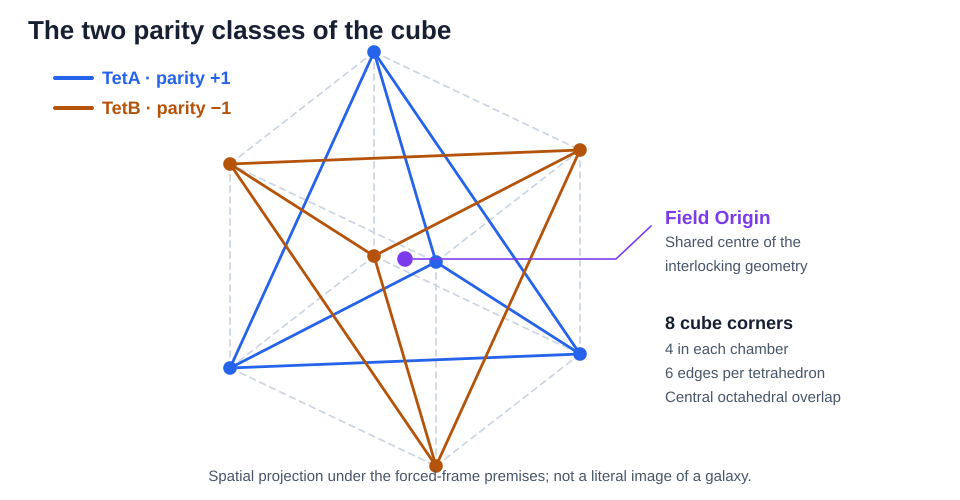
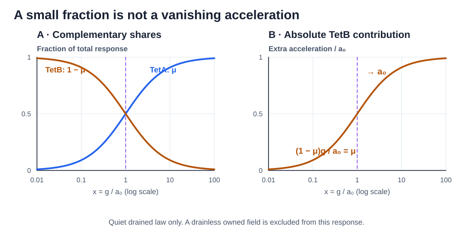
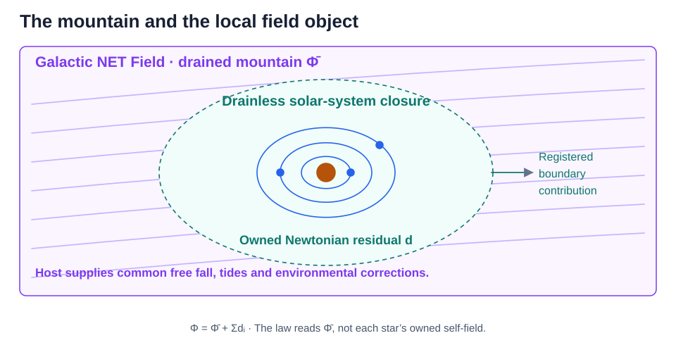
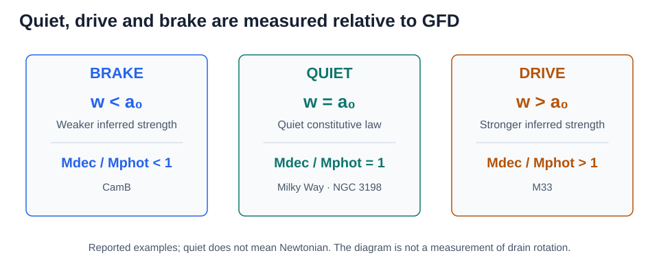

# The Other Root

*For ninety years astronomers have searched for the matter that holds galaxies together. A new reading of Einstein's equations suggests it was never missing. It was set aside.*

**Stephen Nelson** · Field Dynamics Research

---

On a clear autumn night, far from city lights, you can see the Andromeda galaxy with your own eyes: a faint smudge in the constellation that bears its name, light that left its stars two and a half million years ago. It looks still. It is not. Andromeda turns, like a slow pinwheel, its stars circling the centre at hundreds of kilometres every second.

In the late 1960s and 1970s the astronomer Vera Rubin and her colleague Kent Ford set out to measure exactly how fast. They expected the answer every physics student would have predicted. Near the centre, where most of the stars are packed, the orbits should be fast. Farther out, where the stars thin out, the pull of gravity should weaken and the orbits should slow down, just as Neptune creeps around the Sun far more slowly than Mercury does.

That is not what they found. Out at the edge, where the light fades almost to nothing, the stars and the gas between them were still moving as fast as the stars closer in. Galaxy after galaxy showed the same thing. Their rotation curves, the plots of orbital speed against distance from the centre, did not fall. They went flat.

*Figure 1 — The observational puzzle, drawn schematically rather than as measured points from a particular galaxy. The expected curve depends on the actual baryonic distribution; the declining branch illustrates the finite-mass exterior.*

It was as if the galaxies were holding on to their outer stars with far more gravity than the visible matter could supply. Something was missing, and the search for it became one of the great detective stories of modern science.

## The case of the missing mass

Rubin was not the first to notice. In 1933 the Swiss astronomer Fritz Zwicky measured how fast galaxies were moving within the Coma cluster, a swarm of more than a thousand galaxies, and concluded that the cluster should have flown apart long ago unless it contained far more mass than it showed. He called the unseen material *dunkle Materie*: dark matter.

For decades his suggestion sat at the edge of astronomy. Rubin's rotation curves moved it to the centre. If galaxies spin too fast for their visible matter, the reasoning went, then each one must be wrapped in an invisible halo of something else, something that pulls like ordinary matter but neither shines nor absorbs light. The standard model of cosmology holds that this invisible substance outweighs ordinary matter by about five to one.

The idea has real successes, especially on the largest scales of the universe. But no dark matter particle has been conclusively identified. Physicists have built extraordinarily sensitive detectors, deep underground, to catch the rare collision of a dark matter particle with an atomic nucleus. In December 2025 the LUX-ZEPLIN experiment in a former gold mine in South Dakota reported its then-largest dataset, and once again found no sign of the particles it was built to find. This is a historical example of the search, not an assertion about the most recent detector limits or a disproof of all dark matter candidates.

Absence of evidence is not evidence of absence. But after ninety years it is fair to ask whether we have been looking for the right thing.

## Milgrom's clue

In 1983 the Israeli physicist Mordehai Milgrom noticed something about the galaxy data that a missing substance does not easily explain. The discrepancy is organised around an *acceleration*.

Acceleration is how quickly a velocity changes, and gravity is an acceleration: it is the rate at which a falling object picks up speed. At Earth's surface that rate is 9.8 metres per second, every second. Milgrom proposed that the relation between the observed acceleration and the acceleration attributed to baryons departs systematically from Newton's law around a characteristic value, with Newtonian behaviour approached at high acceleration. The transition is gradual, not an on/off switch:

$$a_0 \approx 1.2 \times 10^{-10} \text{ metres per second per second.}$$

That number is almost unimaginably small. Push a toy car with a force that gives it an acceleration of $a_0$, and after an entire year of pushing it would be moving at about four millimetres per second, slower than a snail. It is a whisper of a pull.

To see where it matters, compare it with the actual pull of gravity in different places:

| Where | Pull of gravity | Compared with $a_0$ |
|---|---|---|
| Standing on Earth | 9.8 m/s² | about 80 billion times larger |
| The Sun's pull on Earth | 0.006 m/s² | about 50 million times larger |
| The Sun's pull on Neptune | 0.0000066 m/s² | about 55,000 times larger |
| The Milky Way's pull on the Sun | about 0.0000000002 m/s² | about twice as large |
| The outskirts of a galaxy | below $a_0$ | smaller |
| Andromeda's pull on the Milky Way | roughly 0.0000000000003 m/s² (illustrative estimate) | about 400 times smaller |

The planets sit far above the line. Our Sun, orbiting the centre of the Milky Way, sits near it. The outer reaches of galaxies, and much of the space between them, lie below it. That is where large mass discrepancies become conspicuous. But as we will see, high acceleration alone is **not** GFD's explanation for the precision of Newton and Einstein in the solar system: the field being measured matters as much as its strength.

A missing substance would have to arrange itself, galaxy by galaxy, so that its effects correlate with this characteristic acceleration. That is an important constraint on a halo explanation. Milgrom proposed instead that gravity itself changes its behaviour below $a_0$.

## The dial

Milgrom's idea, made into a proper field theory with Jacob Bekenstein in 1984, is now called MOND, for Modified Newtonian Dynamics. Its heart is a single function, written $\mu$ and pronounced "mew", that acts like a dial.

You feed the dial one number, the ratio of the gravitational pull $g$ to the threshold $a_0$:

$$x = \frac{g}{a_0}.$$

The dial returns a number between 0 and 1. When $x$ is large, the dial approaches 1, the Newtonian limit. When $x$ is small, the dial reads about $x$. For an isolated finite mass in the spherical deep-field limit, orbital speeds stop falling with distance, rotation curves go flat, and a galaxy's baryonic mass becomes tied to the fourth power of its rotation speed. That last relation, discovered in its luminosity form by Brent Tully and Richard Fisher in 1977, has a baryonic counterpart predicted by MOND.

MOND works remarkably well for individual galaxies. In 2016 Stacy McGaugh, Federico Lelli and James Schombert showed that across 153 galaxies the observed gravitational pull follows the pull of the visible matter along a remarkably tight common curve, as MOND expects. Dark matter models must explain that regularity as well.

MOND has a gap of its own, though. Its limiting conditions tell you what the dial must do at the two extremes, but not what it does in between. Infinitely many functions behave correctly at both ends. GFD asks whether a geometric mechanism can select the function rather than leave it to phenomenological choice.

## The second root

To see where Gravity Field Dynamics, or GFD, enters the story, start with an equation every schoolchild meets:

$$x^2 = 4.$$

It has two answers, $x=2$ and $x=-2$, and the equation does not prefer either. Its complete solution is the pair. If you are measuring the side of a square, however, you have a legitimate extra condition: lengths are positive. That condition comes from the problem, not from squaring the number.

Einstein's general relativity contains a relation with a similar ambiguity. In its tetrad formulation, gravity is described using a local frame of four directions at every point of spacetime, one timelike and three spacelike. The metric is built by a quadratic contraction of that frame. In particular the square of the frame determinant is fixed by the metric, while its sign is not. Hold the time leg fixed and future-pointing, and the two orientation sectors are related by spatial inversion. They are not merely two individual frames; each also allows continuous rotations.

Standard oriented tetrad gravity can choose one sector consistently. The metric alone cannot see which was chosen. Independently, general relativity uses a torsion-free metric connection: of its 64 possible connection slots, 24 antisymmetric combinations are set aside. In GFD's reading, those combinations provide the sector in which the orientation-sensitive contribution of TetB can reside. The algebra establishes that the Levi-Civita connection is root-blind; it does not, by itself, establish that the excluded orientation is an independent gravitating field. Whether that distinction is physically active on the scale of a galaxy is exactly the question.

*Figure 2 — Two orientations, one metric image. The torsion-free projection is a separate operation from frame parity; GFD proposes a physical link between them.*

Physics has been here before. In 1928 Paul Dirac wrote down an equation for the electron that had solutions with negative energy. Dirac took the additional solutions seriously, and in 1932 Carl Anderson found the positron. That is a precedent for investigating an apparently redundant branch, not a proof that gravitational orientation sectors behave like antimatter.

GFD asks a related question of Einstein's tetrad. What if the second root is not spare, but real?

## Two tetrahedra in a cube

When you draw the four arrows of a tetrad in space, retaining equal magnitudes, equal pair relations and distinct legs as specified in the [forced-frame proof](proofs/forced-tetrahedral-frame/), they are forced into a perfect shape: they point from the centre of a regular tetrahedron to its four corners. The mirror-image root points to the opposite four corners. Together the two tetrahedra interlock to form an eight-pointed star, the stellated octahedron, which fits exactly inside a cube, each tetrahedron taking alternate corners.

GFD calls the two tetrahedra TetA and TetB. TetA represents the observable spacetime sector. TetB is its dual chamber, and the shared central coupling locus is called the Field Origin. The geometric overlap is a central octahedron, not just a single point; the Field Origin is the centre and the framework's proposed coupling throat.

*Figure 3 — A spatial projection of the two tetrahedra with labelled parity classes. The proof of the geometry and the physical identification of the two Field Chambers are distinct steps.*

The claim is that gravity's field is shared between these two chambers, and that the dial $\mu$ measures the share carried by TetA. When $\mu=1$, the gravitational response is TetA alone. When $\mu$ is small in a drained field, the complementary TetB share of the response is large. This does not mean that the outer region of a galaxy is literally the TetB chamber: TetB is the occupied throat interior, whose gravitational response is read in the exterior. What astronomers have been calling dark matter is, in this picture, a gravitational discrepancy produced by that second chamber rather than an additional material halo.

## A tug of war

Here is the simplest way to see what the dial does. Picture a rope with a flag tied at its middle, and two teams pulling on it from opposite ends. However hard they pull, the rope never gets longer; all that changes is how much of it each team holds.

In the quiet drained-field model, TetA pulls with the total local gravitational field $g$, and TetB pulls with the fixed strength $a_0$. Each team's share of the rope is its own strength divided by the two together:

$$\mu = \frac{g}{g+a_0} = \frac{x}{x+1}.$$

When the pull weakens to $a_0$, the two teams pull equally and the flag sits at the middle: each chamber carries half the response. In the outskirts of a galaxy, $g$ can be far below $a_0$, and TetB holds most of the rope. In strong regions of a drained field, TetA's fractional share approaches unity.

*Figure 4 — Left: the shares. Right: although the TetB fraction tends to zero at high acceleration, its absolute acceleration tends to $a_0$. The right-hand panel is why the same law cannot simply be applied to every solar-system source.*

Of all the functions MOND allows, why this one? The archive's proofs, with algebraic cores checked in Lean, give a precise answer. Swapping the two chambers motivates the exchange symmetry. Applied to the specified screening-balance family, it forces the odds between the teams to be a simple power of $x$. Only one power makes isolated outer rotation curves flat, and it is the same power for which both teams' strengths enter linearly as accelerations. That power gives $x/(x+1)$. It is the curve astronomers call MOND's "simple" function. Exchange alone does not select it from all possible functions; the screening and degree-one premises matter.

There is a striking consequence. Each team carries its share of its own strength, so the quiet field splits as

$$g=\mu g+\mu a_0.$$

TetA carries the familiar source part, $\mu g$. TetB carries $\mu a_0$, which can grow towards $a_0$ but can never exceed it in this quiet law, however much mass is present. The extra acceleration has a ceiling, and the ceiling is $a_0$.

## The vortex

Watch water drain from a bathtub. It rarely goes straight down. Any slight swirl in the water is concentrated as it moves inward, and the column of water is stretched as it falls through the drain, which spins it faster still. A small leaf floating on the surface rides the flow and traces its shape, but the leaf alone does not set the strength of the vortex. The drain matters. Close the drain, and the swirl slowly spreads and dies.

GFD reads a galaxy the same way. The stars and gas we see are the leaves: they ride the flow and trace it, while their mass also sources the gravitational field. TetA is the observable exterior. TetB lies beyond the throat of the vortex, past the Field Origin, where we cannot look directly. We infer its proposed response by watching what we can see, the way you would know a drain was open by watching the leaves.

Fluid physics even supplies an exact picture of a steady drain. In 1948 the Dutch physicist Jan Burgers found the precise solution for a vortex in which the inward strain, stretching of the column and spreading caused by viscosity balance. For fixed circulation and viscosity, stronger strain tightens the core and increases its characteristic speed; weaker strain lets it spread. Far from the core the azimuthal flow depends on circulation and radius rather than strain. The [tug-of-war proof](proofs/constitutive-law-tug-of-war/) uses this as a mathematical analogue, not as a derivation that a galaxy is a fluid drain.

If galaxies are vortices with a TetB drain, why does the solar system show no corresponding self-field anomaly? Every object's enclosed gravitational content contributes to its measured $GM$; the detailed exterior field also carries shape and multipoles. But the decisive distinction is that a solar system has its own field closure and, in GFD, no drain in its mutual gravitational field. The solar system's own field is read linearly, in TetA. Meanwhile the whole solar system rides inside the galaxy's vortex like a pebble in a stream. Zoom in and the host field looks nearly like a uniform slope: everything falls with it together, while the small curvature of the slope, the tide, remains. Zoom out and the galactic slope is apparent.

*Figure 5 — The net-field rule. The star system and the galaxy are both Field Objects. Only the galaxy's drained accounting uses the full constitutive response; the host still supplies tides and environmental effects.*

This is the newer [net-field rule](proofs/net-field-rule/) and [mountain-scale construction](proofs/sst-mountain-scale/). It supersedes the older explanation that large $g$ alone hides TetB in the solar system. The constitutive law would actually leave an absolute extra pull approaching $a_0$ if applied pointwise to a star's own field. Such a tail is constrained by planetary observations. GFD instead excludes that owned internal field from the drained response, under the assumptions of the static construction. For the full architectural story see [Closure of Closures](CLOSURE_OF_CLOSURES.md) and [Snapshot Accounting](FIELD_CLOSURE_AND_SNAPSHOT_ACCOUNTING.md).

## Quiet, drive and brake

The tug of war gives a new way to read a galaxy. If you know how fast its stars move, you can work out the total gravitational pull at each distance from its centre. If you know how much starlight and gas it holds, you can estimate the pull of its visible matter. A [companion paper](papers/letter-decoding-mass-from-rotation-curves/) turns the observed speeds into a "decoded" mass using the dial, and compares it with the mass inferred from the light.

The tug-of-war picture says what that comparison measures under its assumptions. At each radius, it infers a strength $w$ for TetB, set against the standard strength $a_0$. When the two masses agree, $w=a_0$ and the galaxy's interior is quiet. When the decoded mass is larger, $w>a_0$: drive. When it is smaller, $w<a_0$: brake. The Milky Way and NGC 3198 come out close to quiet, M33 shows drive, and CamB shows brake in the archive's examples. Quiet does not mean Newtonian: it means the visible mass agrees with the quiet GFD law, which can itself give a large TetB response. Co-rotation and counter-rotation of the drain are proposed mechanisms; the inferred mass discrepancy alone does not measure the drain's rotation.

*Figure 6 — The mass-decoding dictionary, not new measurements of the named galaxies.*

The same arithmetic explains why a given change in the inferred strength shifts decoded mass by tens of per cent in a galaxy's faint outskirts but much less in a high-acceleration drained field. In the solar system the stronger explanation is the distinct drainless accounting rule, not a small residual drive or brake.

## How to test it fairly

Any new idea about gravity has to be testable, and this one has a subtlety worth spelling out. Because the observed speed of a star already includes the putative TetB share, any alternative law, looked at one galaxy at a time, can be expressed as an effective drive or brake. Fitting rotation curves galaxy by galaxy cannot on its own tell the difference.

What can help tell the difference is the pattern across many galaxies. A universal error in the constitutive law can show up as a common apparent drive or brake at the same acceleration. Genuine drive and brake are proposed to belong to each galaxy's own drain and may vary with its state. So a fair test is to stack hundreds of galaxies and ask whether the average inferred strength, after controlling for selection, environment and errors, is flat at $a_0$. Another law leaves a fingerprint: the exploratory "bound" law GFD studies for nuclear systems would, if applied to galaxies, produce an inferred strength of the golden ratio, 1.618 times $a_0$, at $x=1$ (the quiet-law equal-share point).

The test has pitfalls of its own. Measurement errors in a star's speed enter both sides of the comparison and can masquerade as drive or brake at the extremes, so any honest analysis must simulate those errors first. And because $a_0$ was itself measured from galaxies, the shape of the result, not just its overall level, is informative. But the test is clear, and the data to run it already exist. The [SPARC letter](papers/letter-radial-acceleration-relation-sparc/) reports 0.181 dex scatter over 164 galaxies and 3,284 radial bins using a shared $a_0$ and fixed mass-to-light assumptions, indistinguishable at that precision from the empirical RAR fit. It does not distinguish GFD from simple-function MOND by itself.

The proposed closure rule offers a different test: bound wide binaries should have Newtonian mutual gravity in the current construction, and the idealised spherical closure calculation predicts no anomalous Cassini quadrupole at the calculated order. These tests probe where the law acts, not merely which shape the dial has. Their assumptions and limitations are explained in [Einstein's TetA Partition](EINSTEIN_TETA_PARTITION.md).

## What is proven, and what is not

It is worth being precise about what this story rests on, because the difference between mathematics and physics matters here.

The mathematical results include the two determinant roots of the tetrad equation, their spatial parity relation with fixed future time leg, the forced tetrahedral projection under its stated premises, the connection split, the conditional screening-law derivation and the mass-decoding identity. The repository contains proof-assistant checks of algebraic cores and scripts testing finite geometry and numerical examples. The detailed assumptions and narrower formal results are recorded in the [proof index](proofs/README.md).

The physics rests on clearly stated premises. That the second orientation has a physical gravitational role is the central one. That the quiet TetB strength is a fixed acceleration, $a_0$, is another; the RAR comparison uses the common empirical value (other research proposes its origin). That galaxies are vortices with an occupied TetB drain is the framework's picture, not yet derived from full dynamics. The fixed-ownership static closure proof gives a concrete local mechanism; general drained-to-parent registration, the torsion-to-effective-action derivation, moving boundaries, full cosmological perturbations and decisive observational discrimination remain open.

## The root that was set aside

There is something quietly satisfying in the shape of this story. For ninety years astronomers have looked for the missing mass in the sky and in detectors deep underground. GFD suggests looking somewhere else: in the algebra of an equation we have been using for a century, at the orientation sector it does not distinguish.

Einstein's equations are not discarded in this picture. They describe the TetA response that GFD recovers in a drainless system's internal field, at the orders established. Galaxies may expose a larger field structure because their own drained accounting includes the other chamber's constitutive response. If that turns out to be true, the missing mass was never missing. It was on the other side of the drain all along.

---

### Further reading

- V. C. Rubin and W. K. Ford, *Rotation of the Andromeda Nebula from a Spectroscopic Survey of Emission Regions*, Astrophysical Journal 159, 379 (1970).
- F. Zwicky, *Die Rotverschiebung von extragalaktischen Nebeln*, Helvetica Physica Acta 6, 110 (1933).
- M. Milgrom, *A modification of the Newtonian dynamics as a possible alternative to the hidden mass hypothesis*, Astrophysical Journal 270, 365 (1983).
- J. Bekenstein and M. Milgrom, *Does the missing mass problem signal the breakdown of Newtonian gravity?*, Astrophysical Journal 286, 7 (1984).
- R. B. Tully and J. R. Fisher, *A new method of determining distances to galaxies*, Astronomy and Astrophysics 54, 661 (1977).
- S. S. McGaugh, F. Lelli and J. M. Schombert, *Radial Acceleration Relation in Rotationally Supported Galaxies*, Physical Review Letters 117, 201101 (2016).
- P. A. M. Dirac, *Quantised singularities in the electromagnetic field*, Proceedings of the Royal Society A 133, 60 (1931); C. D. Anderson, *The positive electron*, Physical Review 43, 491 (1933).
- J. M. Burgers, *A mathematical model illustrating the theory of turbulence*, Advances in Applied Mechanics 1, 171 (1948).
- LZ Collaboration, *LZ sets a world's best in the hunt for galactic dark matter*, Lawrence Berkeley National Laboratory (8 December 2025), [newscenter.lbl.gov](https://newscenter.lbl.gov/2025/12/08/lz-sets-a-worlds-best-in-the-hunt-for-galactic-dark-matter/).
- The GFD archive: [the tug-of-war proof](proofs/constitutive-law-tug-of-war/), [Einstein's equation as the TetA partition](EINSTEIN_TETA_PARTITION.md), and [the decoding-mass letter](papers/letter-decoding-mass-from-rotation-curves/).
- Continue with [Closure of Closures](CLOSURE_OF_CLOSURES.md) for the general-reader explanation of local gravitational accounting.
