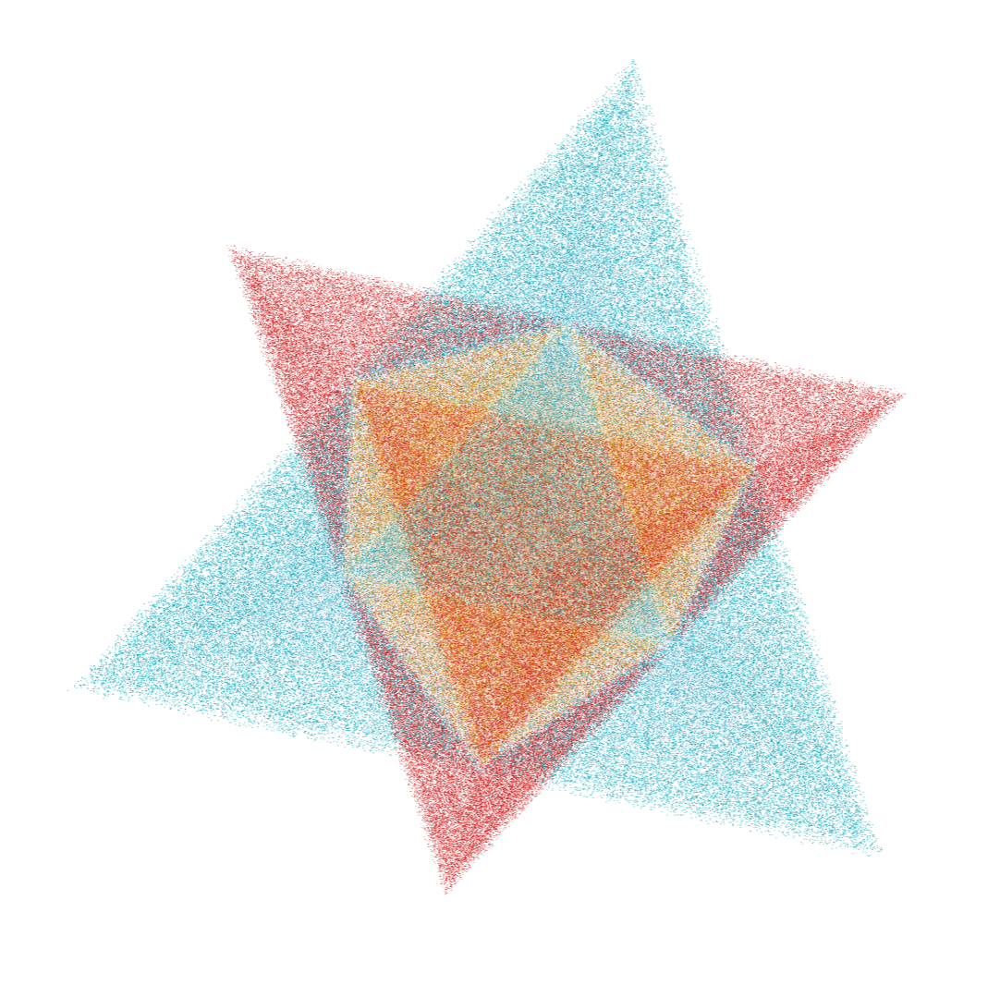

# The Coordinate-Space Geometry of the Tetrad Frame

*Letter 1 of the tetrad letters: one orthonormal tetrad, four half-space inequalities, and the stellated octahedron they force · Gravity Field Dynamics (GFD) · Field Dynamics Research*

`tetrad` `vierbein` `half-space` `stellated-octahedron` `octahedron` `Sierpinski` `K=4` `D=3`

---

A four-page Letter with two figures, submitted to *Classical and Quantum Gravity* (CQG-115428). It is the first of three letters; Letters 2 and 3 build on it. A validation script checks 29 claims, and two supplementary notes come with it.



## The argument in one paragraph

Start from a single orthonormal tetrad, with no second frame.
- **Four directions.** The signature (−,+,+,+) maps null directions to the unit sphere. Asking for four directions with no net preferred direction fixes the regular tetrahedral frame, with pairwise inner product −1/3. Its four projections are v₁ = x+y+z, v₂ = x−y−z, v₃ = −x+y−z, v₄ = −x−y+z.
- **Sixteen regions.** Each projection gives two half-spaces, so there are 2⁴ = 16 intersections.
- **Exactly two are bounded.** Since v₁ + v₂ + v₃ + v₄ = 0, the region with all four signs kept is bounded (TetA: max vᵢ ≤ 1), and so is the region with all four flipped (TetB: max(−vᵢ) ≤ 1). Every mixed choice is unbounded, because the flipped normal is a positive combination of the others.

TetB was never constructed: it emerges as the unique second bounded region. The two tetrahedra intersect in a regular octahedron (|vᵢ| ≤ 1), and their union is the stellated octahedron. Each face is cut by the opposing vertex into 3 corners plus 1 central core, the first Sierpiński level, which gives **4 × 4 = 16 boundary channels**.

## Results

| Section | Result |
|---|---|
| Four planes | The regular tetrahedral frame from the signature (proved in the supplementary note); its four projections as half-spaces; TetA as the region where all four are bounded |
| The emergent geometry | Of the 16 sign combinations exactly two are bounded, TetA and TetB. Their intersection is a regular octahedron and their union the stellated octahedron (Kepler's stella octangula). Each face splits 3 + 1 (Figure 2), giving 16 channels |
| Structural inventory | Every count reduces to K = 4 faces and D = 3 dimensions: 2 tetrahedra, 2^D = 8 vertices, K × D = 12 edges, 2K = 8 faces, K² = 16 channels, f-vector (8, 12, 8) with sum K(K + D) = 28, and V − E + F = 4 for two disjoint closed surfaces |
| Discussion | Each tetrahedron has a 3 + 1 face split matching the signature. The metric is quadratic in the tetrad, so parity-related frames give the same g_μν: TetA and TetB are two tetrad-level realisations of one metric. The geometry precedes any action or field equation |

## Figures

| Figure | File | What it shows |
|---|---|---|
| 1 | [`fig1_tetrad_frame.png`](fig1_tetrad_frame.png) | Four million points classified by the four inequalities: TetA blue, TetB red, the octahedral core gold. Interactive version: [`Supplementary/fig1_tetrad_frame.html`](Supplementary/fig1_tetrad_frame.html) |
| 2 | drawn in TikZ in [`letter.tex`](letter.tex) | One face of TetA, (a) whole and (b) cut by TetB's vertex into three corners and one inverted core |

## Contents

| File | What it is |
|---|---|
| [`letter.pdf`](letter.pdf), [`letter.tex`](letter.tex) | The Letter. [`Nelson_2026_Geometry_of_the_Tetrad_Frame.pdf`](Nelson_2026_Geometry_of_the_Tetrad_Frame.pdf) is the same text under its distribution name |
| [`letter - Copy.tex`](letter%20-%20Copy.tex) | An earlier draft, without the 3 + 1 face remark, the "square root of the metric" paragraph or the scheme-proof reference |
| [`cover_letter.pdf`](cover_letter.pdf), [`cover_letter.tex`](cover_letter.tex) | Cover letter to *Classical and Quantum Gravity* |
| [`justification.pdf`](justification.pdf) | Justification for accelerated publication |
| [`build_letter.bat`](build_letter.bat) | Windows build script |
| [`Supplementary/run_all_validations.py`](Supplementary/run_all_validations.py) | Validation script: 29 claims (NumPy, SciPy) |
| [`Supplementary/supplementary_signature_to_frame.pdf`](Supplementary/supplementary_signature_to_frame.pdf) | *From the Lorentz Signature to the Tetrahedral Frame*: the four directions from the signature |
| [`Supplementary/supplementary_scheme_proof.pdf`](Supplementary/supplementary_scheme_proof.pdf) | *The Tetrad Scheme and the Two Bounded Regions*: an independent derivation from the quadratic structure of the tetrad equation |
| [`Supplementary/research/`](Supplementary/research/) | Working notes, not part of the submission: the exterior-algebra derivation, the "Grothendieck X-ray", K-theory and descent explorations, and *Two Rows of Pascal's Triangle* (the subset bijection) |
| [`Frameworks/`](Frameworks/) | The writing guides used to draft the letters |

## Running the checks

```
cd Supplementary
python run_all_validations.py
```

It ends with `29/29 claims verified. 0 failures.`

## Later work in this repository

These build on the Letter. They do not change it.
- **Letter 2**, [`../letter-2-other-half-of-gravity-torsion/`](../letter-2-other-half-of-gravity-torsion/): a torsion-free connection cannot tell TetA from TetB, and TetB carries the field fraction 1/(x + 1).
- **Letter 3**, [`../letter-3-field-closure-of-tetrad-frame/`](../letter-3-field-closure-of-tetrad-frame/): the 40/24 split of the connection, and field closure.
- **The scheme proof, revised**, [`proofs/tetrad-scheme-two-bounded-regions/`](../../proofs/tetrad-scheme-two-bounded-regions/): exactly two connected components, one over each root, carried into each other by spatial parity.
- **The forced frame**, [`proofs/forced-tetrahedral-frame/`](../../proofs/forced-tetrahedral-frame/): the legs are forced to a regular tetrahedron, and three is the only dimension where the shape is forced.
- **The cube and Hadamard**, [`proofs/hadamard-cube-frame/`](../../proofs/hadamard-cube-frame/): a simplex and its parity image fill the cube only for D = 3, which is the content of 2(D + 1) = 2^D.
- **The null cone**, [`papers/null-cone-boolean-operator/`](../null-cone-boolean-operator/) and [`proofs/g-null-rotation/`](../../proofs/g-null-rotation/): the star's eight points as the null cone sampled at eight directions, and the 16 channels as the Sierpiński blocks of G's graded operator.
