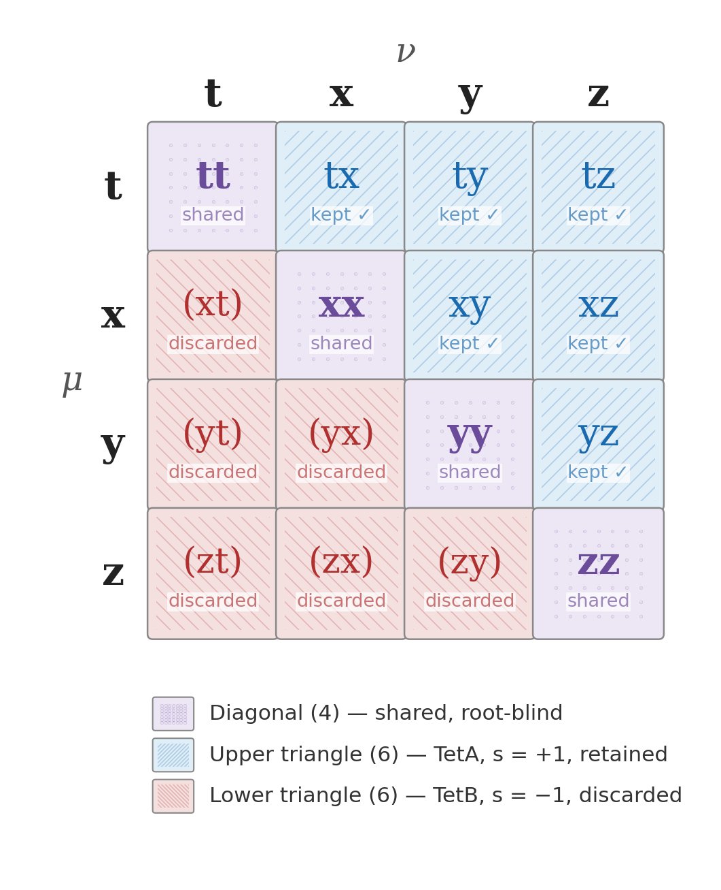

# Gravity Field Dynamics: Field Closure of the Tetrad Frame

*Letter 3 of the tetrad letters: the torsion-free condition keeps 40 connection components and discards 24, and restoring them closes the field · Gravity Field Dynamics (GFD) · Field Dynamics Research*

`tetrad` `torsion` `affine-connection` `coupling-polynomial` `constitutive-law` `AQUAL` `covariant-action` `field-closure`

---

A six-page Letter with two figures, prepared for *Classical and Quantum Gravity* (cover letter included). It is the third and final letter in the sequence with Letter 1 (CQG-115428) and Letter 2 (CQG-115447). It comes with supplementary notes and a validation script that checks 52 claims.



## The argument in one paragraph

The affine connection Γ^λ_μν on a K = 4 frame has K³ = 64 components. For each upper index λ, the lower pair (μ, ν) is a 4 × 4 matrix (Figure 1, above). The torsion-free condition Γ^λ_μν = Γ^λ_νμ sets each mirror pair equal, so it keeps:
- the 4 diagonal entries;
- 6 symmetric combinations of off-diagonal pairs.

That is **10 kept and 6 discarded per face, 40 kept and 24 discarded across four faces.**

The same split is read from the coupling polynomial f(K, s) = 1 + sK + K²: remove the field-origin term 1 and halve for the mirror pairs.
- kept: (f(4, +1) − 1)/2 = (21 − 1)/2 = 10;
- discarded: (f(4, −1) − 1)/2 = (13 − 1)/2 = 6.

Letter 2 identified s = +1 with TetA and s = −1 with TetB, so the 24 discarded components are the second root of the tetrad equation. Restoring them gives the full 64-component connection: **field closure**.

## Results

| Section | Result |
|---|---|
| 1. The torsion-free projection | 40/24 split per face and in total; the polynomial form of the split; the ±K separating 10 from 6 is the parity-odd sK term. Field closure is defined as all K³ components of the connection being active. It is distinguished from Einstein's "complete field theory", from geodesic completeness and from Einstein–Cartan, where torsion couples to spin and vanishes in vacuum |
| 2. The partition in space | TetA carries μ(x) = x/(x+1) and TetB carries 1 − μ = 1/(x+1). The two surfaces are mirrors that cross on the ring x = 1 (μ = ½), the MOND transition scale (Figure 2). They satisfy the logistic identity x dμ/dx = μ(1 − μ), which peaks at ¼ on the ring. The radial acceleration relation follows: g_bar = g_obs²/(g_obs + a₀) |
| 3. From partition to action | The partition gives a disk-and-bulge morphology, a TetB field bounded by a₀ (no central cusp) and no new particles. Integrating μ gives the unique kinetic functional F(y) = y − 2√y + 2 ln(1 + √y). Long division u²/(u+1) = u − 1 + 1/(u+1) maps F's three terms to the polynomial's three levels K², sK and K⁰; the remainder 1/(u+1) is the TetB fraction. F fixes the scalar sector of the four-term covariant action, the SST (below) |
| 4. Data and reproducibility | Lists the interactive figure, the validation script and the supplementary notes |

The SST, the GFD covariant action, as stated in Eq. (13):

$$S = \int d^4x\,\sqrt{-g}\left[\frac{R}{16\pi G} - \frac{a_0^2}{8\pi G}F\!\left(\frac{|\nabla\Phi|^2}{a_0^2}\right) - \frac14 e^{-2\Phi/c^2}F_{\mu\nu}F^{\mu\nu} + \mathcal L_{\rm matter}\right]$$

Φ is the standard gravitational potential, not a new field: the partition changes its response, not its identity. Varying with respect to Φ gives the Bekenstein–Milgrom equation ∇·[μ∇Φ] = 4πGρ in the quasi-static limit. The Letter states γ = 1 at all accelerations and that gravitational waves travel at c.

## Figures

| Figure | File | What it shows |
|---|---|---|
| 1 | [`fig1_matrix.png`](fig1_matrix.png) | The 4 × 4 (μ, ν) matrix for one face λ, rows and columns t, x, y, z. The diagonal (4) is shared and root-blind. The upper triangle (6) is TetA, s = +1, kept. The lower triangle (6) is TetB, s = −1, discarded. The same pattern holds for all four λ. Rendered by [`Figures/render_table1_matrix.py`](Figures/render_table1_matrix.py) |
| 2 | [`fig2_tetrad_partition.png`](fig2_tetrad_partition.png) | μ (blue, TetA) and 1 − μ (red, TetB) as surfaces of revolution over radius. They sum to 1 everywhere, and the white ring marks x = 1. Interactive version: [`Supplementary/figure2_tetrad_partition.html`](Supplementary/figure2_tetrad_partition.html) |

## Contents

| File | What it is |
|---|---|
| [`letter.pdf`](letter.pdf), [`letter.tex`](letter.tex) | The Letter |
| [`cover_letter.pdf`](cover_letter.pdf), [`cover_letter.tex`](cover_letter.tex) | Cover letter to *Classical and Quantum Gravity* |
| [`justification.pdf`](justification.pdf) | Submission justification |
| [`Supplementary/run_all_validations.py`](Supplementary/run_all_validations.py) | Validation script: 52 claims (the polynomial identity, the 40/24 split, the partition, the logistic identity, the RAR, both limits of F) |
| [`Supplementary/proof_polynomial_40_24.tex`](Supplementary/proof_polynomial_40_24.tex) | *The Coupling Polynomial Generates the 40/24 Split*: step-by-step proof |
| [`Supplementary/supplementary_covariant_completion.tex`](Supplementary/supplementary_covariant_completion.tex) | *Covariant Completion*: the four-term action from the constitutive law, the prefactors, the EM coupling, and γ = 1 (its Section 3) |
| [`Supplementary/supplementary_chiral_holonomy.tex`](Supplementary/supplementary_chiral_holonomy.tex) | *Chiral Holonomy of the Closed Tetrad Frame*: supplementary material |
| [`Supplementary/supplementary_vortex_closure.md`](Supplementary/supplementary_vortex_closure.md) | Supplementary note: from 24 = D × 2K to vortical closure |
| [`Supplementary/eight_channel_structure.html`](Supplementary/eight_channel_structure.html) | *The Eight-Channel Structure*: interactive page |
| [`Figures/`](Figures/) | Script for Figure 1 |
| [`Einstiens tetA gap/`](Einstiens%20tetA%20gap/) | Discovery-stage synthesis (Einstein's equation as μ, the Gram matrix, the 64 components), not in the submitted Letter |
| [`research/`](research/) | Working drafts of Letters 1–2 material, supplementary proofs and interactive pages |
| [`letter 4 staging/`](letter%204%20staging/) | Draft of a following letter, *Field Closure of General Relativity* |
| [`archive/`](archive/) | Earlier versions of the Letter and interactive pages |

## Running the checks

```
cd Supplementary
python run_all_validations.py
```

It ends with `52/52 claims verified. 0 failures.`

## Later work in this repository

These build on the Letter. They do not change it.
- **The SST in its quasi-static limit:** [`proofs/sst-quasi-static-limit/`](../../proofs/sst-quasi-static-limit/). This derives the field equation, γ = 1 (Ψ = Φ from the curvature term), the spherical field equation with its solver and decoder, and Tully–Fisher from the action above, read as the framework reads it.
- **The SST's y made covariant:** [`proofs/sst-covariant-time-leg/`](../../proofs/sst-covariant-time-leg/). y is the acceleration of the tetrad's time leg, and Φ is the lapse of the metric.
- **The torsion sector:** [`proofs/torsion-regular-representation/`](../../proofs/torsion-regular-representation/). The 24 discarded components carry the regular representation of S₄.
- **The energy functional:** [`proofs/aqual-energy-functional/`](../../proofs/aqual-energy-functional/). This proves the closed form and convexity of F.
- **The solar system:** the Letter says the second root contributes less than one part in a million there. The later reading in the Coles Notes (§5.4) is stronger: a bound system such as the solar system is pure TetA, and μ applies to the host galaxy's net field rather than to each mass.
