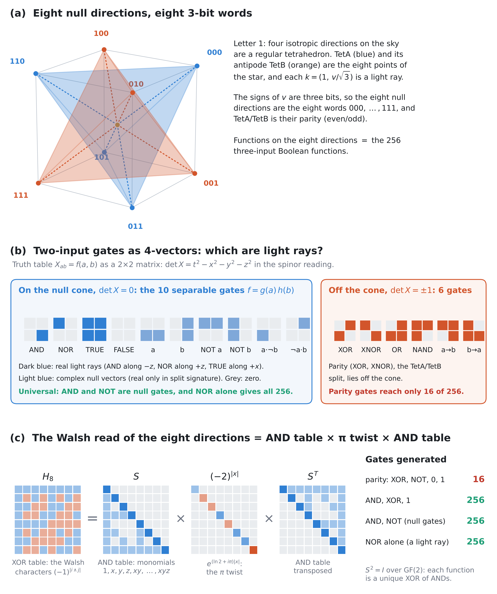

# The Null Directions of the Tetrad Frame Carry a Complete Boolean Basis

*When the null cone of the tetrad frame is a universal Boolean operator, and where that universality comes from · Gravity Field Dynamics (GFD) · Field Dynamics Research*

`null-cone` `tetrad` `stellated-octahedron` `Boolean-functions` `functional-completeness` `Walsh-Hadamard` `algebraic-normal-form` `null-rotation`

---

A four-page paper with one figure, and a script that checks every statement (18 checks, exact arithmetic, closures exhaustive over all 256 three-input functions). Status: manuscript in preparation.



## The question

Letter 1 derives the stellated octahedron from the null cone. Four null directions that pick out no spatial direction form a regular tetrahedron, and with their opposites they are the star's eight points. [`universe-is-pixelated/`](../../research/universe-is-pixelated/) then states a claim: the null cone of every event, sampled at those eight directions, is a universal Boolean operator. This paper makes the claim precise and proves it in the strong sense.

"Universal" has two meanings:
- **Representation.** Every Boolean function can be written on the eight points. This is true, but it holds for any eight labelled points.
- **Gate universality (functional completeness).** Composing the gates gives every Boolean function. This is the meaning that says something about the structure.

## Results

**1. The eight null directions are the eight 3-bit words (Proposition 1).** The signs of each direction's spatial part are three bits. TetA and TetB are the words with an even and an odd number of 1s. So functions on the null directions are exactly the 256 three-input Boolean functions.

**2. Every function can be represented, but parity is not universal (Proposition 2, Theorem 1).**
- **Representation.** The Walsh–Hadamard matrix represents every function.
- **Parity is limited.** Each Walsh character, and the TetA/TetB split itself, is a parity: XOR-only, or "affine". Composing parity gates (XOR, NOT, 0, 1) reaches only 16 of the 256 functions, so by Post's theorem parity alone is never universal.
- **The node.** The octahedral node computes NAND and the full adder because its readout is a real linear combination of Walsh coefficients, not because parity gates are universal.

**3. The Walsh read factors into an AND table and an XOR table (Theorem 2).**

$$H_8 = S \cdot \operatorname{diag}\big((-2)^{\text{popcount}}\big) \cdot S^{T}$$

- **S is the AND table.** S is the Sierpiński matrix, and it is exactly the table of the eight AND gates (1, x, y, z, xy, xz, yz, xyz) at the eight corners.
- **S is its own inverse mod 2,** so every function is a unique XOR of ANDs (its algebraic normal form).
- **The middle factor is a half-turn per bit,** (−2)^n = e^{(ln 2 + iπ)n}.
- **So the read splits into the two halves of a universal gate set:** AND (outside) and XOR (the π sign in the middle).

**4. The light rays of the two-bit block are a universal gate set (Theorem 3 and Corollary).** Read a two-input gate's truth table as a 2×2 matrix X, with the two bits as spinor indices. Then det X is the Minkowski norm:

| | Gates | Minkowski norm |
|---|---|---|
| **On the null cone** | FALSE, TRUE, AND, NOR, a, b, NOT a, NOT b, a·¬b, ¬a·b: exactly the separable gates f = g(a)·h(b) | 0 |
| **Off the cone** | XOR, XNOR, OR, NAND, a→b, b→a | ±1 |

- **Three of them are real light rays:** AND along −z, NOR along +z, TRUE along +x. FALSE is the zero vector, and the rest are complex null vectors.
- **AND is the light ray fixed by the Sierpiński null rotation** of [`proofs/g-null-rotation/`](../../proofs/g-null-rotation/).
- **The null gates are universal:** they include AND and NOT, and NOR, a real light ray, is universal on its own.
- **Parity lies off the cone.**

## What it does not claim

- **Physical light.** It does not show that physical light computes, or that a lattice of photons is a computing medium. Those remain the archive's interpretation.
- **Standard ingredients.** Post's theorem, the algebraic normal form, NOR's universality and the spinor–vector correspondence are standard. What's new is their placement on the frame.
- **The real form matters.** Only AND, NOR and TRUE are real light rays in Minkowski signature. The other null gates are real only in split signature.
- **The 10 + 6 split is not claimed to be related.** The ten null and six non-null gates are a different split from the archive's 10 symmetric + 6 antisymmetric components. The null gates do not form a linear subspace, and no connection is claimed.

## Contents

| File | Contents |
|---|---|
| [`paper.pdf`](paper.pdf) | The paper, four pages |
| [`paper.tex`](paper.tex) | LaTeX source (IOP journal class, included) |
| [`null_cone_boolean_figure.png`](null_cone_boolean_figure.png) | Figure 1 |
| [`make_figure.py`](make_figure.py) | Draws Figure 1 (numpy, matplotlib) |
| [`verify_null_cone_boolean.py`](verify_null_cone_boolean.py) | Checks for Propositions 1–2, Theorems 1–3 and the Corollary: Letter 1's directions as light rays and as bits, Walsh completeness, the affine closure (16), the AND table, S² = I over GF(2), the factorisation, the closures of {AND, XOR, 1}, {AND, NOT} and {NOR} (256 each), the 10 null gates, their Minkowski components, and the fixed ray |
| [`iopjournal.cls`](iopjournal.cls) | Document class, so the source builds here |

```bash
pip install sympy
python verify_null_cone_boolean.py      # 18/18
python make_figure.py                   # needs numpy, matplotlib
pdflatex -interaction=nonstopmode paper.tex
```

## Related

- [Letter 1](../letter-1-tetrad-frame-geometry/) and its signature-to-frame supplement: the null directions of the frame.
- [Paper C](../algebraic-papers-a-b-c/gfd_paper_c_hadamard_tetrad.tex): H₈ = H₂ ⊗ H₄ and the parity-restricted Walsh kernel.
- [`proofs/g-null-rotation/`](../../proofs/g-null-rotation/): the Sierpiński block as a null rotation, and the frame's legs as a Newman–Penrose null tetrad.
- [`research/universe-is-pixelated/`](../../research/universe-is-pixelated/): the original claim and the octahedral resonance node.
