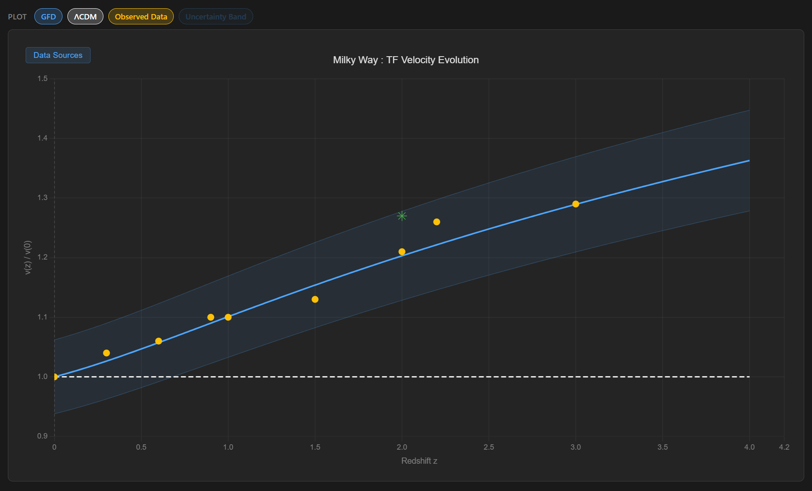

# Tully–Fisher Velocity Evolution from Dual-Tetrad Gravity

### A zero-parameter prediction compared to IFU survey data

*Stephen Nelson · Field Dynamics Research · February 2026*

`tully-fisher-relation` `galaxy-kinematics` `high-redshift-galaxies` `ifu-spectroscopy` `hubble-constant` `hubble-tension` `modified-gravity` `cosmology`

---

**Distant galaxies spin faster.** For a fixed mass, a spiral galaxy seen ten billion years in the past rotates about a fifth faster than one nearby. Two decades of integral-field (IFU) surveys have measured this, across five survey programmes and six independent analyses.

Standard cosmology does not predict it. In ΛCDM, the baryonic Tully–Fisher relation is the same at every epoch, so the velocity ratio $v(z)/v(0)$ should be 1 at all redshifts.

Gravity Field Dynamics predicts a rising curve, with an exponent fixed in advance:

$$\frac{v(z)}{v(0)} = \left[\frac{H(z)}{H_0}\right]^{0.17}$$

All nine measurements fall on it.



*Blue curve: the GFD prediction $[H(z)/H_0]^{0.17}$. Shaded band: the ±6.2% topological band, $(k/\pi)^{1/4}$. Dashed line: ΛCDM, $v(z)/v(0) = 1$. Orange points: the nine IFU measurements. Green star: SINS BX442 at $z = 2.18$, rotating 27% faster than the local relation. Chart produced with [GRAVIS](https://github.com/fielddynamics/gravis).*

## The equation behind the curve

The curve plotted is $v(z)/v(0) = [H(z)/H_0]^{0.17}$. It is built on the **scalar-tensor transition (SST)**, the field equation GFD uses for galaxies. The SST supplies the Tully–Fisher law itself; the evolving acceleration scale supplies the redshift dependence. The chain has four links.

**1. The SST.** In its spherical limit, the GFD action gives the relation between the acceleration sourced by ordinary matter, $g_s$, and the total acceleration that governs orbits, $g_t$:

$$g_s = \frac{g_t^2}{a_0 + g_t}, \qquad \text{equivalently} \qquad \mu\!\left(\frac{g_t}{a_0}\right) = \frac{g_t/a_0}{1 + g_t/a_0} .$$

Where the field is strong ($g_t \gg a_0$), $g_t \to g_s$ and gravity is Newtonian. In the outskirts of galaxies, where the field is weak, the SST takes a different form.

**2. The weak-field limit gives Tully–Fisher.** For $g_t \ll a_0$, the SST reduces to $g_s \approx g_t^2/a_0$. On a flat rotation curve, $g_t = v^2/r$, and the matter-sourced acceleration is $g_s = GM/r^2$. So

$$\frac{GM}{r^2} = \frac{(v^2/r)^2}{a_0} \qquad\Longrightarrow\qquad v_{\mathrm{flat}}^4 = G\,M\,a_0 .$$

The radius cancels. This is the baryonic Tully–Fisher relation, $M_b \propto v^4$, derived from the SST rather than fitted.

**3. The acceleration scale follows the expansion rate.** GFD ties $a_0$ to the Hubble parameter:

$$a_0 = \frac{cH}{2\pi}\sqrt{\frac{k}{\pi}}, \qquad k = 4 .$$

The expansion rate was higher in the past, $H(z) = H_0\sqrt{\Omega_m(1+z)^3 + \Omega_\Lambda}$, so $a_0$ was larger. At fixed mass, Tully–Fisher then makes galaxies rotate faster:

$$\frac{v(z)}{v(0)} = \left[\frac{a_0(z)}{a_0(0)}\right]^{1/4} .$$

**4. The exponent.** If $a_0$ scaled exactly in proportion to $H$, the exponent would be $1/4$. The paper derives a smaller effective exponent, **0.17**. Rotation speeds are measured from the Doppler shifts of light that has crossed the scalar field, and part of the evolution is absorbed along the photon path. That path correction is governed by the aperture factor $\sqrt{k/\pi} = 1.128$ (§2.3 of the paper).

A second route, developed in [`research/cmb/`](../../research/cmb/), reaches the same number from the source side. There, the coupling of densely packed closure boundaries makes $a_0 \propto H^{1-1/\pi}$, and through $v^4 = GMa_0$ the exponent becomes $(1 - 1/\pi)/4 = 0.1704$. That route also gives the CMB enhancement of 6.46 at recombination. The two routes agree to better than 0.002 in $v(z)/v(0)$ at every redshift plotted.

**The band.** The tetrahedral field chamber has flat faces, counted by $k = 4$. The cosmological geometry it sits in is curved, and its natural angular measure is $\pi$. Observables that cross between the two pick up corrections in powers of $k/\pi$. For velocity the power is $1/4$, so $(4/\pi)^{1/4} = 1.062$, a band of ±6.2%.

## The data

| $z$ | Observed $v(z)/v(0)$ | $\sigma$ | GFD | Survey |
|---|---|---|---|---|
| 0.0 | 1.00 | 0.02 | 1.000 | Local calibration |
| 0.3 | 1.04 | 0.05 | 1.026 | Kassin et al. 2007 (DEEP2) |
| 0.6 | 1.06 | 0.06 | 1.057 | Puech et al. 2008 (IMAGES) |
| 0.9 | 1.10 | 0.07 | 1.090 | Kassin et al. 2007 (DEEP2) |
| 1.0 | 1.10 | 0.06 | 1.101 | Miller et al. 2011 (DEEP2) |
| 1.5 | 1.13 | 0.08 | 1.154 | Übler et al. 2017 (KMOS³ᴰ) |
| 2.0 | 1.21 | 0.09 | 1.203 | Cresci et al. 2009 (SINS) |
| 2.2 | 1.26 | 0.10 | 1.222 | Straatman et al. 2017 (ZFIRE) |
| 3.0 | 1.29 | 0.12 | 1.289 | Übler et al. 2017 (KMOS³ᴰ) |

*Cosmology: $\Omega_m = 0.30$, $\Omega_\Lambda = 0.70$. $H_0$ cancels in the ratio.*

Every point lies within $1\sigma$ of the prediction. The largest residual is $0.4\sigma$, at $z = 2.2$. Over the eight measurements beyond the local anchor, $\chi^2 = 0.34$ for eight degrees of freedom. The ΛCDM flat line sits more than $2\sigma$ below the measurement at $z = 2$.

## The Hubble constant

The same geometry predicts the present expansion rate. Inverting the link between $a_0$ and $H$,

$$H_0 = \frac{2\pi\,a_0}{c\,\sqrt{k/\pi}} = 70.29\ \text{km/s/Mpc},$$

including the one-loop Schwinger correction (70.21 at tree level). This lies between Planck (67.4 ± 0.5) and SH0ES (73.0 ± 1.0), and agrees with the GW170817 standard siren ($70.0^{+12}_{-8}$). The same ±6.2% band, applied to $H_0$, spans 66.2 to 74.7 km/s/Mpc and contains all six major measurement methods.

Two independent observables, galaxy kinematics and the cosmic expansion rate, are bounded by one geometric factor taken from the face count of a tetrahedron.

## What comes next

GFD and ΛCDM diverge further with every step in redshift. At $z = 4$ the prediction is 1.36, and at $z = 5$ about 1.43; ΛCDM stays at 1.0. JWST's NIRSpec IFU is already resolving rotation at $z > 3$. A sample of about ten disk galaxies with clean rotation curves at $z = 4$ would separate the two predictions at more than $5\sigma$. Euclid, combined with ground-based IFU programmes, will calibrate the relation continuously from $z = 0.3$ to $2.5$.

## Files

| File | Contents |
|---|---|
| [`tf_velocity_evolution.pdf`](tf_velocity_evolution.pdf) | The paper |
| [`tf_velocity_evolution.tex`](tf_velocity_evolution.tex) | LaTeX source |
| [`tf-evolution.png`](tf-evolution.png) | Figure 1: the prediction, band, ΛCDM line and data |
| [`run_all_validations.py`](run_all_validations.py) | Checks every equation, constant and table entry against CODATA 2022 and Planck 2018 (64 checks) |

```bash
python run_all_validations.py      # ALL 64 VALIDATIONS PASSED
```

## Related work

- [`research/cmb/`](../../research/cmb/): the source-side derivation of the exponent, $(1 - 1/\pi)/4$, and the CMB enhancement of 6.46 from the same scaling law.
- **Paper X**, [`10-two-scale-kinematics-tully-fisher-h0/`](../10-two-scale-kinematics-tully-fisher-h0/): the SST applied at galactic and cosmological scales, with Tully–Fisher evolution and $H_0$.
- [`letter-radial-acceleration-relation-sparc/`](../letter-radial-acceleration-relation-sparc/): the same SST tested at $z = 0$ against 164 SPARC galaxies.
- [GRAVIS](https://github.com/fielddynamics/gravis): Galactic Rotation from Field Dynamics, the interactive tool used for Figure 1.

## References

- Cresci, G. et al. (2009). *Astrophys. J.* 697, 115.
- Kassin, S. A. et al. (2007). *Astrophys. J.* 660, L35.
- McGaugh, S. S., Schombert, J. M., Bothun, G. D. and de Blok, W. J. G. (2000). The baryonic Tully–Fisher relation. *Astrophys. J.* 533, L99.
- Miller, S. H. et al. (2011). *Astrophys. J.* 741, 115.
- Planck Collaboration (2020). Planck 2018 results. VI. *Astron. Astrophys.* 641, A6.
- Puech, M. et al. (2008). *Astron. Astrophys.* 484, 173.
- Riess, A. G. et al. (2022). *Astrophys. J. Lett.* 934, L7.
- Straatman, C. M. S. et al. (2017). *Astrophys. J.* 839, 57.
- Tully, R. B. and Fisher, J. R. (1977). *Astron. Astrophys.* 54, 661.
- Übler, H. et al. (2017). *Astrophys. J.* 842, 121.
