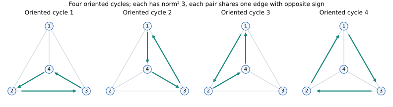
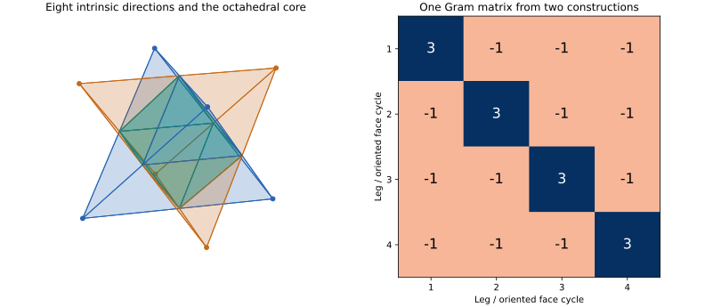
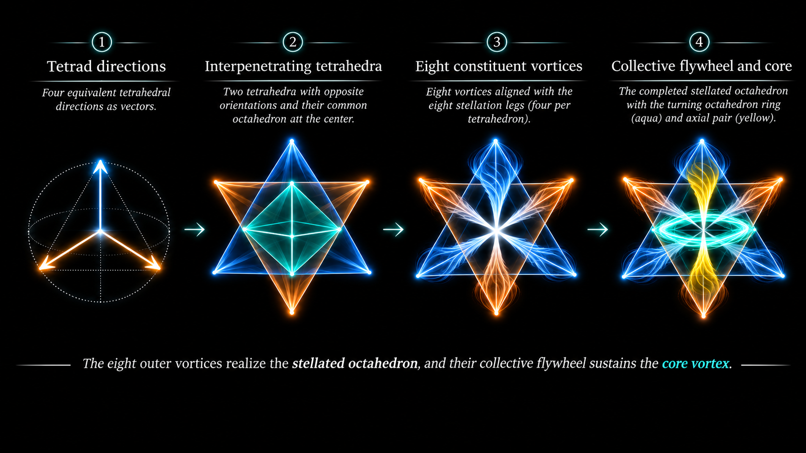
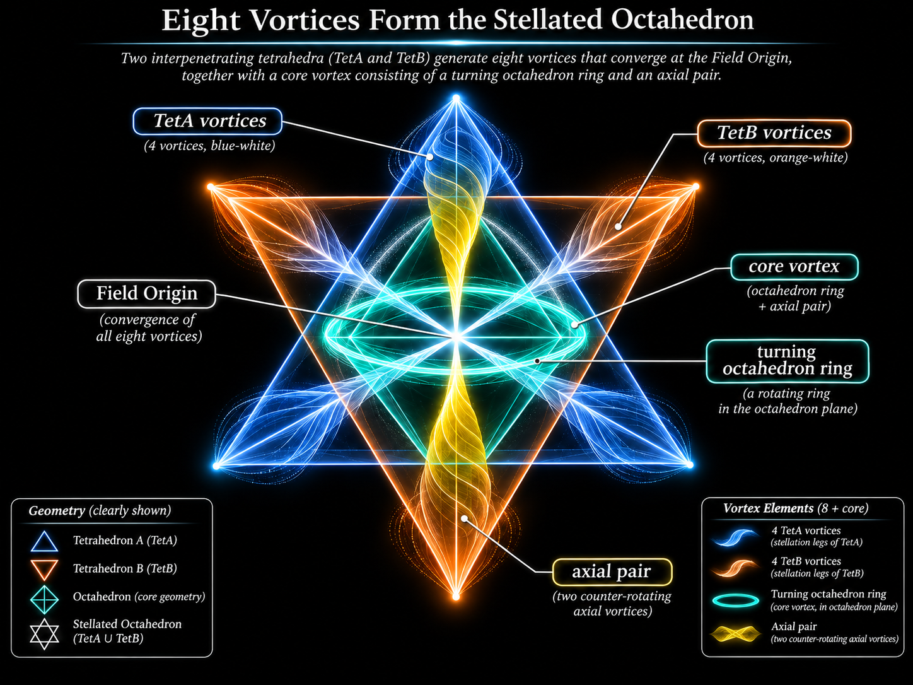
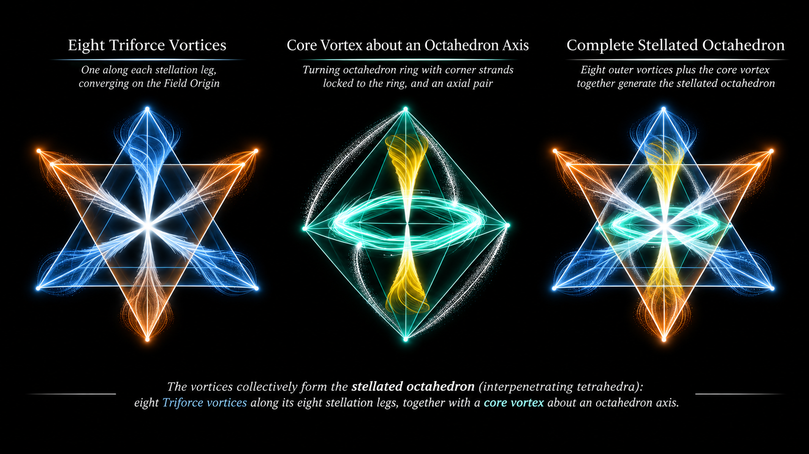

# The Intrinsic Tetrahedral Geometry of the Collective Flywheel

*The intrinsic frame of the eight-vortex flywheel, the collective core and the two tetrad roots · Gravity Field Dynamics (GFD) · Field Dynamics Research · November 2026*

`tetrad` `stellated-octahedron` `vortex` `flywheel` `Gram-matrix` `incidence` `Triforce` `proof` `Lean`

---

**Status:** Mathematical proof for the established labelled, equal-norm flywheel model. 65 new exact SymPy checks and 167 inherited checks (including full Stage VII Hamiltonian reconstruction and numerical evolution) pass. 50 theorem statements are machine-checked in Lean 4 (57 axiom reports with helper lemmas, standard axioms only; [Lean audit](LEAN_AUDIT.md)). This is not a physical stability theorem under geometric deformation or a derivation of gravitational constants. Repository basis `d69739e984e5f1f8de5e4639d8fd0e7a2a8214b8`.

[Manuscript (PDF)](flywheel_tetrad_geometry.pdf) · [LaTeX (portable)](flywheel_tetrad_geometry.tex) · [IOP-format LaTeX](flywheel_tetrad_geometry_iop.tex) · [Exact verifier](verify_flywheel_tetrad.py) · [Output](verification_output.txt) · [Scope review](referee_review.md) · [Lean formalisation](lean/FlywheelTetradGeometry.lean) · [Lean audit](LEAN_AUDIT.md).

This folder follows the proof programme’s manuscript, exact verifier, referee review, figures and Lean package convention. The supplied PDF is a three-page two-column preprint rendered using the portable article class. The IOP entry point follows the existing vortex proof’s `iopjournal` format and shares the same abstract and body; it requires the repository’s IOP class and has not been compiled here.

> **Next proof:** [Proof 25 — Convergence of the Tetrad and Collective Flywheel Geometries](../tetrad-flywheel-convergence/) gives the unified normed frame, explicit composition law, intrinsic convex reconstruction and sharp metric bounds. [Root reading path](../../README.md#reading-path-from-the-tetrad-to-the-collective-flywheel).

## The question

The [tetrad geometry paper](../../papers/letter-1-tetrad-frame-geometry/) and [Gram matrix paper](../../papers/gram-matrix-of-tetrad-equation/) recover two tetrahedra from the spatial frame. The [vortex proof](../vortices-of-the-stellated-octahedron/) establishes circulating states, and the [sustained flywheel](../../research/hadamard-null-cone-vortex-flywheel/SUSTAINED_TRIFORCE_FLYWHEEL.md) establishes simultaneous eight-ring and core circulation in its specified model. The reverse question is whether the normed circulation and phase-read algebra independently determines the same intrinsic regular frame. No spatial coordinates enter either Gram calculation below.

> **Interaction connectivity, not spatial continuity.** The shared geometry in this proof (the common Gram matrix, the octahedral core and the maps between representations) describes how TetA and TetB are connected through the Field Origin as an interaction structure. It does not imply a physical spatial passage between them: TetB shares no vertex, edge or face with TetA, and the chambers couple only through the nonlinear Field Origin vertex. Circulation currents on linear cross-chamber bonds are exact within the stated Stage VII model; whether that model emerges from the nonlinear vertex is the open [vertex research](../../research/hadamard-null-cone-vortex-flywheel/FIELD_ORIGIN_VERTEX.md). See [TetB is the subspace](../../TETB_THE_SUBSPACE.md). This clarification changes no theorem and no Lean statement.

## Theorem 1 — Oriented cycle frame

On four labels, orient the six unordered edges from the smaller label to the larger. B is the vertex-edge incidence (tail −1, head +1). Let the columns of D be the signed boundaries of the four faces of an oriented abstract tetrahedral simplex, using (-1)^i for the omitted label i in zero-based indexing. Write G=4I−J, P=G/4, W=1⊥ in R^4. Then

```
BB^T = D^T D = G,
BD = 0, D 1 = 0,
rank D = 3, im D = ker B,
DD^T/4 = I_6 − B^T B/4.
```

Indeed each cycle has three edges, and each pair of faces shares one oppositely oriented edge. Connectedness gives rank B=3. The Gram immediately gives rank D=3 and D1=0. The two three-dimensional complementary subspaces of R^6 have the indicated projectors. The columns of D form a regular tight tetrahedral frame in the cycle space. This is a statement about an abstract labelled simplex, not a derivation of the simplex incidence from arbitrary vortex dynamics.



**Metric necessity.** For any positive diagonal edge metric diag(w_e), the off-diagonal Gram entry of faces i,j is minus the weight of their unique shared edge. Thus all off-diagonal entries are equal if and only if all six weights are equal. Unit weights give G, not an arbitrary anisotropic geometry. Full label-permutation invariance of a symmetric form on W implies it is scalar on W: extend by zero on constants; every diagonal is equal and every off-diagonal is equal. This establishes conditional uniqueness up to scale, not a dynamical selection of the metric.

## Theorem 2 — The flywheel column frame and its minimum-norm read

In one chamber the twelve outer tiles have labels (i,j), i≠j. Let R sum rows and Q sum columns. In the existing Euclidean amplitude norm, RR^T=3I and P_r=I−R^TR/3 projects onto the eight-dimensional row-closed space. With C=QP_r,

```
C C^T = (2/3) G,
F = sqrt(3/2) C^T,
F^T F = G.
```

Each column read has three entries with projector diagonal 2/3; two distinct column reads share two rows with entry −1/3 each. Thus the normalized read frame has precisely the cycle Gram. The unique minimum-norm row-closed array for any q in W (also over C) with QX=q is

```
X = (3/8) C^T q,
X_ij = (3/8)(q_j + q_i/3),
||X||² = (3/8)||q||².
```

It is a solution since C C^T=(8/3)P, and lies orthogonal to the kernel of C inside ker R. Any other solution differs by a vector in that kernel and has strictly greater squared norm. This proves the form of the existing row-closed flywheel without adding a physical energy-minimization postulate. Five other row-closed array directions are not seen by this column read; these are not additional energy reservoirs.

## Theorem 3 — Exact equivalence and its orientation

The partial isometry L=DF^T/4 satisfies LF=D, L^TL=FF^T/4, LL^T=DD^T/4. This follows by inserting G=4P and F1=D1=0. For a label permutation p, let T act on labels, U on ordered tiles, and V on oriented unordered edges. Then UF=FT, VD=sgn(p) DT, and VL=sgn(p) LU. The second identity follows by applying p to the oriented simplex boundary; a permutation of its four vertices changes its orientation by sgn(p). This is an ordinary equivariance for proper tetrahedral rotations and a sign-twisted equivalence for the full tetrahedral group. The axial cycle frame is not an ordinary polar frame under reflections.

## Theorem 4 — The actual octahedral core realizes the cycle space

Orient the twelve central-tile bonds from y_i^+ to y_j^- (i≠j). Write the currents as a 4×4 real off-diagonal array I. Divergence-free currents are precisely those with zero row and column sums. The bipartite graph is K_{4,4} minus a matching, connected, with eight nodes and twelve edges; the dimension is 12−8+1=5.

Chamber inversion exchanges the endpoints and sends I to −I^T. Its even sector is antisymmetric, identified with ker B on the six unordered edges via I_ij=a_ij for i<j, I_ji=−a_ij. Its dimension is 3. Its odd sector is symmetric, with six entries constrained by four independent row sums. Independence follows because a linear dependence of the row constraints would require c_i+c_j=0 for every distinct i,j, hence all c_i=0 by a triangle. Its dimension is 2. Thus the actual five-dimensional core circulation space has the canonical decomposition **3+2**. The even sector is isometric to the cycle frame after dividing the duplication map by sqrt(2).

## Theorem 5 — Collective phase and edge-current reconstruction

For the established collective phase q=x+iy in complex W, set a_ij=Im(conj(q_i)q_j)=x_i y_j−x_j y_i. Summing over j yields zero, so this wedge lies in ker B. Every direction in ker B is realized by such a wedge: the natural exterior inclusion Λ²W→Λ²R^4 maps into ker B, is injective, and both spaces have dimension three; every bivector in a three-dimensional real space is decomposable (orthonormalize a basis of the plane perpendicular to its Hodge dual). There is no independent core axis within the collective ansatz. Inversion-even states populate the antisymmetric current sector, not arbitrary core patterns.

With j0=D^T a, the exact reconstruction is Dj0=4a. In the published Stage VII amplitude pattern X_ij^±=ρ(uq_i+vq_j), y_i^±=ρwq_i, the row shift u q_i cancels from each oriented triangular mean of Im products. With r=k=−1 and the original current convention,

```
j = (2ρ² |v|² / 3) D^T a,
I_(i<j) = 2ρ² |w|² a,
|v|² I_(i<j) = (3/4) |w|² D j.
```

The other six core bonds follow by antisymmetry. This undivided formula remains valid at zero winding. For v≠0 it is the exact complementary-ring-difference law; general nonzero r multiplies the divided ratio by k/r. All currents are currents of the existing graph, not new oscillator variables. At fixed q the common gain still evolves with the existing u,v,w equations; no universal magnitude or gravitational normalization follows.

## Theorem 6 — Reconstruct the stellated octahedron

Choose an orthonormal realization of the common Gram G: rows s_i=(1,1,1),(1,−1,−1),(−1,1,−1),(−1,−1,1). Every realization spanning a Euclidean three-space with this Gram is related by an isometry (extend the map on spanning columns using equality of squared norms of linear combinations). The inverted copy supplies four further directions. For any x, the affine barycentric coordinates for conv(s_i) are λ_i=(1+s_i·x)/4. The opposite tetrahedron has coordinates (1−s_i·x)/4. The overlap is all |s_i·x|≤1, equivalently |x_1|+|x_2|+|x_3|≤1, since ±s_i comprise all eight sign triples. Its six vertices are the pairwise midpoints of the original four s_i. In the positive tetrahedron outside the overlap, exactly one λ_i>1/2; the closure of each such component is the tetrahedron with apex s_i and its three adjacent edge midpoints. The inverted tetrahedron gives four more. The eight stellations and the shared octahedron are thus the unique normed-frame reconstruction up to isometry and common scale. The full engine's incidence is inherited, not dynamically generated by this theorem.



## Reproduction and limitations

Run `python verify_flywheel_tetrad.py` (SymPy). Then run `python verify_geometry_bridge.py` in the [inherited geometry-bridge research](../../research/vortex-induced-triforce-refinement/collective-engine/geometry-bridge/) (NumPy, SciPy, SymPy, Matplotlib). The latter reconstructs all 104 Stage VII bonds using labels alone, checks the invariant nine-dimensional collective sector, and compares the actual 33-coordinate evolution with its existing three-amplitude reduction. No new Hamiltonian parameters. The two scripts are complementary and overlap in some checks. Neither is a Lean kernel proof. The accompanying Lean source is built against the existing recursive Triforce package. Run `cd lean`, `lake update`, `lake exe cache get`, `lake build` when ready; see the audit for intended coverage and remaining analytic prose. The cycle Gram is Euclidean, not the Lorentz metric; no claim of physical stability, spontaneous geometry selection, time-axis identification, or G follows. The next step is an independently justified geometry-selection law, not a fitted energy functional designed to favor the desired tetrahedron.


## Visual figures

These illustrations show the geometric claim at a glance: the eight constituent vortices form the stellated octahedron, and the collective flywheel sustains the core vortex. They are illustrations, not mathematical certificates; the exact figures above are generated from the verified matrices.



*Four stages: tetrad directions, interpenetrating tetrahedra, the eight constituent vortices, and the completed collective flywheel with its core.*



*TetA and TetB vortices, the Field Origin, the turning octahedron ring, the axial pair and the complete stellated octahedron.*



*The eight outer vortices, the core vortex, and the two combined. The outer vortices do not merely sit inside the stellated octahedron: together they form its stellation geometry, while the core vortex carries the shared octahedral circulation.*
