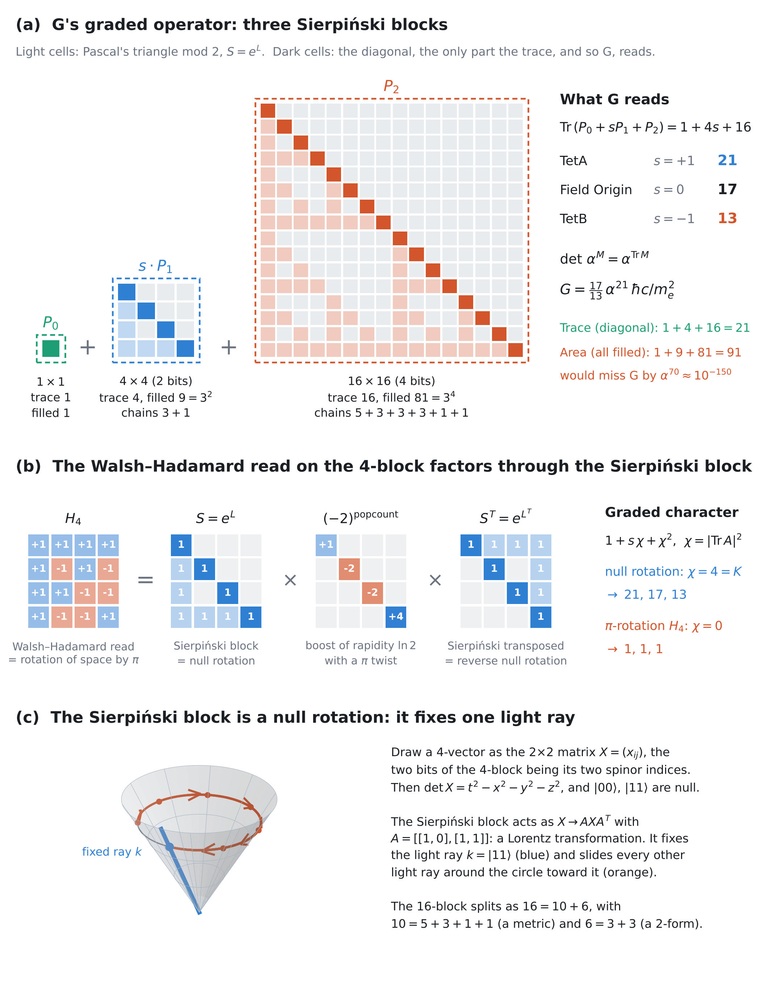

# G's Graded Operator Is a Null Rotation

*What the Sierpiński blocks in G's derivation are · Gravity Field Dynamics (GFD) · Field Dynamics Research*

`gravitational-constant` `Sierpinski-triangle` `Walsh-Hadamard` `null-rotation` `Lorentz-group` `coupling-polynomial` `proof`

---

This folder holds a four-page proof with one figure, and a script that checks every step (33 checks, exact algebra). The archive derives Newton's constant as G = (17/13) α²¹ ħc/m_e² from a graded operator on blocks of size 1, 4 and 16 ([`g_matrix_synthesis.md`](../../research/g_from_topology/g_matrix_synthesis.md)). Its diagram, [`g_three_sierpinski_blocks.html`](../../research/g_from_topology/g_three_sierpinski_blocks.html), draws those blocks as Sierpiński triangles. The proof works out what those blocks are.



## Result 1: the blocks are Sierpiński matrices, and G reads only their diagonal (Theorems 1 and 2)

- **What the blocks are.** Each block is S = A ⊗ A ⊗ ⋯ with A = [[1,0],[1,1]], on 0, 2 and 4 bits. That is Pascal's triangle mod 2, and S = e^L, where L removes one bit.
- **G is unchanged.** The diagonal is all 1s, so the traces are 1, 4, 16 and Tr = 1 + 4s + 16 = 21, 17, 13. The spectra are the same as the identity's, and det(α^M) = α^Tr.
- **G reads the diagonal, not the triangle.** Counting the filled cells (1 + 9 + 81 = 91) instead would miss G by a factor of about 10⁻¹⁵⁰.

## Result 2: the Sierpiński block is a null rotation (Theorem 3)

Write a 4-vector as the 2×2 matrix X = (x_ij), with the two bits of the 4-block as its two spinor indices. Then det X = t² − x² − y² − z², and the states |00⟩ and |11⟩ are the two light-cone directions.
- **It is a Lorentz transformation.** The 4×4 Sierpiński block acts as X → A X Aᵀ.
- **It is a null rotation.** It fixes one light ray (|11⟩) and moves every other light ray toward it. It is not the identity, and (Λ − 1)³ = 0.
- **It fixes y.** It acts as the Lorentz group of (t, x, z), with y fixed.

## Result 3: the Walsh–Hadamard read is a half-turn built from null rotations (Theorem 4)

- **The read is a rotation of space by π.** The normalised H₂ acts on 4-vectors as a rotation by π about (x + z)/√2.
- **It factors exactly** as H = S · diag((−2)^popcount) · Sᵀ = e^L · e^((ln 2 + iπ)·popcount) · e^(Lᵀ). In Lorentz terms: a null rotation, then a boost of rapidity ln 2 with a π twist, then the reverse null rotation.
- **So the Sierpiński blocks are the outer factors of the read,** and the half-turn e^{iπ} sits in the middle.

## Result 4: K = 4 is the trace of a null rotation (Theorem 5)

- **The character.** On a 4-vector, the trace of the Lorentz transformation of A is χ = |Tr A|², and on a rank-2 tensor it is χ². So the graded trace on scalar, vector and tensor is 1 + sχ + χ² = f(χ, s).
- **The two cases:**
  - **Null rotation:** χ = 4 = K, which gives 21, 17, 13.
  - **The Walsh–Hadamard read itself:** χ = 0, which gives 1. So the read itself cannot produce G's numbers.
- **The boundary.** Rotations have χ ≤ 4 and boosts χ ≥ 4, so the null rotations sit exactly on the boundary between them.

## Result 5: the chains (Theorem 6)

The Sierpiński chains split each block without changing its size:

| Block | Chains |
|---|---|
| 4 | 3 + 1 |
| 16 | 5 + 3 + 3 + 3 + 1 + 1 |
| 16, symmetric part (the 10 GR keeps) | 5 + 3 + 1 + 1 |
| 16, antisymmetric part (the 6, torsion-type) | 3 + 3 |

These are the pieces of a symmetric tensor (a metric) and of a 2-form.

## Result 6: the tetrad frame is the same read (Theorem 7)

The archive's tetrad frame ([`hadamard-cube-frame/`](../hadamard-cube-frame/)) is a row of ones over the four TetA corners.
- **It is the 4-block's read.** The frame is exactly H₂ ⊗ H₂ with two rows exchanged: the Walsh–Hadamard read on G's 4-block.
- **So it factors through the null rotation:** frame = (row swap) · S · diag((−2)^popcount) · Sᵀ.
- **One matrix, two roles.** As an operator on the 4-block it is a Lorentz transformation, the rotation by π. As four legs read in (t, x, y, z), it is not a Lorentz structure: each leg has norm −2.

## Result 7: the legs are a Newman–Penrose null tetrad (Theorem 8)

Read the frame's two bits as spinor indices. Each leg is then an outer product h_a h_bᵀ of two columns of H₂, so every leg is null:

| Leg | Minkowski components | Kind |
|---|---|---|
| l | (1, 1, 0, 0) | real light ray along +x |
| n | (1, −1, 0, 0) | real light ray along −x |
| m | (0, 0, −i, 1) | complex null |
| m̄ | (0, 0, i, 1) | its complex conjugate |

- **The products** are l·n = 2 and m·m̄ = −2, with every other product 0. That is a Newman–Penrose null tetrad, the standard null frame of general relativity, built from the spinor dyad formed by the two columns of H₂.
- **The orthonormal frame comes back.** Adding and subtracting the legs (another Hadamard step) gives the orthonormal frame: l + n, l − n, m + m̄ and i(m − m̄) are 2t, 2x, 2z and 2y.
- **At most two legs can be real light rays.** This holds in any spinor reading, and is proved. So "built from null directions" holds in the form GR uses: two real light rays and a complex-conjugate pair.

## What it does not do

- **It does not derive G.** G still rests on the archive's assumption that each of the 21 coupling levels contributes one factor of α, and on K = 4 from D = 3. The proof identifies the operator G is read from.
- **The trace cannot tell a null rotation from the identity.** Both have χ = 4. The new content is what the drawn blocks are.
- **It sharpens an archive statement.** The archive said the blocks "are" H₁, H₄, H₁₆; strictly, they are the Sierpiński factors of those matrices, whose own traces are 0. The wording in [`universe-is-pixelated/`](../../research/universe-is-pixelated/README.md) and [`what_is_gravity.md`](../../research/g_from_topology/what_is_gravity.md) has been updated to say this.
- **Components need rotations.** The Sierpiński blocks act through the Lorentz group of (t, x, z). So the chain lengths match a vector, a metric and a 2-form exactly, but naming components (h₀₀, h₀ᵢ, …) needs ordinary rotations.
- **Two null legs are complex.** The tetrad's legs are null only in the spinor reading, and there two of them are complex. Read in (t, x, y, z), the tetrahedral legs have norm −2.
- **Most of the ingredients are standard:** the spinor–vector correspondence, null rotations, the triangular factorisation of the Hadamard matrix, and building a null tetrad from a spinor dyad. What's new is identifying them with G's blocks and with the archive's tetrad frame.

## Contents

| File | Contents |
|---|---|
| [`g_null_rotation.pdf`](g_null_rotation.pdf) | The proof, four pages, Theorems 1–8 and Figure 1 |
| [`g_null_rotation.tex`](g_null_rotation.tex) | LaTeX source (IOP journal class, included) |
| [`g_null_rotation_figure.png`](g_null_rotation_figure.png) | Figure 1 |
| [`make_figure.py`](make_figure.py) | Draws Figure 1 (numpy, matplotlib) |
| [`verify_g_null_rotation.py`](verify_g_null_rotation.py) | Checks of every theorem: the diagram's blocks cell by cell, Lucas, S = e^L, traces and areas, spectra, det(α^M) at 30 digits, the spinor map and Minkowski norm, the null rotation and its fixed plane, the π-rotation, the Hadamard factorisation at m = 0, 2, 4, the boost, the characters, rotation and boost bounds, the Jordan chains, Clebsch–Gordan, and the symmetric/antisymmetric split; the tetrad frame as the 4-block read and its factorisation; the null legs, their Minkowski components and products, the orthonormal frame, and the bound of two real light rays |
| [`iopjournal.cls`](iopjournal.cls) | Document class, so the source builds here |

```bash
pip install sympy mpmath
python verify_g_null_rotation.py      # 33/33
python make_figure.py                 # needs numpy, matplotlib
pdflatex -interaction=nonstopmode g_null_rotation.tex
```

## Related

- [`research/g_from_topology/`](../../research/g_from_topology/): the derivation of G, the Sierpiński diagram and the read sweep.
- [`universe-is-pixelated/`](../../research/universe-is-pixelated/): the cube as a Boolean computer and its Walsh–Hadamard spectrum.
- [The Stellated Octahedron, the Cube and the Hadamard Matrix](../hadamard-cube-frame/): K = 4 from D = 3.
- [BBP and the coupling polynomial](../bbp-coupling-polynomial-ladder/): the coupling polynomial as cyclotomic polynomials, and π from the octahedral lattice.

---

*The algebra is exact and machine-checked. The physical reading of G's operator is GFD's, stated so that it can be tested.*
