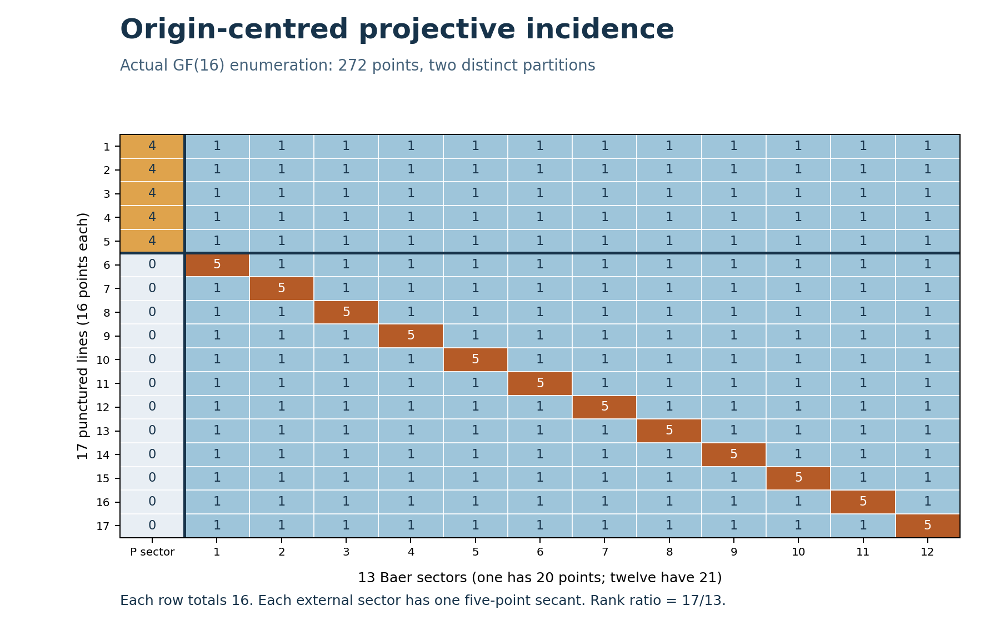

# Optional mathematical appendix: projective interpretations of the coupling ratio

Preserved from Revision 3. These are exact constructions in specified finite spaces, not premises of Proof 26 or established physical operations. The main manuscript uses the inherited coupling-polynomial ratio. In particular neither point exclusion, trace exclusion, nor incidence-rank averaging is required by the main argument. The symbols $T$ and $f$ refer to the invariant transmission and signed count in the main manuscript. The proposed volume derivatives are optional witnesses, not physical source definitions.

**Appendix A1 (norm-transversal register).** Let $F=\mathbb F_4$, $E=\mathbb F_{64}$, $L=\mathbb F_{16}$, $U=\mathbb F_{4096}$. View $E$ as a 3-dimensional $F$-space and $U$ as a 3-dimensional $L$-space. Their projective point sets are $E^*/F^*$ and $U^*/L^*$. The norm $N:U^*\to E^*$ induces a surjection $\nu$ of projective point sets with fibres of size 13. The embedded $E^*/F^*$ is a norm transversal, and its 13 cosets partition the larger plane into Baer subplanes.

*Proof.* The subfields intersect in $F$ (gcd of extension degrees 3 and 2). Norm is $z^{65}$, restricting to the square on $E$ and to the quadratic norm on $L$. The latter lands in $F^*$, so the quotient map is well defined. Squaring is invertible on the order-21 subgroup, proving surjectivity and the transversal property; the order ratio is 273/21=13. Multiplication by a nonzero element is an invertible $L$-linear map, so every multiplicative coset of the embedded subplane is a projective image of a Baer subplane. The embedded subplane has the usual $F$-line incidence: an $L$-line restricts to at least one nonzero $F$-vector because its one $L$-linear constraint yields at most two $F$-linear constraints on three coordinates; if it contains two independent $F$-vectors it contains their $F$-line. This supplies the Baer property. QED.

Choose an $F$-basis of $E$ and $\theta\in L\setminus F$. Each projective representative of grade $d$ has last nonzero coordinate 1 in position $d$. For same-grade representatives $u,v$, map matrix-unit coordinate $(u,v)$ to $[u+\theta v]\in\mathrm{PG}(2,16)$. Divide by $1+\theta$ to set the pivot to 1; every earlier coordinate is uniquely a combination of $1/(1+\theta)$ and $\theta/(1+\theta)$ over $F$. This proves a bijection. For $u=v$ it is $[u]$. The flag and basis are choices; the map is not an algebra homomorphism or established physical incidence propagation.

**Appendix A2 (projection from a distinguished point).** Let $\mathcal P=\mathrm{PG}(2,16)$, the point space of Appendix A1, and choose a point $P$. Write $\mathcal X=\mathcal P\setminus\{P\}$. The map $\pi_P:Q\mapsto\overline{PQ}$ from $\mathcal X$ to the pencil of lines through $P$ partitions the 272 remaining points into 17 disjoint fibres of size 16. In particular,

$$|\pi_P(\mathcal X)|=|\mathbb P(L^3/P)|=17=\frac{273-1}{16}.$$

Here $P$ in the quotient denotes its one-dimensional vector subspace. *Proof.* Two distinct points determine a unique projective line. Lines through $P$ correspond to one-dimensional subspaces of the two-dimensional quotient $L^3/P$. There are $(16^2-1)/(16-1)=17$ such subspaces, and a projective line has 17 points, of which exactly one is $P$. Distinct pencil lines intersect only at $P$, so their punctured sets are disjoint and cover $\mathcal X$. QED.

There is a useful way to see why this improves the previous normalization. Let $A$ be the 17-by-272 incidence matrix of these fibres. Its rows have disjoint support of size 16, so $AA^T=16I_{17}$. The orthogonal projection onto functions constant on each punctured line is $Q_{\pi}=A^TA/16$. Its trace and rank are both 17. The factor 16 in this operator is fixed by idempotence: if $cA^TA$ is a nonzero projection then $16c=1$. This is a consequence of incidence geometry, not a normalization fitted to $G$.

In the coordinate flag of Appendix A1 the singleton matrix-unit grade is $P_0=[1:0:0]$. It is a candidate distinguished point for this pencil. The choice is intrinsic to the **specified flag**, not to an unmarked projective plane: projective linear transformations act transitively on the points, and the scalar $\mathbb F_4^*$ action is already trivial on projective classes. Neither selects $P_0$ without extra structure. The common Walsh record is also not this singleton contrast; removing $P_0$ here does not discard the physical mass inventory. Proving that the physical Field Origin implements this projection remains a separate identification.

{ width=96% }

**Appendix A3 (two incidence ranks and the ratio).** Restrict the 13 Baer subplanes of Appendix A1 to $\mathcal X$. Each remains nonempty: one has size 20 and the other twelve have size 21. Let $C$ be their 13-by-272 incidence matrix and $D_C=CC^T=\operatorname{diag}(20,21,\ldots,21)$ after putting the containing subplane first. The orthogonal projector $Q_B=C^TD_C^{-1}C$ has rank 13. Consequently,

$$\boxed{\gamma_{\rm inc}=\frac{\operatorname{tr}Q_{\pi}}{\operatorname{tr}Q_B}=\frac{17}{13}=\frac{f(4,0)}{f(4,-1)}.}$$

*Proof.* The punctured Baer blocks are a partition, so their incidence rows are nonzero and orthogonal. The displayed projector is symmetric and idempotent, and its trace equals the number of rows. Apply Appendix A2 and the signed count of Theorem 7 in the main manuscript. QED.

This establishes a geometric rank ratio without a selected factor of 16 or a global traceless-generator premise. It does **not** show that a physical response is a ratio of ranks: that is the new, explicit physical selection criterion. In particular the two partitions are not equivalent, and averaging with unequal physical weights need not implement the counting read.

**Proposition (incidence compatibility test).** Each pencil line meets the Baer subplane containing $P$ in either 5 points or just $P$. There are five lines of the first type. Each of the other twelve Baer subplanes meets exactly one pencil line in 5 points and the other sixteen in one point. Its five-point line is one of the twelve remaining lines, and this assignment is bijective. *Proof.* A line meets a Baer subplane in 1 or 5 points by the dimension argument of Appendix A1. For the containing subplane its 20 remaining points must be apportioned four per secant, giving five. For an external subplane all 21 of its points lie on the pencil, so if $n$ lines meet it in 5 points, $5n+(17-n)=21$ gives $n=1$. Every pencil line has 17 points; if it already has five from the containing subplane and one from each external subplane, it is full. On any remaining line, one external subplane supplies five and the others one. QED. This provides an explicit incidence signature for the proposed native read, not merely a numerical target.

**Appendix A4 (comparison with the previous norm compression).** On the full point space let $M$ be the 21-by-273 norm incidence, $R=M/\sqrt{13}$, and $d$ the block identity vector. The trace exclusion $P_{\rm tr}=I-dd^T/21$ and point exclusion $P_{\rm pt}=I-e_Pe_P^T$ give

$$B_{\rm tr}=RP_{\rm tr}R^T=I-\frac{\mathbf1\mathbf1^T}{273},\qquad B_{\rm pt}=RP_{\rm pt}R^T=I-\frac{e_j e_j^T}{13},$$

where $j=\nu(P)$. *Proof.* $MM^T=13I$, $Md=\mathbf1$, and $Me_P=e_j$. Substitute. Each compressed operator has eigenvalues 1 (multiplicity 20) and 12/13 (multiplicity 1), hence trace $272/13$ and determinant $12/13$. Their exceptional eigendirections are different. With no exclusion, $RR^T=I$ has trace 21. QED.

The old division $\operatorname{tr}B/16$ now has an incidence interpretation, since $272=16\operatorname{rank}Q_{\pi}$; it equals $\gamma_{\rm inc}$. But the norm fibres and pencil fibres are distinct maps. Neither one factors through the other in general (their fibre sizes even differ); trace equality does not identify their operators or prove which register the action uses. The previous trace construction remains an alternative algebraic witness, not a physical trace constraint. The ordinary mean of either compressed operator is $272/273$, not $17/13$.

The older winding-stiffness Schur complement and Paper VI's $(K^2+1)/(DK+1)$ remain alternative routes. For the latter, $D=K-1$ gives the same denominator as $f(K,-1)$; agreement at the specified geometry is not independent evidence of an identical physical response. If independently motivated, the pencil construction offers a testable alternative: does settlement read directions from the Field Origin, and does its source average over the 13 Baer sectors? These are questions for the native action rather than adjustable factors in the arithmetic.

**Appendix A5 (collective incidence response).** On the direct sum of the invariant contrast space and the punctured projective register define the formal collective volume

$$F_{\pi}(\varepsilon)=\det(T^\dagger T)\det\left(I_{272}+\frac{\varepsilon}{\operatorname{rank}Q_B}Q_{\pi}\right).$$

Then

$$F_{\pi}'(0)=\frac{17}{13}|t_1|^2|t_2|^8|t_3|^{32}.$$

*Proof.* Since $Q_{\pi}$ is an orthogonal projector of rank 17, the second determinant is $(1+\varepsilon/13)^{17}$. Differentiation at zero and the three grade dimensions prove the formula, including singular $T$. If all retained intensities equal $\alpha$, the result is $(17/13)\alpha^{21}$. QED.

The perturbation is deliberately a **candidate source definition**: equal normalization over the 13 Baer sectors and use of a pencil-projector volume derivative are not derived from the vortex Hamiltonian. In particular replacing $1/13$ by another coefficient would change the response. The rank ratio is forced once this read is specified; the physical selection of the read is not. No ad hoc finest-grade divisor occurs in this version.

For comparison, the earlier $F_{\rm tr}(\varepsilon)=\det[T^\dagger T(I+\varepsilon B_{\rm tr}/16)]$ and the point-compressed version with $B_{\rm pt}$ have the same first derivative. Their second determinant is $(1+\varepsilon/16)^{20}(1+12\varepsilon/208)$, which differs from the pencil polynomial beyond first order. For example their second derivatives at zero (with $T=I$) are $1355/832$ and $272/169$ for the old and pencil constructions, respectively, as can be checked directly. Thus the native response at higher order can discriminate between these witnesses. The determinant is an observable of a frame, not the state amplitude of a single vortex.

