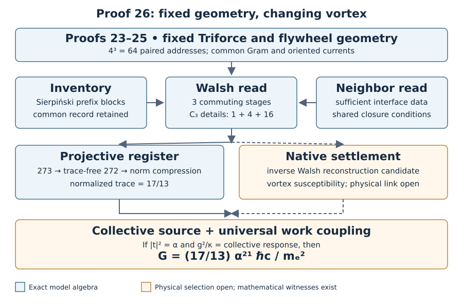

# Proof 26 candidate — Gravity as the response of recursive field closure

**Research draft.** The previous topology calculation of G is taken as the target, not as evidence that the physical mechanism has been independently verified. The fixed Triforce/Hadamard architecture accounts for TetB inventory; compatible settlement responds to neighbors; the vortex is the variable state. The proposed collective determinant response reproduces the existing normalization under explicit additional premises.

## Read in order

1. [Inventory of the 25 prior proofs](PROOF_INVENTORY.md)
2. [Build plan](BUILD_PLAN.md)
3. [Proof manuscript](proof26.pdf) ([editable Markdown](PROOF_26.md), [portable LaTeX](proof26.tex))
4. [Referee-style audit](REFEREE_REVIEW.md)
5. [Source register](SOURCE_REGISTER.md)

## Core results

- Theorems 1–2: information-dependent closure and exact susceptibility/Schur complement.
- Theorems 3–6: reversible Walsh read, Sierpiński factorization, invariant dimensions 1/4/16, inventory conservation.
- Theorems 7–10: signed trace, finite-field tower, norm-transversal compression, collective response 17/13 times the product of grade gains.
- Theorems 11–13: exact native fixed-geometry vortex susceptibility in a specified branch, recursive registration, and a conditional Newtonian Green-action completion.

Proof 23's physical pointing and pair-action obstructions are retained explicitly. The candidate is not a claim that P23, P24 or P25 already establish physical attenuation. The 21 is an invariant dimension, not a count of literal time steps or oscillators. The physical gain, source vertex and long-wave action remain unproved.

## Reproduce

`python verify_proof26.py` (Python 3.10+, NumPy and SymPy); [492 fresh exact assertions](verification_output.txt). Seven selected prior verifiers were run again from `sources/`, with outputs in `inherited-checks/`: 1,352 recorded assertions. Do not add the archived totals as fresh results. Use `pandoc PROOF_26.md -s -o proof26.tex` followed by `xelatex proof26.tex` to rebuild the PDF (from this directory). XeLaTeX output was compiled and all nine page thumbnails inspected; no new Lean build or full browser test.

## Visuals

- [Synthesis architecture](figures/proof26_architecture.svg)
- [Packing and Walsh read](figures/packing_walsh_bridge.svg), [Walsh filter](figures/projective_01_walsh_filter.svg)
- [Field tower](figures/projective_03_field_tower.svg), [Baer ledger](figures/projective_04_baer_ledger.svg), [trace compression](figures/projective_05_trace_compression.svg)
- [Fixed vortex](figures/fixed_geometry_vortex.svg), [registration](figures/necessity_02_registration.svg), [Green response](figures/information_02_green.svg)
- Offline: [synthesis explorer](interactive/index.html), [packing](interactive/packing_walsh.html), [projective Walsh](interactive/projective_walsh.html), [vortex susceptibility](interactive/fixed_vortex_response.html). These illustrate conditional models, not measured physics.
