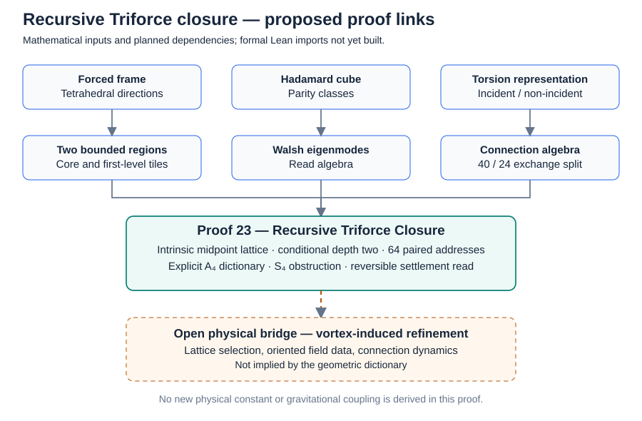
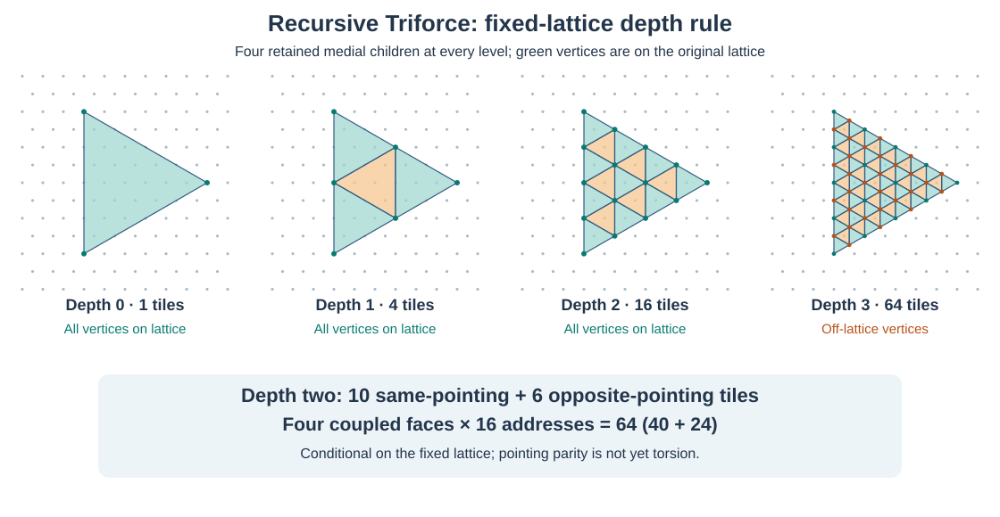
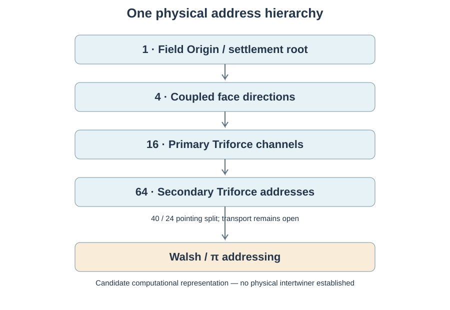

# Recursive Triforce Closure of the Dual Tetrad 

*Dyadic depth, channel parity and a constructive connection dictionary · Gravity Field Dynamics (GFD) · Field Dynamics Research · November 2026*

`tetrad` `stellated-octahedron` `Triforce` `lattice` `torsion` `representation-theory` `closure` `proof` `Lean`

**Status.** Refined standalone mathematical manuscript and Lean source, based on repository commit `30f9d789dffc72adde5da566d0c120e5886d82cc`. The expanded exact Python verifier passed 214 checks. Lean source is supplied, but the kernel build and axiom audit have not been executed because Lean is unavailable here. See [LEAN_AUDIT.md](LEAN_AUDIT.md). The physical selection of the lattice, maximal subdivision depth, dynamical degrees of freedom and torsion carrier is open.

## The question

The preceding geometric proofs establish that the spatial realization of the tetrad gives two complementary tetrahedra whose intersection is a regular octahedron. On each tetrahedral face, that intersection distinguishes a central triangular region from three lateral regions. We ask whether the same fourfold structure can be continued within those regions, whether the subdivision has a natural geometric limit, and how its symmetry relates to the connection of the tetrad. We do not assume that there are 64 physical channels, nor that equal dimensions imply equivalent representations.

## Setting and conventions

Let I={0,1,2,3} and s_i be the four sign vectors (1,1,1),(1,-1,-1),(-1,1,-1),(-1,-1,1). The two solids are conv(S) and conv(-S). We work with either chamber, naming a face by its omitted vertex i, and pair it with the inverted face in the other chamber. The half-space proof uses the opposite convention for the name TetA; the results below are invariant under exchanging those names. Pairing two surfaces is an address quotient, not a claim that their field values agree. The overlap is the octahedron conv(±e_1,±e_2,±e_3). These inputs should be imported from the existing formal geometry, rather than reintroduced as independent axioms.

The label i on a child denotes the central child; each label j≠i denotes the corner child at parent vertex j. Every child's corner labels are transported from the parent by its own affine similarity. This is important: the actual geometric action on the third index must be proved, not stipulated.

## Theorem 1. Medial refinement and the first-level intersection

For any nondegenerate triangular face with centroid c and vertices v_j, the maps F_i(x)=c-(x-c)/2 and F_j(x)=(x+v_j)/2 for j≠i give the four medial children. The central region agrees with the intersection of that tetrahedral face with the complementary chamber; this first-level identification is inherited from the half-space proof. At all deeper levels, the affine maps give a complete partition with equal areas and disjoint relative interiors. Closed triangles share boundaries; use an almost-everywhere partition or a consistent boundary convention for integration, not a claim that closed tiles are pairwise disjoint.

In barycentric coordinates the corner region at j has coordinate λ_j≥1/2, while the central region has every coordinate ≤1/2. Their union covers the triangle; intersections are boundaries. The affine maps have scale magnitude 1/2 and determinant +1/4 in the face plane. Iteration proves 4^n equal-area triangles with (2^n+1)(2^n+2)/2 vertices. In particular, a downward-pointing central child is not a change of planar orientation or circulation handedness.

## Theorem 2. An intrinsic midpoint lattice and the exact depth criterion

The twelve edge midpoints of the octahedron are (±e_r±e_s)/2 for r<s. They generate L=(1/2){z∈Z³: z_1+z_2+z_3 is even}. Indeed the doubled generators all have even sum; the three doubled vectors (1,1,0),(1,0,1),(0,1,1) have determinant of magnitude 2, so generate the entire index-two even-sum sublattice. Alternatively solve for their coefficients by half the pairwise sums and differences of z coordinates, which are integers precisely for even total sum.

For the face normal to (1,1,1), P=I-11ᵀ/3 and P(e_1)+P(e_2)+P(e_3)=0. In the basis p=P(e_1)/2, q=P(e_2)/2, projected edge midpoints have integer coordinates. In particular the projected midpoints (-e_2-e_3)/2 and (-e_1-e_3)/2 equal p and q. Thus P(L)=Zp+Zq, precisely the earlier Flower lattice. Symmetry transports this result to each face in its own normal plane.

Each tetrahedron vertex is in L and every edge displacement is a signed permutation of (0,2,2). Its step at complete dyadic depth n belongs to L exactly when n≤2: at depth two it is a signed octahedral edge midpoint; at depth three it has non-half-integral coordinates. The general barycentric grid proves sufficiency for every vertex, and the first edge step proves necessity. In fact the L-points among depth-three vertices are exactly the depth-two vertices. Hence maximal complete L-compatible dyadic depth is two. The planar statement follows independently from the projected face coordinates (4,0),(0,4),(-4,-4) up to sign and permutation; the joint edge-coordinate gcd is 4.

**Scope:** This fixes the lattice canonically once we choose the additive group generated by the octahedral edge midpoints. It does not prove that nature restricts physical channels to that lattice or uses maximal depth. L/2 is a counterexample to an unconditional depth bound, and unrefined faces also obey L-compatibility. No new microscopic length is derived.

### The complete lattice mesh, not merely an admissible depth

In the reference face opposite s₀, x+y+z=−1 and x,y,z≥−1. Write a=2x+2, b=2y+2, c=2z+2. Membership in L on this face is equivalent to a,b,c being nonnegative integers of sum four: the doubled coordinate sum is automatically −2. Conversely each such triple gives exactly one point on the face. The number of these triples is C(6,2)=15, and their coordinates are precisely the quarter barycentric grid. All other faces follow by tetrahedral isometry. Thus the intersection of the entire lattice with the face, not just a sampled portion, is exactly the set of refined vertices.

For two distinct grid points the difference of their integer triples has sum zero. Its squared Euclidean norm is at least two, with equality exactly when one coordinate increases by one and another decreases by one. Consequently the nearest-neighbour edges have length 1/√2 in the normalized three-dimensional coordinates and are exactly the elementary grid edges. The elementary triangular cliques have two forms: u+e_j for j=1,2,3 with u≥0 and sum u=3, or v−e_j with v≥(1,1,1) and sum v=5. To see exhaustiveness, fix one edge between two integer triples; the only points at unit-transfer distance from both endpoints are the third corners on the two sides of that edge. This gives precisely the two forms. The first family has C(5,2)=10 triangles, the second C(4,2)=6. Their interiors do not intersect, and their union is the face by the medial subdivision theorem. The grid contains 30 primitive edges (10 parallel to each of the three directions), so its Euler characteristic is 15−30+16=1. This is a canonical nearest-neighbour mesh conditional on L, not a proof that dynamics select nearest-neighbour interactions.

## Theorem 3. The geometric address quotient and its action

Let X=I³, where (i,j,k) labels face, child and grandchild, with central label i at both stages. At depth two there are 64 distinct triangles on one chamber. Inversion pairs them with 64 triangles in the other chamber; the quotient has 64 addresses. The chamber boundary surfaces are distinct, so an arbitrary two-chamber field can carry distinct values on the two paired tiles. The quotient does not prove that it has exactly 64 independent field amplitudes.

A tetrahedral symmetry g∈S₄ sends s_i to s_g(i). Since it commutes with centroids and affine midpoint formation, it sends every actual tile to (g(i),g(j),g(k)). This proves the simultaneous action on all three indices, including the recursive level. It is not the ordered corner-pair action of the earlier π walk.

## Theorem 4. Pointing partition and signed traces

A central child reverses the pointing of its parent, while three corner children preserve it. At depth n the difference of the two counts is (3-1)^n=2^n, and their sum is 4^n. The counts are (4^n±2^n)/2. For n=2 these give 10/6 per face and 40/24 on X. The sign of (i,j,k) is (-1)^([j=i]+[k=i]). The per-face pointing operator Q=J⊗J, with J=diag(-1,1,1,1), has trace 4. Consequently 1+tr(I+sQ)=17+4s. These are exact weighted traces, not a physical exchange, stiffness, or attenuation. Pointing parity is not planar orientation, spatial inversion, or torsion.

## Theorem 5. A constructive graded A₄ connection dictionary and the S₄ obstruction

Let V=R^I with basis f_i, and take the same magnitude-reading permutation representation as the torsion regular-representation proof. Write C_+=V⊗Sym²V and C_-=V⊗Λ²V, with unordered symmetric basis monomials and oriented antisymmetric wedges. The geometric pointing spaces are X_+, X_- (linear spans of the corresponding tiles).

**Negative pointing.** There are exactly two 12-element families: central then lateral, (i,i,j), and lateral then central, (i,j,i), with i≠j. Define

- (i,i,j) ↦ f_i⊗(f_i∧f_j), the incident torsion basis;
- (i,j,i) ↦ f_i⊗(f_k∧f_l), where {k,l}=I\{i,j} and the ordered quadruple (i,j,k,l) is even, the non-incident basis.

The first family is a permutation-equivariant bijection to the incident basis with its fixed upper-first orientation. The second uses the chosen orientation of I. Each incident or non-incident component occurs once up to the wedge sign. Every even permutation preserves the orientation rule, so this is an explicit A₄-equivariant isomorphism. Each geometric family is a regular A₄ orbit because the stabilizer of the ordered pair in S₄ is the transposition of the two unused labels and contains no nonidentity even element. Under an odd permutation the second map picks up a minus sign. Equivalently, twisting that family's action by the sign representation yields an S₄-equivariant dictionary to the entire torsion sector. This is an algebraic alternative, not an established physical sign law.

**Positive pointing.** The four central-central tiles map by (i,i,i) ↦ f_i⊗f_i²; the twelve same-label lateral-lateral tiles map by (i,j,j) ↦ f_i⊗f_j². For the remaining 24 tiles with i,j,k distinct, let l be the unused label. If (i,j,k,l) is even, map to f_i⊗(f_i f_l); if odd, map to f_i⊗(f_j f_k). For each i and each unordered distinct pair j,k in its face, the two orders have opposite parity, so one supplies the incident symmetric pair (i,l) and one the nonincident pair (j,k). This fills all 40 distinct symmetric basis elements and is equivariant under A₄.

Together these maps give an explicit graded vector-space isomorphism between the 64-dimensional geometric address space and the connection slot space, under proper tetrahedral permutations. If Euclidean orthonormal bases are desired, normalize the symmetric and antisymmetric products. The map then preserves the corresponding norm. It does not identify the field values, actual connection coefficients, derivatives, Lorentz action, or physical units.

**The obstruction.** Write f(g)=number of fixed labels and f₂=f(g²). The geometric characters are χ_+=f(1+(f-1)²) and χ_-=2f(f-1), while the symmetric and antisymmetric connection characters are f(f²±f₂)/2. For a transposition these give geometric (4,4) and connection (8,0). Therefore no S₄-equivariant graded isomorphism exists with the untwisted geometric permutation action. Their proper-rotation characters agree, but the explicit basis map above is stronger than a character count. The full ungraded address and connection tensor representations do coincide as triple permutation spaces; it is the pointing-versus-swap grading that obstructs their identification. A single chosen vortex is not proved to preserve all A₄; a chiral state or field of oriented data would need to be studied dynamically. No connection action is derived here.

### A precise S₄ repair and its limitations

The failure under reflection is not an opaque discrepancy. Let a permutation g act geometrically on all three labels. If g is odd and all three labels of the input address are distinct, exchange the last two labels after applying g. If g is odd and the input lies in the lateral-then-central family, multiply its basis vector by −1. In every other case, keep the usual address action. The two modifications commute with the geometric permutations because their predicates depend only on label equality; their squares are the identity. Since the parity of a product is the product of parities, the modified action is an S₄ representation. Under the explicit dictionary it agrees exactly with the lower-index connection action: the first modification interchanges the two orders that encode incident and nonincident symmetric pairs, and the second supplies the antisymmetric wedge sign. We have thus characterized an explicit algebraic repair, without asserting that a physical reflection acts this way. The ordinary geometric action remains inequivalent as a graded action.

The A₄ dictionary is also not canonical merely from covariance. Each negative family is a free transitive A₄-set. After selecting a base tile, right translations of this regular action commute with its left action. For example, on the central-then-lateral family, choose (0,0,1) as base and the even cycle (1 2 3) fixing face 0. Sending g(0,0,1) to g(0,0,2) gives a different equivariant correspondence which even preserves the face index. This freedom is an explicit counterexample to any claim that symmetry uniquely fixes the physical dictionary. A physical constitutive or transport law must resolve it, or show that the alternatives are gauge-equivalent.

## Theorem 6. Reversible closure and invariant contrasts

On X use the normalized 4-point Hadamard matrix h=H₄/2. The full tree applies h on each group of four siblings at the deepest level, then on the four intermediate common groups, then at the root, always retaining the other three details. The operation is orthogonal as a product of orthogonal block maps. The root, four face nodes and sixteen primary tile nodes make 21 internal readers; the detail ranks are 3,12,48, leaving one uniform mean. Thus the transform is a bijection on snapshots; it does not prove a physical clock or automatic availability of arbitrary independent input values.

A physical three-cycle fixes one leaf and has 21 triple orbits. More strongly, prefix-constant spaces at depths 0,1,2,3 have C₃-invariant dimensions 1,2,6,22 by Burnside (fixed prefix count one at each nonzero depth). Taking successive differences gives invariant detail ranks 1,4,16. The ordered cube-corner-pair action instead fixes four addresses, giving 24 invariant dimensions; there can be no physical-rotation-equivariant bijection. The internal XOR cycle is a different operation. The 21 readers, 21 invariant contrasts, and a determinant with 21 attenuation factors must not be conflated.

### A further obstruction to the proposed closure grading

The 22-dimensional invariant subspace contains fourteen positive-pointing and eight negative-pointing modes, since the unique fixed leaf is positive. If e is the normalized uniform mean, its squared norms in these two sectors are 40/64 and 24/64. Thus e is not an eigenvector of pointing parity. On the mean-zero invariant subspace the compressed parity has thirteen eigenvalues +1, seven eigenvalues −1, and one eigenvalue −1/4. Indeed, the thirteen and seven directions orthogonal to the corresponding mean components retain their eigenvalues; the remaining unit direction in the span of those components exchanges their squared weights, giving 24/64−40/64. This disproves an identification of pointing parity with the former 17/4 grading. For a positive invariant weighted mean the same argument applies with the positive and negative total weights instead of the uniform fractions. No determinant or physical source rule follows from this algebra.

## Proposition. The radial registration measure

The refined triangles have equal Euclidean areas but not equal solid angles as seen from the origin. For each triangle use the exact radial surface measure Ω/(4π); the measure is additive across children and invariant under all tetrahedral isometries, and each face totals 1/4. The previous central and lateral first-level weights are 1/8 and 1/24. The refined weights are not obtained by dividing these by four. Weighted prefix projections remain nested orthogonal projections and commute with the physical permutation action, giving the same invariant ranks. This is a mathematical registration identity, not the physical settlement operator. A second enclosing surface counts the same source flux again and is not an additional source. The integrated research contains the numerical solid-angle quadrature and tests. The formal paper can retain this proposition using measure additivity and invariance without claiming numerical evaluation as an exact proof.

## What this does not establish

The lattice constraint, maximal physical depth, chamber identification, independent channel amplitudes, dynamic selection of an orientation, equality between channel values and connection coefficients, the derivative/connection law, and a gravitational source vertex remain to be derived. In particular neither the recursive trace nor the explicit A₄ dictionary derives the GFD constitutive law, G or α²¹. The current H36 contains primary tile amplitudes but no resolved secondary geometry. Refinement must be derived from a continuous field or independently specified fine Hamiltonian, with the existing refinement-invariance criterion. The existing torsion proof works under magnitude-reading permutations; this is not an assertion of full Lorentz covariance.

## Machine-checking and reproducibility

The Lean subpackage imports `HalfSpaceTwoBoundedRegions`, which already imports the forced tetrad frame. Its integer vertex coordinates are explicitly tied to the imported matrix by `vertex_bridge`. It states barycentric covering and inverse maps, lattice generation, projection, exact face-grid and depth criteria, finite triangle coefficients and covariance, parity recurrences, the inverse signed dictionary, completeness of the finite permutation table, its proper and repaired equivariance, a reflection trace witness, local Hadamard orthogonality and the finite orbit counts. The full analytic simplex partition, shortest-edge clique classification, representation-theoretic lift, tree factorization, mean-zero compression, and solid-angle proposition are established in the prose or checked in Python rather than claimed as complete Lean formalizations. See the scope-by-scope [audit](LEAN_AUDIT.md).

Run `python verify_recursive_triforce_closure.py` using the standard library; the recorded output has 214/214 passing. From the `lean/` directory of a repository checkout, run `lake update`, `lake exe cache get`, and `lake build` with the pinned toolchain. The source contains no unfinished proof placeholders, but it has not been compiled in this environment. Compiler success, absence of warnings, and inspection of the axiom output remain release gates. No CI badge is included and no established proof index or dependency diagram has been overwritten before those gates pass.

## Contents

| File | Contents |
|---|---|
| `README.md` | Accessible theorem narrative and proofs |
| `recursive_triforce_closure.tex` / `.pdf` | Standalone mathematical manuscript |
| `verify_recursive_triforce_closure.py` | Independent exact standard-library checks |
| `verify_output.txt` | Recorded verification output |
| `lean/RecursiveTriforceClosure.lean` | Formalization source, not yet kernel-tested |
| `LEAN_AUDIT.md` | Statement-to-source map, limitations and build instructions |
| `referee_review.md` | Adversarial mathematical review and remaining obligations |
| `recursive_triforce.svg`, `closure_hierarchy.svg`, `proof_dependencies.svg` | Geometry and dependency illustrations |

## Related

The proofs of the [forced frame](../forced-tetrahedral-frame/), [two bounded regions](../half-space-two-bounded-regions/), [Hadamard cube](../hadamard-cube-frame/), [torsion regular representation](../torsion-regular-representation/), [Walsh modes](../walsh-eigenmodes-of-the-cube/) and [vortices](../vortices-of-the-stellated-octahedron/) supply the context. The [recursive Triforce research](../../research/recursive-triforce-geometry/) remains the place for dynamical hypotheses. The proposed proof dependencies are not a claim that all those packages are Lean imports.
