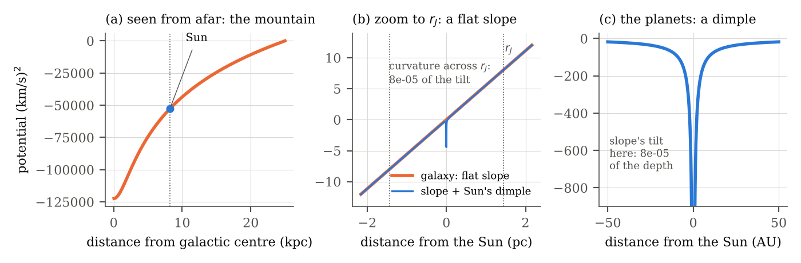
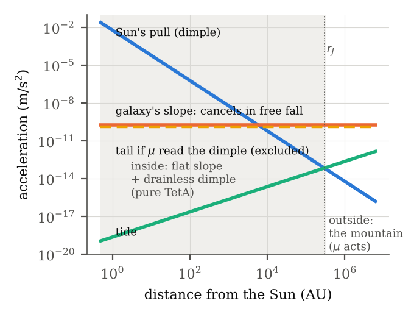

# The SST Khronon: Preferred-Frame Effects of the Time Leg

*What the SST's preferred frame does, and why it is safe · Gravity Field Dynamics (GFD) · Field Dynamics Research*

[](https://github.com/fielddynamics/research/actions/workflows/lean-sst-khronon-preferred-frame.yml)

`SST` `khronon` `preferred-foliation` `PPN` `alpha1` `alpha2` `stability` `net-field-rule` `proof`

---

This folder holds a five-page proof, a script that checks it (32 checks), a Lean 4 formalisation (15 theorems) and a script that draws its two figures. It answers the main question the [time-leg proof](../sst-covariant-time-leg/) left open.

## The picture

A mountain stream looks flat close up; zoomed out, it runs down a mountain.



- **Inside a solar system** (smaller than the Jacobi radius, 1.44 pc), the galaxy's field is a **flat slope**. Everything falls with it together, so only its curvature, the **tide** (about 2 × 10⁻¹⁸ m/s² at Saturn), is felt. The galaxy's TetB share is there (μ ≈ 0.60 at the Sun), but as part of that flat slope.
- **The Sun is a dimple** on the slope, and the dimple has **no drain**. Its own field is taken linearly, its TetB share is exactly zero, and it is pure TetA with the bare G.
- **Seen from another galaxy**, the whole **mountain** shows. The Sun is one grain of it (at the Jacobi radius its pull is 1/2700 of the galaxy's field). The mountain has the drain, so μ acts there.
- **The two views meet at the Jacobi radius**, where the Sun's pull equals the tide.



A stronger field is not the same as no drain. The law's TetB share is a₀μ, which stays between 0 and a₀ however strong the field gets. Only reading the law at the mountain's scale gives pure TetA:

| μ reads | Result | Test |
|---|---|---|
| each mass's own field | tail a₀ (about 80 mas/yr of backwards perihelion turning at Saturn) | fails |
| Sun + galaxy together | a quadrupole | fails Cassini |
| the mountain (scale r_J) | pure TetA inside | passes |

The proof below shows that the SST's preferred frame obeys this picture exactly.

## The question

The time-leg proof showed that the SST is a theory with a **preferred time direction**: the tetrad's time leg, normal to a foliation of spacetime (the "khronon"). Theories like that can make the motion of planets depend on how fast the solar system moves through the preferred frame. Experiments limit those effects, written α₁ and α₂, to below about 10⁻⁴ and 4 × 10⁻⁷. Does GFD pass?

## What we found, in plain terms

1. **The textbook formula gives nonsense for GFD, and that's a flaw in the formula.** Plugged into the published formula (Bonetti & Barausse 2015), α₂ comes out infinite, because the SST has no "expansion" or "shear" terms for the time leg. Flanagan (2023) showed that formula's method doesn't apply to theories built this way, and gave one that does.

2. **The preferred frame is the TetB share.** In Flanagan's method, the khronon's mass density is exactly GFD's phantom density, the TetB share. The preferred frame isn't a new ingredient: it is what carries the TetB share, as a conserved fluid.

3. **GFD's law is stable at every acceleration, which is rare.** Flanagan's stability test, read in GFD terms, says that neither μ nor the TetB share may decrease as the field gets stronger. For x/(x+1) the TetB share (in units of a₀) *is* μ, so the two conditions are one, and it holds everywhere. Flanagan argued that laws of this kind fail somewhere near a₀. GFD escapes because its f doesn't level off at high field.

4. **Stability forces the tail.** A law that is stable everywhere must leave every mass with a small leftover pull (the per-mass tail). Of the standard family x/(1+xⁿ)^{1/n}:
   - the "standard" MOND law (n = 2) is unstable above x ≈ 0.79;
   - laws with n < 1 leave a tail that grows without bound;
   - only n = 1, GFD's law, is stable everywhere with a bounded tail.

5. **Slope and dimple turn the preferred frame off inside the solar system.** The khronon's inertia and density are both proportional to the TetB share. The Sun's dimple has none, and the galaxy's share is a flat slope (its khronon density at the Sun is smooth and its pull is part of the tide), so the preferred-frame sector is empty: **α₁ = α₂ = 0**. Without the rule, the Sun would carry a khronon density about 20,000 times the ephemeris limit at Saturn's orbit. That is the same per-mass tail the rule already removes.

6. **Rotation curves are untouched, and there is a new prediction.**
   - A steadily rotating galaxy is stationary, so every SPARC and decoding-mass result is exact.
   - A changing system (a bar, an interaction) gets an order-unity khronon correction: the TetB share must be carried along and lags a moving pattern.

**In one sentence:** the preferred frame is GFD's TetB share; the law is stable because of the tail; and the net-field rule hides both inside a solar system.

In vortex terms, the frame flow has inertia only where there is TetB share for it to carry. Around a drain there is; in a drainless field there is nothing to move.

## Results

| Statement | Result | Checked |
|---|---|---|
| Theorem 1 | Bonetti–Barausse at β = λ = 0: α₁ = −4α finite, α₂ has a pole, c_s² = 0; their expansion does not apply there (Flanagan) | script A4–A6; Lean `bb_point` |
| Theorem 2 | GFD's f is Flanagan's f exactly; χ̄ = μ − 1; the khronon density is the phantom density (TetB share), conserved, carried by v_T = −∇π | script A1–A3 |
| Theorem 3 | Stability f′ ≤ af″ ≤ 0 ⟺ μ′ ≥ 0 and (x(1 − μ))′ ≥ 0; for x/(x+1) these coincide (x(1 − μ) = μ) and hold at every a | script B1–B4; Lean `stability_dictionary`, `share_eq_law`, `law_deriv`, `share_deriv`, `gfd_stable` |
| Theorem 4 | Stability everywhere ⇒ f ↛ constant ⇒ a per-mass tail; for GFD a₀μ → a₀. In x/(1+xⁿ)^{1/n} only n = 1 is stable with a bounded tail | script B5–B7; Lean `stability_forces_tail`, `no_constant_limit`, `share_limit`, `standard_law_turns_over` |
| Theorem 5 | Around a point mass the khronon density is positive and a mode oscillates at ω² = [2/(2 − μ)]Ω² = −dg/dr, the radial tidal frequency (Ω to √2 Ω); it does not propagate | script C1–C5; Lean `density_exponent`, `oscillation_frequency` |
| The picture | The slope cancels in free fall; the dimple has no TetB share; a stronger field never gives that (share between 0 and a₀); the edge at r_J; the three readings | script F1–F8; Lean `strong_field_not_pure`, `slope_and_dimple` |
| Theorem 6 | Khronon inertia, density and momentum ∝ TetB share; the Sun's dimple carries none and the galaxy's is flat, so α₁ = α₂ = 0 inside a star system; leakage ≤ 4 × 10⁻¹⁷ at 1 AU | script D1–D4, F5–F6; Lean `inertia_vanishes`, `slope_and_dimple` |
| Proposition 7 | Stationary systems (steady discs) exact; non-stationary systems carry an O(1) khronon correction | script E1–E2 |

## Prior work

- Blanchet & Marsat, *Modified gravity approach based on a preferred time foliation*, arXiv:1107.5264: the theory.
- Bonetti & Barausse, *Post-Newtonian constraints on Lorentz-violating gravity theories with a MOND phenomenology*, Phys. Rev. D 91, 084053 (2015), arXiv:1502.05554: the khronometric parametrisation and its PPN parameters.
- Flanagan, *Khronometric theories of modified Newtonian dynamics*, arXiv:2302.14846: the slow-motion limit at β = λ = 0, the khronon fluid and the stability conditions.

What this note adds:
- their application to GFD's f;
- the stability conditions read as conditions on μ and the TetB share;
- the proof that GFD's f meets them everywhere, and why;
- the forced tail and the uniqueness of n = 1;
- the khronon frequency;
- the khronon sector under the net-field rule.

## What it leaves open

- **Stability in general geometry.** Flanagan's density condition is established for spherical, cylindrical and planar symmetry only.
- **The size of the non-stationary correction** in any particular system (bars, interactions). This is the natural next test.
- **The mountain's scale in the action.** Now written in: [`../sst-mountain-scale/`](../sst-mountain-scale/) derives Theorem 6 from the action, with the law's term read on modes longer than each bound system's Jacobi radius.
- **Beyond the slow-motion limit.** Tensor modes travel at c; the khronon's coupling to radiating binaries is not computed.
- **The fourth term** (the electromagnetic coupling).

## Contents

| File | What it is |
|---|---|
| [`sst_khronon_preferred_frame.pdf`](sst_khronon_preferred_frame.pdf) | The proof (5 pages) |
| [`sst_khronon_preferred_frame.tex`](sst_khronon_preferred_frame.tex) | LaTeX source (IOP class, [`iopjournal.cls`](iopjournal.cls)) |
| [`verify_sst_khronon_preferred_frame.py`](verify_sst_khronon_preferred_frame.py) | 32 checks: sympy exact algebra, the solar-system and Milky Way numbers, the family scan and an orbit integration |
| [`make_figures.py`](make_figures.py) | Draws [`fig_zoom`](fig_zoom.pdf) and [`fig_scales`](fig_scales.pdf) |
| [`verify_output.txt`](verify_output.txt) | Its output |
| [`lean/KhrononPreferredFrame.lean`](lean/KhrononPreferredFrame.lean) | Lean 4 formalisation, 15 theorems, importing the [net-field rule](../net-field-rule/lean/) and the constitutive law |
| [`LEAN_AUDIT.md`](LEAN_AUDIT.md) | What the Lean proves and what is cited |

## Running the checks

```
python verify_sst_khronon_preferred_frame.py
cd lean && lake exe cache get && lake build
```

The script needs sympy, mpmath, numpy and scipy, takes a few seconds, and ends with `32/32 checks passed`.
