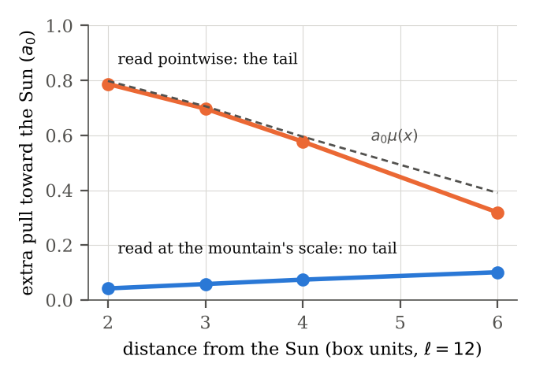

# The Mountain Scale in the SST: the Net-Field Rule From the Action

*Writing "read the law at the mountain's scale" into the action · Gravity Field Dynamics (GFD) · Field Dynamics Research*

[](https://github.com/fielddynamics/research/actions/workflows/lean-sst-mountain-scale.yml)

`SST` `net-field-rule` `mountain-scale` `Jacobi-radius` `sweeping-projector` `preferred-foliation` `action` `proof`

---

This folder holds a three-page proof, a script that checks it (23 checks), a 3D numerical solution, and a Lean 4 formalisation (5 theorems). It closes the step that the [time-leg](../sst-covariant-time-leg/), [net-field rule](../net-field-rule/) and [khronon](../sst-khronon-preferred-frame/) proofs all left open. It was revised after an external review, which is summarised below.

## The picture

A mountain stream looks flat close up; zoomed out, it runs down a mountain.

- **Inside a bound system** the host's field is a flat slope, and each body is a dimple with **no drain**: pure TetA.
- **Seen from outside**, the whole mountain shows, and the law acts on it.
- **The views meet at the system's Jacobi radius.**

## What was open

The action applied the law wherever the time leg accelerates, including around the Sun. That gives every star a tail (a pull of a₀ on every planet), which is excluded. The net-field rule removed the tail, but as a rule added on top of the action.

## What this proof does

1. **The sweeping projector writes the picture into the action.** For each bound system, the field inside its Jacobi ball is replaced by the smooth (harmonic) field with the same values on the ball's surface. That is the same as sweeping the system's mass onto its Jacobi surface as a thin shell:
   - **inside the ball** what is left is exactly the host's flat slope and tide;
   - **outside**, nothing changes (the shell theorem): from afar the system is one grain of the mountain.

   The action reads the curvature term (all of Newton and Einstein) at every point, and the law's term (the TetB share) on this swept field, the mountain.
2. **The field equation splits exactly, with each system's own Jacobi radius.** The only requirement is that the projector be self-adjoint in the field-energy product, and the sweeping projector is. It does *not* need to commute with the Laplacian. Inside each ball:
   - the field is **plain Newton for the system's own mass**, with the bare G, and the same whatever the law is;
   - plus the host's slope and tide.

   That is the net-field rule, now derived.
3. **Nesting is simple.** Sweep only the outermost bound systems of the drained host. The Earth and Moon sit inside the Sun's ball, so they are already in the Newtonian dimple.
4. **What follows:**
   - no tail;
   - galaxies unchanged once their size is large compared with the Jacobi radii;
   - γ = 1 at leading order;
   - no preferred-frame effects inside a star system, at linear order.
5. **The data fix the scale at each system's own Jacobi radius,** r_J³ = GM/(4Ω² − κ²):

   | System | Size | Its Jacobi radius | Result |
   |---|---|---|---|
   | Sun | planets out to ~0.0005 pc | 1.44 pc | dimple: pure TetA |
   | Pal 14 | 26 pc | ~160 pc | dimple: bare G, as its dispersion requires |
   | Pal 4 | 18 pc | ~270 pc | dimple: bare G |

   One universal length fails: at the Sun's 1.4 pc, Pal 14 would be read through the law, which its dispersion excludes at 8.9σ.
6. **The action does not choose the edge.** Making a Jacobi ball bigger always *raises* the field energy, because the law's energy term is concave. That is the same condition that made the khronon stable. So energy alone would pick the pointwise reading (the tail). The Jacobi edge is a **binding** criterion, which matter moves together, and not an energy minimum. In the picture's terms: the stream decides what belongs to the mountain by where it flows, not by what costs least.

## The 3D check

A galaxy and a compact "Sun" were solved in a periodic box with one fixed scale, both ways:



- **Read pointwise**, the extra pull around the Sun is the tail, matching a₀μ(x) to 3%.
- **Read on the mountain**, it is small and fades toward the Sun.
- The galaxy's own field differs from the pointwise reading by 4 × 10⁻², 3 × 10⁻³ and 2 × 10⁻⁴ for a scale of 2, 1 and ½ of its width. In the Milky Way the ratio is about 2 × 10⁻⁴.

The case where each system has its own scale is checked exactly in 1D: two systems with different Jacobi radii, where the dimple matches Newton to 3 × 10⁻¹⁴ under two different laws.

## The external review, and what changed

| Review point | Response |
|---|---|
| Position-dependent spectral cutoff breaks idempotence and commutation | Agreed. Replaced by the sweeping projector, exact for any set of systems with their own Jacobi radii |
| The split only needs P² = P and [P, Δ] = 0 | True, and the Lean proof already used that. Weaker still: P self-adjoint in the field-energy product suffices, and the sweeping projector does not commute with Δ |
| Which system's radius at the Earth? | Only the outermost bound systems of the drained host are swept; the rest are already in the linear dimple |
| r_J³ = GM/2Ω² holds only for flat curves | Now the general GM/(4Ω² − κ²) |
| The mountain obeys a projected law, not pointwise AQUAL | Agreed; stated, and the difference measured |
| Relativistic and khronon claims go beyond the static variation | Agreed; now stated at leading order (γ = 1) and linear order (khronon) |
| "Pure TetA" needs derivation from the geometry | In GFD μ is the TetA share by definition, so a linear response (μ = 1) is all TetA |
| Derive the scale selection rather than insert it | Tested: the action cannot select it (Theorem 4). It is a binding criterion, which remains a premise |

## What it leaves open

- **The binding criterion** itself, which matter forms a bound system. It is a premise, and Theorem 4 shows it cannot come from minimising the energy.
- **Time-dependent binding**: mergers and tidal stripping.
- **Higher relativistic order.**

## Contents

| File | What it is |
|---|---|
| [`sst_mountain_scale.pdf`](sst_mountain_scale.pdf) | The proof (3 pages) |
| [`sst_mountain_scale.tex`](sst_mountain_scale.tex) | LaTeX source (IOP class, [`iopjournal.cls`](iopjournal.cls)) |
| [`verify_sst_mountain_scale.py`](verify_sst_mountain_scale.py) | 23 checks: the split with a fixed scale and with each system's own scale (1D, two laws), the projector on a curved slice, nesting, the Jacobi radii, the edge test, and the 3D results |
| [`verify_output.txt`](verify_output.txt) | Its output |
| [`demo_mountain_scale.py`](demo_mountain_scale.py), [`demo_output.txt`](demo_output.txt) | The 3D solution (about 5 minutes) |
| [`galaxy_scaling.py`](galaxy_scaling.py), [`galaxy_scaling_output.txt`](galaxy_scaling_output.txt) | The galaxy's field against the scale (about 5 minutes) |
| [`make_figure.py`](make_figure.py) | Draws [`fig_demo`](fig_demo.pdf) |
| [`lean/MountainScale.lean`](lean/MountainScale.lean) | Lean 4, 5 theorems, importing the [khronon](../sst-khronon-preferred-frame/lean/) formalisation |
| [`LEAN_AUDIT.md`](LEAN_AUDIT.md) | What the Lean proves and what is cited |

## Running the checks

```
python demo_mountain_scale.py > demo_output.txt
python galaxy_scaling.py > galaxy_scaling_output.txt
python verify_sst_mountain_scale.py
cd lean && lake exe cache get && lake build
```
