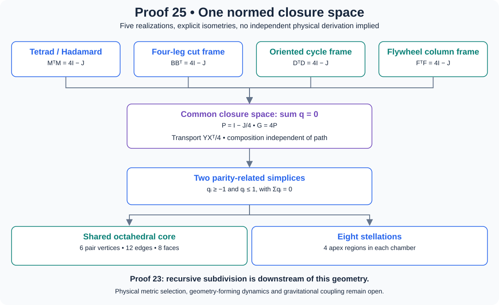
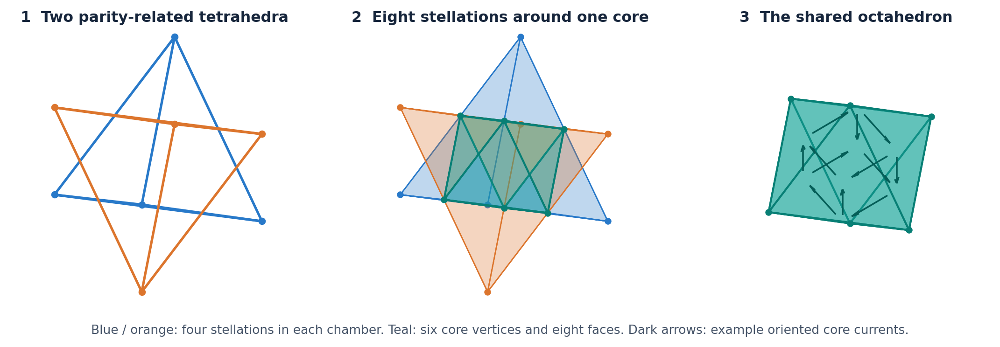
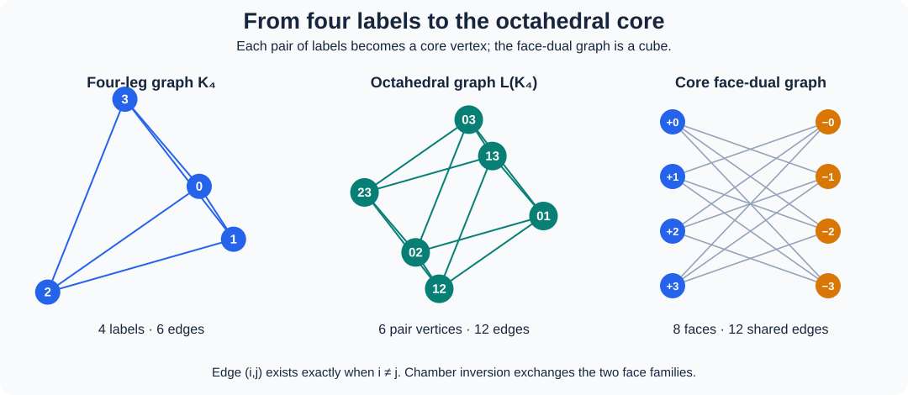

# Convergence of the Tetrad and Collective Flywheel Geometries

*Proof 25 · Gravity Field Dynamics · Field Dynamics Research · November 2026*

`tetrad` `closure-space` `Gram-matrix` `Hadamard` `vortex` `stellated-octahedron` `proof` `Lean`

**Start here.** The purpose of this proof is to explain why the spatial tetrad, the Hadamard frame and the collective eight-vortex engine all lead to the same regular tetrahedral geometry. It joins the earlier proofs by explicit maps, rather than by comparing counts. Each map preserves lengths and angles on the relevant three-dimensional space; taking a different route gives exactly the same result. The two opposite tetrahedra then produce the eight stellations around one octahedral core.



[Manuscript (PDF)](tetrad_flywheel_convergence.pdf) · [LaTeX](tetrad_flywheel_convergence.tex) · [IOP entry point](tetrad_flywheel_convergence_iop.tex) · [Python verifier](verify_convergence.py) · [Verification output](verification_output.txt) · [Lean source](lean/TetradFlywheelConvergence.lean) · [Lean audit](LEAN_AUDIT.md) · [Referee review](referee_review.md)

**Status.** All 297 exact Python assertions pass. A Lean source draft is supplied, importing Proof 24; it has not been compiled. The hand proofs establish intrinsic finite geometry under stated assumptions. They do not establish dynamical self-assembly of an initially unconstrained field, a Lorentzian metric from a Euclidean graph norm, gravitational normalization, or physical torsion. Repository source inspected at `5ce5c650871754d1411ca165d673cc3551b6a798`.

## Why these steps exist

| Step | Question answered | Why it is needed |
|---|---|---|
| 1. Recognition | Can the incidence itself be recovered? | Avoid starting with a picture of a tetrahedron. |
| 2. Common frame | What do the earlier routes actually share? | Identify the normalized invariant, with its precise premises. |
| 3. Transport | Are equal Gram matrices a genuine equivalence? | Construct the unique isometry on each frame image and prove path independence. |
| 4. Reconstruction | Why two tetrahedra and one octahedron? | Recover actual convex solids without assuming their shape. |
| 5. Core bridge | How are the faces and edges tied to the flywheel? | Derive the core incidence and explain the existing collective circulation. |
| 6. Rigidity | What breaks if the assumptions change? | Prove necessity and sharp quantitative bounds; prevent circular physical claims. |

## Read the source chain

| Source | Input to this synthesis | What it does not establish on its own |
|---|---|---|
| [Letter 1](../../papers/letter-1-tetrad-frame-geometry/) and [forced frame](../forced-tetrahedral-frame/) | Equal lengths, equal pair relations, distinctness and spatial dimension three imply the regular frame. | The Lorentz signature alone does not imply those realization premises. |
| [Half-spaces](../half-space-two-bounded-regions/) | Sixteen selections; two bounded tetrahedra; octahedral intersection. | A dynamical selection of the bounded regions. |
| [Tetrad scheme](../tetrad-scheme-two-bounded-regions/) | Two determinant signs; parity exchanges them for a fixed observer and time orientation. | Two individual tetrads or a polyhedron without a spatial realization. |
| [Gram matrix](../gram-matrix-tetrad-equation/) and [Hadamard frame](../hadamard-cube-frame/) | Common Gram and root-blindness; normalized sign-frame realization. | An identification of the positive spatial Gram with the Lorentz metric. |
| [Vortex proof](../vortices-of-the-stellated-octahedron/) and [Stage VII](../../research/hadamard-null-cone-vortex-flywheel/SUSTAINED_TRIFORCE_FLYWHEEL.md) | Circulating eigenstates and a simultaneous eight-ring/core trajectory on specified graphs. | Formation of the graph from arbitrary initial field configurations. |
| [Proof 24](../flywheel-tetrad-geometry/) | Cycle and column-frame Gram identities; current reconstruction on the actual core. | Geometric stability under deformation. |
| [Proof 23](../recursive-triforce-closure/) | Medial subdivision and the connection dictionary on the specified midpoint lattice. | Physical selection of depth or the connection carrier. |

These are compatible routes, not seven independent empirical confirmations. The half-space and scheme branches establish different properties of the realized tetrad; the Hadamard form is an equivalent coordinate realization. The cycle and column calculations require their own incidence and norm assumptions. All maps below use the same fixed four-label set, in a declared orientation.

## Theorem 1 — Recognition of the tetrahedral circulation incidence

**Why.** The reverse direction from circulation to geometry should not begin by declaring the geometry tetrahedral.

In a simple undirected graph, take four distinct simple triangular cycles, every pair sharing exactly one edge, with no edge in more than two cycles. The union of their edges is K4. Moreover, consistent boundary orientations (opposite traversal on a shared edge) exist and are unique up to common reversal.

**Proof.** Name the first triangle 012. The other three share its three distinct edges, so their vertex sets are 01a, 02b and 12c, with a,b,c outside 012. The first two of these can share an edge only if a=b, in which case it is 0a. Applying the same argument to the remaining pairs gives a=b=c. The six edges of the resulting K4 occur twice. Its four oriented face boundaries give compatible orientations; the connected adjacency graph propagates a choice of orientation on one face to all others. □

The four abstract cycles of Proof 24 are the relevant objects. They are not a claim that the eight physical outer tile rings share six actual bonds. The recognition hypotheses must be physically justified separately. Without the multiplicity restriction, four distinct triangles sharing the same common edge form a counterexample (a fan on six vertices).

## Theorem 2 — The common normed closure frame

**Why.** One closure relation explains the common dimension, but it does not itself explain the metric. We identify exactly the extra conditions needed.

Let L={0,1,2,3}, 1 be the all-ones vector, J=11ᵀ, W=1⊥, P=I−J/4, G=4P. Then P is the rank-three orthogonal projector onto W. Call X:R⁴→E a normalized closure frame if XᵀX=G, where E is a finite real Euclidean space. X1=0 because ||X1||²=1ᵀG1=0. Consequently XP=X, X/2 is an isometry on W, and Π_X=XXᵀ/4 is the orthogonal projector onto im X.

Five realizations of this definition follow from earlier results or the following calculations:

1. Abstract: X=2P, since P²=P=Pᵀ.
2. Spatial: X=M, the inherited 3×4 sign frame, with MᵀM=G and MMᵀ=4I₃. The Hadamard matrix is [1ᵀ; M], so its spatial part is M, not the full rank-four Hadamard matrix.
3. Cut: X=Bᵀ, where B is K4 vertex-edge incidence (tail −1, head +1). Each vertex has three incident edges; distinct vertices share one with opposite signs. Thus BBᵀ=G.
4. Cycle: X=D, with D columns the four coherently oriented triangle boundaries. Each has three unit entries, and every distinct pair overlaps with one opposite sign, so DᵀD=G. The identity BD=0 and rank three give im D=ker B. The cut and cycle spaces are perpendicular complements in R⁶; BᵀB+DDᵀ=4I₆.
5. Flywheel: X=F=√(3/2)Cᵀ, where R and Q sum the twelve ordered off-diagonal tile entries by rows and columns and C=Q(I−RᵀR/3). RRᵀ=QQᵀ=3I, RQᵀ=J−I. Thus CCᵀ=3I−(J−I)²/3=(2/3)G and FᵀF=G. The minimum-norm row-closed preimage is (3/8)Cᵀq for q∈W; its orthogonality to ker C in ker R gives uniqueness. This is the Proof 24 calculation, not a physical minimization postulate.

For the spatial route, equal squared lengths c² and equal off-diagonal entries b yield (c²−b)I+bJ. Noncoincidence implies c²−b>0 by squared pair distance. Since rank ≤3, the constant eigenvalue c²+3b vanishes, hence b=−c²/3. Setting c²=3 fixes our scale. The frame is forced under those premises, not from Lorentz signature alone.

**Orientation and the complementary-edge map.** In edge order 01,02,03,12,13,23 define H on the standard edge basis by swapping 01↔23 with sign −, 02↔13 with sign +, and 03↔12 with sign −. These signs correspond to the boundary convention D of Proof 24 (H is minus the oriented four-dimensional Hodge star on bivectors). Direct substitution gives Hᵀ=H, H²=I, HBᵀ=D. The signed complementary-edge map exchanges cut and cycle projectors. Under a label permutation T the oriented-edge action E has EH=sgn(T)HE, since the ordered volume changes by the permutation sign. Equivalently EBᵀ=BᵀT and ED=sgn(T)DT. The two frames are isometric as Euclidean frames, with a sign twist under improper transformations; they are not ordinary identical S₄ representations.

## Theorem 3 — Path-independent convergence of the realizations

**Why.** Matching Gram entries must give an actual, composable equivalence, not just a count.

For any two normalized closure frames X,Y define U_YX=YXᵀ/4. Then

```
U_YX X = Y,
U_YXᵀ U_YX = Π_X,
U_YX U_YXᵀ = Π_Y,
U_ZY U_YX = U_ZX.
```

**Proof.** XᵀX=YᵀY=4P and XP=X, YP=Y, ZP=Z. Inserting these equations gives all four identities; e.g. (ZYᵀ/4)(YXᵀ/4)=ZPXᵀ/4=ZXᵀ/4. The first equality defines the map uniquely on im X because its columns span that image. The second and third make it an isometry onto im Y and zero on the perpendicular complement of im X. Any closed path is Π_X, the identity on im X. □

The construction works for arbitrary finite Euclidean target dimensions, not only the five displayed matrices. It is not physical transport through spacetime, nor a claim of trivial gravitational holonomy. The polar/axial sign of Theorem 2 must be transported with the map. The scheme's determinant sign is an orientation sector of the full tetrad, and the normalized positive spatial frame is an additional realization; the former is not itself an X in this theorem.

## Theorem 4 — Intrinsic reconstruction of the dual tetrahedra

**Why.** The frame equivalence should determine the actual solids and their overlap, not merely four directions.

Use q=Mᵀx in W with physical inner product ⟨q,r⟩=qᵀr/4. Its inverse is x=Mq/4, an isometry. Define a_i=G e_i (3 at i and −1 elsewhere). Then the four a_i have Gram G in this inner product. Their inverted copy supplies the opposite frame. For S₊=conv(a_i), S₋=conv(−a_i),

```
S₊ = {q∈W : q_i≥−1},   S₋ = {q∈W : q_i≤1},
O = S₊∩S₋ = W∩[−1,1]⁴.
```

**Proof.** The barycentric coordinates of S₊ are λ=(q+1)/4; their sum is one, and Gλ=q. They are nonnegative exactly when all lower bounds hold. Inversion gives S₋. The other fourteen sign selections are unbounded: for upper-bound labels U and lower-bound labels L, both nonempty, take d_i=−|L| on U, +|U| on L. It is a nonzero zero-sum recession direction, and the ray td, t≥0, satisfies all inequalities. The uniform selections are bounded by the zero-sum relation. A point of O with at least two unsaturated entries is not extreme, since they may be perturbed by equal opposite amounts. If three entries are saturated, the fourth is ±1 by the zero sum and the bound. Conversely every point with two +1 and two −1 is extreme because all coordinates are saturated. The six such points are (a_i+a_j)/2, i<j. Under M/4 they are exactly ±e_x,±e_y,±e_z. □

In S₊ outside O exactly one q_i>1 (λ_i>1/2). The closure of that region is the tetrahedron whose vertices are a_i and the three adjacent midpoints: λ=(e_i+η)/2 with η in the standard simplex. Four such stellations occur in S₊ and four in S₋. Their interiors are disjoint; the octahedron is their common base structure, not eight independent cores. This proves the unique labelled reconstruction up to common scale and orthogonal transformation. We use + and − rather than a conflicting TetA/TetB convention: the inherited half-space proof calls the upper-bound simplex TetA, whereas the flywheel often calls the positive-vertex simplex TetA.



*The plotted coordinates are calculated from M and pair midpoints; the surfaces are the eight actual tetrahedral stellations, not artist-drawn vortex envelopes.*

**Connection with the scheme.** At fixed nondegenerate metric and fixed observer/time orientation, parity changes the sign of det e and interchanges the two spatial realizations. The determinant equation fixes (det e)², not a unique tetrad in either sector. This synthesis links that parity action to q↦−q; it does not infer the four spatial directions from determinant sign alone, and it does not collapse the full Lorentz-group solution space to two points.

## Theorem 5 — Core geometry, incidence and collective current

**Why.** The core should arise from the same four labels, not be appended as an independent oscillator.

Let N be the unsigned 4×6 incidence matrix of pairs {i,j}, with two ones per column. The physical core vertex matrix is V=MN/2. If A is the adjacency matrix of the line graph L(K4), then NᵀN=2I₆+A and

```
VᵀV = Nᵀ G N/4 = 2I₆ + A − J₆,
VVᵀ = 2I₃.
```

The first identity follows from column sums two, the second from NNᵀ=2I₄+J and M1=0. Thus diagonal entries are 1, pairs sharing a label have inner product 0 and disjoint pairs have inner product −1. The six vertices are three orthogonal antipodal pairs. This independently describes the regular octahedron's metric from its pair incidence. The eight triangular faces are the four stars (pairs containing i) and four complementary triangles (pairs not containing j); these are exactly the constraints q_i=+1 and q_j=−1. Faces of the same family share a vertex; opposite families share an edge iff i≠j, so the face-dual is K₄,₄ minus a matching, the cube. Its twelve edges are ordered distinct labels (i,j). The shared primal edge corresponding to dual edge (i,j) has midpoint (a_i−a_j)/4 in W, mapped to (s_i−s_j)/4. Inversion swaps i,j.



Orient the twelve dual edges from the positive-face family to the negative family. Write their real currents as I_ij with diagonal zero. Divergence-free means both row and column sums vanish. Connectedness gives dimension 12−8+1=5. The involution I↦−Iᵀ splits it into antisymmetric (even) and symmetric (odd) parts. The first is ker B, dimension three; for the second, four independent row constraints act on six entries, dimension two. Independence follows because a relation would require c_i+c_j=0 for every pair; a triangle forces all coefficients zero. These are current-space dimensions, not numbers of independently operating vortices.

For the Stage VII collective phase q=x+iy∈W_C, a_ij=Im(conj(q_i)q_j)=x_i y_j−y_i x_j is divergence-free by closure. This wedge gives the even current pattern, and all directions of ker B can occur: Λ²W is three-dimensional and every bivector in three dimensions is decomposable; the wedge maps injectively to the antisymmetric arrays with zero row sums, hence onto. For j₀=Dᵀa, DDᵀa=4a, so Dj₀=4a. From the established flywheel ansatz with amplitudes v,w, scale ρ and bond weights r=k=−1, Proof 24 gives, on the six independent entries of the actual even core current,

```
j=(2ρ²|v|²/3)Dᵀa,   I_even=2ρ²|w|²a,
|v|² I_even=(3/4)|w|²Dj.
```

This is valid also at v=0 (the divided gain is not). The outer mean ring currents j are consistently oriented in the D convention. The opposite-chamber means follow by the inherited parity relation. The four abstract triangular reads are not the literal 24 outer ring bonds. Stage VII proves particular sustained solutions on the fixed 33-site graph; there is one collective phase vector and no separately prescribed core phase in that ansatz. This is the mathematical sense in which the circulation realizes the intrinsic geometry. A core angular current is not axial through-flow, and this algebra does not prove spontaneous vortex formation.

## Theorem 6 — Metric rigidity and sharp robustness

**Why.** An unassailable proof should show what fails if its assumptions are removed, and precisely how regularity depends on the edge metric.

For positive weights w_e on the six edges, G_w=Dᵀdiag(w)D. The off-diagonal entry (i,j) is −w_{complement(i,j)}, since the cycles share exactly the complementary edge. Consequently the six weights are recoverable from the off-diagonal entries. G_w is a multiple of G iff all weights agree; this is true for diagonal edge metrics, not a classification of arbitrary 6×6 metrics. For q∈W,

```
4 min(w)||q||² ≤ qᵀG_w q ≤ 4 max(w)||q||².
```

Proof: ||Dq||²=4||q||² and every term in the weighted sum lies between its extreme-weight multiples. In particular relative operator deviation from 4w₀ I_W is at most ε if all w_e/w₀∈[1−ε,1+ε]. Symmetrizing G_w over label permutations gives w̄G, w̄=(Σw_e)/6, because the average has equal diagonal/off-diagonal entries, annihilates constants, and trace 2Σw_e. This is a mathematical average, not dynamics.

**Sharp deviation theorem.** Put δ=w−w̄1 and let N_c=|D|ᵀ (unsigned complementary-edge incidence), d=N_cδ. Then

```
||G_w−w̄G||_F² = 2||δ||² + ||d||²,
2||δ||² ≤ ||G_w−w̄G||_F² ≤ 4||δ||².
```

The off-diagonal terms are the six −δ values twice each; diagonal terms are the incident sums d. Also N_c N_cᵀ=2I+J. Since Σδ=0, d∈W. The singular-value bound on the zero-sum edge subspace is √2: for d≠0, ||d||²=⟨N_cᵀd,δ⟩≤√2||d||||δ||. For d=0 the bound is immediate. Equality in the lower bound occurs for any nonzero δ∈ker N_c (dimension two); equality in the upper bound occurs for δ=N_cᵀt, t∈W nonzero, using N_c N_cᵀt=2t. Both variations can be scaled small enough to keep every weight positive. Thus the constants are sharp. □

Counterexamples: diag(2,1,1)M still has closure, rank three and equal column lengths, but not equal pair relations. A nonuniform positive edge metric keeps the same graph and destroys the regular Gram. The four-loop fan defeats recognition without the multiplicity assumption. Hence neither the closure equation alone nor arbitrary circulation nor a fixed-graph evolution selects the regular embedded geometry. The conclusion is an exact equivalence of the stated symmetric constructions.

## Recursive closure follows, rather than supplying another independent route

Proof 23 applies to the reconstructed tetrahedral faces: first medial subdivision into a central and three lateral tiles, and complete depth two on the specified fixed midpoint-generated lattice. This gives 16 paired subaddresses per face and 64 across four paired faces; pointing parity 40/24. Its signed connection dictionary is A₄-equivariant with a full S₄ reflection obstruction and a conditional repair. Pairing the surfaces is an address convention, not equality of their physical amplitudes. No identification of pointing parity with physical torsion, or of 21/17/13 traces with circulation counts or gravitational coupling, follows from this synthesis.

## Reproduce and continue

Run `python verify_convergence.py` (SymPy) for the 297 exact assertions, including all 125 compositions, 24 orientation actions, all fourteen mixed half-space rays, and explicit sharpness witnesses. These checks overlap; they are not independent proofs. `python draw_diagrams.py` reproduces the two SVG diagrams; `python draw_stellations.py` reproduces the coordinate figure. The [Lean audit](LEAN_AUDIT.md) states exactly which theorems are encoded and which arguments remain prose. A successful build is required before marking it verified.

**Next physical question:** can an independently derived interaction law select the incidence and equal metric, and sustain the eight-vortex geometry under deformation? That requires evolving geometry, not simply another proof on a fixed graph. Proof 25 provides the exact target and the necessity tests for that law.
