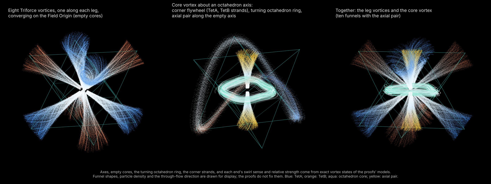

# Vortices of the Stellated Octahedron

*The cube with its stellated octahedron holds vortices: circulating states around an empty axis, which read as rotating waves of the cube · Gravity Field Dynamics (GFD) · Field Dynamics Research*

`stellated-octahedron` `vortex` `ring-current` `standing-wave` `tetrahedral-symmetry` `Field-Origin` `Triforce` `proof`

---

This folder holds:
- a five-page proof ([PDF](vortices_of_the_stellated_octahedron.pdf), [LaTeX](vortices_of_the_stellated_octahedron.tex)): four pages of proof and one of figures;
- a script that checks every step ([`verify_vortices_stellated_octahedron.py`](verify_vortices_stellated_octahedron.py), 81 checks, [output](verify_output.txt));
- an internal referee review ([`referee_review.md`](referee_review.md)), with the change made for each point.

The revision after review made five changes:
- it corrected the sign of the current;
- it added the octahedron's own edges to the cube graph;
- it stated the time-reversal degeneracy;
- it read the rotating wave in the coupled-oscillator sense;
- it gave hand proofs for the Triforce split.

The proof consolidates the research in [`research/diamond-tetrad-lattice/vortex-theorem/`](../../research/diamond-tetrad-lattice/vortex-theorem/THEOREM.md).

## The question

GFD always works with a cube holding a stellated octahedron. TetA and TetB interlock, and their overlap, the central octahedron, is the Field Origin, with centre O. Can this shape hold a vortex: something that circulates around an axis, with an empty core?

## What a vortex means here

The proof works with the stationary states, the waves the cube can hold.
- **Stationary state:** an energy eigenstate. Its intensity pattern never changes.
- **Vortex:** a stationary state that winds around an axis and carries a current circulating around it.
- **How the current is measured:** as the physical flow through any half-plane whose edge is the axis. The proof shows every such half-plane gives the same value, so nothing depends on how it is measured.

The proof covers every Hamiltonian with the tetrahedral symmetry on two graphs:
- **the cube graph, on the cube's points:** the Field Origin (its centre O and its octahedron's six vertices, with the octahedron's edges) and the eight corners;
- **the Triforce graph, on the cube's faces:** the centre O, the 8 central tiles and the 24 outer tiles, which are the Triforce's central and outer sub-channels.

The symmetry keeps TetA and TetB distinct and lets them differ. The graphs fix which sites are coupled. They are not nearest-neighbour graphs. In both, TetA and TetB couple only through the Field Origin, never along the cube's edges. This matches GFD's position that TetB is reached only through the Field Origin. The coupling algebra notes that symmetry alone would also allow the cube's edges.

## The answer

**Yes. About each axis of the octahedron:**
- **Energies.** There are exactly three vortices and three antivortices, with distinct energies, one between each pair of the corner energies.
- **Empty axis.** Every vortex is zero at the Field Origin's centre and at the octahedron's two vertices on the axis.
- **Current.** The current is $I = (E - \Delta_f - 2h)\lvert\rho\rvert^2$, where:
  - $\rho$ is the amplitude on each vertex of the Field Origin's equatorial ring;
  - $h$ is the hopping along the octahedron's edges.
- **Locking.** The cube's 8 corners are locked to that ring, and turn with it. The circulation runs through the Field Origin, around its empty centre.
- **Without the Field Origin's octahedron nothing circulates,** in this graph, where TetB is reached only through the Field Origin. If the cube's edges are added, the corners can circulate on their own.

**Waves.** Read as modes of a network of coupled oscillators:
- **A vortex is a rotating wave.** A quarter turn of the pattern equals a fixed delay, so the pattern turns once per period.
- **A pair makes a standing wave.** A vortex plus its antivortex oscillates in place and carries no current.
- **In the quantum reading, nothing visibly rotates.** A stationary state's density and currents are constant, and the quarter turn is only a phase.

**Time reversal.** Every vortex level is shared with its antivortex. The theorems say which circulating states exist. Which one the system is in is set by its initial state, or by something that breaks time reversal.

**Context.** That the Walsh–Hadamard functions are standing waves is established mathematics. They are the eigenmodes of the Boolean cube: the eigenvectors of its Laplacian, with eigenvalue 2|S| (O'Donnell, *Analysis of Boolean Functions*, Cambridge University Press, 2014). Each one is real, so on its own it carries no current. What the proof adds is that the cube's symmetry combines degenerate modes into circulating states.

**About each leg (the Triforce faces):**
- **Six vortices on W′.** In the archive's Triforce terms, a star point's outer sub-channel (its three outer tiles, spatial coupling) turns around an empty core. That core is exactly the gravitational coupling line: penetrator → central tile → Field Origin → partner central tile → partner penetrator. Six such vortices exist for all parameter values except a measure-zero set.
- **Four doubled states on W.** Four further winding states have doubled energies, given in closed form by a 2×2 matrix. Whether every combination of them circulates depends on the parameters.

## The vortices, rendered



*Left: the eight leg (Triforce) vortices. Centre: the core vortex about an octahedron axis, with the turning octahedron ring (aqua), the TetA (blue) and TetB (orange) corner strands locked to it, and the empty axis. Right: both together.*

**Taken from exact vortex states of the proof's models:** the axes, the empty cores, the turning ring, the corner strands, and each end's swirl sense and relative strength.

**Drawn for display only:** the funnel shapes, the particle density and the direction of flow along an axis. The theorems do not fix these.


*The same vortices as currents.* Each arrow is the physical current on a bond in an exact vortex eigenstate, and marker size is amplitude.
- **(a)** A vortex of the cube graph about an octahedron axis, with TetA and TetB unequal: the corners and the octahedron ring carry the current together around the empty axis.
- **(b)** The same vortex from above.
- **(c)** A Triforce vortex, looking down a leg: the star point's outer sub-channel (its three outer tiles) circulates around the empty leg.

Both images are generated by [`make_vortex_render.py`](../../research/diamond-tetrad-lattice/pixel-vortex/make_vortex_render.py) and [`make_vortex_figure.py`](../../research/diamond-tetrad-lattice/pixel-vortex/make_vortex_figure.py). They appear as figures 1 and 2 of the PDF.

## Why it holds

1. **The axis symmetry is exact.** A quarter turn about an octahedron axis swaps TetA and TetB, so when they differ it is not a symmetry. The rotoreflection is: a quarter turn plus a top–bottom flip. A 120° turn about a leg is a symmetry in every case.
2. **Winding forces an empty axis.** A state that picks up a phase under the symmetry must vanish wherever the symmetry leaves a point in place. So the Field Origin's centre and the axis are always empty.
3. **Conservation makes the current well defined.** In a stationary state the current is conserved at every site, so the same total crosses every half-plane bounded by the axis.
4. **The cube graph reduces to a 3×3 problem.** About an octahedron axis it is solved exactly, for all parameters. This gives the energies, the locking of the corners to the ring, and the current in closed form. The octahedron's edges leave the energies unchanged and add $-2h\lvert\rho\rvert^2$ to the current.
5. **The Triforce splits by symmetry.** The winding space about a leg is 10-dimensional, and representation theory splits it into two parts:
   - **W′ (6 dimensions):** every state circulates and turns the ring, for generic parameters. This is certified by exact polynomial calculations over $\mathbb Q(i)$ and $\mathbb Q(\omega)$, written without any computer-algebra system.
   - **W (4 dimensions):** it lives on the star points. There the Hamiltonian is two copies of one 2×2 matrix, which is why its energies are doubled.

## What it does not claim

- That the GFD field occupies these states.
- That these models are the field's dynamics. The theorems concern the stated graphs and class of models.
- That anything braids.
- That the currents are persistent in the equilibrium sense. Every vortex level is shared with its antivortex.
- That linear models capture the Field Origin. In GFD it is nonlinear, non-analytic at zero field.
- Anything about flow along the axis. In GFD's hourglass picture, that is the through-flow at the throat; the theorems fix only the swirl.

## Contents

| File | Contents |
|---|---|
| [`vortices_of_the_stellated_octahedron.pdf`](vortices_of_the_stellated_octahedron.pdf) | The proof, 5 pages (4 of proof, 1 of figures) |
| [`vortices_of_the_stellated_octahedron.tex`](vortices_of_the_stellated_octahedron.tex) | LaTeX source |
| [`verify_vortices_stellated_octahedron.py`](verify_vortices_stellated_octahedron.py) | 81 checks: 54 exact certificates (pure Python, no computer algebra) and 27 symbolic checks in all parameters (sympy) |
| [`verify_output.txt`](verify_output.txt) | Output of the script |
| [`referee_review.md`](referee_review.md) | Internal referee review and the response to each point |
| [`vortex_render.png`](vortex_render.png) | Particle render of the vortices |
| [`vortex_figure.png`](vortex_figure.png) | Bond currents of exact vortex states |

## Reproduce

```
python verify_vortices_stellated_octahedron.py      # 81/81
pdflatex -jobname=vortices_of_the_stellated_octahedron '\providecommand\ead[1]{\email{#1}}\input{vortices_of_the_stellated_octahedron.tex}'
```

## Related

- [Research note and theorem](../../research/diamond-tetrad-lattice/vortex-theorem/THEOREM.md), with the earlier research notes and the scripts that make the renders. Those scripts use the reversed current sign; the note carries a correction.
- [The Gram matrix of the tetrad equation](../gram-matrix-tetrad-equation/): TetA and TetB as the two roots, and the stellated octahedron's symmetry.
- [The Walsh eigenmodes of the cube](../walsh-eigenmodes-of-the-cube/): the vortices are made of the T₂ (vector and bivector) modes.
- [The coupling algebra](../../research/coupling-algebra/), [the Triforce synthesis](../../research/faces/enterprise_triforce_synthesis.md) and [TetA and TetB as one vortex](../../research/vortex-hourglass/): the framework context for the bond set, the sub-channels and the hourglass.
