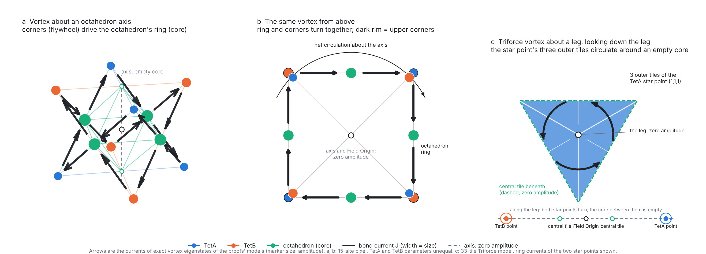

# Vortices of the Stellated Octahedron

*The pixel holds vortices: standing waves of the cube that rotate about an empty axis · Gravity Field Dynamics (GFD) · Field Dynamics Research*

`stellated-octahedron` `vortex` `standing-wave` `tetrahedral-symmetry` `Field-Origin` `Triforce` `proof`

---

This folder holds a four-page proof ([PDF](vortices_of_the_stellated_octahedron.pdf), [LaTeX](vortices_of_the_stellated_octahedron.tex)) and a script that checks every step ([`verify_vortices_stellated_octahedron.py`](verify_vortices_stellated_octahedron.py), 72 checks, [output](verify_output.txt)). It consolidates the research in [`research/diamond-tetrad-lattice/vortex-theorem/`](../../research/diamond-tetrad-lattice/vortex-theorem/THEOREM.md).

## The question

The pixel of GFD is the stellated octahedron in its cube. TetA and TetB interlock, and their overlap is an octahedron around the Field Origin. Can this shape hold a vortex: something that circulates around an axis, with an empty core?

## What a vortex means here

The proof works with the waves (stationary states) the pixel can hold.
- **Stationary state:** a state whose intensity pattern never changes. It is a standing wave of the cube.
- **Vortex:** a stationary state that winds once around an axis and carries a current circulating around it.
- **How the current is measured:** through any half-plane whose edge is the axis. The proof shows every such half-plane gives the same value, so nothing depends on how it is measured.

The proof covers every model of the pixel with the tetrahedral symmetry, which keeps TetA and TetB distinct and lets them differ.

## The answer

**Yes. About each axis of the octahedron:**
- there are exactly three vortices and three antivortices, with distinct energies;
- the axis is empty: every vortex is zero at the Field Origin and at the octahedron's two vertices on the axis;
- the current is $I = -(E - \Delta_f)\rho^2$, where $\rho$ is how strongly the octahedron's ring moves;
- the cube's 8 corners act as a flywheel, locked to that ring;
- without the octahedron nothing circulates. The octahedron is what turns.

**The standing-wave picture holds exactly.**
- **A vortex is a standing wave that rotates.** Its intensity never changes, and turning it a quarter turn about the axis gives the same pattern a fixed time earlier.
- **A pair makes a fixed standing wave.** A vortex plus its antivortex is an ordinary standing wave that oscillates in place and carries no current.

**About each leg (the Triforce faces):**
- the three outer tiles of a star point turn around an empty core;
- the core runs through the central tiles and the Field Origin to the opposite star point;
- six such vortices exist for all parameter values except a measure-zero set;
- a further four winding states have doubled energies, and whether every combination of them circulates depends on the parameters.

## The vortices, rendered


*Left: the eight leg (Triforce) vortices. Centre: the core vortex about an octahedron axis, with the turning octahedron ring (aqua), the TetA (blue) and TetB (orange) corner strands acting as the flywheel, and the empty axis. Right: both together.* The axes, the empty cores, the turning ring, the corner strands, and each end's swirl sense and relative strength come from exact vortex states of the proof's models. The funnel shapes, particle density and the direction of flow along an axis are drawn for display only; the theorems do not fix them.



*The same vortices as currents.* Each arrow is the current on a bond in an exact vortex eigenstate; marker size is amplitude. (a) A pixel vortex about an octahedron axis, with TetA and TetB unequal: the corners and the octahedron ring circulate together around the empty axis. (b) The same vortex from above. (c) A Triforce vortex, looking down a leg: the star point's three outer tiles circulate around the empty leg.

Both images are generated by [`make_vortex_render.py`](../../research/diamond-tetrad-lattice/pixel-vortex/make_vortex_render.py) and [`make_vortex_figure.py`](../../research/diamond-tetrad-lattice/pixel-vortex/make_vortex_figure.py) and appear as figures 1 and 2 of the PDF.

## Why it holds

1. **The axis symmetry is exact.** A quarter turn about an octahedron axis swaps TetA and TetB, so when they differ it is not a symmetry. The rotoreflection is: a quarter turn plus a top–bottom flip. A 120° turn about a leg is a symmetry in every case.
2. **Winding forces an empty axis.** A state that picks up a phase under the symmetry must vanish wherever the symmetry leaves a point in place, so the Field Origin and the axis are always empty.
3. **Conservation makes the current well defined.** In a stationary state, current is conserved at every site, so the same total crosses every half-plane bounded by the axis.
4. **The pixel reduces to a 3×3 problem.** About an octahedron axis it is solved exactly, for all parameters, giving the energies, the locking of corners to the ring, and the current in closed form.
5. **The Triforce case is certified exactly.** The winding space about a leg is 10-dimensional. It splits exactly into a 6-dimensional part, where every state circulates and turns the ring, and a 4-dimensional part with doubled energies. The generic statements are certified by exact polynomial calculations over $\mathbb Q(i)$ and $\mathbb Q(\omega)$, written without any computer-algebra system.

## What it does not claim

- That the GFD field occupies these states.
- That these models are the field's dynamics. The theorems concern the stated class of models.
- That anything braids. The strands checked are unlinked, and the legs meet at the Field Origin.

## Contents

| File | Contents |
|---|---|
| [`vortices_of_the_stellated_octahedron.pdf`](vortices_of_the_stellated_octahedron.pdf) | The proof, 4 pages (3 of proof, 1 of figures) |
| [`vortices_of_the_stellated_octahedron.tex`](vortices_of_the_stellated_octahedron.tex) | LaTeX source |
| [`verify_vortices_stellated_octahedron.py`](verify_vortices_stellated_octahedron.py) | 72 checks: 54 exact certificates (pure Python, no computer algebra) and 18 symbolic checks in all parameters |
| [`verify_output.txt`](verify_output.txt) | Output of the script |
| [`vortex_render.png`](vortex_render.png) | Particle render of the vortices |
| [`vortex_figure.png`](vortex_figure.png) | Bond currents of exact vortex states |

## Reproduce

```
python verify_vortices_stellated_octahedron.py      # 72/72
pdflatex -jobname=vortices_of_the_stellated_octahedron '\providecommand\ead[1]{\email{#1}}\input{vortices_of_the_stellated_octahedron.tex}'
```

## Related

- [Research note and theorem](../../research/diamond-tetrad-lattice/vortex-theorem/THEOREM.md), with the earlier pixel and Triforce notes and the scripts that make the renders.
- [The Gram matrix of the tetrad equation](../gram-matrix-tetrad-equation/): TetA and TetB as the two roots, and the stellated octahedron's symmetry.
