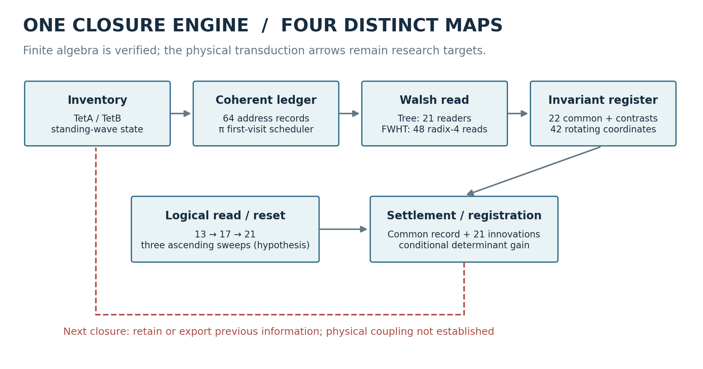
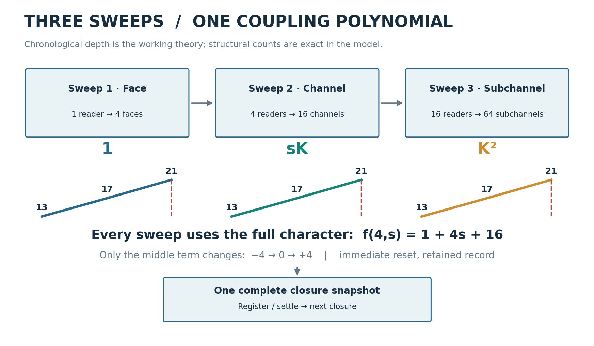
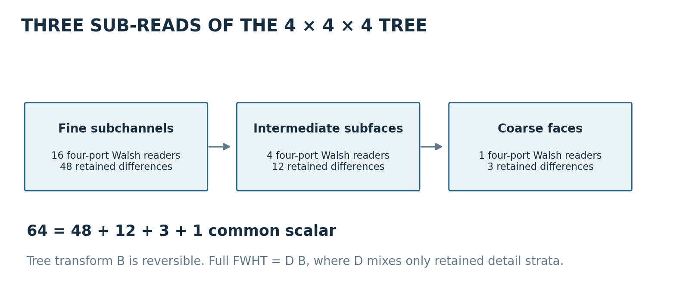
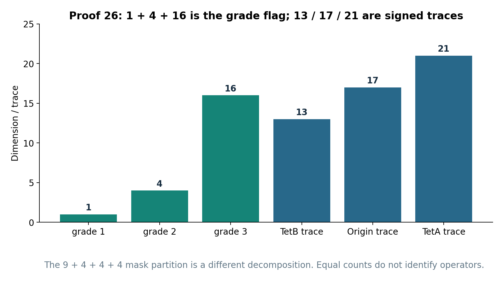
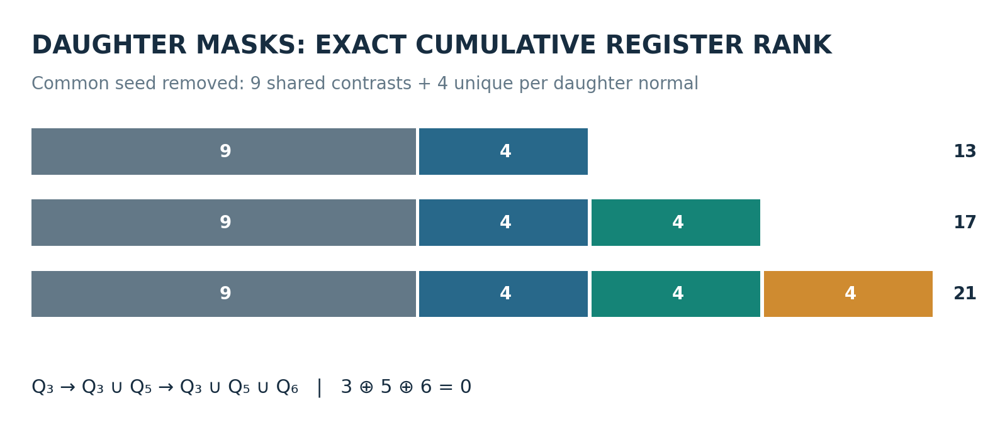
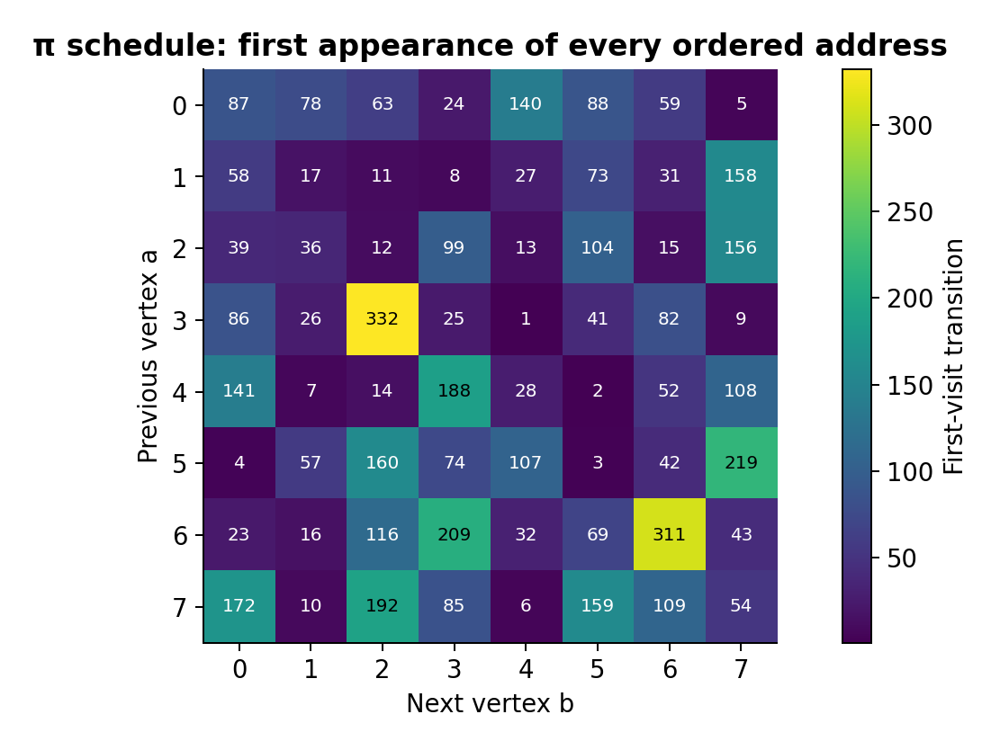
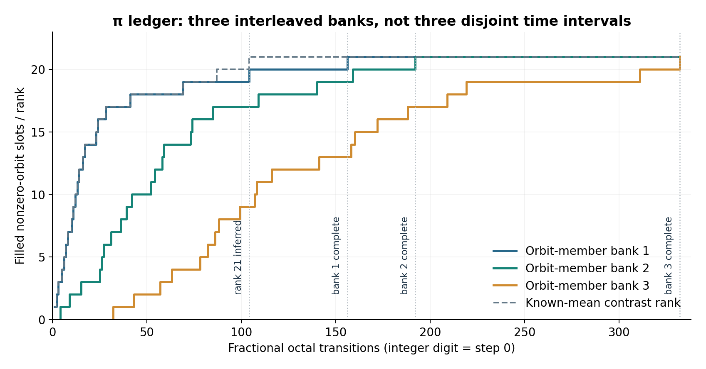
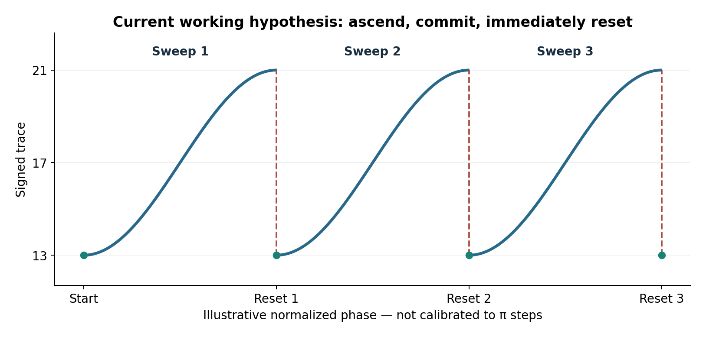
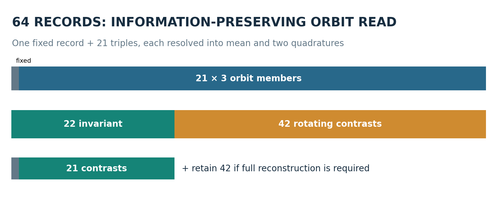

# Three-Sweep Understanding · v3

**Gravity Field Dynamics | Closure-engine research compendium | 27 November 2026**

> One closure cycle, three proposed ascending reads, one retained inventory. The Walsh read, the π address schedule, and the physical settlement mechanism must be connected by explicit operators—not merely by matching integers.

This folder is the consolidated successor to `research/3 sweep understanding`. It preserves all three original files, adds the later Proof 26, recursive Triforce, π/BBP, I Ching, and Field Origin findings, and provides a reproducible finite-algebra implementation. It does not change Proof 26 or assert a completed physical derivation of gravity.



## 1. The current understanding

The GFD picture is a stellated octahedral field with coupled tetrahedral chambers TetA and TetB, an interface called the Field Origin, and a standing-wave/vortex inventory. The proposed closure engine reads that inventory at successive resolutions and registers the result. The working hypothesis is **three ascending sweeps, each from the TetB coupling 13 through the neutral Field Origin coupling 17 to the TetA coupling 21, followed by an immediate reset to 13**. This supersedes the older slow inhale–exhale return interpretation. The reset is a candidate logical operation; the timing, physical carrier, and work law are not yet derived.

The useful advance is that the related finite algebra is now precise enough to constrain the engine. The closure algebra of the original folder supplies the Walsh/Clifford framework and cyclotomic character; the new work supplies the address tree, the invariant register, a genuine progressive rank theorem, the certified π walk, and a reversible reset protocol.

### Central working theory: face → channel → subchannel



The standing-wave and vortex inventory is proposed to be read in three successive resolutions. **Sweep 1 reads the four faces; sweep 2 reads the sixteen channels (four per face); sweep 3 reads the sixty-four subchannels (four per channel).** Each sweep runs through the full 13 → 17 → 21 coupling progression and immediately resets to 13, advancing the depth selector while retaining the previous resolution. Only after all three passes is the complete field snapshot registered and settled. This is the primary physical working theory, not a result that the π ledger has already proved.

The coupling polynomial has three structural components: **1 (scalar/root), sK (parity-sensitive linear vielbein/frame), K² (parity-even quadratic frame/metric)**. At K=4 these correspond structurally to the 1 root reader, 4 face-local readers, and 16 channel-local readers; they resolve 4, 16, and 64 addresses respectively. The original code explicitly assigns the odd parity to the linear term. The depth selector and the phase s are independent: no sweep is limited to one term or one coupling state. See the [full three-sweep theory and mathematical construction](research_notes/FACE_CHANNEL_SUBCHANNEL.md).

| Sweep | Read resolution | Reader count | Address count | Phase character |
|---|---|---:|---:|---|
| 1 | Faces | 1 | 4 | 13 → 17 → 21 |
| 2 | Channels | 4 | 16 | 13 → 17 → 21 |
| 3 | Subchannels | 16 | 64 | 13 → 17 → 21 |

**Status key:** [T] mathematical identity or theorem under stated definitions; [N] independently reproduced finite computation; [D] conditional model consequence; [H] physical hypothesis requiring derivation. None of [T]/[N] alone establishes a physical theory.

## 2. Six meanings of “three sweeps”

| Construction | Exact result | What it does not establish |
|---|---|---|
| Original closure algebra [T] | Order-three action and cyclotomic factors | A physical stopping rule |
| Hierarchical tree read [T] | 16 + 4 + 1 four-way readers | Three temporal cycles |
| Full Walsh transform [T] | Three radix-four stages, 48 four-way reads | π generated the butterflies |
| Daughter-trigram masks [T] | Cumulative ranks 13 → 17 → 21 | Chamber labels or physical time |
| π address banks [N] | Completion at 156, 192, 332 transitions | Three nonoverlapping sweeps |
| Signed orientation read [D/H] | Trace 13 → 17 → 21, possible reset | A native clock, attenuation or force |

These are compatible ingredients, not six independent proofs of the same operator. In particular, the three rank-increment masks, three tree levels, three chronological orbit-member banks, and three proposed physical passes must not be identified by the number three alone.

## 3. Geometry and the two Walsh reads

The recursive Triforce model uses four face directions, four subfaces per face and four children per subface. Its mathematical address ledger has 64 leaves. Geometric addressing and the proposed temporal read go coarse-to-fine; the existing tree Walsh aggregation algorithm goes fine-to-coarse. A nested prefix projection gives an exact progressive snapshot model (ranks 1,4,16,64; orthogonal increments 3,12,48). These are two compatible mathematical views of a snapshot, not proof of the native temporal order. At each four-way node an orthogonal Walsh matrix h = H₄/2 retains one common coefficient and three details.



The tree needs 16 fine readers, four intermediate readers, and one coarse reader. It gives a common scalar and 63 details: 64 = 1 + 48 + 12 + 3. All are recoverable. A full tensor Walsh transform is not the same operation; it is obtained by a detail mixer D applied to the tree transform B. Exact identity: H₆₄/8 = D B. The full transform uses 48 four-point transforms (or 192 two-point butterflies). The eight-vertex cube itself has the Walsh grade counts 1,3,3,1. The 64-leaf ledger is not automatically the 36-coordinate microscopic vortex state or the 64-component affine connection.

See [operator dictionary and proofs](research_notes/OPERATOR_DICTIONARY.md) for definitions and the native Pauli read distinction.

## 4. The signed coupling ladder

Let K=4 and f(K,s)=1+sK+K². The three **terms** are rank-zero scalar, rank-one parity-odd vielbein, and rank-two parity-even frame/metric components (legacy code terminology). The three **states** are evaluations of the entire polynomial, not the three terms. The middle term changes sign; the baseline 1+16=17 is unchanged. Then

| GFD label | s | Coupling character |
|---|---:|---:|
| TetB | −1 | 13 |
| Field Origin | 0 | 17 |
| TetA | +1 | 21 |

Proof 26 gives a grade flag of invariant contrasts with ranks (1,4,16). Writing the orthogonal grade projectors as G₁,G₂,G₃, the constructed response is A_s=G₁+sG₂+G₃ and its trace is f(4,s). Equivalently, on the contrast space, TetA is I, TetB is J*=I−2G₂ and the Field Origin character is (I+J*)/2. The 13 is a signed trace, not the rank of the TetB chamber. The Origin's character is not a statement that the equal-shares ring x=1 is the physical throat.



The cyclotomic identities inherited from the original folder are f(K,+1)=Φ₃(K), f(K,0)=Φ₄(K), f(K,−1)=Φ₆(K). Their product f(K,+1)f(K,−1)=1+K²+K⁴=273 at K=4. The 273 is a distinct projective count (PG(2,16)); it is not the number of nonzero elements in the actual lower-triangular Sierpiński blocks, which have 91. The 21-dimensional flag is also different from the 21 internal tree readers.

## 5. I Ching: an actual 13→17→21 register theorem

On V=F₂³, use ordered pairs (a,b), with R(a,b)=(b,a⊕b). R³=I. It has one fixed address and 21 length-three orbits, so the invariant space has dimension 22. Remove the canonical common seed f(a,b)=1[a=0]+1[b=0]+1[a=b] rather than deleting a coordinate. The seed is fixed by the symplectic Walsh operator; it is not the uniform mean used in another settlement model.

For an axis u≠0, Qᵤ retains pairs dependent modulo span(u). Each reduced mask has rank 13; each pair of distinct masks has rank-nine intersection. The three daughter normals perpendicular to Heaven 111 are 011,101,110 (decimal 3,5,6). They sum to zero. Their common intersection has rank nine and each contributes four unique directions. The union is exactly the complete 21-dimensional seed-orthogonal register.



Consequently any ordering of these three masks yields 13,17,21 cumulative ranks. Independent triples instead yield rank 19. The six daughter orderings are tested. A separate minimal exchange-even completion also has ranks 13 and 17 but has different parity content; it is not the same operator as the union of two daughter masks. See the [immediate-reset prior study](research_notes/IMMEDIATE_RESET_PRIOR.md).

## 6. π stepping: the actual 333-digit closure

The address schedule starts with the integer octal digit 3 at step 0. Each fractional digit d updates v→(v+d) mod 8. The ordered pair (old v,new v) is recorded; XOR is not used for this update. We independently certify the 332 fractional digits using rational BBP bounds, not a floating-point approximation.



The first full 64-pair coverage happens at transition 332 (digit 333 including the integer digit). The final new pair is (3,2). The orbit assignment is a separate XOR-based operation. Track the first, second and third distinct member of each three-member orbit in three banks:

| Transition | Bank 1 | Bank 2 | Bank 3 | Distinct pairs |
|---:|---:|---:|---:|---:|
| 156 | 21 | 19 | 13 | 54 |
| 192 | 21 | 21 | 17 | 60 |
| 332 | 21 | 21 | 21 | 64 |



The completed-third-member counts really are 13,17,21 at the three bank boundaries. This is a striking finite correspondence, but not a proof of causal equivalence: the completed orbit sets do not equal the daughter masks at the first two boundaries; 32 future-bank entries already exist at the first boundary. The prior random-walk control reproduced the count pattern in 1,626 of 200,000 trials (0.813%, reported prior result, not rerun here). This is not a preregistered significance test.

A static or coherently time-referenced table X can be sampled in this order. Register the first sample per address, then perform the FWHT; equivalently sum the spectral outer products for newly seen pairs. Both exactly recover the normalized two-index read H₈ X H₈, with H₈ normalized. The second implementation is a direct transform, not a fast butterfly algorithm. π orders the read but does not itself establish the physical FWHT circuit.

## 7. Three ascending sweeps and immediate reset



The continuous orientation model has an orthogonal four-dimensional rotating plane M and a skew generator A, with A²=−M. Its lifted read U(θ)=I+(cosθ−1)M+sinθ A gives contrast trace 17+4cosθ. Reading θ from π to 0 yields 13→17→21. The reset waveform in the figure is illustrative, not fitted to BBP transitions. A natural order-three phase sampling instead gives 21,15,15, not the desired ladder; also U(π) and the signed orientation gate can have equal trace without being equal operators.

The proposed chronological read is face → channel → subchannel, retaining the previous prefix resolution at every reset. The exact nested-projection implementation demonstrates the information structure, not native timing. A complementary logical protocol is to acquire an address snapshot; preserve it or compensate to a common reference time; select the daughter masks in sequence; commit the resolved record; return the read controller to its start without deleting the physical state. Repeat for the three proposed reads. The three bank acquisitions overlap, so a controller that clears all pending data at each reset is incompatible with the observed ledger.



Each triple can be converted into one mean and two quadratures with an orthogonal Fourier matrix. All 64 values are retained as 22 invariant coefficients and 42 rotating contrasts. If only the invariant register is physically needed, the latter may be absent by symmetry or stored elsewhere; an arbitrary register cannot be irreversibly discarded in a closed reversible model. The common line of the chosen contrast space must also be retained. The I Ching is used here as a mathematical labeling framework, not as historical evidence of physics.

## 8. Settlement, attenuation and gravity

Proof 26's conditional attenuation calculation becomes incremental using 21 orthogonal innovations on the orbit-constant register with independently known uniform weighted mean. Each new independent contrast resolves one projector Dᵢ. Repeated visits resolve no new direction. Their sum is I−P_mean. Complete rank 21 is attained at transition 104 if the mean is independently known; direct orbit coverage is at 156; complete three-member verification is at 332. These are different milestones.

If the elementary amplitude on a resolved direction is t, the transfer T=I+(t−1)L obeys det(T†T)=|t|^(2 rank L). Choosing |t|²=α gives α²¹ at full invariant settlement; full arbitrary 64-address contrasts would instead give α⁶³, while a three-stage serial amplitude path would give α³ in intensity if each stage had intensity α. The orthogonal reset itself has unit determinant magnitude and supplies no attenuation. A rank-based conditional coupling normalization gives the expression

$$G_{\rm candidate}=\frac{17}{13}\,\alpha^{21}\,\frac{\hbar c}{m_e^2}.$$

Some other GFD notes include the electron magnetic-moment factor g_e/2. This compendium does not choose or fit that correction; it preserves Proof 26's stated expression. The physical elementary gain, selection of determinant as work observable, stiffness ratio and dimensional source response must be derived, not inferred from a matching number. Hierarchical registration at all field-object scales is the intended GFD interpretation; no superluminal signaling or instantaneous physical propagation is established by an algebraic reset.

## 9. Research priorities: closing the actual engine

The next advance should derive the map between the native 36-coordinate field state and the 64-address read ledger, then produce a native event/clock rule and a chamber-sensitive action. The strict tests are: (1) preserve common inventory through reset; (2) recover the specific Walsh and daughter-mask operators, not just ranks; (3) account for interleaved π samples without mixing incompatible times; (4) show the physical mechanism selecting 21 innovations; (5) derive the work response and its long-wave flux; (6) test against native free-evolution inversion symmetry and density positivity. See [next proof roadmap](research_notes/NEXT_PROOF.md).

## 10. Folder guide and reproduction

| File / directory | Purpose |
|---|---|
| `legacy/` | All three original repository files, byte-exact at pinned commit |
| `research_notes/FACE_CHANNEL_SUBCHANNEL.md` | Central theory, polynomial components, exact progressive snapshot model |
| `research_notes/OPERATOR_DICTIONARY.md` | Exact proofs, notation and crosswalk |
| `research_notes/NEXT_PROOF.md` | Prior-model limitations, native dynamics and research program |
| `research_notes/*_PRIOR.md` | Full preserved recent immediate-reset, π-innovation and rotation notes |
| `sweep_engine.py` | Reusable finite model and certified scheduler |
| `tests/test_sweep_engine.py` | 129 executed tests |
| `generate_figures.py` | Recreates all figures and ledgers |
| `figures/` | Nine diagrams in both PNG and SVG |
| `outputs/` | π digits, full step ledger, mask membership, running rank, test log |
| `SOURCES.md` | Pinned provenance, source map and exact legacy hashes |

Run from this folder:

```bash
python -m pip install -r requirements.txt
python -m pytest -q
python generate_figures.py
```

The new verifier ran successfully: **129 passed**. Tests verify algebraic consequences and finite data; they are not 114 independent proofs of a physical model. Original legacy script preserved separately and not required for these tests. No Lean proof run, experimental validation, or GitHub write was performed.
