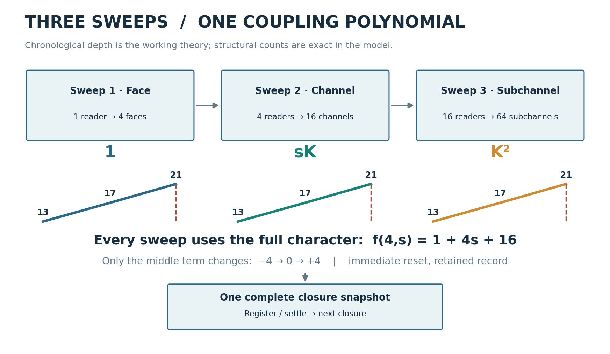

# The three-sweep field-read theory

**GFD working theory — 27 November 2026.** The proposed chronological order is face → channel → subchannel. The three-term coupling polynomial gives the mathematical organizing principle; the physical timing, orientation control and π-to-geometry transduction remain open.

## 1. One engine, two independent indices

A single stellated-octahedral field has two coupled tetrahedra (TetA and TetB), with standing waves and vortices carrying the proposed field inventory. The Field Origin mediates their read/registration relationship. The hypothesis is that one complete snapshot is obtained through three increasingly fine passes of the same engine, not three independent fields or three separate settlements.

Let K=4, with addresses (a,b,c) in {0,1,2,3}³. Here a identifies a face direction, b identifies a channel within that face, and c identifies a subchannel within that channel (called subface and child in the recursive Triforce research). A sweep selects the depth d=1,2,3. Within each depth an independent read phase s runs from −1 through 0 to +1; the controller then immediately returns to −1 while retaining the record. Thus each of the three sweeps has the full 13→17→21 coupling trajectory. There is no slow return, and s is not the depth index.

| Sweep | What is resolved | Four-way parent readers | Output addresses | Coupling trajectory |
|---|---|---:|---:|---|
| 1 | Face directions | 1 | 4 | 13→17→21, reset |
| 2 | Channels within each face | 4 | 16 | 13→17→21, reset |
| 3 | Subchannels within each channel | 16 | 64 | 13→17→21, reset for next closure |

The read controller changes resolution at reset, not the underlying geometric inventory. The 4,16,64 outputs are nested views of one ledger; do not sum them as independent inventory or count the same source three times.

## 2. The three components of the polynomial

The original `legacy/gfd_algebra.py` explicitly describes the tetrad equation as three structural ingredients of ranks 0,1,2 on the frame space. Its rank-one vielbein is parity-odd; ranks zero and two are parity-even. In this terminology the scalar/root, linear frame/kinematic, and quadratic frame/metric components are:

$$f(K,s)=\underbrace{1}_{\text{rank 0}}+\underbrace{sK}_{\text{rank 1}}+\underbrace{K^2}_{\text{rank 2}}.$$

| Term | Structural interpretation | Recursive correspondence | K=4 contribution |
|---|---|---|---:|
| 1 | Scalar/root; parity-even, unchanged by s | One root reader resolving four faces | +1 |
| sK | Linear vielbein/frame; parity-sensitive | Four face-local readers resolving sixteen channels | −4, 0, +4 |
| K² | Quadratic frame/metric sector; parity-even | Sixteen channel-local readers resolving sixty-four subchannels | +16 |

This correspondence is a structural count, not an established identification of the physical vielbein with a particular reader. The 21 reader nodes have three groups 1+4+16. Separately, the invariant contrast flag of Proof 26 has dimensions 1,4,16; it is not literally the set of tree nodes. If G₀,G₁,G₂ are the flag's mutually orthogonal projectors, then A(s)=G₀+sG₁+G₂ and tr A(s)=1+4s+16. Each of the three passes is hypothesized to use this same coupling character. Do not assign one fixed coupling value or just one polynomial term to a sweep: the row correspondence concerns resolution architecture, whereas the character is the sum of all three terms at each s.

| Read phase | s | Rank 0 | Rank 1 | Rank 2 | Character |
|---|---:|---:|---:|---:|---:|
| TetB | −1 | 1 | −4 | 16 | 13 |
| Field Origin | 0 | 1 | 0 | 16 | 17 |
| TetA | +1 | 1 | 4 | 16 | 21 |

The invariant baseline is 17; the linear component swings by ±4. The range is 8, the cube vertex count at K=4. The zero of the middle term is not a zero of the entire field or a deletion of four stored coordinates. At s=0 the signed trace operator itself has rank 17; at s=±1 it has rank 21. In particular 13 is not its rank. The separate I Ching daughter-mask construction has actual cumulative ranks 13,17,21 and must not be identified with this signed character by matching numbers alone.

## 3. Exact coarse-to-fine snapshot model

For a coherently time-referenced scalar or complex ledger x[a,b,c], let E_d be the orthogonal conditional-mean projection onto functions constant on prefixes of length d. E₀ is the global mean, E₁ is the face average broadcast across its descendants, E₂ is the channel average broadcast, and E₃=I. In counting inner product E_i E_j=E_min(i,j). The nested ranks are 1,4,16,64. Retaining the innovations Δ_d=E_d−E_(d−1) gives orthogonal increments of ranks 3,12,48 and exact recovery:

$$x=E_0x+\Delta_1x+\Delta_2x+\Delta_3x.$$

The chronological face → channel → subchannel protocol is thus a mathematically valid progressive reveal of a retained snapshot. After each read, the previous record can be retained and only the next innovation added. Walsh coordinates of these same four strata give the existing fine-to-coarse tree transform B, and detail mixing gives the full FWHT. Calculating coarse averages from raw leaves requires access to those leaves or pre-existing coherent aggregates: the construction does not demonstrate that coarse reads arrive earlier in native time.

Under the specified simultaneous order-three digit cycle, the invariant prefix ranks become 1,2,6,22. Its invariant innovations have ranks 1,4,16, the very dimensions used in Proof 26's signed character. This gives an exact algebraic bridge between depth refinement and polynomial grading *within that representation*. It does not supply an identification with physical corner-pair rotations or select the physical sign on grade 1 (the four-dimensional middle grade).

## 4. π-walk, reset and registration

The π hypothesis is that the cumulative octal walk addresses the standing-wave inventory and drives the progressive spectral read. The certified finite prefix covers 64 ordered pairs in 332 fractional transitions (333 digits including the initial 3). Its three interleaved orbit-member banks complete at transitions 156,192,332. The π bank data do not demonstrate the face/channel/subchannel chronology, three equal 111-digit sweeps, or a native BBP generator. A geometric pair-to-prefix map, physical time law and coherent sampling rule must be derived. The separate six binary FWHT stages or three full radix-four stages are not the physical sweeps by definition.

At the end of sweep 1 retain the face record; at sweep 2 retain its channel refinements; at sweep 3 retain subchannel refinements and register the complete snapshot. Reset the read orientation without clearing the previous information. For a closed physical process an active reset must account for energy and norm; a logical index reset alone does not establish instantaneous physical action. The proposed settlement then updates the field response and makes the new registered inventory available for the next closure, including nested field objects. Neither a native force law nor the α gain is derived here.

## 5. Verification and next proof

`prefix_read` and `progressive_snapshot` in `sweep_engine.py` implement the nested projections. New tests check projector ranks, nestedness, orthogonal detail energies, reconstruction for arbitrary complex snapshots, invariant grades and the polynomial trace. The proof target is the native coupling between the actual vortex state, the depth selector and the read phase, including the π schedule and a derived work functional. The existing Proof 26 is unchanged.
