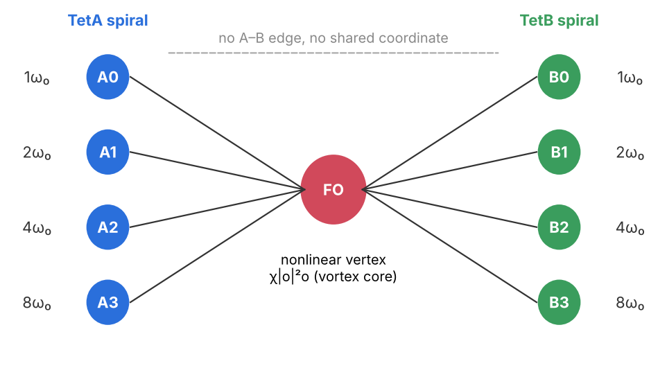
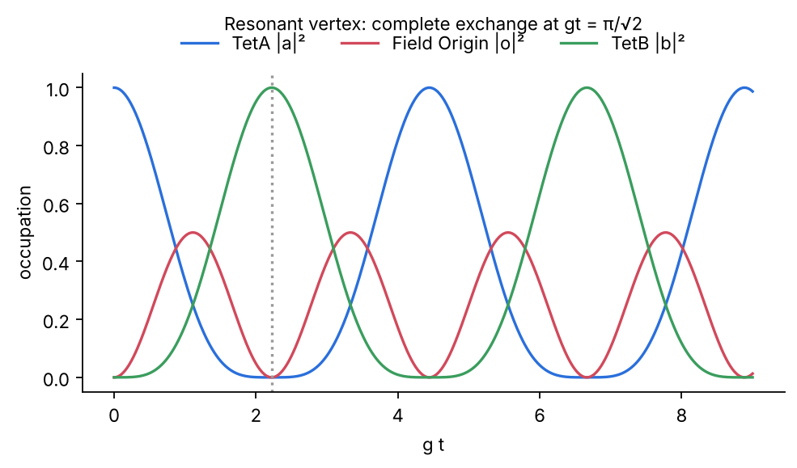
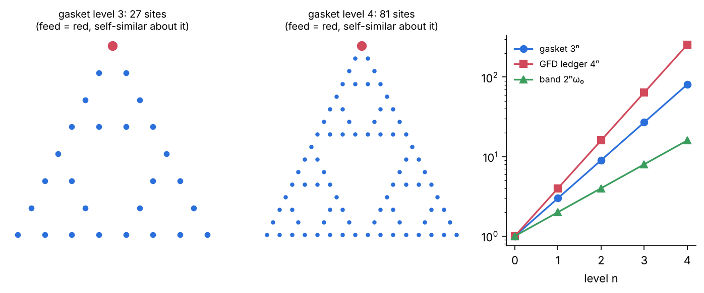
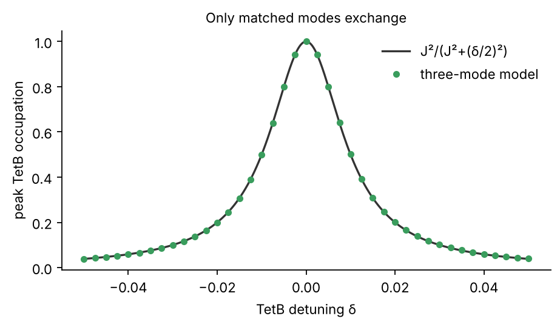
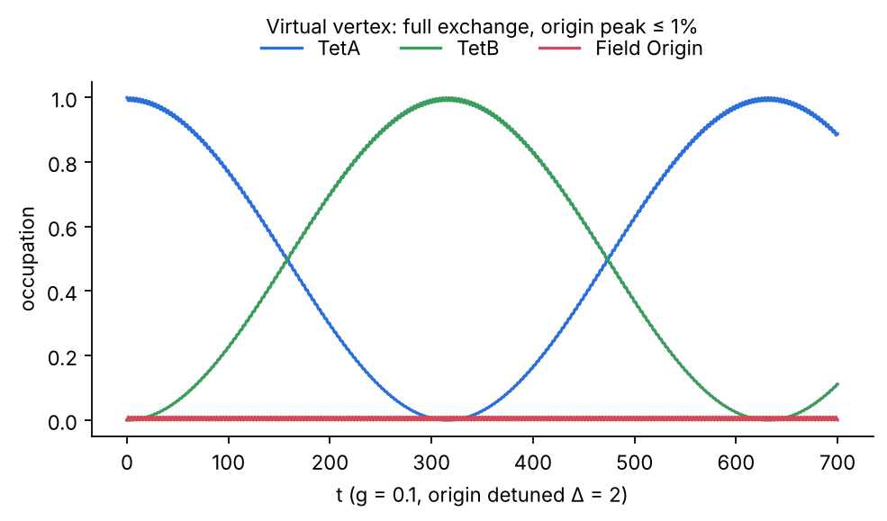
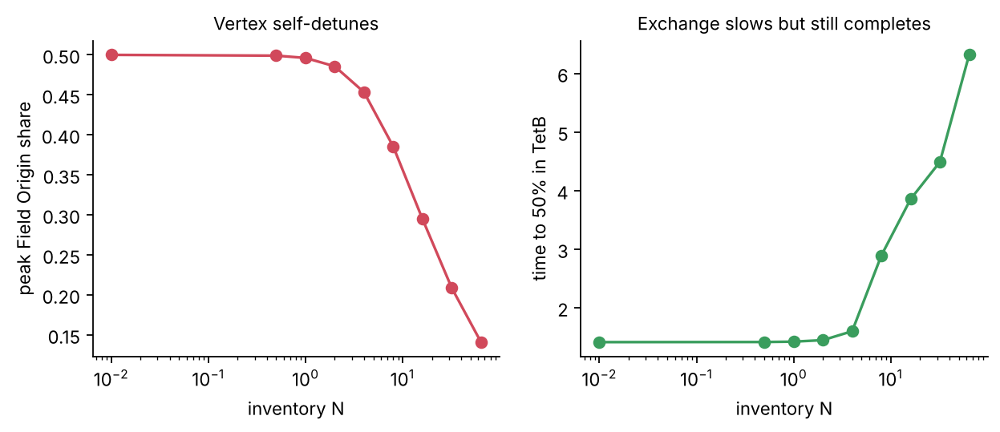

# Antenna Theory · v2

**Gravity Field Dynamics | Resonant coupling through the Field Origin | 27 November 2026**

> TetA and TetB share no space. They communicate only through the Field Origin, a nonlinear vertex, and what they exchange is selected by resonance.

This folder is the consolidated successor to the original `research/antenna theory`. It keeps both original files unchanged in `legacy/`, adds a sourced review of Sierpiński antenna engineering, and lays out the non-spatial resonance mechanism with a reproducible finite model and tests. It does not change any proof or paper.



## 1. The current understanding

**TetA and TetB communicate through the nonlinear Field Origin, by resonance, not through space.** TetA is our observable 3+1 chamber. TetB is a subspace reachable only through the Field Origin. Nothing travels between them through space. Each chamber carries its own self-similar ladder of modes, and the only term connecting the two ladders sits at the Field Origin. The picture is a water-vortex hourglass: two spiral funnels whose only shared element is the core at the throat. A wave in one spiral reaches the other only by exciting the core, and it gets through only if the other spiral has a matching wave.

The full statement, model and results are in [the non-spatial resonance note](research_notes/NONSPATIAL_RESONANCE_FIELD_ORIGIN.md). In short:

| Result | Status |
|---|---|
| With **no** TetA–TetB term, the chambers still exchange their entire inventory through the vertex: complete at gt = π/√2 | [T] closed form |
| A detuned origin acts as a **virtual vertex**: full exchange (99.99%) while the origin never holds more than ~1% | [D, N] |
| **Resonance selects** what exchanges: peak transfer J²/(J²+(δ/2)²); matched self-similar ladders exchange in every band, a ladder scaled by 0.9–1.5 exchanges < 5% | [D, N] |
| The origin's nonlinearity is the cubic vortex-core form (Hasimoto). It **self-detunes**: as inventory grows the origin's share falls (0.50 → 0.14) while exchange still completes | [D, N] |
| Lossless and time-reversible throughout; no dissipation or circuit machinery | [T] |

**Status key:** [T] identity or theorem under stated definitions · [N] reproduced finite computation · [D] consequence of the stated model · [H] physical hypothesis.



## 2. What Sierpiński antennas actually show

From the measured literature ([review](research_notes/SIERPINSKI_ANTENNA_LITERATURE.md)):

- A five-iteration Sierpiński gasket monopole matches at five bands spaced by a factor of **2**, the gasket's own scale factor (Puente et al. 1996, 1998). The surface current is self-similar band to band, and infrared thermograms confirmed it.
- The multiband behaviour is organised **around the feed**. Best (2002) showed that most of the gasket's gaps can be removed with little effect, as long as the gaps along the axis through the feed stay. Hohlfeld and Cohen (1999) showed that frequency independence needs self-similarity **and** symmetry about the feed point.
- Sierpiński tetrahedron antennas have been 3D-printed. No stellated-octahedron (two interpenetrating Sierpiński tetrahedra) antenna was found.

**What this gives GFD:** a measured precedent for a structure whose resonances form a dyadic ladder, organised by self-similarity about one central point. In GFD that point is the Field Origin, and it is the one genuine structural parallel. The literature gives **no** measurement of 2/17, no evidence about TetB, and no link to gravity.



The physical gasket keeps 3 of 4 children (3ⁿ). GFD's complete ledger keeps the gate child too (4ⁿ = 64 at depth three, with gate-depth counts 27/27/9/1). These are two different constructions and must not be conflated.

## 3. Resonance, not distance



Matched frequencies decide which modes exchange. Because each chamber's ladder is self-similar (2ⁿω₀), two matched chambers resonate in every band at once. A uniformly mis-scaled partner barely exchanges at all. In vortex terms, a TetB spiral turning the same way but more slowly is a detuned partner.



## 4. The nonlinear Field Origin



A thin vortex core obeys the cubic nonlinear Schrödinger equation (Hasimoto 1972), so the Field Origin is given that χ|o|²o nonlinearity. At small inventory the linear results return exactly. At large inventory the core's own frequency shift detunes it, so it holds less and less of the inventory while still passing all of it. A nonlinearity at the vertex alone does **not** trap inventory on one side while the chambers stay matched; one-way behaviour would need a detuning or an asymmetry.

The framework calls for one vertex law with two regimes. This package models the **drainless / resonant** regime (a local solar system's field has no open drain). The **draining / transfer** regime (a galaxy's open drain) is the next step.

## 5. Legacy audit

The [audit](research_notes/LEGACY_AUDIT.md) keeps what stands and flags what does not:

- **Stands:** gate-depth counts, μ(x) algebra and the dyadic bands.
- **Incorrect:** the inner octahedron has 12 edges, not 9, which undercuts the 128 + 9 + 1/28 route.
- **Conflicts with the framework:** treating the continuous (x−1)/(x+1) → −1 deep field as TetB.
- **Superseded:** "the Field Origin emerges in the space between" two structures. The current position is non-spatial.
- **The legacy test script:** it prints 20/20, but 11 of its checks compare a constant with itself and cannot fail. It is superseded by the 63 tests here, every one of which can fail.

## 6. Folder guide and reproduction

| File / directory | Purpose |
|---|---|
| `legacy/` | The two original files, byte-exact |
| `research_notes/NONSPATIAL_RESONANCE_FIELD_ORIGIN.md` | Central mechanism: model, results, vortex grounding, limits |
| `research_notes/SIERPINSKI_ANTENNA_LITERATURE.md` | What measured Sierpiński antennas show and don't |
| `research_notes/LEGACY_AUDIT.md` | Claim-by-claim review of the originals |
| `research_notes/NEXT_STEPS.md` | Draining regime, band couplings, link to the three-sweep read |
| `antenna_engine.py` | Sierpiński bookkeeping and the three-mode vertex model |
| `tests/test_antenna_engine.py` | 63 tests |
| `generate_figures.py` | Recreates all figures and ledgers |
| `figures/` | Six diagrams, PNG and SVG |
| `outputs/` | Gasket/ledger table, nonlinear-vertex sweep, test log |
| `SOURCES.md` | Literature and provenance |

Run from this folder:

```bash
python -m pip install -r requirements.txt
python -m pytest -q
python generate_figures.py
```

Result: **63 passed**. The tests check identities and the behaviour of the stated model. They are not evidence that GFD's chambers obey it.
