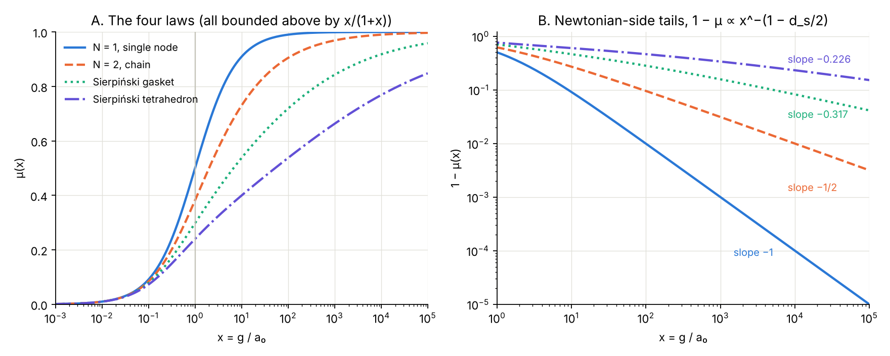

# Antenna Theory

*The coupling between TetA and TetB read as a circuit and an antenna · Gravity Field Dynamics (GFD) · Field Dynamics Research*

`constitutive-law` `transmission-line` `impedance` `sierpinski` `fractal-antenna` `screening` `field-origin`

---



*The constitutive law produced by four networks of one construction. Every curve lies below GFD's law x/(1 + x), and the more fractal the network, the more slowly it reaches the Newtonian regime. From [`network_constitutive_laws.md`](network_constitutive_laws.md).*

---

This folder asks what the coupling through the Field Origin looks like to an electrical engineer. It holds two layers of work.

1. **The result.** [`network_constitutive_laws.md`](network_constitutive_laws.md) is the current, tested account. Every statement in it is checked by script. **Start here.**
2. **The original note.** [`resonant_coupling_field_origin.md`](resonant_coupling_field_origin.md) and [`twenty_antenna_tests.py`](twenty_antenna_tests.py) are the earlier exploratory work that proposed reading the field as a Sierpiński fractal antenna. They are kept as written; the [status table](#status-of-the-original-claims) says which claims have been tested.

## The findings

**The constitutive law is a transmission line.** GFD's Möbius map $s = (x-1)/(x+1)$ is exactly the reflection coefficient Γ, with $x$ the normalised load impedance.
- The constitutive law $\mu = (1+s)/2$ is the voltage divider.
- The transition $x = 1$ is the matched load, where the power delivered, $4\mu(1-\mu) = 1 - s^2$, is greatest.
- The TetA↔TetB exchange $x \to 1/x$ is the quarter-wave transformer.

**The paper's N = 2 law is an infinite ladder.** The per-section transfer of an infinite L-ladder satisfies the screening equation $x(1-\mu)^2 = \mu$ exactly, and gives $1/\varphi^2$ at the transition.

**Sierpiński networks give new, exactly computable laws.** Built the same way, the Sierpiński gasket gives $\mu(1) = 0.298$ and the Sierpiński tetrahedron $\mu(1) = 0.240$.
- **Deep field:** $\mu \approx x - c\,x^2$, where $c = 1 + (\text{edges at the corner})$, giving 1, 2, 3, 4.
- **Newtonian side:** $1 - \mu \propto x^{-(1 - d_s/2)}$, with $d_s$ the network's spectral dimension, verified to five digits.

**Every such network is bounded by x/(1 + x).** The corner's own shunt sits in parallel with the rest, so $\mu_{\text{net}}(x) \le x/(1+x)$. GFD's law is the most Newtonian law any network of this construction can produce.

**The fractal-antenna reading fails observationally.** Against the radial acceleration relation and the Solar System, the fractal laws do worse than N = 1, and worse the more fractal they are. The excess at Saturn's orbit is 0.14% for N = 2, 2.5% for the gasket and 12% for the tetrahedron. What survives is the bound, together with the case for a nonlinear, screening shunt as the next model.

## Contents

| File | Contents |
|---|---|
| [`network_constitutive_laws.md`](network_constitutive_laws.md) | The result: the transmission-line dictionary, the ladder reading of N = 2, the Sierpiński laws, the bound, and the comparison with observation |
| [`network_constitutive_laws.py`](network_constitutive_laws.py) | 17 checks, exact or high precision: the dictionary (symbolic), the chain against Eq. 23, decimation against brute-force meshes, the deep-field and tail exponents, the bound and ordering, and the fits; draws the figure |
| [`network_constitutive_laws.png`](network_constitutive_laws.png) | The figure |
| [`resonant_coupling_field_origin.md`](resonant_coupling_field_origin.md) | The original note: Sierpiński subchannels, the Möbius map, the fine-structure count, resonant bands and the BBP walk |
| [`twenty_antenna_tests.py`](twenty_antenna_tests.py) | The original script comparing Sierpiński bowtie antennas with the coupling polynomial |

## Status of the original claims

| Claim in the original note | Status | Where |
|---|---|---|
| The Möbius map $s(x)$ governs the coupling across the Field Origin | **Established, and sharpened**: it is the reflection coefficient of a transmission line | `network_constitutive_laws.md` §1 |
| $\mu + (1-\mu) = 1$, $\mu(x) + \mu(1/x) = 1$, $x(1-\mu) = \mu$ | **Established** (identities); in circuit terms, the voltage and current shares and the quarter-wave transformer | §1 |
| The gravity field *is* a Sierpiński fractal antenna | **Tested and not supported** as a passive network: such networks are bounded by $x/(1+x)$, and their slow tails fit the data worse | §§3–4 |
| Sierpiński bands spaced by a factor of 2 | Consistent with the engineering literature on Sierpiński monopoles; not tested here for the three-dimensional structure | — |
| The twenty antenna tests | **Interpretation.** Most assert equalities between framework constants (for example 2 = 2) rather than checking antenna behaviour | `twenty_antenna_tests.py` |
| The three values of the number-theoretic Möbius function as the polynomial's three states (Part 7) | **Interpretation.** The Möbius transformation and the Möbius function share a name, not a mechanism | — |
| The BBP walk, its "agreement" weights, Lorentzian signs and closure at 333 digits (Part 10) | **Corrected** in the I Ching programme: the reading order is free, the weight rule is ordered, and closure belongs to the space of digits | [`../exploratory/i-ching/README.md`](../exploratory/i-ching/README.md#status-of-the-original-claims) |
| $1/\alpha = 128 + 9 + 1/28$ (Part 8) | Not tested here | — |

## Reproduce

```bash
pip install numpy scipy sympy mpmath matplotlib
cd "research/antenna theory"
python network_constitutive_laws.py      # 17 checks; writes the figure
python twenty_antenna_tests.py           # the original 20 tests
```

## Next

The open direction is screening. In the circuit picture, a shunt whose impedance depends on the local field can steepen the Newtonian-side tail beyond the passive bound. That would test whether the bimetric sector's Vainshtein screening can reconcile the N = 2 law with the Solar System. A separate direction is to build the stellated octahedron as a wire antenna and model its resonances directly.
