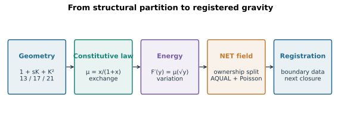
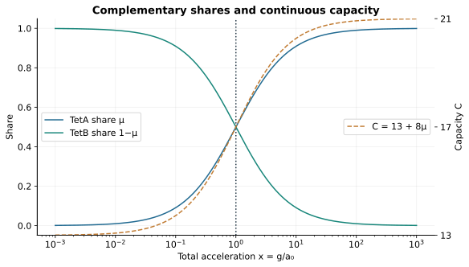
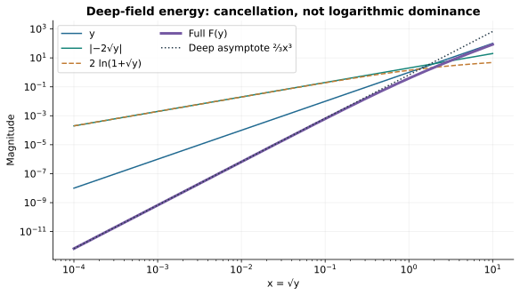
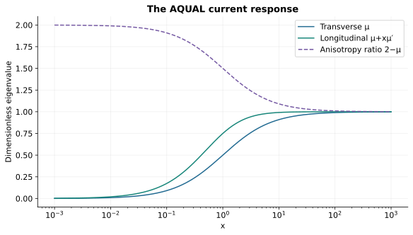
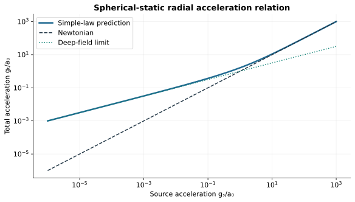
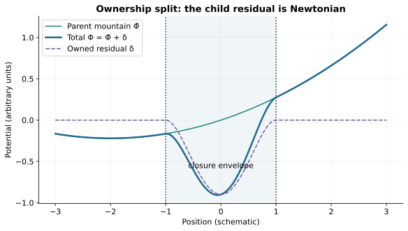
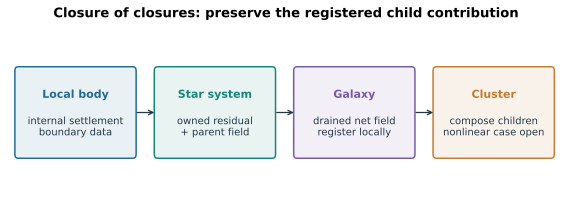

# AQUAL in Gravity Field Dynamics

**From two-chamber partition to gravitational energy, field equations and recursive settlement**  
Field Dynamics Research · November 2026 · research consolidation, v2

> **The central idea.** AQUAL supplies the gravitational response of the field that is actually being read. The GFD constitutive law allocates that response between TetA and TetB; the energy functional makes the allocation variational; the net-field and mountain-scale results specify which part of a composite field receives the constitutive response. Local closure, settlement and registration are proposed at every scale, including galaxies.



## 1. Start with the entire chain

Let $g_t=|\nabla\Phi|$ be the total acceleration, $g_s$ the source/Newtonian acceleration in a symmetry-reduced field, $x=g_t/a_0$, and $y=x^2$. The static AQUAL functional is

$$\mu(x)=\frac{x}{1+x},\qquad F(y)=y-2\sqrt y+2\ln(1+\sqrt y),\qquad F'(y)=\mu(\sqrt y).$$

$$S_{\rm static}=\int d^3r\left[-\frac{a_0^2}{8\pi G}F(y)-\rho\Phi\right],\qquad \nabla\cdot[\mu(x)\nabla\Phi]=4\pi G\rho.$$

The three equations play different roles. The first is a constitutive statement, the second fixes the energy, and the divergence equation follows by variation. **AQUAL is not the whole SST**: SST names the four-term covariant action. In the GFD reading the scalar energy represents the lapse response, and the Newtonian part of the energy is counted once, not twice. The covariant and ownership prescriptions are further model ingredients, not consequences of the integral alone.

## 2. The three components of the coupling polynomial

$$f(K,s)=1+sK+K^2,\qquad K=4,\qquad s\in\{-1,0,+1\}.$$

| Structural component | TetB ($s=-1$) | Field Origin ($s=0$) | TetA ($s=+1$) |
|---|---:|---:|---:|
| Scalar / root, $1$ | 1 | 1 | 1 |
| Linear / signed, $sK$ | −4 | 0 | +4 |
| Quadratic / metric, $K^2$ | 16 | 16 | 16 |
| Total character | **13** | **17** | **21** |

The rank-one term changes sign; the other two do not. Extend the discrete character with the **continuous share difference** $\sigma(x)=2\mu(x)-1$, not a literal chamber location:

$$C(x)=17+4\sigma(x)=13+8\mu(x)=\frac{21x+13}{1+x}.$$

Thus $C(1/x)+C(x)=34$. A pair of exchange-related states has mean capacity 17. On the 16-dimensional tensor square the swap $\tau$ has symmetric/antisymmetric ranks 10/6. The identity $I+\sigma\tau=2[\mu P_++(1-\mu)P_-]$ yields the same character by taking its trace and adding 1. This is exact algebra; assigning the two projectors to physical chambers requires the tetrad interpretation. The discrete labels, continuous response, and Proof 26's signed recursive counts are related but not interchangeable operators.



**The energy has three terms as well**, $y$, $-2\sqrt y$, and $2\ln(1+\sqrt y)$. They follow by integration, not by matching individual terms of the coupling polynomial. In the deep field the first two powers cancel against the logarithmic expansion, leaving $\frac23y^{3/2}$.



## 3. The formal mathematical result

The existing [AQUAL energy proof](https://github.com/fielddynamics/research/tree/3a13b00666b90bbc63d54d33094cab7cc13986c7/proofs/aqual-energy-functional) establishes the unique normalized primitive, convergent series, strict convexity, monotone flux and conditional uniqueness on bounded domains. The accompanying Lean audit records 12 standard-axiom checks; the integration-by-parts step in PDE uniqueness is cited, not kernel-formalized. This package provides an independent proof exposition and new tests; it does not claim to rerun upstream Lean CI.

For $p=\nabla\Phi$, define $J(p)=\mu(|p|/a_0)p$. Its response eigenvalues are $\mu$ transverse to $p$ and $\mu+x\mu'=x(x+2)/(1+x)^2$ longitudinally. Their ratio is $2-\mu=1+(1-\mu)$. The operator degenerates at zero field but is strictly monotone. It is not uniformly elliptic throughout space. See [the complete proof exposition](chapters/02_energy_and_proof.md).



## 4. From field strength to observable velocity

Under spherical symmetry, and the corresponding vanishing solenoidal correction in other sufficiently symmetric geometries, integrate the field equation:

$$r^2\mu(g_t/a_0)g_t=GM(<r),\qquad g_s=\frac{g_t^2}{g_t+a_0}.$$

The positive root and the mass decoder are

$$g_t=\frac{g_s+\sqrt{g_s^2+4a_0g_s}}{2},\qquad M_{\rm dec}=\frac{rv^4}{G(a_0r+v^2)}.$$

The quiet extra acceleration is $(1-\mu)g_t=a_0\mu$. It tends to $a_0$ at large $x$, even though its **fraction** tends to zero. At low $g_s$, $g_t\sim\sqrt{a_0g_s}$, giving the isolated baryonic Tully–Fisher relation $v^4\to GMa_0$. These are not exact pointwise mass reconstructions in a general disc; full AQUAL is nonlinear and has a divergence-free correction. The SPARC/RAR letter reports 3,284 bins in 164 galaxies, scatter 0.181 dex for its recipe; this is an archive-reported result, not a new fit or a discrimination of AQUAL from every competing model.



## 5. The most important development since the original AQUAL folder

The scalar response alone is insufficient as a theory of local and cosmic gravity. The later proofs introduce the **covariant time leg**, then the **net-field ownership sweep**, then the **closure surface**. GFD's proposal is to apply the non-Newtonian term to the parent-level mountain field, not to the self-field residual of each completed drainless child. Strong acceleration alone cannot eliminate the self-tail.



Every field object closes: atom, asteroid, star, planetary system, galaxy, cluster. The registered boundary state is a pointer to a settled child, not merely a mass unless the monopole approximation suffices. For nested Newtonian ownership sweeps the representation composes exactly under stated containment and boundary hypotheses. A general drained-child / drained-parent nonlinear composition theorem is **still open**. A fixed spherical drained-to-Newtonian junction has a conditional current-conservation construction, described in [chapter 7](chapters/07_settlement_bridge.md).



The two-dimensional and three-dimensional models in the mountain proof are conditional on ownership, boundary and action assumptions. They do not establish an autonomous selection of the closure radius, moving-surface junction conditions, or a full relativistic theory. The Jacobi radius is a physically motivated choice; the newer closure-surface proof gives a conditional tidal/stagnation rationale. All registered levels, including galaxies, are part of the architecture; drainless and drained internal dynamics need not be identical.

## 6. Reading order — from elementary algebra to current research

| Chapter | What it covers |
|---|---|
| [01 — Partition and geometry](chapters/01_partition.md) | Exchange premises; tug of war; polynomial, 40/24 split, logistic law; three-sweep distinction |
| [02 — AQUAL energy and proof](chapters/02_energy_and_proof.md) | Derivation, source sign, limits, Hessian, ellipticity and uniqueness; Lean audit |
| [03 — Galaxies and observations](chapters/03_galactic_dynamics.md) | Forward/inverse, radius scales, phantom density, lensing, quiet/drive/brake |
| [04 — Dualities and bound law](chapters/04_dualities.md) | Legendre dual, QUMOND/BIMOND, bound exchange, hyperbolic variables, bimetric obstruction |
| [05 — SST and time leg](chapters/05_covariant_sst.md) | Quasi-static action, lapse, khronon, stability, wave and coupling limits |
| [06 — NET Field and hierarchy](chapters/06_net_field.md) | Balayage, action split, 4 ports, overlap, tidal surface, anisotropic shell and interface |
| [07 — READ → SETTLE → REGISTER](chapters/07_settlement_bridge.md) | Walsh read, vacancy potential, exact AQUAL emergence, interface registration, Proof 26 |
| [08 — Research audit and roadmap](chapters/08_research_audit.md) | Reconciles old notes and later proofs; separates theorems from premises and experiments |
| [Source index](SOURCES.md) | Pinned repository paths, proof links, evidence levels and archive retrieval |

## 7. Evidence key

- **T — theorem / exact identity:** follows under its stated mathematical hypotheses.
- **C — conditional construction:** mathematically valid after imposing physical/model premises; those premises are not established by the construction.
- **N — numerical/observational check:** supports specific statements for tested inputs only.
- **O — open:** no derivation, general theorem or empirical validation is established here.

## 8. Reproduce and preserve the original folder

```bash
python -m pip install -r requirements.txt
python -m pytest -q verification/test_aqual.py
python verification/generate_figures.py
```

The new chapters, code and figures work offline. Results of the new test run are in `verification/RESULTS.txt`. The original six files and related formal proofs are pinned to commit `3a13b00666b90bbc63d54d33094cab7cc13986c7`; their original blob identifiers are preserved in `upstream/original_manifest.json`. The GitHub connection permitted inspection but the local archive environment could not download repository bytes directly. Therefore the original source binaries/text are **not asserted to be embedded byte-for-byte**; `restore_upstream.py` creates the exact source copy from a local repository (preferred) or GitHub, verifies the six original blobs, and never overwrites the new chapters. To hydrate this folder from your existing checkout:

```bash
python restore_upstream.py --repo /path/to/fielddynamics/research --proofs
```

The original repository is unchanged. No new formal Lean compilation, external empirical fit, or claim of physical completion is made in this consolidation.
