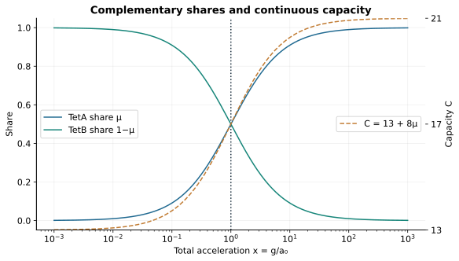

# 01 · The partition, the two chambers and the polynomial

[Back to README](../README.md) · [Next: AQUAL energy](02_energy_and_proof.md)

## Geometry and vocabulary

GFD starts with a tetrad satisfying $e^T\eta e=g$. For a parity operation $P$ preserving $\eta$ and reversing the spatial orientation, $Pe$ yields the same metric and opposite determinant. These are algebraic representatives of the two orientation roots; the physical identification of bounded chambers is a framework premise. The metric alone does not distinguish them. In the lower-index exchange of a four-dimensional affine connection, the 64 slots split into 40 symmetric and 24 antisymmetric. This counts components, not independent propagating degrees of freedom. Spatial parity of a tetrad, exchange of lower indices, and permutation of frame labels are three different group operations. The torsion-free condition retains a symmetric connection, while a contorsion can carry orientation-sensitive data if the model specifies it.

GFD names the exterior TetA, interior beyond the throat TetB, and the shared interface Field Origin. A galaxy has an occupied TetB in this model. Only an unbound elementary envelope is described as empty. Deep field means small acceleration in the exterior; it does not mean the throat interior. A drainless *parent-level field* means no additional constitutive repartition of its own settled residual, not absence of TetB in its children.

## The conditional uniqueness argument

The exchange-symmetry proof requires (E) an endpoint with zero share at zero acceleration, (X) closure under exchanging the two shares, and (A) a non-degenerate bilinear relation, solvable in both variables (degree one in each). General form $a x\mu+b x+c\mu+d=0$, determinant nonzero. The zero endpoint forces $d=0$; the complementary endpoint at infinity forces the asymptote to be 1. On the physical monotone branch this gives $\mu=kx/(1+kx)$ with $k>0$. The acceleration unit is chosen so the odds equal 1 at $x=1$, fixing $k=1$. The proof does not derive the numerical value of $a_0$. Nor do exchange symmetry or the two asymptotes alone force this law; different degrees and non-rational symmetric modifications are possible. The degree-one premise is a load-bearing physical interpretation of one-directional coupling.

The odds, screening, parity and derivative are therefore

$$\Omega=\frac{\mu}{1-\mu}=x,\quad x(1-\mu)=\mu,\quad \mu(1/x)=1-\mu(x),\quad x\mu'=\mu(1-\mu).$$

The tug-of-war interpretation uses positive strengths $g_t$ and $a_0$; share = strength divided by their sum. This is a compact physical interpretation of the linear odds, not proof that the native vortices generate those strengths. Source-variable degree differs from total-variable degree: with $z=x\mu$ we get $z(1-\mu)=\mu^2$.

## Three components, three states, three sweeps

For $K=4$, $f(K,s)=1+sK+K^2$. A scalar term $1$ persists, the signed linear term $sK$ distinguishes orientation, and the quadratic term $K^2$ persists. The structural state totals are 13, 17, 21. In the continuous capacity $C(x)$ only the linear weight changes, with $s$ replaced by $\sigma(x)=(x-1)/(x+1)$. The numerical value 17 at the equal-share ring $x=1$ is not a spatial identification with the Field Origin. Also $C(x)$ is not a PDE and does not have the dimensions of acceleration.

Let $V$ be four-dimensional and $\tau(v\otimes w)=w\otimes v$. The trace is $K$, since just the diagonal basis tensors are fixed. Projectors $P_\pm=(I\pm\tau)/2$ have dimensions $(K^2\pm K)/2=10,6$. Then

$$I+\sigma\tau=(1+\sigma)P_++(1-\sigma)P_-=2\mu P_++2(1-\mu)P_-,$$
$$1+\operatorname{tr}(I+\sigma\tau)=1+2[10\mu+6(1-\mu)]=13+8\mu.$$

The continuous ratio $C(x)-13$ to the full span 8 is exactly the share. For exchanged inputs the mean is 17; any distribution symmetric under $\ln x\mapsto-\ln x$ has mean 17. Writing $\theta=\ln(x)/2$ gives $\sigma=\tanh\theta$ and $I+\sigma\tau=\operatorname{sech}\theta\,e^{\theta\tau}$. Thus odds multiply, and parity differences compose as $(\sigma_1+\sigma_2)/(1+\sigma_1\sigma_2)$. This is an algebraic composition law, **not** the general rule for nested gravitational fields.

The 3-sweep research proposes face → channel → subchannel resolution, with $4,16,64$ terminal address counts at successive depths and three ascending 13→21 reads. The signed $1,4,16$ grade counts in Proof 26, the three structural polynomial terms, the recursive reads and the I Ching rank masks (9+4+4+4) are different mathematical descriptions. Exact dimension coincidences do not identify their operators. AQUAL is the continuum response to a field gradient; the precise transduction from the π-addressed Walsh read to that gradient and its constitutive capacity is the purpose of the settlement bridge in chapter 7. No 333-digit physical clock is assumed by AQUAL.

**Sources:** [P-exchange, P-tug, P-lock, Einstein partition, P-response and three-sweep research](../SOURCES.md). The three premises and the finite identities are T; their native dynamical realization is C/O.
