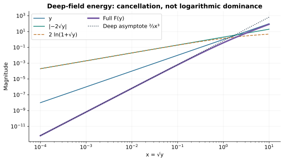
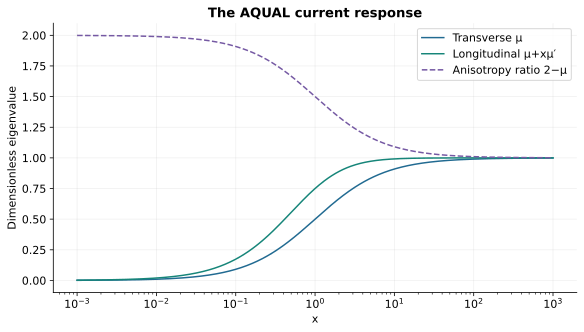

# 02 · The AQUAL energy functional — proof exposition

[Back](../README.md) · [Next](03_galactic_dynamics.md)

**Theorem (given the constitutive law).** For $y\ge0$, the unique normalized primitive of $\mu(\sqrt y)=\sqrt y/(1+\sqrt y)$ is $F(y)=y-2\sqrt y+2\ln(1+\sqrt y)$. The static energy is strictly convex in the field gradient and has a strictly monotone flux. The field equation is elliptic away from zero field and admits at most one sufficiently regular solution with prescribed Dirichlet data on a connected bounded domain (or under suitable weak-solution assumptions). This is the content of the archive's AQUAL proof, not a claim of solution existence on arbitrary domains.

## 1. Derivation of the primitive

Let $u=\sqrt y$. Then $dy=2u\,du$ and

$$F(y)=\int_0^{\sqrt y}\frac{2u^2}{1+u}\,du=2\int_0^{\sqrt y}\left(u-1+\frac1{1+u}\right)du.$$

Integrating gives the claimed expression. The additive constant is fixed by $F(0)=0$. Differentiation recovers $F'(y)=\sqrt y/(1+\sqrt y)$; at zero the right derivative is zero, and for $y>0$, $F''(y)=1/[2\sqrt y(1+\sqrt y)^2]>0$. Since $F'=\mu\ge0$, $F\ge0$. The scalar $F$ is not twice differentiable at $y=0$, but $W(q)=F(|q|^2)$ **is** twice continuously differentiable there, with zero Hessian. Distinguish these two functions.

## 2. The cancellation and two asymptotics

$$F(y)=\frac23 y^{3/2}-\frac12 y^2+\frac25 y^{5/2}-\cdots,\quad 0\le y<1.$$

At $y=1$ the alternating series also converges (Abel/alternating-series argument). For any $y\ge0$ the integral identity implies

$$0\le F(y)-\tfrac23y^{3/2}+\tfrac12y^2\le\tfrac25y^{5/2}.$$

Indeed the remainder in $2u^2/(1+u)=2u^2-2u^3+2u^4/(1+u)$ is bounded between 0 and $2u^4$ before integration. At $y>1$,

$$F(y)=y-2\sqrt y+\ln y+\frac{2}{\sqrt y}-\frac1y+\frac{2}{3y^{3/2}}-\cdots,$$
$$0<F-(y-2\sqrt y+\ln y)\le 2/\sqrt y\quad(y>0).$$

The latter bound follows from $\ln(1+t)\le t$. The logarithm does not dominate the deep-field *energy*: its $\sqrt y$ and $y$ contributions cancel the first two terms. The leading deep energy is cubic in $|q|$; the large-field leading energy is quadratic.

The screening integral is $\ln(1+x)=\int_0^x(1-\mu(t))dt=\int_0^x\mu(t)d\ln t$. Hence $y-F(y)=2[x-\ln(1+x)]$. This is the accumulated screening correction, and it will reappear as the Legendre dual of a finite-vacancy cost in chapter 7.

## 3. Variation: why the source sign matters

Use $g=-\nabla\Phi$ for the physical acceleration vector, positive $g_t=|\nabla\Phi|$, and positive Newtonian $G$. Vary the static action (overall negative of the static minimization energy)

$$\mathcal S=-\int_D\left[\frac{a_0^2}{8\pi G}F(|\nabla\Phi|^2/a_0^2)+\rho\Phi\right]d^3r.$$

For a test variation $h$ vanishing on the boundary, $\delta y=2\nabla\Phi\cdot\nabla h/a_0^2$. Integration by parts yields

$$\delta\mathcal S=\int_D\left[\frac1{4\pi G}\nabla\cdot(\mu\nabla\Phi)-\rho\right]h\,d^3r.$$

Arbitrary $h$ forces the modified Poisson equation with **positive** $4\pi G\rho$. The earlier $+\rho\Phi$ Lagrangian sign would reverse it. The constitutive current, not the bare gradient, is conserved through vacuum boundaries. Its flux is $\oint J\cdot n\,dA=4\pi GM$ for a surface enclosing mass $M$. The acceleration-vector convention would reverse the flux sign.

## 4. Hessian and anisotropy

Set dimensionless $q=p/a_0$, $x=|q|$, $W(q)=F(q\cdot q)$ and $\hat q=q/x$. For nonzero $q$,

$$\nabla W=2\mu(x)q,\quad \nabla^2W=2\mu I+2x\mu'\hat q\hat q^T.$$

Equivalently $DJ=\mu I+x\mu'\hat p\hat p^T$. The transverse eigenvalues of $DJ$ are $\mu$, the longitudinal eigenvalue is $(x\mu)'=x(x+2)/(1+x)^2$. Both are positive for $x>0$ and vanish at zero. Their ratio is $1+1/(1+x)=2-\mu$, i.e. one plus the TetB share. For every nonzero field the ratio is strictly between 1 and 2. Anisotropy remains bounded while ellipticity degenerates at zero; there is no global positive lower bound for the eigenvalues. The linear response at a nonzero background is SPD, enabling the anisotropic shell result in chapter 6.

## 5. Strict convexity and uniqueness

The radial derivative $dF(x^2)/dx=2x\mu(x)$ is strictly increasing from zero, so $W$ is strictly convex. More directly, for distinct $p,p'$, integrate the nonnegative directional Hessian along their connecting segment. Its integrand is positive except possibly at the isolated point where the gradient is zero; therefore $(J(p)-J(p'))\cdot(p-p')>0$. This proves strict monotonicity in any finite spatial dimension.

If $\Phi_1,\Phi_2$ solve the same static equation with identical Dirichlet data, subtract the weak equations and use $h=\Phi_1-\Phi_2$. The boundary term vanishes and the integral of the nonnegative strict monotonicity expression is zero. Thus gradients coincide almost everywhere and the fixed boundary value removes the additive constant. Neumann data require a separate constant normalization and source compatibility. On all space, decay conditions on the difference are required (the isolated deep-MOND point mass has a logarithmic potential, so naive vanishing potential at infinity is not valid). Existence, regularity and time-dependent stability are separate questions. A convex static functional is not by itself a proof of covariant ghost freedom.

## 6. Formal proof provenance

The upstream `proofs/aqual-energy-functional/` holds the LaTeX proof, Python verifier (24 checks reported in the Coles Notes), Lean 4.36.0 + Mathlib v4.36.0 formalization and audit. It imports the exchange proof. The audit records theorems for the primitive, series/bounds, $C^2$ gradient energy, Hessian, strict convexity and strict monotonicity. The divergence-theorem/integration-by-parts step and the endpoint series are cited rather than formalized. The audit reports 12 axiom inspections, using only standard Lean axioms. This is a source-reported build at the pinned revision; new tests in this folder independently check examples and symbolic identities, not the Lean kernel. The foundational AQUAL equation is due to Bekenstein and Milgrom (1984); the simple interpolating function was used in MOND before GFD. The closed primitive is elementary; no priority claim is made.
