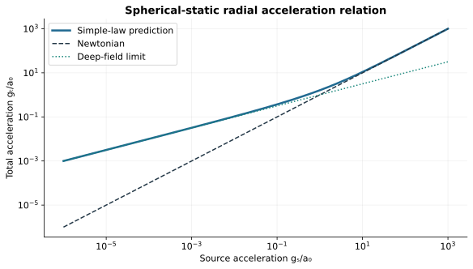
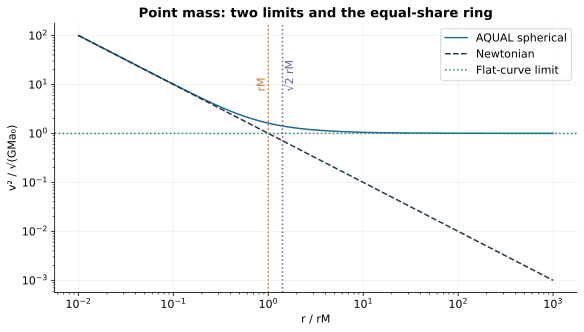

# 03 · Galactic dynamics, the inverse read and observations

[Back](../README.md) · [Next](04_dualities.md)

## 1. Spherical field equation and its inverse

Assume a static spherical field, with positive magnitudes and enclosed source mass $M(r)$. AQUAL gives $g_s=GM(r)/r^2=\mu(g_t/a_0)g_t$. Set $z=g_s/a_0$. Then

$$z=\frac{x^2}{1+x},\quad x=\frac{z+\sqrt{z^2+4z}}2,\quad \nu(z)=\frac{x}{z}=\frac{1+\sqrt{1+4/z}}2.$$

For positive source this is the unique positive branch. The quiet prediction has $g_t=g_s+a_0\mu$, so the absolute extra acceleration is bounded by $a_0$ and approaches it from below at large $x$. The relative fraction $1-\mu$ vanishes there, but the absolute residual does not. In the isolated deep field $g_t\sim\sqrt{g_s a_0}$. The next terms are $g_t=g_s+a_0-a_0^2/g_s+\cdots$ at strong source and $g_t=\sqrt{g_sa_0}+g_s/2+\cdots$ at weak source.

For circular speed $v^2=rg_t$ the exact spherical formula is

$$v^2=\tfrac12 v_N^2+\sqrt{\tfrac14 v_N^4+GM(r)a_0},\quad M_{\rm dec}=\frac{r v^4}{G(a_0r+v^2)}.$$

It also gives $v^4=GM(r)(g_t+a_0)$ and the isolated asymptotic $v^4=GMa_0$. A non-isolated system, a non-spherical disk or a varying source profile need not follow the asymptote exactly. The decoder is an effective spherical mass when applied to disk data; in a full disk solve, source geometry and boundary conditions matter. Other interpolating laws have explicit inverse mass decodes too: $r^2g_t\mu(g_t/a_0)/G$. The particular law here has a quadratic forward inverse and linear odds.

## 2. The two radii and the potential

For a point mass, define $r_M=\sqrt{GM/a_0}$, $A=\sqrt{GMa_0}$. At $r_M$, $z=1$ and $x=\varphi=(1+\sqrt5)/2$, so $\mu=1/\varphi$. Equal shares $x=1$ occur at $\sqrt2 r_M$, not at $r_M$. Neither radius is automatically the Jacobi surface. With $\psi=\operatorname{asinh}(2r/r_M)$,

$$x=\operatorname{csch}^2(\psi/2),\quad \mu=\operatorname{sech}^2(\psi/2),\quad v^2=A\coth(\psi/2),\quad \Phi=A\psi-v^2+\mathrm{const}.$$

The potential has $\Phi'=g_t$; at small radius it is Newtonian to leading order, and at large radius it grows logarithmically. The identity $\Phi+v^2=A\psi+\mathrm{const}$ is an exact check. The equal-share ring corresponds to $\psi/2=\ln(1+\sqrt2)$.

## 3. Effective TetB density and tidal relation

Define the effective density by rewriting the AQUAL equation as ordinary Poisson,

$$\rho_{\rm ph}=\frac1{4\pi G}\nabla\cdot[(1-\mu)\nabla\Phi].$$

This is an effective source representation, not evidence of particulate matter or direct measurement of interior inventory. For the exterior of a point mass,

$$\rho_{\rm ph}=\frac{a_0}{4\pi Gr^2}\frac{d}{dr}(r^2\mu)=\frac{a_0\mu}{2\pi Gr(2-\mu)}.$$

The extra acceleration is bounded, but the effective density has a $1/r$ central cusp, with finite enclosed excess mass. At large $r$, $\rho_{\rm ph}\sim A/(4\pi Gr^2)$ and the apparent Newtonian enclosed mass grows linearly. This corrects the older bounded-density claim. In a vacuum spherical region the apparent flux exponent is

$$\frac{d\ln(r^2g_t)}{d\ln r}=\frac{2(1-\mu)}{2-\mu}=h(\mu),\quad h(h(\mu))=\mu.$$

The radial tidal magnitude is $-g_t'=2g_t/[r(2-\mu)]$. These relations require constant enclosed source mass and the quiet law; applying them to rotation-curve slopes within a luminous disc is not generally exact.

## 4. Quiet, drive and brake

The decoding-mass and tug-of-war notes introduce an empirical effective strength $w=g_t(g_t-g_s)/g_s$ for $g_s>0$. It parameterizes the observed departure from the quiet prediction. With $M_{\rm phot}=r^2g_s/G$ in the same spherical convention,

$$\frac{M_{\rm dec}}{M_{\rm phot}}=\frac{g_t+w}{g_t+a_0}.$$

Thus $w=a_0$ is quiet, $w>a_0$ drive, $w<a_0$ brake. The archive defines $\Delta M_{\rm eff}=M_{\rm phot}-M_{\rm dec}$; do not silently reverse that sign. This residual is different from the quiet TetB share $1-\mu$. The law with fixed $a_0$ does not itself predict arbitrary $w(r)$; the interpretation of a residual as interior activity competes with inclination errors, mass-to-light ratios, gas uncertainties, source geometry, external field and other systematics. A predictive theory must derive this activity rather than fit it after the fact. For the data-oriented derivation see [P-tug and the decoding letter](../SOURCES.md).

## 5. Lensing and empirical scope

In the stated quasi-static lapse completion (chapter 5), $\Psi=\Phi$ at leading order with matching boundary data. The same potential that drives slow matter then contributes to weak lensing. In the isolated point-mass asymptotic regimes, a straight-line Born approximation gives $4GM/(bc^2)$ for Newtonian and $2\pi A/c^2$ in the deep regime. This is not a general full-relativistic cluster lensing prediction; a finite closure boundary or external field can change the line-of-sight potential.

The RAR letter reports 164 galaxies and 3,284 radial bins from SPARC with quality cut $Q\le2$, scatter 0.181 dex and nearly identical scatter to the empirical RAR relation. Those are reported archive statistics, not recalculated here. Data do not directly observe the microscopic TetB partition, and closely related MOND interpolation functions can be observationally hard to discriminate. Stronger tests should compare likelihoods with systematic errors, full non-spherical predictions, external-field dependence, lensing and independent galaxy populations. The source mass decoder and point-mass relations in this package are newly tested algebraically and numerically, not refitted to SPARC.
