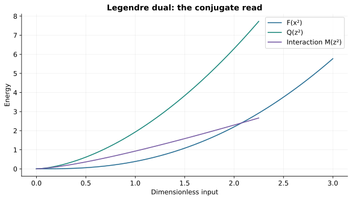

# 04 · Legendre duality, the bound law and bimetric comparisons

[Back](../README.md) · [Next](05_covariant_sst.md)

## 1. AQUAL and its exact dual

With $W(x)=F(x^2)$, $W'(x)=2z$ and $z=x\mu(x)$, define the radial Legendre dual in the convention $Q(z^2)=\sup_{x\ge0}(2zx-W(x))$. At $z\ge0$, $x=(z+\sqrt{z(z+4)})/2$ is the maximizer. Algebra yields

$$Q(z^2)=\frac{z^2}{2}+\frac{(z+2)\sqrt{z(z+4)}}2-4\operatorname{asinh}(\sqrt z/2).$$

The interaction $\mathcal M(z^2)=Q(z^2)-z^2$ obeys

$$F(x^2)+z^2+\mathcal M(z^2)=2xz,\quad \frac{dQ}{d(z^2)}=\nu(z),\quad \frac{d\mathcal M}{d(z^2)}=\nu(z)-1=1/x.$$

With $b=1/(1+x)$, the second closed form is $\mathcal M=2x-1+2b-b^2+2\ln b$. Both forms have the same limit at zero. The Hessian of the Legendre dual of the dimensionless energy $W/2$ is the inverse of the original Hessian at conjugate gradients. Its anisotropy is reciprocal. The upstream BIMOND proof gives a corresponding two-potential interaction and a conditional sign convention from oriented tetrads. This is an exact static energy duality, not a proof that the full bimetric covariant theory is GFD.

## 2. Do not equate AQUAL with QUMOND away from symmetry

Let $\Phi_N$ solve $\Delta\Phi_N=4\pi G\rho$. In AQUAL, $\nabla\cdot[J(\nabla\Phi)-\nabla\Phi_N]=0$. Hence the two currents may differ by a divergence-free field (subject to boundary/topology conditions). In QUMOND the equation is instead $\Delta\Phi=\nabla\cdot[\nu(|\nabla\Phi_N|/a_0)\nabla\Phi_N]$. The physical acceleration is the gradient of the solution, not in general the algebraic vector $\nu\nabla\Phi_N$ (which may have curl). The latter is the auxiliary field and becomes the physical field when the solenoidal correction vanishes. The original AQUAL notes contain wording implying the QUMOND vector algebra is exact for the physical field in arbitrary geometry; that is too strong. Example: for $\Phi_N=u^2+2v^2$, the gradient and the gradient of its magnitude are not parallel at a generic point, so the curl of $\nu\nabla\Phi_N$ is nonzero. The symbolic check in this folder verifies that obstruction.

A first-order variational representation of AQUAL with an **unconstrained auxiliary covector** is exactly equivalent by pointwise elimination. If one imposes that the covector is itself a gradient before varying, the resulting two-potential theory changes the allowed variations; this is the QUMOND/BIMOND comparison, not automatically equivalent to AQUAL. See `research/bimond-gfd/` and P-bimond.

## 3. Bound versus one-directional law

From the one-directional law $x(1-\mu)=\mu$, go to its source variable $z=x\mu$. This gives $z(1-\mu)=\mu^2$. Exchange the share and invert the variable: $(z,\mu)\to(1/z,1-\mu)$. The image is $z(1-\mu)^2=\mu$. Rename the independent input $x$ to obtain the proposed bound law:

$$x(1-\mu_b)^2=\mu_b,\quad \mu_b=\frac{\sqrt{1+4x}-1}{\sqrt{1+4x}+1}.$$

This is exact algebra; treating the exchange as the physical binding mechanism is an additional premise. For $x=1$, $1-\mu_b=1/\varphi$; the one-directional share at $z=1$ is the same value. Both low-field shares scale as $x$. At large $x$, the bound complement scales as $x^{-1/2}$ rather than $x^{-1}$; if the input is $A^2$, this gives the $1/A$ vs $1/A^2$ asymptotic signature. The bound energy (normalized at zero) is

$$F_b(y)=y+\sqrt y-\left(\tfrac23\sqrt y+\tfrac16\right)\sqrt{1+4\sqrt y}+\tfrac16,$$

with $F_b'(y)=\mu_b(\sqrt y)$, small-$y$ expansion $\frac23 y^{3/2}-y^2+\cdots$, and strong-field leading correction $-\frac43 y^{3/4}$. In its own source variable $z_b=x\mu_b$, $\mu_b=\sqrt{z_b}/(1+\sqrt{z_b})$. Setting $\psi=\operatorname{asinh}(2\sqrt x)$ gives $\mu_b=\tanh^2(\psi/2)$; this is the complementary hyperbolic form in the point-mass note with its corresponding input.

## 4. The generalized family

For $x^n(1-\mu)^m=\mu^k$ with positive exponents, the implicit share is unique on $(0,1)$ because the right/left odds function increases strictly from zero to infinity. Its differential equation is

$$x\mu'=\frac{n\mu(1-\mu)}{k+(m-k)\mu}.$$

With $k=1$ this recovers the generalized logistic equation in the earlier AQUAL note. Source rewriting $S:z=x\mu$ maps $(n,m,k)\to(n,m,k+n)$; exchange $E$ maps $(n,m,k)\to(n,k,m)$. The limits are $\mu\sim x^{n/k}$ and $1-\mu\sim x^{-n/m}$. Exchange-fixed forms have $m=k$; adding a unit-slope deep limit within this family forces $n=m=k$ and the simple law. This narrower uniqueness statement is compatible with the exchange proof; it does not exclude arbitrary non-monomial functions.

## 5. Why the Hassan–Rosen lock is not an AQUAL derivation

The pinned lock proof reports the palindromic coefficients $\beta=(1,0,16,0,1)$. In a single-leg deformation $S=\operatorname{diag}(1,1,1,w)$, the potential is $49(1+w)$, producing elasticity $w/(1+w)$. The functional shape is right but $w$ is a deformation, not the physical acceleration. Standard HR weak-field volume odds approach 1; the derivative-free potential cannot generate the required acceleration variation on its own. The static decoupling-limit screening is density controlled ($M/r^3$), not acceleration controlled ($M/r^2$), and Vainshtein and MOND radius scalings differ. Parity roots of the tetrad are also invisible to a metric-only principal square root. A time-leg auxiliary metric can be constructed with $w=x$ but is not TetB itself. The nonlinear energy vertex, junction condition and physically derived clock/odds remain necessary. This negative result is important; do not present the lock as a completed proof of the constitutive law.
