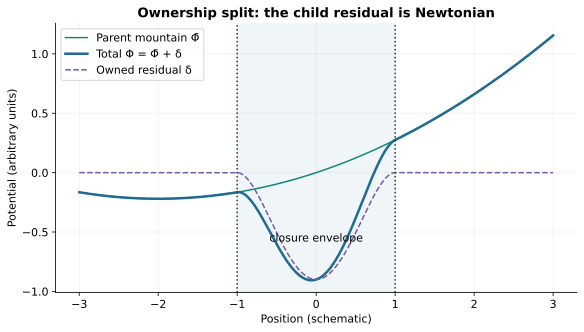
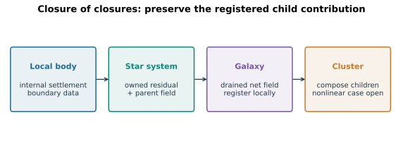

# 06 · The NET Field, ownership, mountain scale and closure boundaries

[Back](../README.md) · [Next](07_settlement_bridge.md)

## 1. Why the field being read matters

The pointwise simple-law AQUAL applied to each star leaves $(1-\mu)g_t\to a_0$ at high acceleration. Complement symmetry plus the unit-slope deep limit imply this same constant tail even before selecting the simple rational function. A strong field is not enough to explain precise local Newtonian motion. In the presence of a Galactic background, a pointwise nonlinear response also creates an external-field quadrupole. The net-field proof proposes that the nonlinear constitutive response belongs to the parent-level field with a drain, and the local settled drainless residual obeys Newton/GR. The distinction is **what field is being read**, not an arbitrary acceleration threshold.

## 2. A mathematical implementation: ownership sweep

Assign each constituent density to its owning system (ownership is single-valued even when fields and boundaries overlap). For a bounded child $D_i$ with density $\rho_i$, represent its external Newtonian field by a swept boundary measure $\sigma_i$ on $\Sigma_i$. Define the Newtonian residual $\delta_i$ by $\Delta\delta_i=4\pi G(\rho_i-\sigma_i)$, with $\delta_i=0$ exterior. Let $\delta=\sum_i\delta_i$, $\bar\Phi=\Phi-\delta$ and $\bar\rho=\rho-\sum_i\rho_i+\sum_i\sigma_i$. Here surface measures are interpreted distributionally. Balayage preserves exterior potential, not just total mass. On a sphere of radius $R$, for an interior point mass $m$ at $b$ the boundary density is

$$\sigma(n)=\frac{m(R^2-|b|^2)}{4\pi R|Rn-b|^3},\qquad |b|<R.$$

It is the Poisson kernel times $m$; its integral is $m$. Its exterior Newtonian potential is precisely the original point-mass potential by harmonic evaluation. By linearity it represents extended/asymmetric sources, preserving all exterior multipoles. One can construct the sweep on suitable non-spherical closed surfaces using harmonic measure. For a sphere the interior swept field is harmonic. The least Dirichlet-energy extension of a prescribed registered boundary potential is unique and harmonic; this is the variational premise connecting registration to sweep. The physics selecting this minimization and the surface is not established solely by that theorem.

## 3. The fixed-ownership action

In the static weak-field limit take the energy

$$E=\int\left\{\frac{1}{8\pi G}\left[|\nabla\Phi|^2+a_0^2\big(F(|\nabla\bar\Phi|^2/a_0^2)-|\nabla\bar\Phi|^2/a_0^2\big)\right]+\rho\Phi\right\}d^3r.$$

Holding the residual/ownership geometry fixed when varying $\Phi$ gives

$$\nabla\cdot[\nabla\Phi+(\mu(\bar x)-1)\nabla\bar\Phi]=4\pi G\rho.$$

Substituting $\Phi=\bar\Phi+\delta$ then gives the exact split

$$\nabla\cdot[\mu(\bar x)\nabla\bar\Phi]=4\pi G\bar\rho,\qquad \Delta\delta=4\pi G(\rho-\bar\rho).$$

Thus the mountain gets ordinary AQUAL and the residual gets ordinary Poisson. A child with no additional drain has no extra pointwise self-tail in its residual, though tidal and environment-dependent forces remain. The theorem is conditional on the specified action and fixed residual during the field variation. Varying matter, radius and shape requires additional terms; the mountain paper estimates the centre-of-mass motion contribution to be a common acceleration and reports tide-sized remaining corrections. A fully constrained variational moving-boundary model is open. Overlapping closures are not merged: only the owned mass of each child is swept. The same prescription must not double-count child mass at parent and child levels.

## 4. Four ports and the non-harmonic trace term

The regular tetrahedron's four unit face directions $n_i$ satisfy $\sum_i n_i=0$ and $\sum_i n_i n_i^T=(4/3)I$. Expand the parent potential at the child centre: $\bar\Phi(Rn_i)=c_0+R\,b\cdot n_i+\frac12R^2 n_i^T T n_i+O(R^3)$ where $T$ is the host Hessian. Then

$$\sum_i\bar\Phi(Rn_i)=4c_0+\tfrac23R^2\operatorname{tr}T+O(R^3).$$

The scalar read retains the trace of the host Hessian. The host need not be harmonic: diffuse matter and effective TetB density can live inside the envelope. A single tetrahedron's vector read aliases an off-diagonal quadratic term with sign reversed on the opposite tetrahedron. The paired eight-corner read cancels this quadratic alias and recovers the gradient to the stated Taylor order. The leading four ports are one scalar (clock) and three vector (free-fall) components; a general smooth field already has a scalar and gradient, so it is the tetrahedral sampling/cancellation that is geometry-specific. Four equal solid angles of $\pi$ add to $4\pi$; flux is equal per face only in the centred symmetric case, not for arbitrary asteroids. Gauss fixes the total current flux $4\pi GM$ independently of this decomposition.

## 5. The anisotropic shell theorem and the closure-surface kink

Linearize the parent current about a nonzero nearly constant background $p_0$. Its response matrix $A=DJ(p_0)$ is SPD, with axial/transverse ratio $2-\mu$. The Green function of the constant-coefficient operator $\nabla\cdot A\nabla$ in three dimensions is proportional to $(\det A)^{-1/2}|A^{-1/2}r|^{-1}$. A uniform spherical swept shell has constant potential in its interior for this kernel. To see this directly, from an interior point $x$ pair opposite ray directions $u,-u$. Their distances to the spherical surface are $t_\pm=\mp x\cdot u+\sqrt{(x\cdot u)^2+R^2-|x|^2}$. The area-to-solid-angle factor is $t_\pm^2/(n_\pm\cdot(\pm u))$ with the denominator equal to the square root divided by $R$. Homogeneity of the Green function contributes $1/t_\pm$; the sum of the two distances cancels the square root, leaving a constant independent of $x$. The argument is valid for any even degree −1 angular kernel, hence the stated constant SPD response. It is equivalent to transforming the sphere into a homoeoid in stretched coordinates.

This removes the self-induced anomalous quadrupole at the stated order for a centred spherical shell with constant linear response. It is not a theorem for arbitrary aspherical shells, varying coefficients or nonlinear corrections. The ordinary Galactic tide and isotropic trace remain. The pinned mountain proof reports the solar Jacobi scale around 1.44 pc, a tide around $1.5\times10^{-30}$ s⁻² and an interface kink of order $10^{-14}$ m/s² under its estimates; these are reported values, not a new observational fit.

At an ownership interface with swept surface density $\sigma$, the residual derivative jump is $[\partial_n\delta]=-4\pi G\sigma$. The mountain current jump is $[\mu\partial_n\bar\Phi]=4\pi G\sigma$. With continuous potentials and the same orientation convention,

$$[\partial_n\Phi]=[(1-\mu)\partial_n\bar\Phi].$$

This is a real effective phantom surface layer, not an inconsistency with current conservation. It does not mean matter vanishes across the surface or that TetB ceases to exist. Relativistic junction conditions, energy flux across moving boundaries, and thickness/dynamics of the interface are open.

## 6. Where the boundary sits

The closure-surface proof links local self-gravity against the host tidal field to a stagnation surface in a rotating frame. For a circular orbit in an axisymmetric host, the usual radial Jacobi estimate is

$$r_J^3=\frac{GM}{4\Omega^2-\kappa^2},\qquad 4\Omega^2>\kappa^2.$$

The eigenstructure of the tide and orbital assumptions determine the actual surface. This is a candidate for the dynamical limit of a coherent child, not a universal sphere or an energy minimum of the static split. Under flat rotation and host radial scaling with fixed rotation speed and child mass, $r_J\propto R_{\rm host}^{2/3}$. Same laws at different levels are **scale-universal**, not an unrestricted Weyl/scale symmetry; $a_0$ and the external tide select dimensionful scales.

## 7. Closure of closures: every object registers

If a child's boundary is strictly inside the next boundary and the relevant external potential is harmonic, the composition of successive harmonic-measure sweeps equals the direct sweep to the outer boundary. This follows by testing against all harmonic functions (the tower property for harmonic extension). For nested Newtonian ownership the exact pointer is a boundary measure or equivalent boundary data, not a scalar mass in general. This is the rigorous portion of distributed field processing: a parent may close over already-settled children without re-opening their entire interior. Geometrical overlap does not excuse double counting; exact composition needs compatible owned sources and suitable nested domains.

For a drained galaxy, cluster, or interacting moving boundaries, nonlinear AQUAL has no simple superposition law. The parent should still use registered children in the GFD architecture, but the nonlinear compositional theorem has not yet been established. The conditional spherical drained-to-drainless current match in chapter 7 is a concrete step. It should be extended with boundary maps, junction conditions and causal evolution, not by replacing every galaxy with a point mass irrespective of its exterior multipoles.
