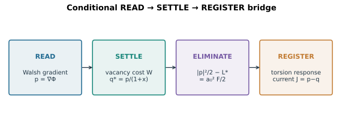

# 07 · READ → SETTLE → REGISTER: a bridge from the field engine to AQUAL

[Back](../README.md) · [Next](08_research_audit.md)

The recent `research/read-settle-register-bridge/` and `vertex-research/CONSTITUTIVE_VERTEX.md` connect the finite field architecture to the continuum energy. This is the most direct research bridge to AQUAL found in the repository. It is a conditional construction, not a new proof of the physical existence of the microscopic engine.

## 1. READ: from Walsh samples to a gradient

At eight cube corners $s\in\{\pm1\}^3$, sample the same scalar field at $X+\ell s$. Define Walsh coefficients $\widehat f_S=2^{-3}\sum_s\prod_{i\in S}s_i f_s$. The degree-one read

$$p_i^{(\ell)}=\frac1{8\ell}\sum_s s_i\Phi(X+\ell s)$$

recovers the gradient exactly for quadratic potentials, and approaches it as $\ell\to0$ for smooth fields. The two parity-selected tetrahedra each have a quadratic cross-term alias with opposite sign; the full cube cancels it. Identifying this read with $p_\mu=-c^2u_\lambda u^\nu T_{\rm read}^{\lambda}{}_{\mu\nu}$ and the acceleration of the time leg is a model premise of the bridge. The face→channel→subchannel theory proposes repeated ascending resolution reads and π-scheduled addressing. A coherent snapshot, not an arbitrary mixture of moving samples, is needed to interpret the read as a field gradient. The 333 octal digit sequence and the 21-dimensional finite character do not themselves derive the continuum field equation.

## 2. SETTLE: finite-capacity response

Let $p$ be a physical acceleration-gradient vector, and $q$ the response allocated to TetB. Assume the local relaxation law from the bridge,

$$\dot q=\kappa[(1-|q|/a_0)p-q],\quad \kappa>0,\quad |q|<a_0.$$

For fixed $p$, the unique fixed point is $q_*(p)=a_0p/(a_0+|p|)$. Thus $|q_*|/a_0=\mu(x)$, **whereas** $q_*/p=1-\mu(x)$ as a parallel vector factor. The dimensionless fraction of the finite capacity filled is not the fraction of the total gradient allocated to TetB. This distinction prevents swapping the two shares.

Set $b=|q|/a_0$ and derive the convex cost

$$W(q)=a_0^2[-b-\ln(1-b)],\qquad \nabla_q W=\frac{q}{1-b}.$$

The relaxation law becomes gradient descent with mobility $\kappa(1-b)$ on $W(q)-p\cdot q$, yielding

$$\frac d{dt}(W-p\cdot q)=-\kappa(1-b)|\nabla_q W-p|^2\le0$$

for fixed $p$. The barrier diverges at capacity. This Lyapunov identity is not a complete energy-conservation law of an isolated microscopic Hamiltonian; it assumes a prescribed drive and relaxation, with a reservoir or coarse-graining needed for physical dissipation. The vertex research studies a finite Hamiltonian realization of the same saturating slope, with a conditional orbital stability theorem in its own model. It has not derived the identification of the overlap with physical acceleration or autonomous irreversible settlement.

## 3. Exact variational elimination yields the AQUAL energy

The radial conjugate of $W$ is $W^*(p)=a_0^2[x-\ln(1+x)]$, attained at $q_*$. Hence

$$\inf_q\left\{\tfrac12|p|^2-p\cdot q+W(q)\right\}=\tfrac12|p|^2-W^*(p)=\tfrac{a_0^2}2F(x^2).$$

Its derivative is $p-q_* = \mu(x)p$, precisely the AQUAL current. This construction obtains the three-term energy from finite-capacity cost and work conjugacy, with no fitted exponent. The rate law, the identification of $p$, the work coupling and the capacity $a_0$ are inputs. The field variation with $p=\nabla\Phi$ and the source term then yields AQUAL as in chapter 2. Notice the distinction between the finite-capacity conjugate $W^*$ here and the full AQUAL Legendre dual $Q$ in chapter 4: one is the screening correction, the other the conjugate of the complete gradient energy.

## 4. REGISTER: torsion response and current accounting

The bridge specifies an auxiliary torsion ansatz in a foliation,

$$T^\lambda_{{\rm resp}\,\mu\nu}=c^{-2}u^\lambda(u_\mu q_\nu-u_\nu q_\mu),\qquad u\cdot q=0.$$

With $u\cdot u=-1$, the same contraction $-c^2u_\lambda u^\nu T^\lambda_{{\rm resp}\,\mu\nu}=q_\mu$ reads the response. This algebra is exact within the ansatz. Deriving it from a complete connection action is still open. The constitutive current $J=p-q$ carries source flux. Across a fixed interface, integrating the field equation gives $[n\cdot J]=4\pi G\sigma_m$, where $\sigma_m$ denotes a real material sheet. The effective density representation has phantom sheet $[n\cdot q]/(4\pi G)$.

For a spherical drained child with total source mass $M$ at radius $R$ and a drainless Newtonian parent with negligible background, impose no material sheet. Let $z=GM/R^2$. The inner total slope is $g_-=(z+\sqrt{z^2+4a_0z})/2$ and the outer Newtonian slope is $g_+=z=\mu(g_-/a_0)g_-$. The slope jumps by $z-g_-<0$, which is the negative effective surface sheet. The interior apparent excess mass is exactly cancelled by the integrated sheet, leaving the parent registered current mass $M$. A drained parent would instead solve its own constitutive current matching problem. This is not the same interface as the positive swept parent response in the mountain proof; the two examples have different material and current assignments. Neither proves arbitrary moving or nonspherical nonlinear composition.

## 5. Relationship to Proof 26 and microscopic constants

Proof 26 develops the finite recursive read and signed block characters $1+4+16=21$, $1+16=17$, $1-4+16=13$. A candidate determinant intensity with common elementary gain $\alpha$ gives $\alpha^{21}$; adding the inherited coupling ratio yields a conditional $G_{\rm eff}=(17/13)\alpha^{21}\hbar c/m_e^2$. The choice of gain, determinant observable, ratio as stiffness and physical work coupling is not established by the finite count alone. The static vacancy bridge fixes a response given $a_0$; it does not derive $G$, $a_0$, the electron mass or an elementary α from the native vortex dynamics. A future unification must connect the coherent Walsh read, finite inventory, relaxation or reversible settlement, current registration and these dimensional constants without importing the result being sought.
