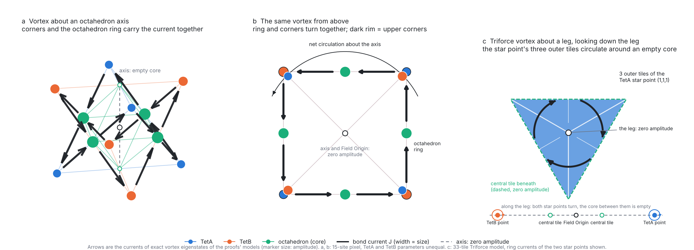
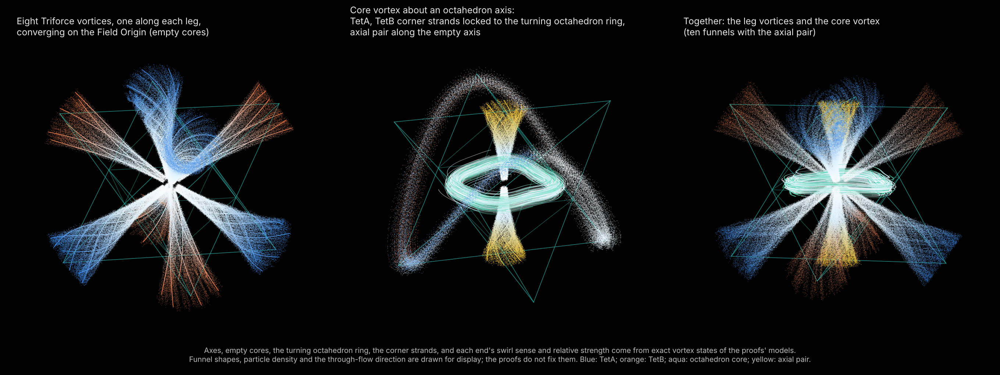

# Vortices in the Pixel: A Proof

*Field Dynamics Research, research folder, 2026-11-15. Status: theorem with proof; every step is checked by [`verify_pixel_vortex.py`](verify_pixel_vortex.py) (28 checks, exact algebra, plus a numerical cross-check). Output: [`verify_output.txt`](verify_output.txt).*

> The consolidated theorem, with an independent exact certifier, a closed form for the current through any half-plane bounded by the axis, $I = (E - \Delta_f)\rho^2$ for the physical flow (this folder's scripts use the reversed sign; see the correction there), and the Triforce case, is [`../vortex-theorem/THEOREM.md`](../vortex-theorem/THEOREM.md).

## Statement in brief

The pixel has vortices. Take the stellated octahedron in its cube, with the octahedron inside, and any couplings that respect the tetrahedral symmetry, so that TetA and TetB may differ. Then, about each of the octahedron's three axes:
- there are exactly three stationary states that wind once around the axis, and three that wind the other way at the same energies;
- they are empty on the axis: zero at the Field Origin and at the two axial octahedron vertices;
- they carry a persistent current circulating around the axis. Its size is fixed by how much the octahedron's equatorial ring moves, $L = -2(E - \Delta_f)\lvert r\rvert^2$;
- the corners and the ring are locked together: whenever TetA and TetB differ, every vortex turns the ring.

Without the octahedron, the pixel has winding states but nothing circulates. The circulation runs through the octahedron.

*Every arrow is a bond current of an exact vortex eigenstate of the proofs' models. Arrow width shows the current's size, marker size the amplitude; [`make_vortex_figure.py`](make_vortex_figure.py) regenerates the figure. **a, b:** a vortex about the octahedron axis $z$ in the 15-site pixel, with TetA and TetB parameters unequal. The corners (the flywheel) and the octahedron's equatorial ring (the core) turn together, while the axis and the Field Origin carry zero amplitude. **c:** a Triforce vortex in the 33-tile model, seen down the leg $(1,1,1)$. The star point's three outer tiles circulate around the empty leg. The strip below shows the whole leg: both star points turn, and the central tiles and the Field Origin between them are empty.*

*The same vortices rendered in the style of [`convergent_vortex.png`](../../universe-is-pixelated/convergent_vortex.png); [`make_vortex_render.py`](make_vortex_render.py) regenerates the image. **Left:** the eight Triforce vortices, one along each leg, converging on the Field Origin with empty cores. **Middle:** the core vortex about an octahedron axis: the corner flywheel (TetA and TetB strands zigzagging above and below the equator), the turning octahedron ring, and the axial pair along the empty axis. **Right:** both together.*

*Taken from exact vortex states of the proofs' models: the axes, the empty cores, the turning ring, the corner strands, and each end's swirl sense and relative strength. In the state computed, the TetB end of a leg turns about 0.07 times as strongly as the TetA end, and the opposite way about its own outward axis. Drawn for display only, and not fixed by the proofs: the funnel shapes, the particle density, and the direction of the through-flow.*

## Setting

**Sites (15).**
- $O$, the Field Origin.
- The octahedron's 6 vertices, at the cube's face centres $\pm\hat x, \pm\hat y, \pm\hat z$.
- The cube's 8 corners: the 4 with $xyz = +1$ form TetA, the 4 with $xyz = -1$ form TetB.

**Hamiltonian.** A real symmetric $H$ on these 15 states, invariant under the tetrahedral group $T_d$ (24 elements). $T_d$ is the symmetry that keeps TetA and TetB, so $H$ may treat them differently, as it must away from the ring. For Theorems 2 and 3 we use the most general nearest-neighbour $H$ of this kind, with nine parameters:

| | Parameters |
|---|---|
| On-site | $\Delta$ at $O$, $\Delta_f$ at the octahedron vertices, $\epsilon_A, \epsilon_B$ at the TetA and TetB corners |
| $O$ to octahedron vertex | $-t_f$ |
| $O$ to corner (the 8 legs) | $-t_A$, $-t_B$ |
| Octahedron vertex to adjacent corner | $-c_A$, $-c_B$ |

**Axis and its symmetry.** Take the octahedron axis $z$. Let $S$ be the rotoreflection $(x, y, z) \mapsto (-y, x, -z)$, a quarter turn followed by a top–bottom flip. Let $C$ be the quarter turn $(x, y, z) \mapsto (-y, x, z)$.

**Definition (vortex).** A vortex about $z$ is a stationary state $H\psi = E\psi$ with $S\psi = \pm i\,\psi$ (winding $\pm1$) and nonzero circulation
$$L(\psi) = \sum_{\text{bonds } ij} J_{ij}\,(\mathbf r_i \times \mathbf r_j)_z, \qquad J_{ij} = 2\,\mathrm{Im}\big(\psi_i^*\,H_{ij}\,\psi_j\big),$$
where $J_{ij}$ is the standard bond current of a stationary state.

## Lemma 1: the symmetry about an octahedron axis

$S \in T_d$, so $SH = HS$ for every allowed $H$, whatever $x$ is. The quarter turn $C$ is not in $T_d$: it sends every TetA corner to a TetB corner. $CH = HC$ holds exactly when the TetA and TetB parameters are equal, which is the ring, $x = 1$. Also $S^4 = 1$, $S^2 = C^2$ (the half turn), and $\det S = -1$.

*So away from the ring, the symmetry about the axis is the rotoreflection: each quarter turn also exchanges top and bottom. It becomes a plain rotation only at the ring.* (Checks L1.)

## Lemma 2: the winding spaces

Let $V_{\pm}$ be the eigenspaces of $S$ with eigenvalues $\pm i$.
- **The orbits of $S$ on the sites are:**
  - $\{O\}$;
  - the axial pair $\{\pm\hat z\}$;
  - the equatorial ring $\{\pm\hat x, \pm\hat y\}$;
  - the four TetA corners;
  - the four TetB corners.
  
  The TetA orbit zigzags above and below the equator ($z = +, -, +, -$), and so does the TetB orbit.
- **Each of $V_\pm$ has dimension 3,** spanned by the phase-weighted orbit vectors of the ring, the TetA corners and the TetB corners.
- **Every vector in $V_\pm$ vanishes at $O$ and at $\pm\hat z$.** $S$ fixes $O$ and $S^2$ fixes $\pm\hat z$, so no eigenvalue $\pm i$ can live there.

(Checks L2.)

## Theorem 1: vortex states exist, for every $H$

$H$ commutes with $S$, so it maps $V_+$ into itself. Restricted to $V_+$ it is a $3\times3$ Hermitian block, so there are three stationary states with winding $+i$. Because $H$ is real, complex conjugation maps $V_+$ onto $V_-$ with the conjugate block, giving three states with winding $-i$ at the same energies. This holds for every real $T_d$-invariant $H$, not only the nearest-neighbour family.

For the nearest-neighbour family, in the basis (ring, TetA corners, TetB corners) the block is
$$H_+ = \begin{pmatrix} \Delta_f & a & b \\ \bar a & \epsilon_A & 0 \\ \bar b & 0 & \epsilon_B \end{pmatrix},\qquad a = -c_A(1+i),\quad b = -c_B(1+i).$$
$\Delta$, $t_f$, $t_A$ and $t_B$ drop out: the winding states never touch $O$. (Checks T1.)

## Theorem 2: vortices circulate

1. **The circulation is a coupling energy.** For every $\psi$ in $V_+$ with coordinates $w = (r, p, q)$ (ring, TetA, TetB), $L(\psi) = -w^\dagger V w$, where $V = H_+ - \mathrm{diag}(\Delta_f, \epsilon_A, \epsilon_B)$ is the ring–corner coupling. The current runs through the bonds between the octahedron's equatorial vertices and the corners.
2. **The eigenstates.** The eigenvectors are $w = (r,\ \bar a r/(E - \epsilon_A),\ \bar b r/(E - \epsilon_B))$, with $E$ a root of the cubic
$$E - \Delta_f = \frac{2c_A^2}{E - \epsilon_A} + \frac{2c_B^2}{E - \epsilon_B}.$$
3. **Closed form.** On each eigenvector, $L = -2\,(E - \Delta_f)\,\lvert r\rvert^2$.
4. **Antivortices.** The complex-conjugate state, winding $-i$, has the same energy and the opposite circulation.

*Proof of 3.* The ring row of $H_+w = Ew$ gives $a p + b q = (E - \Delta_f)\,r$. Then $w^\dagger V w = 2\,\mathrm{Re}\big(\bar r\,(a p + b q)\big) = 2\,(E - \Delta_f)\,\lvert r\rvert^2$. ∎ (Checks T2.)

## Theorem 3: the corners and the core turn together

Assume $c_A c_B \neq 0$, so the octahedron touches the corners, and $\epsilon_A \neq \epsilon_B$, so TetA and TetB differ, as they do away from the ring.
- **No vortex energy equals $\epsilon_A$ or $\epsilon_B$.** $\det(H_+ - E)$ is $2c_A^2(\epsilon_A - \epsilon_B)$ at $E = \epsilon_A$ and $2c_B^2(\epsilon_B - \epsilon_A)$ at $E = \epsilon_B$, both nonzero.
- **So every vortex has $r \neq 0$:** the octahedron's equatorial ring always turns. The corners are locked to it, $p = \bar a r/(E - \epsilon_A)$ and $q = \bar b r/(E - \epsilon_B)$; if the ring were still, the corners would be too.
- **Every vortex circulates, $L \neq 0$,** except when $E = \Delta_f$. That needs the single condition $c_A^2(\Delta_f - \epsilon_B) + c_B^2(\Delta_f - \epsilon_A) = 0$, which is not an identity.
- **At $\epsilon_A = \epsilon_B$** (TetA and TetB corners alike), $E = \epsilon_A$ becomes a root with $r = 0$, and that one winding state carries no current.

(Checks T3, plus a numerical cross-check: 20 random parameter sets, every vortex a stationary state of the full 15-site pixel, ring turning, $L$ matching the closed form.)

## Corollary: the octahedron is what circulates

Remove the octahedron, leaving the 9-site pixel of the Λ studies: $O$ and the 8 corners, joined by the 8 legs. Winding states still exist ($V_+$ has dimension 2), but they vanish at $O$, and every bond touches $O$. So every bond current is zero: nothing circulates. (Checks C1.)

## What is proved, and what is not

**Proved.** In the pixel with its octahedron, under any couplings with the tetrahedral symmetry, there are stationary vortex states about each octahedron axis:
- winding $\pm1$, in vortex–antivortex pairs at equal energy;
- empty on the axis;
- carrying a persistent circulating current $L = -2(E - \Delta_f)\lvert r\rvert^2$, which flows through the octahedron;
- with the corners locked to the octahedron's equatorial ring.

Away from the ring the symmetry about the axis is a rotoreflection, so each quarter turn also exchanges top and bottom.

**Not proved.**
- That the field's actual state in the pixel is one of these vortices.
- How vortices in neighbouring pixels connect in the tiling.
- Any link to a galaxy's vortex.

The model is a tight-binding (wave) model of the pixel's states. "Vortex" here has its exact meaning: a stationary state with quantised winding and a persistent circulating current.
