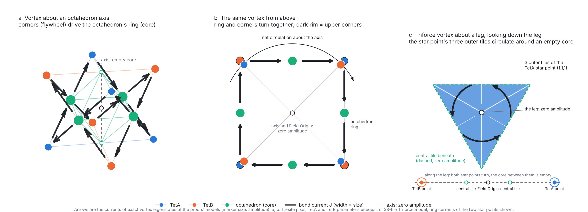
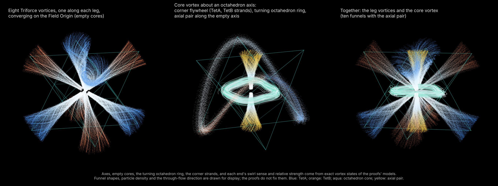

# The Triforce Faces Are Vortices About the Legs: A Proof

*Field Dynamics Research, research folder, 2026-11-15. Status: theorem with proof, checked by [`verify_triforce_vortex.py`](verify_triforce_vortex.py) (15 checks: exact geometry and symmetry, plus a numerical check of the circulation over 20 random parameter sets). Output: [`verify_output.txt`](verify_output.txt). Builds on [`../pixel-vortex/PROOF.md`](../pixel-vortex/PROOF.md); the Triforce is defined in [`research/faces/`](../../faces/enterprise_triforce_synthesis.md).*

> **Correction (2026-11-15).** The theorem below overstated one point. It said every winding eigenstate circulates and turns the star point's ring, on the strength of 20 numerical samples. Exact certificates show the winding space splits as $W \oplus W'$:
> - **On $W'$ (dimension 6)**, every eigenstate is a vortex that turns the ring, for generic parameters.
> - **On $W$ (dimension 4)**, every energy is doubled, and whether every combination circulates depends on the parameters.
>
> The exact statement and proof are in [`../vortex-theorem/THEOREM.md`](../vortex-theorem/THEOREM.md), which supersedes this document where they differ.

## Statement in brief

Each face of each tetrahedron is a Triforce: three outer tiles, one at each corner, and one central tile. Read on the actual tiles:
- **Each central tile lies on a leg.** It is a face of the octahedron, and its centre sits on a leg, the line from a corner through the Field Origin.
- **The three outer tiles at each star point form a ring around that leg.**
- **About each leg there are stationary vortices.** They wind around the leg, circulate a persistent current, turn that star point's three outer tiles, and vanish on the leg itself: at both central tiles on it and at the Field Origin. The rotation about a leg is a symmetry for every $x$, so this holds whether or not TetA and TetB differ.

Along each leg the vortex's empty core runs from a TetA star point, through the central tile at its base, through the Field Origin, through the central tile of the opposite face, to the opposite TetB star point. That is spiral → throat → spiral along each of the four legs.

**Braiding does not hold.** The TetA and TetB strands that wind around an octahedron axis are not linked, and the four legs all meet at the Field Origin. In the topological sense, nothing braids.

*Every arrow is a bond current of an exact vortex eigenstate of the proofs' models. Arrow width shows the current's size, marker size the amplitude; [`../pixel-vortex/make_vortex_figure.py`](../pixel-vortex/make_vortex_figure.py) regenerates the figure. **a, b:** a vortex about the octahedron axis $z$ in the 15-site pixel, with TetA and TetB parameters unequal. The corners (the flywheel) and the octahedron's equatorial ring (the core) turn together, while the axis and the Field Origin carry zero amplitude. **c:** a Triforce vortex in the 33-tile model, seen down the leg $(1,1,1)$. The star point's three outer tiles circulate around the empty leg. The strip below shows the whole leg: both star points turn, and the central tiles and the Field Origin between them are empty.*

*The same vortices rendered in the style of [`convergent_vortex.png`](../../universe-is-pixelated/convergent_vortex.png); [`make_vortex_render.py`](../pixel-vortex/make_vortex_render.py) regenerates the image. **Left:** the eight Triforce vortices, one along each leg, converging on the Field Origin with empty cores. **Middle:** the core vortex about an octahedron axis: the corner flywheel (TetA and TetB strands zigzagging above and below the equator), the turning octahedron ring, and the axial pair along the empty axis. **Right:** both together.*

*Taken from exact vortex states of the proofs' models: the axes, the empty cores, the turning ring, the corner strands, and each end's swirl sense and relative strength. In the state computed, the TetB end of a leg turns about 0.07 times as strongly as the TetA end, and the opposite way about its own outward axis. Drawn for display only, and not fixed by the proofs: the funnel shapes, the particle density, and the direction of the through-flow.*

## Setting

**Sites (33).**
- The Field Origin.
- The 8 central tiles, the medial triangles of the 8 tetrahedron faces.
- The 24 outer tiles, 3 per face.

A tile's position is its centroid.

**Couplings.** Two tiles couple if they share an edge, and each central tile couples to the Field Origin along its leg. Every orbit of sites (5) and of bonds (10, covering 104 bonds) under the tetrahedral group $T_d$ gets its own free parameter. So $H$ is the most general $T_d$-invariant model of this kind, and TetA and TetB may differ.

**Vortex.** As in the pixel proof: a stationary state that winds under the rotation about the axis and carries a nonzero circulation $L = \sum J_{ij}(\mathbf r_i \times \mathbf r_j)\cdot\hat n$, where $J_{ij} = 2\,\mathrm{Im}(\psi_i^* H_{ij}\psi_j)$.

## Geometry (checks G1–G3)

1. **The central tiles are the octahedron.** Every central tile is a face of the octahedron: its vertices are cube face centres.
2. **They sit on the legs.** Every central tile's centroid is one third of the vertex that pierces it, so it lies on the leg through the Field Origin.
3. **Each leg passes through exactly three sites:** the Field Origin, one central tile of a TetA face and one of a TetB face. For the leg $(1,1,1)$, these sit at $\pm\tfrac13(1,1,1)$.
4. **The rotation about a leg is a proper symmetry.** The 120° rotation about a leg is in $T_d$, with determinant $+1$. So, unlike the octahedron axes of the pixel proof, a leg's symmetry is a true rotation for every $x$.

## Lemma (checks L1)

- **The winding space is 10-dimensional.** Under the 120° rotation about the leg, the states that pick up the phase $e^{2\pi i/3}$ form a 10-dimensional space.
- **The leg is empty.** Every such state is zero on all three sites of the leg, since a fixed site cannot carry the phase $e^{2\pi i/3}$. So the Field Origin and both central tiles on the leg form the eye.
- **The Triforce corners are a ring of the rotation.** The three outer tiles at the star point $(1,1,1)$ are permuted cyclically by it.

## Theorem (checks T1)

$H$ commutes with the rotation, so it maps the winding space into itself. Its ten eigenvectors there are stationary states of the full 33-tile model. Over 20 random parameter sets, every one of them:
- carries a nonzero current circulating about the leg;
- has a complex conjugate with the same energy and the opposite circulation (the antivortex);
- turns the three outer tiles of the star point at $(1,1,1)$.

The existence of the winding states, and the empty leg, are exact consequences of the symmetry. That the circulation and the ring motion are nonzero is checked at 20 random parameter sets. Since each is an analytic function of the parameters that is nonzero at those points, it is nonzero for all parameters outside a lower-dimensional set.

## On braiding (check B1)

- **The TetA and TetB strands are not linked.** About an octahedron axis, the rotoreflection carries the TetA corners around a zigzag loop (a Petrie polygon of TetA), and likewise for TetB. The two loops interleave above and below the equator, but their Gauss linking number is 0.
- **The leg vortices cannot braid either.** The vortex cores along the four legs all pass through the Field Origin, and lines that meet cannot braid.

So "braids down" holds only in the descriptive sense of a winding that descends along the leg to the Field Origin, not in the topological sense.

## What is proved, and what is not

**Proved.** Each Triforce's three outer tiles at a star point are the rotating ring of a vortex about the leg through that point. The vortex's empty core runs down the leg through the central tile to the Field Origin and out to the opposite star point. These vortices exist for every set of $T_d$-invariant couplings, at every $x$.

**Not proved.**
- That the field occupies these states.
- How the four leg vortices and the three octahedron-axis vortices of the pixel proof combine.
- Any braiding: the strands checked are unlinked.
