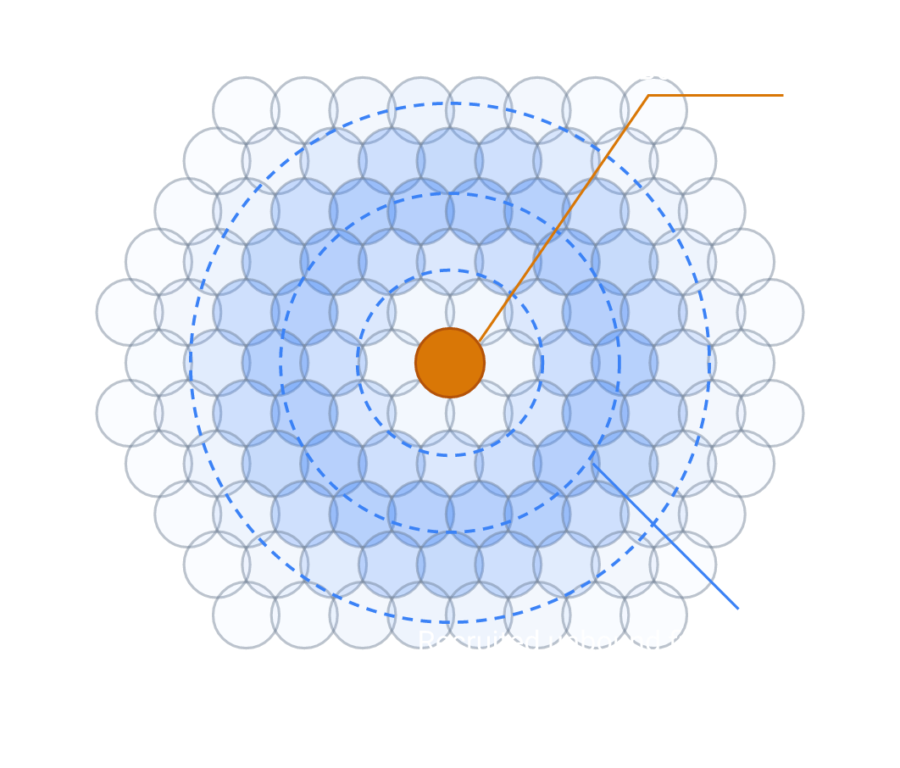
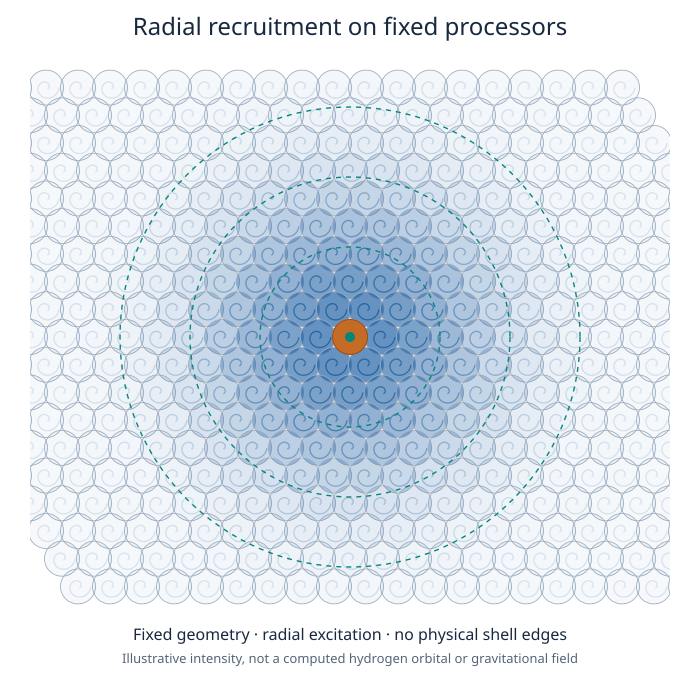

# Distributed vortex recruitment and temporal registration

**Gravity Field Dynamics · Research archive · 27 November 2026**

## Start here

This archive consolidates the current conversation's research from the AQUAL settlement work through hydrogen recruitment, the invariant Flower lattice and the shared central vortex. It is an offline research snapshot, not a new formal proof or a modification to the public repository.

**Working hypothesis:** the Hadamard processor and its neighbor topology remain invariant. A bound field excites pre-existing vortices in surrounding unbound fields, creating a spatially extended, potentially radial coherent response. Through their paired time faces, the collective core states may modulate temporal registration. Observable TetA geometry could therefore change without deforming the processor lattice or introducing voids. TetB occupation, optical amplitude, physical energy, charge and clock rate are distinct quantities.

The reference is a conceptual drawing, not a physical orbital calculation. See the radial illustration below for the intended envelope: the computational lattice does not impose a six-sided valence shell.

## Reading order

| Module | Scope | Recorded tests |
|---|---|---:|
| [AQUAL settlement](research/gfd-aqual-settlement/README.md) | Vector constitutive response and constraints | 75 |
| [Collective tetrad settlement](../../proofs/collective-tetrad-settlement/) | Four-face collective registration (now in `proofs/`) | 90 |
| [Causal workload](research/gfd-causal-workload-research/README.md) | Energy accounting and candidate causal capacity | 124 |
| [Core vortex modulation](research/gfd-core-vortex-modulation/README.md) | Native stationary vortex and load response | 102 |
| [Recursive causal closure](research/gfd-recursive-causal-closure/README.md) | Nuclear packing, nested clocks, compactness | 116 |
| [Flower deformation](research/gfd-flower-deformation/README.md) | Metric compatibility, optical and causal benchmarks | 116 |
| [Hydrogen recruitment](research/gfd-hydrogen-recruitment/README.md) | Extended electronic envelope, neutral charge and mass | 116 |
| [Latest synthesis](latest/README.md) | Radial recruitment, nonspatial core interpretation, native overlap transfer, throat susceptibility | 14 fresh tests |

The seven older modules contain their original scripts, data, diagrams and recorded verification logs (739 cases cumulatively; not necessarily distinct). They have been preserved rather than rerun or edited. The latest 14 tests were executed for this archive. Total recorded case count 753, not a count of independent physical validations. Run each module in its own directory to avoid collisions between identically named model files. The latest module requires numpy, scipy, sympy and pytest.

## Decisions and limits

- The fixed-processor, variable-state approach supersedes literal cube deformation as the preferred hypothesis; the earlier deformation experiments are retained as compatibility studies and controls.
- The shared core is a circulation of central triangle currents, not the scalar coordinate O. Its placement outside observable TetA spacetime is an interpretation, not a geometric theorem.
- The latest coherent matched-interface calculation uses an explicitly specified perturbation −εT/2. The factor 1/2 and sign are a convention for this experiment, not derived physical neighbor normalization. Without it the derivative differs by −2.
- Hydrogen benchmarks import Coulomb coupling and reduced-mass normalization. They are not independent predictions of atomic structure. A charge-odd field read alone is not conserved physical charge.
- Static susceptibility, microscopic frequency changes, clock rate and causality must not be conflated. The gapless static response and universal lapse coupling remain to be derived. Schwarzschild compactness and causal cones serve as GR benchmarks, not established predictions of the vortex model.
- No new Lean compilation, empirical validation or repository changes were made for this archive.

## Next gate

Use the actual multi-cell nonlinear Hamiltonian, with physical TetA interface routing and a nonspatial vertex interaction. Find a stable circulating reference, derive its full linearized response and check whether a gapless energy-even mode couples to the core without introducing an artificial cancellation. Then derive universal clock registration and its physical normalization, with neutral hydrogen and drainless stellar closure as controls. Only after that investigate a causal horizon.
