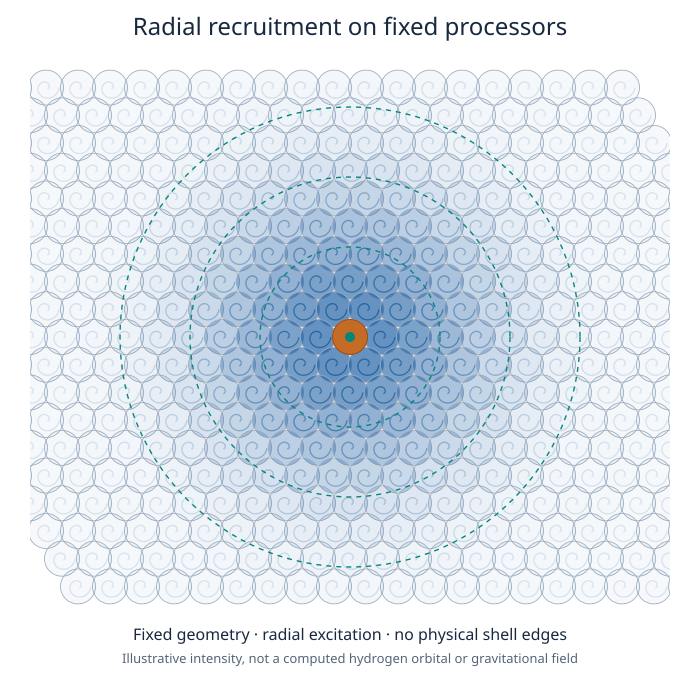

# Radial recruitment and the shared central core

## 1. Framework and geometry

The user's corrected visual places a bound field at the center of an unchanged network of excited unbound vortices. Recruitment intensity can decay radially; a hexagonal clipping of the drawing is not a physical shell. Hydrogen 1s is the spherical benchmark, not a claim that all atomic orbitals are spherical. The fixed Hadamard geometry supplies the computational structure, not necessarily observable proper distances. In the preferred GFD hypothesis, TetA is observable spacetime, TetB is nonspatial relative to TetA, and the paired time faces provide the nonlinear interaction. The central core is an interface phenomenon; this interpretation does not follow from parity alone.

A recruited field has no requirement to acquire retained TetB inventory. Write w_i=w_0+δw_i for an existing core amplitude. The intensity difference is 2 Re(w_0* δw_i)+|δw_i|². The interference term allows a first-order response about a nonzero coherent background. The original scalar band reference is real and noncirculating, so a circulating background supporting the same pole still needs to be demonstrated.

## 2. Radial continuum limit

Use the four tetrahedral directions s=(1,1,1),(1,-1,-1),(-1,1,-1),(-1,-1,1). Their sum is zero and their outer products sum to 4I. The dimensionless diamond acoustic eigenvalue is λ(k)=4−|Σ exp(i a k·s)|. Expansion gives

λ=2a²|k|²−a⁴ Σ k_i⁴/6−a⁴ Σ_{i<j}k_i²k_j²+O(a⁶|k|⁶).

Thus the leading second-order stiffness is isotropic, with higher-order anisotropy. Axis versus body diagonal relative difference is (a|k|)²/9+O((a|k|)⁴), tested at four scales. For the full microscopic 72-coordinate Bloch operator the existing numerical scalar stiffness is 0.12429467 (full overlap) or 0.10509418 (filtered). The static band-edge susceptibility scales as 1/(D|k|²). Its 3D Green function is 1/(4πDr) in continuum normalization. A physical source and units are not selected by this result.

## 3. Core versus central coordinate

The Stage VII ansatz has X^±_ij=ρ(u q_i+v q_j), y^±_i=ρ w q_i, q_i=s_i·z, ||z||=1, and ψ_O=0. Despite the dark O coordinate, the central triangle angular moment is −|w|² C_axis/6 in the original ρ normalization, where C_axis=−i z̄×z. Rescaling the ansatz also rescales its currents. This proves the core is collective circulation rather than a separate point oscillator in that model. It does not prove the core is outside spacetime. The shared nonspatial interaction is a GFD framework premise, consistent with but not implied by the geometric construction. The 33-coordinate Stage VII witness and 36-coordinate directional-origin graph are distinct models.

## 4. Exact Flower port reduction

The inherited interface matrix W is (1/9)[[0,2,2,1],[2,0,2,1],[2,2,0,1],[1,1,1,6]]. For a matched port i, its three lateral inputs are u q_i+v q_j (j≠i), and its base is w q_i. Since Σq=0, the outer output at j is [(4u−2v+w)q_i−2v q_j]/9, and the base output is (3u−v+6w)q_i/9. Therefore the reduced map is

T=(1/9)[[4,−2,1],[0,−2,0],[3,−1,6]].

It is self-adjoint in G=[[3,−1,0],[−1,3,0],[0,0,1]]. For x*=(1/3,1,−4/15), Tx*=(-14/135,−2/9,−8/45). The nonzero base output demonstrates an existing path for a matched coherent excitation to influence the core. It is not a derivation of the physical coupling between two arbitrary circulating cells; routing, orientation and parity must be respected.

## 5. Exact stationary susceptibility

Use M=[[-2,1/2,−2],[−1/2,1,−1],[−5,−1,−89/10]], C=[[0,−1/2,0],[−1/2,0,−1],[1,−3,1]], M_A=M−C. Define n=x*ᵀGx*=616/225; constrain xᵀGx=n; χ=xᵀGCx/(2n). At reference χ*=59/308, ω*=11/10. The t=1 constitutive gain g(χ)=2χ/(χ*+|χ|). F''(χ*)=h=308/59; the inherited balanced fixed-z curvature threshold is h_c=290521/42815.

For an added energy 2εχ, the generator has +εC and dχ/dε=2/(h_c−h)=1.277827281099. This is a local stationary susceptibility about the stable fixed-orientation witness, not a measured clock response.

For the matched port experiment specify the perturbation precisely:

[M_A+g(χ)C−εT/2]x=ωx, xᵀGx=n.

Let r=x*ᵀGC/n and L=M−ω*I. Solve the augmented tangent system

[[L+(h/2)Cx*r, −x*], [x*ᵀG,0]] [x',ω']ᵀ=[Tx*/2,0]ᵀ.

Then χ'=r x'=−3639415/71166942=−0.05113912299... and I_c'=2w*x'_w/n=−3597250/391418181=−0.00919029869..., where I_c=|w|²/n. The fresh test uses exact rational arithmetic and centered finite differences at four perturbation sizes. The −1/2 factor is an explicit choice of perturbation convention to reproduce the conversation's numbers; it is not selected by the Flower geometry. A generator +εT yields −2 times these derivatives. The matched experiment is a constrained stationary response, not an autonomous lattice simulation or a proof of an energy-positive susceptibility.

## 6. Long-range condition and the temporal dictionary

Let f be a candidate excitation amplitude and v a throat modulation. The illustrative static quadratic response matrix is [[m²+D|k|²,−λ], [−λ,κ]], κ>0. Schur elimination gives D|k|²+m²−λ²/κ. An unscreened stable branch at k=0 requires m²κ=λ² in this two-variable model. Equivalently the square-completion functional D fᵀL_D f/2+κ||v−β f||²/2−sᵀf has v=βf and D L_D f=s. This construction imposes the gapless identity; the native action has not been shown to enforce it. The Stage VII operating point is a constrained energy maximum, so its stationary response cannot simply be identified with a positive spring without a justified reduction.

If a physical static lapse N(u) were derived, a first-order core perturbation proportional to 1/r could give ln(N/N_ref) proportional to 1/r. In a static metric the acceleration of a released particle relative to static observers is −c² grad ln N locally. Its sign, coupling to all matter and metric normalization are open. A vortex frequency is not automatically proper time: a universal phase-cycle rule must be shown. A static susceptibility is not a causal propagator. Global U(1) symmetry protects a phase direction, not necessarily the amplitude or throat response.

## 7. Charge, energy and scale

Charge-odd recruitment must reverse under physical charge conjugation; energy-even recruitment must not. Chamber exchange is a candidate algebraic symmetry, not proof of physical charge conjugation. Neutral hydrogen has zero net charge but positive total energy m_p c²+m_e c²−binding. The conventional exterior electric field of an isolated charge has energy density ∝r⁻⁴; a local response proportional only to that density cannot produce the leading 1/r temporal potential. Total registered energy and the collective Green response are necessary ingredients of the proposed mechanism. A static radial electric field is not a literal circulation or steady outward energy flux. The solar-system closure and black-hole threshold are larger-scale benchmarks, not proofs that spacetime is a computational lattice. Compactness and local causal tilt must be distinguished from cumulative clock deficits. No separate universe or execution thread is established.

## 8. Source notes

Public GFD repository sources inspected during the conversation:

- [TetB is the subspace](https://github.com/fielddynamics/research/blob/main/TETB_THE_SUBSPACE.md)
- [Stage VII core circulation](https://github.com/fielddynamics/research/blob/main/research/hadamard-null-cone-vortex-flywheel/SUSTAINED_TRIFORCE_FLYWHEEL.md)
- [Field Origin vertex](https://github.com/fielddynamics/research/blob/main/research/hadamard-null-cone-vortex-flywheel/FIELD_ORIGIN_VERTEX.md)
- [Constitutive vertex](https://github.com/fielddynamics/research/blob/main/research/hadamard-null-cone-vortex-flywheel/vertex-research/CONSTITUTIVE_VERTEX.md)
- [Vertex curvature](https://github.com/fielddynamics/research/blob/main/research/hadamard-null-cone-vortex-flywheel/vertex-research/VERTEX_CURVATURE.md)
- [Unified Flower interface](https://github.com/fielddynamics/research/blob/main/research/hadamard-null-cone-vortex-flywheel/UNIFIED_HADAMARD_FIELD_DYNAMICS.md)
- [Spectral gravity read](https://github.com/fielddynamics/research/blob/main/research/hadamard-null-cone-vortex-flywheel/SPECTRAL_GRAVITY_READ.md)
- [Closure of closures](https://github.com/fielddynamics/research/blob/main/CLOSURE_OF_CLOSURES.md)

Reproduce: `OPENBLAS_NUM_THREADS=1 pytest -q test_throat.py`. See [verification](verification.txt). No remote files modified.
