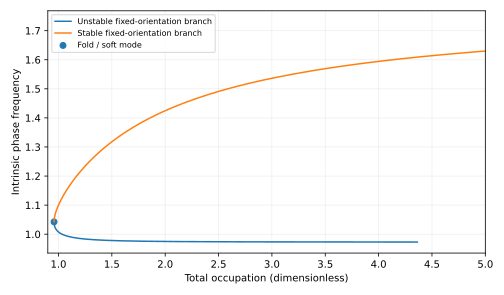
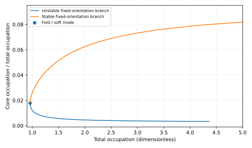
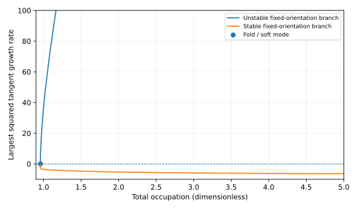

# Native core vortex modulation — causal workload research, round 2

Research tests, not a formal proof or physical simulation of gravity. This extends the earlier causal workload package by retaining the **existing eight-ring/core vortex**. No extra oscillator, gravitational field, fitted clock, drain or horizon is inserted. The original Stage VII weights and the already published constitutive vertex are used; t=1 is the inherited illustrative operating example. All numerical values are dimensionless. Total occupation is scanned as a model load, not identified with matter density, entropy or mass-energy. The scan retains both chambers' balanced collective sector; it is not a literal TetB-only inventory loading experiment.

## Reproduce

`python -m pip install -r requirements.txt` then `OPENBLAS_NUM_THREADS=1 python -m pytest -q` and `python make_figures.py`. The tests reconstruct the 33-coordinate weighted graph from its 104-bond dictionary, including 48 cross terms. This is Stage VII/constitutive vertex, not the distinct 36-coordinate uniform optical model. The test logs cover the new suite only, not a rerun of all upstream checks.

## Findings

### 1. Native stationary continuation

Let G=[[3,-1,0],[-1,3,0],[0,0,1]], M the inherited reduced matrix, C the inherited cross block, A=M-C. Use a G-unit eigenvector x(g) of A+gC on its simple highest eigenvalue branch, matching the Stage VII witness at gain g=1. The exact full-graph embedding B obeys B†B=G, HB=BM, VB=BC. At occupation n, psi=sqrt(n) Bx. Define h=x^T G C x/2. The registered overlap u=n h and the inherited gain g=2u/(chi+u), chi=59/308, yield

    u(g)=chi*g/(2-g),  n(g)=u(g)/h(g).

This is an inverse parametrization of the existing nonlinear stationary condition, not a new response law. Use only positive h and 0<g<2. The full graph residual is checked independently. The core occupation fraction is |x_3|²; actual angular current moment is -(4/9)g n |x_3|² C_axial. On the upper tested branch occupation, phase frequency, core fraction and energy increase together. At g=1, n=1, omega=1.1, core fraction=2/77. At g=1.9, n=7.990264, omega=1.684153, core fraction=0.086637. Thus the core changes with loading, but its frequency is not a gravitational clock: it rises, and different transition gaps do not scale by a common factor. A uniform energy offset also changes its absolute phase rate without changing currents or projective dynamics.

### 2. A real internal threshold, not a horizon

The scan finds a fold at g=0.82682738752, n=0.95843479430, omega=1.04245558. Two stationary branches at the same occupation have different core states. The fold is a **minimum** load on this positive-overlap eigenbranch, not an overload threshold. It coincides with a zero mode of the fixed-orientation projective tangent. Other branches and full-space stability away from the inherited witness are not certified. Increasing n along the tested stable branch does not make its phase frequency vanish; g approaches 2 as n grows without bound. This saturation does not give a finite upper capacity.

With Euclidean coordinates y=G^(1/2)x (implemented via Cholesky), tangent basis Q, l=Q^T(M(g)-omega I)Q in those coordinates, b=Q^T C y in the same coordinates, eigenvector perturbation gives h'=b^T(-l)^(-1)b. The tangent real stiffness is l+(F''(u)n/2)bb^T. Hence n'=(u'-n h')/h and, since u'=2/F'', n'=0 exactly when this stiffness becomes singular. The tests independently compare finite differences, Hessian zero, and minimum occupation. This statement assumes the simple highest eigenvalue and h>0. It is not an event horizon. Frozen linear propagators are reciprocal; a true horizon would require a causal continuum or additional state-dependent directional characteristics, not demonstrated by those propagators.

### 3. Strongest obstruction: hidden energy does not change the core

The actual weighted graph has symmetric zero-row/column-sum outer arrays, no central occupation. Choose the same normalized array in both chambers (q) and opposite arrays (r). They are orthogonal common eigenvectors: H0 q=q, H0 r=r, Vq=-q/2, Vr=r/2. Both are orthogonal to the circulating balanced collective embedding. Add equal occupations to q and r. Their overlap contributions cancel, so u and gain stay fixed, and the core state and phase evolution are exactly unchanged. At g=1 the dark modes evolve at 0.5 and 1.5 while the core remains at 1.1. The added energy equals the added occupation in the model's normalization. The full nonlinear time integration confirms this for arbitrary relative phases. This does not establish that these modes correspond to physical matter; it does disprove universal energy sensitivity of this specific single-overlap core mechanism on its allowed states. A universal clock source must detect energy beyond the existing overlap and core moment, or physically exclude such states. Same total occupation also need not imply same core state (fold example).

### 4. Next research direction

Derive the time-face energy observable that responds to the hidden pair, test whether it modulates all local transition frequencies universally, and derive a direction-dependent propagation law through coupled cores. A clock phase alone is not enough: verify causal cone and distinguish circulation from net radial transport. Do not identify a fold, a scalar lapse zero, or a finite-dimensional reciprocal propagator with a black hole. No physical G, c, lapse or Einstein–Rosen bridge is derived here. No formal proof or Lean run and no repository changes.

## Sources

- [Stage VII sustained core](https://github.com/fielddynamics/research/blob/main/research/hadamard-null-cone-vortex-flywheel/SUSTAINED_TRIFORCE_FLYWHEEL.md): bond dictionary, stationary branch, central current.
- [Constitutive vertex](https://github.com/fielddynamics/research/blob/main/research/hadamard-null-cone-vortex-flywheel/vertex-research/CONSTITUTIVE_VERTEX.md): existing gain, overlap and stable witness.
- [Vertex curvature](https://github.com/fielddynamics/research/blob/main/research/hadamard-null-cone-vortex-flywheel/vertex-research/VERTEX_CURVATURE.md): tangent calculation.
- [Ordered response](https://github.com/fielddynamics/research/blob/main/research/hadamard-null-cone-vortex-flywheel/vertex-research/ORDERED_RESPONSE_AND_DRAIN.md): native common dark-to-base eigenchannel.
- [Open throat](https://github.com/fielddynamics/research/blob/main/research/hadamard-null-cone-vortex-flywheel/OPEN_THROAT.md): circulation distinct from net throughput.
