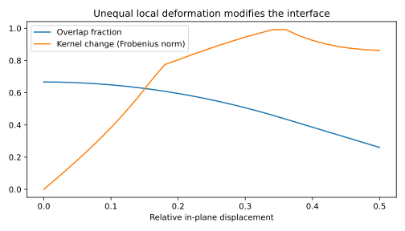
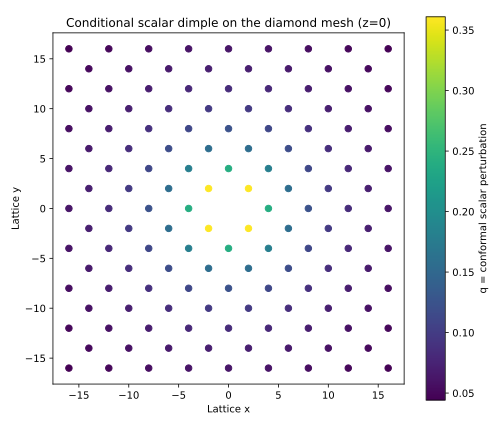
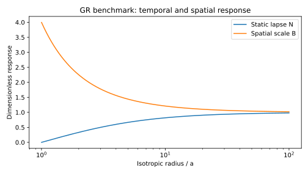
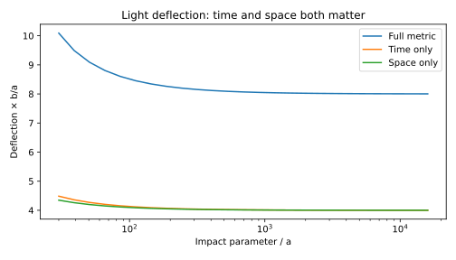

# Flower lattice deformation and causal settlement

Research continuation — not a formal proof or a physical derivation of general relativity. No new oscillator, no change to the upstream repository. The goal is to determine how unbound pixels could accommodate the registered energy of a bound field object, and what additional structure would be needed for a causal horizon.

## Results at a glance

116 pytest cases passed. These include counterexamples and checks of explicitly assumed continuum benchmark laws, not 116 independent proofs. The native 36-coordinate model is reconstructed from the preceding research package and tested using the actual full and filtered Flower coupling matrices. The new static graph model is independent of the native amplitude Hamiltonian.

### 1. Preserve the architecture while changing the metric

The existing Flower model is a 3D diamond graph; its planar circles are a projection, not physical spherical envelopes. Its four active vectors are `(1,1,1),(1,-1,-1),(-1,1,-1),(-1,-1,1)` with reversed parity on the other sublattice. The 4x4 area kernel W has lateral off-diagonal entries 2/9, central-lateral entries 1/9, central-central 6/9, and lateral diagonal zero. The overlap fraction is 2/3. Common affine deformation F multiplies every coplanar tile area by `|det F| |F^{-T} n|`; all normalized overlap fractions are unchanged. Sixteen randomized nonsingular affine matrices verify this. Independent planar clipping reconstructs W; relative in-plane translation and shear change W. Reverse coupling is the transpose of the forward physical area matrix. The test uses a fixed original tile-area normalization for unequal shapes, not an independently normalized reverse kernel. No general noncoplanar deformation dynamics is inferred.



**Obstruction:** the normalized overlap kernel cannot detect common affine deformation. The existing fixed H36 has no metric coordinate, no absolute area or proper-length dependence, and no dynamical rule for selecting a deformation. Unequal interfaces alone, with real reciprocal static couplings, still give `M(-k)=M(k)*`; the band spectrum is even in momentum. A genuine directional causal shift is not obtained by changing these weights alone. A circulating background might break the relevant symmetry of its linearization; that remains to be tested on a unified nonlinear lattice, not ruled out by this static model.

### 2. A dimple without adding matter to the unbound pixels

Use the actual four-port diamond graph and its positive Laplacian L. With coordinate spacing h=1 (bond length sqrt(3)), the continuum-normalized operator is L/(2h^2) ~ -Delta. A primitive two-site cell has volume 16h^3, so the volume per site is 8h^3. The benchmark scalar q=a/r has -Delta q=4 pi a delta_0. Its lattice analogue is Lq=pi a/h at the central source only. The outside boundary is prescribed q=a/r, a deliberate GR-inspired boundary condition, not a discovery of the source coupling. A 4505-node mesh with 8192 undirected edges gives maximum q=1.40815 at the source for a=1. The 3735 interior equations have residual below 2e-13; every interior unbound node has zero source. Shell means of q*r are within 3.5% of a from radii 4 through 12. This is a scalar dimple in a chosen positive static settlement energy, not a simulation of spacetime collapse. The central lattice value is not a physical horizon or singularity.



A separate negative control uses random positive bond stiffnesses and constant boundary data. With no source, the unique solution is constant (five trials). Changing geometry/stiffness alone does not explain where the dimple comes from; a matter-to-field coupling is essential.

### 3. Relative clocks and curvature

For N>0, log ratios D_ij=ln(N_j/N_i) telescope around loops. The existing tetrahedral gradient reconstructs affine ln N exactly and is insensitive to a common clock rescaling. This gives the static acceleration read -c² grad ln N, not the source equation for N. Pure frame changes U_ij=F_i^{-1}F_j telescope to identity and cannot generate intrinsic curvature.

A separate GR benchmark uses the conformal spatial metric h_ij=psi^4 delta_ij, psi=1+a/r, a=GM/(2c²). For a time-symmetric vacuum slice the Hamiltonian constraint gives R(h)=-8 psi^{-5} Delta psi=0. For static vacuum the lapse satisfies Delta_h N=0 and Hess_h N=N Ric(h). Since Delta psi=0, Delta_h N=psi^{-5} Delta(psi N). Spherical harmonicity, asymptotic flatness, and zero signed lapse at the inversion-fixed throat r=a imply psi N=1-a/r=2-psi. Thus N=(1-q)/(1+q), B=psi², R_areal=rB; N²=1-4a/R_areal. The boundary and GR equations are assumptions, not derived from GFD. Independent analytic gradient/Hessian evaluations verify the full static vacuum equations at eight radii, with zero scalar curvature but nonzero Ricci tensor. Numerical Levi-Civita spin transport on a six-edge diamond loop produces nontrivial holonomy, preserves rotations, inverts on path reversal, and scales with loop area as the loop shrinks. The connection is the benchmark metric's connection, not one extracted from H36.



### 4. Deflection and the critical limit

The static optical index n=B/N is used in a numerical turning-point integral. At large impact parameter b, full deflection tends to 8a/b = 4GM/(bc²); lapse-only and space-only models each tend to 4a/b. At b/a=2000, the respective deflection*b/a values are 8.02365, 4.00630, 4.00472. Strong deflection increases toward the Schwarzschild critical photon impact parameter 6 sqrt(3) a. These are conditional metric benchmarks, not emergent GFD light paths.



The imposed characteristic law for a radial shift V (in units c=1) has velocities V +/- N/B. At V=-1, N=B=1, the outward characteristic vanishes and the inward one remains negative. Reciprocal lapse-only scaling cannot do this: it either slows both directions or blocks both. These are algebraic characteristics, not an actual horizon evolved from the mesh. The native H36 Bloch calculation retains quadratic band-edge stiffness D=0.12429467 (full) or 0.10509418 (filtered), not a relativistic linear cone. Deforming the static real area kernels keeps reciprocity. An Einstein–Rosen bridge or separate thread is not proved; the horizon is distinct from the curvature singularity.

## Next research gate

1. Derive an energy-to-metric variation from the proper-time vortex action including complete nonlinear energy, not an inserted scalar source or imposed Schwarzschild boundary data.
2. Determine absolute interface response versus the normalized area fractions (which are deformation-blind), and a genuine connection across interfaces rather than frame relabeling.
3. Linearize an explicitly circulating, self-consistent coupled-core background to test for a directional shift or odd-in-k terms. Keep the native graph, all core degrees of freedom, and local conservation. The real static band obstruction is not a general nonlinear no-go.
4. Derive a covariant causal propagation equation and verify the full optical and static constraints before claiming a horizon. Test flux conservation and boundary registration without counting the unbound field as new retained matter.

## Reproduce

```
python -m pip install -r requirements.txt
OPENBLAS_NUM_THREADS=1 python -m pytest -q
OPENBLAS_NUM_THREADS=1 python make_figures.py
```

Data: `radial_benchmark.csv`, `overlap_scan.csv`, `deflection.csv`; raw test output `verification.txt`. All calculations dimensionless. No Lean run. Source notes: [Hadamard–Flower lattice](https://github.com/fielddynamics/research/blob/main/research/hadamard-null-cone-vortex-flywheel/HADAMARD_FLOWER_LATTICE.md), [Unified dynamics](https://github.com/fielddynamics/research/blob/main/research/hadamard-null-cone-vortex-flywheel/UNIFIED_HADAMARD_FIELD_DYNAMICS.md), [spectral gravity read](https://github.com/fielddynamics/research/blob/main/research/hadamard-null-cone-vortex-flywheel/SPECTRAL_GRAVITY_READ.md), [mountain scale](https://github.com/fielddynamics/research/tree/main/proofs/sst-mountain-scale). The original historical test suites were not rerun.
