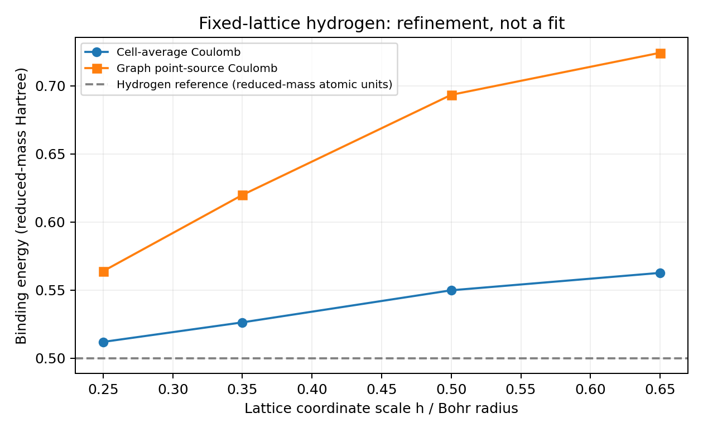
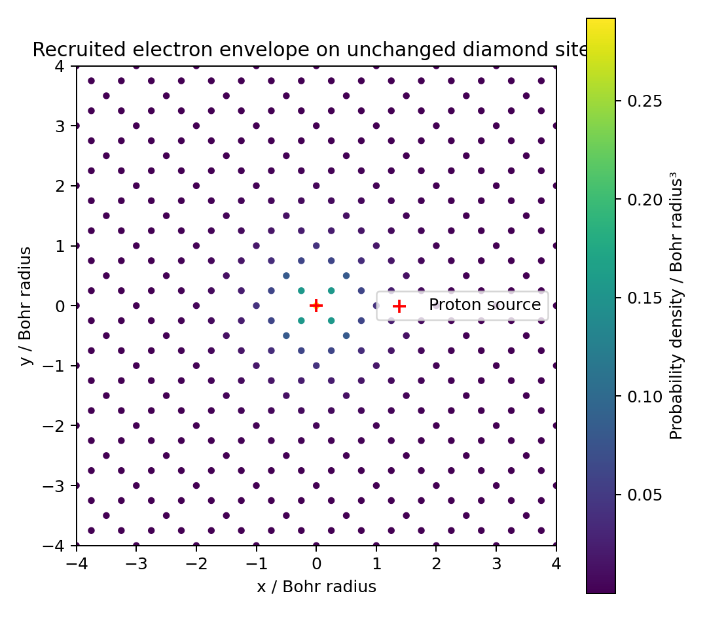
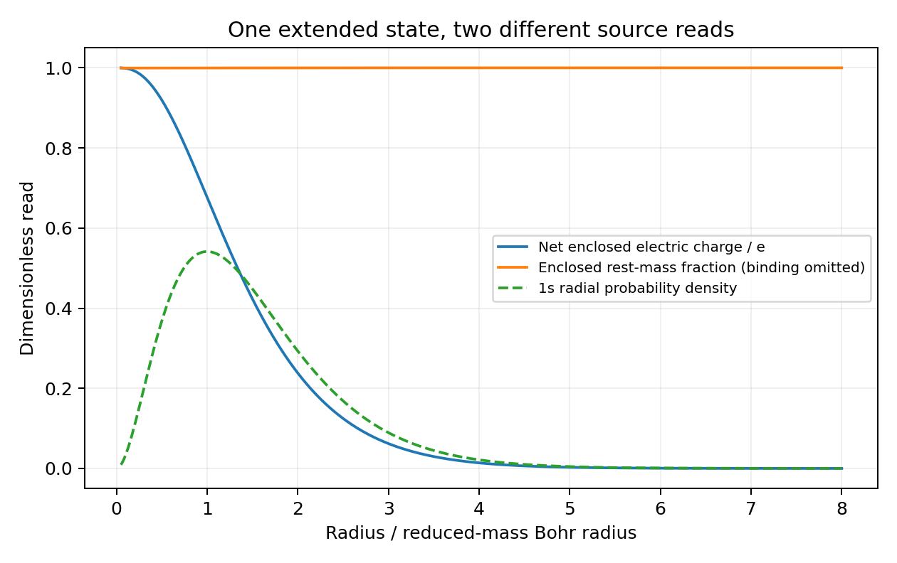

# Hydrogen: recruitment on an invariant Hadamard–Flower network

Research continuation, not a formal proof. **116 pytest cases passed**. No original cube or port is deformed; no new vortex is added to the native cell. The reduced envelope is a conditional effective model, not a simulation of all 36 amplitudes at each site or a derivation of electric charge.

## 1. Upstream architecture

- [Hadamard–Flower lattice](https://github.com/fielddynamics/research/blob/main/research/hadamard-null-cone-vortex-flywheel/HADAMARD_FLOWER_LATTICE.md): overlapping-origin diamond network with four reciprocal links. This is an alternative to the original cube-center embedding, not proof that the planar Flower is a physical lattice.
- [Spectral gravity read](https://github.com/fielddynamics/research/blob/main/research/hadamard-null-cone-vortex-flywheel/SPECTRAL_GRAVITY_READ.md): lowest 72-coordinate Bloch band has curvature D=0.10509418 (filtered) or 0.12429467 (full); dimensionless energy and length.
- [Matter, vortex and charge](https://github.com/fielddynamics/research/blob/main/research/hadamard-null-cone-vortex-flywheel/MATTER_VORTEX_CHARGE.md): inward electron candidate, outward bound response, neutral background vortices; bare chamber difference is not conserved by H36. Empty TetB is not sufficient to identify an electron.
- [Electron closure](https://github.com/fielddynamics/research/blob/main/research/hadamard-null-cone-vortex-flywheel/ELECTRON_CLOSURE_SETTLEMENT.md): proposed electromagnetic closure radius is not an atomic orbital radius.
- [Closure of closures](https://github.com/fielddynamics/research/blob/main/CLOSURE_OF_CLOSURES.md): ownership and registered boundary response.

`native_cell.py` reconstructs the inherited geometry and both overlap kernels from the preceding deformation package. Tests independently reproduce the band curvature and momentum evenness in five directions. They do not rerun the entire upstream suites.

## 2. Conditional link to hydrogen

On the unchanged diamond network, A sites have four displacements h(±1,±1,±1) of positive sign product; B sites have the negatives. The physical interpretation of h is open. The normalized graph operator L=(4I-A)/(2h²) tends to -∇² at long wavelengths. Its leading acoustic curvature follows from the tetrahedral second moment. The native H36 soft scalar band has E(k)-E0=D|k|²+O(k⁴). With physical lattice coordinate spacing h_phys and energy conversion E_unit, a Schrödinger envelope requires E_unit D h_phys²=ℏ²/(2μ_red). This is a matching condition, not a prediction. The native band is not automatically an electron mode: its scalar reference and charge symmetry still need to be derived.

For the actual hydrogen benchmark use reduced-mass atomic units: a=ℏ/(μ_red c α), E_H=μ_red c²α². The nonrelativistic point-nucleus equation is H=-∇²/2-1/r, with ground energy -1/2, mean radius 3/2, and density exp(-2r)/π. The graph solver uses H=L/2+V, with two explicitly chosen conventional electrostatic inputs:

1. V=-1/r, finite-volume average at the origin (sphere with same volume 8h³).
2. V=-φ, φ obtained by solving Lφ=4πδ_origin/(8h³) with exterior 1/r Dirichlet values. This uses the same lattice for the electrostatic propagator and kinetic envelope, but still imposes source strength and sign.

Finite spherical domain R=7 Bohr radii, homogeneous exterior condition for the electron, Coulomb exterior values for φ. No fitting per grid. The two models differ markedly at coarse resolution. No physical pixel spacing is inferred. Refinement is a numerical continuum check, not actual changes in the proposed pixel size.



| h/a | Sites | Cell-average E | Graph point-source E | Cell-average mean r | Graph mean r |
|---:|---:|---:|---:|---:|---:|
| .65 | 657 | -.562654 | -.724307 | 1.00362 | .72366 |
| .50 | 1419 | -.549865 | -.693420 | 1.17526 | .88501 |
| .35 | 4235 | -.526305 | -.619896 | 1.35133 | 1.12681 |
| .25 | 11543 | -.511956 | -.563926 | 1.43451 | 1.29773 |

At the finest grid the binding energies err by 2.39% and 12.79%, respectively. Both improve monotonically in the tested sequence. The radial finite-difference reference independently checks the conventional 1s, 2s, 2p, 3s, 3p and 3d eigenvalues within 2e-5 Hartree (not a native-lattice excited-state test). Fine/hyperfine structure, spin and radiative corrections are outside scope.



The normalized extended ground state assigns probability to many fixed sites. Its real stationary amplitude has zero probability current across each bond; a phase-twisted state with the same density has nonzero currents and greater kinetic energy. Thus a recruited electron density is not the same thing as a literal inward steady flow or a collection of separately charged electrons. The original internal vortices are not resolved by this effective envelope.

## 3. Electric neutrality vs gravitational registration

For a spherically symmetric hydrogen 1s electron with a point proton, P(<r)=1-exp(-2r)(1+2r+2r²) in Bohr units. The net enclosed electric charge in units e is Q(r)=1-P(<r). Its electrostatic potential in atomic units is exp(-2r)(1+1/r). Both decay exponentially in the neutral atom. The gravitational rest-mass fraction (ignoring binding and field stresses) is [m_p+m_e P(<r)]/(m_p+m_e). It approaches unity, not zero. The actual total ground-state mass is m_p+m_e-E_binding/c²; the binding correction cannot be obtained from the rest-mass density alone. The exact exterior mass-energy registration and local stress-energy require the full coupled action.



On each of four diamond grids, the same electron probability is used in two imposed source dictionaries: signed electric source δ-p and positive normalized rest mass (m_p δ+m_e p)/(m_p+m_e). The graph Poisson solver verifies zero total electric boundary flux, positive normalized gravitational flux, and linear superposition. These are tests of the proposed separation, not derivations of those dictionaries. The electron is not fed its own neutral-atom mean-field potential in the Schrödinger equation; that would introduce an unphysical one-electron self-interaction. The gravity calculation is a diagnostic with mass weighting and not a self-consistent relativistic simulation.

## 4. What the results do and do not show

A fixed network can accommodate a changing extended state without geometric gaps. Its bare reciprocal band supplies a quadratic kinetic candidate. A signed charge read and an even energy read can coexist over the same recruited region; neutral hydrogen still gravitates. A pure graph stiffness modification with no source and zero boundary gives zero scalar field. An arbitrary constant shift of H36 changes absolute eigenenergies without changing the eigenvectors; absolute physical energy is not supplied by the microscopic model. No physical charge quantization, proton–electron mass ratio, orbital recruitment dynamics, universal lapse coupling, or black-hole horizon has been derived. Real static hoppings yield even dispersion, not a directional causal shift. The existing electron closure length and the Bohr radius are distinct.

Next gate: derive a conserved excess charge mode and proton coupling from the original core/time-face action, rather than assuming the Coulomb source; identify the band as an electron mode and derive the kinetic scale; then derive gravitational work from total proper-time energy (including binding), and test whether a multi-pixel circulating background supplies a causal cone. Do not confuse static settlement with instantaneous physical information propagation.

## Reproduce

```
OPENBLAS_NUM_THREADS=1 OMP_NUM_THREADS=1 pytest -q
OPENBLAS_NUM_THREADS=1 OMP_NUM_THREADS=1 python make_figures.py
```

`hydrogen.py`: lattice and solvers. `test_hydrogen.py`: 116 parameterized tests, including conventional references, convergence, charge/mass accounting, phase and native spectral checks. `hydrogen_convergence.csv`, `radial_reads.csv`: numerical outputs. `verification.txt`: actual pytest output. No repository changes or formal proof.
