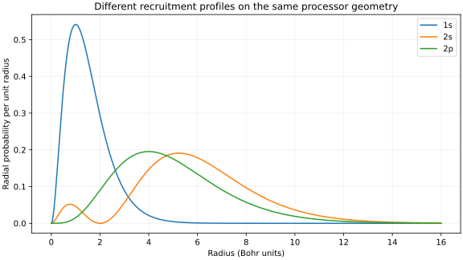
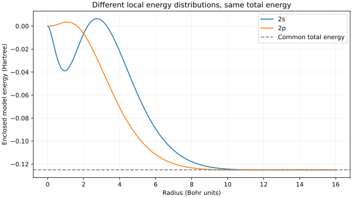
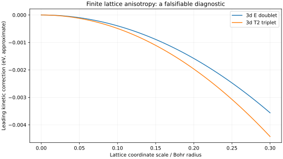

# Orbital recruitment and central-throat response

## Executive result

The electron-configuration folder supplies an angular mode dictionary; distributed vortex recruitment supplies a fixed four-port network and an existing nonlinear core. This module connects them with (1) an exact projected port identity, (2) conventional hydrogen energy/charge benchmarks that discriminate proposed registration laws, and (3) a finite-spacing anisotropy test. No new oscillator, processor deformation or fitted physical coupling is introduced. The microscopic charge source, gapless circulating background, physical lapse and mass normalization remain open.

## 1. Angular organization of recruited TetA

The [electron configurations folder](https://github.com/fielddynamics/research/tree/main/research/electron-configurations) selects the highest SO(3) representation at each depth of the spatial channel tensor product and assigns two time-face orientations. With these premises the capacity is 2(2l+1); summed over l=0,...,n−1 it is 2n². Highest-irrep selection, physical spin and fermionic statistics are not established by counting. Its Madelung cost n+l is an assumed energetic ordering, not an actual spectrum; its updated generative validator reports 76/83 for the primary landmarks versus 70/83 for Madelung alone. The 80/83 exception-only count is not a global prediction. No validator from that folder was rerun here.

For the conventional central-potential benchmark ψ_nlm=R_nl(r)Y_lm(Ω), the sum over occupied angular modes has density (2l+1)|R_nl|²/(4π), times two for full spin occupancy. A half-filled subshell with each m occupied once likewise has spherical total density. A coherent superposition is NOT the same as an equally occupied density matrix: cross terms need not cancel. The local density is radial for hydrogen 1s, not a literal hexagonal shell. Occupied angular modes and retained TetB objects are different concepts.

## 2. Exact connection to the existing Flower port and throat

Use s_i=(1,1,1),(1,−1,−1),(−1,1,−1),(−1,−1,1); q_i=s_i·z with ||z||=1. For x=(u,v,w), define E_i x=(u q_i+v q_j for j≠i, w q_i). The same W from the original Flower interface satisfies W E_i=E_i T, T=[[4,−2,1],[0,−2,0],[3,−1,6]]/9, and Σ E_i†E_i=4G, G=[[3,−1,0],[−1,3,0],[0,0,1]]. Define B_i=(4G)⁻¹ E_i† W E_i. Then Σ B_i=T exactly, every B_i is G-self-adjoint, and weighted port drive B=Σ a_i B_i is the projection onto the inherited fixed-orientation sector. This is an exact matched-state projection, not a derivation of arbitrary full-cell transport. A complex drive has a separate phase tangent; the tests use Re B in the real stationary tangent. Directional drives can leave the fixed-orientation subspace in the full system. The sum identity is an algebraic result, not a proof of radial symmetry at every scale.

Under the inherited bias convention −ε B/2 in the stationary generator, the overlap and core occupation tangent are linear in B. For four equal weights, they are the previous dχ/dε=−3639415/71166942≈−0.051139123 and dI_c/dε=−3597250/391418181≈−0.009190299. The bias factor −1/2 is the earlier documented normalization, not a physical constant. It is not legitimate to substitute a charge density or orbital energy for ε without deriving that map. Even/odd parity of the response is not itself physical charge conjugation. The source and response are existing degrees of freedom.

## 3. Hydrogen: energy cannot be an intensity-only registration

In reduced-mass atomic units, the conventional H Coulomb energy is E_n=−1/(2n²). H(2s) and H(2p) share E=−1/8 Hartree but have different mean radii (6 and 5 Bohr radii), different density-squared integrals (0.000777123746 and 0.001398822742 for m=0), and different spatial energy distributions. H(1s) E=−1/2, <r>=1.5, ∫ρ²=1/(8π). Exciting 1s→2s or 2p costs 3/8 Hartree ≈10.2 eV, without changing charge or retained nuclear inventory. Actual fine structure and Lamb shift break the leading Coulomb degeneracy. Use these as a discriminating benchmark, not a GFD prediction.

A linear total-intensity read ∫ρ=1 cannot distinguish the excitation. A quadratic local-intensity read ∫ρ² distinguishes 2s and 2p despite their equal leading energy. More generally ψ'=e^{iγ z²}ψ_1s has exactly the same density, zero mean momentum and extra kinetic energy 2γ² Hartree in atomic units; no density-only functional can recover the general energy. The phase gradient or another energetic record is necessary.

An illustrative angle-integrated electronic energy ledger is e_nl(r)=½[r²(R'_nl)²+l(l+1)R_nl²]−rR_nl². Its integral is E_n. Its local definition is not unique and is not a derived relativistic stress-energy tensor. For the 2s and 2p states, symbolic integration gives the exact enclosed difference at radius R:

E_2s(<R)−E_2p(<R)=−R²(R−12)(R−2)e^(−R)/96.

The first numerical assumption that the difference would be nonzero at all sampled finite radii failed at R=2. The algebra revealed the two exact crossings, R=2 and R=12, which are now explicitly tested. The total difference tends to zero at infinity. The formula uses the stated energy-density convention; no special physical significance is assigned to those radii.

The exterior gravitational monopole benchmark in weak-field GR is the total conserved energy including rest masses, interactions, and binding (not just this electronic energy term). Hydrogen stays electrically neutral after excitation; gravitational mass changes by ΔE/c², about 1.82e−35 kg for 10.2 eV. Equal monopoles do not require equal local fields or multipoles. An abstract spectral ledger Tr(ρ H) is phase/energy sensitive while Tr(ρ) counts normalized electron states; neither is yet an identified native time-face observable. For a local coupling to lapse, the whole Hamiltonian must scale in proper time, not just the local norm or interaction overlap. See the prior recursive-causal-closure module.

## 4. A new falsifiable lattice diagnostic

The fixed diamond acoustic symbol λ_D(k)=4−|Σ exp(i a k·s_i)| has quadratic isotropy, but not exact SO(3) symmetry at finite a. For a scalar Schrödinger envelope with normalized kinetic λ_D/(4a²),

T(k)=|k|²/2 + a²[−|k|⁴/8 + Σ k_i⁴/12]+O(a⁴|k|⁶).

The l=2 subspace restricts to a doublet E (2z²−x²−y², x²−y²) and triplet T2 (xy,xz,yz). Exact sphere averages of Σ n_i⁴ weighted by each squared harmonic are 5/7 and 11/21 respectively. For hydrogen 3d, <k⁴>=1/45 in atomic units. Thus the leading kinetic E−T2 separation is (a/a_B)²/2835 Hartree, or approximately 0.0095984(a/a_B)² eV. For p modes the same angular expectation is 3/5 for each component and does not split that triplet at this order. The result is only the acoustic-envelope kinetic correction, not the full 72-coordinate band, a full discretized Coulomb atom, or an observational bound on the physical lattice pitch. Other terms could cancel it; a continuum limit or an exactly rotationally invariant emergent dictionary must explain why any residual anisotropy is compatible with spectroscopy. Native band quadratic stiffness (full 0.12429467, filtered 0.10509418) is independently rechecked; no quartic coefficient of that band is equated with the scalar graph coefficient.

## 5. Research gates

1. Derive the electronic orbital amplitudes from the real circulating background and the native source coupling, rather than importing Coulomb orbitals. The current result connects their angular dictionary and matched port response only.
2. Derive a collective energy ledger sensitive to phase, gradients and binding, with conserved charge separately; apply the same law to H, H+, excited H, He, and isotopes.
3. Derive an unscreened response about the actual circulating background, rather than assuming the scalar band-edge pole persists.
4. Derive universal physical lapse coupling and causal propagation. The existing nonspatial core interpretation is a framework hypothesis, not an established physical fact.
5. Check all angular modes and real atomic energies before revisiting transition-metal promotion. No per-element coefficients.

## Reproduce

Python 3 with NumPy, SciPy (sph_harm_y API), SymPy, pytest, Matplotlib. `OPENBLAS_NUM_THREADS=1 pytest -q test_bridge.py native_throat.py` runs 90 tests (14 inherited throat tests and 76 new tests). `python make_figures.py` generates 3 SVGs and the orbital CSV. See verification.txt. Previous archived modules retained without rerunning them all. No remote repository modification. Sources: [native interface](https://github.com/fielddynamics/research/blob/main/research/hadamard-null-cone-vortex-flywheel/UNIFIED_HADAMARD_FIELD_DYNAMICS.md), [spectral gravity](https://github.com/fielddynamics/research/blob/main/research/hadamard-null-cone-vortex-flywheel/SPECTRAL_GRAVITY_READ.md), [vertex curvature](https://github.com/fielddynamics/research/blob/main/research/hadamard-null-cone-vortex-flywheel/vertex-research/VERTEX_CURVATURE.md).
