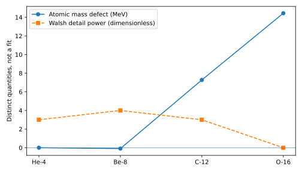
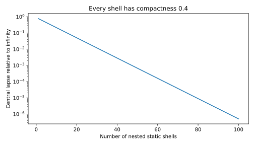
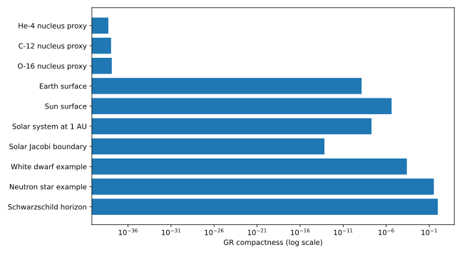

# Recursive causal closure: from packed nuclei to the solar system

Research continuation — not a numbered proof. The native core is the existing Stage VII weighted 33-coordinate model; no new oscillator, bonds or fitted gravitational parameters are added. The loaded states are trial amplitude records, not identified nuclear eigenstates. The GR shell and characteristic calculations are independent geometric benchmarks, not derived from GFD.

## 1. Packed child records

Represent a complete four-address child by (1,1,1,1). Fill k of four children in a 16-address parent, using the normalized Walsh transform W16=H4⊗H4/4. The common coefficient is k; the detail power is 4k−k², and fine within-child details vanish. Thus the common coefficient continues increasing when directional contrast falls to zero at k=4. The 64-address extension is tested separately: with k complete four-address children, common coefficient k/2 and detail power 4k−k²/4. This is the existing recursive packing identity, not a new nuclear Hamiltonian.

Measured neutral atomic mass differences relative to separate He-4 atoms give Be-8 −0.0918395 MeV, C-12 +7.274748 MeV, O-16 +14.436665 MeV. Electronic binding differences are included; these are not bare-nucleus Q values. A constant pair interaction fitted to Be-8 predicts a negative oxygen binding (six pairs), while adding a universal triple term fitted to C-12 overpredicts oxygen. This excludes those simple count-only models, not general geometry-dependent pair potentials or conventional nuclear cluster models.

## 2. Load the original core

The inherited core_model.py retains 104 bonds and the exact Stage VII three-coordinate balanced stationary witness. Map each full row of the existing TetB 4×4 address dictionary (diagonal = base, off-diagonal = lateral) to a trial child record. Add the perturbation 0.13 times that record to the existing stationary vortex; the phase step varies between 0 and 2π. This amplitude scale and row/phase choice are illustrative, not physically inferred. Integrate the full 33-complex-coordinate nonlinear Hamiltonian for dimensionless time 2. The 65 trajectory scan includes 13 repeated unloaded control trajectories. Norm and energy conservation checked on independent sampled trials. No nuclear masses are fitted as amplitudes.

For the same four-child packing the scanned energies span −0.934036 to +0.917321, and initial central angular current magnitudes span 0.001498 to 0.035259. These are signed dimensionless Hamiltonian energies, not physical rest masses. Core circulation responds, but occupancy alone is not an energy register. A common shift of the Hamiltonian changes energy and common phase while leaving projective dynamics unchanged, so an absolute physical vacuum/rest-energy reference must be derived independently.

## 3. Nonlinear clock accounting: a new consistency condition

The prior linear clock scaling D(N)HD(N) cannot just be applied inside the nonlinear vertex. Write H(ψ)=ψ†H0ψ+F(u), u=ψ†Vψ/2, F(u)=2(1+t)[|u|−u0 ln(1+|u|/u0)], u0=tχ*. Uniform lapse N must scale the **whole** proper-time Hamiltonian if it represents a common rescaling of evolution time. The naive substitution gives H_naive=Nψ†H0ψ+F(Nu), whose derivative at N=1 is ψ†H0ψ+uF′(u). The correct common-lapse derivative of NH(ψ) is H(ψ). The difference is

    uF′(u)−F(u)=2(1+t)u0 [ln(1+x)−x/(1+x)], x=|u|/u0,

strictly positive for x>0 (differentiate the bracket). At the reference core t=1, u=59/308, H=0.9520041084, naive excess=0.1479958916 (15.55% of the model energy). This is a mathematical consistency test, not a measured gravitational error.

One candidate local extension uses D=sqrt(N_A)P_A+sqrt(N_B)P_B+sqrt(N_O)P_O and H_N=ψ†DH0Dψ+sqrt(N_A N_B)F(u). At unit lapse the sources are E_i=Re ψ†P_i H0 ψ + F(u)/2 for A/B and the quadratic term alone for O. Sum E_i=H exactly. Uniform N rescales all nonlinear trajectories (tested). The split is a symmetric candidate, not unique; uniform scaling alone only fixes the sum. A real physical lapse, local source sign, energy scale, shift, and dynamics of N are not derived.

## 4. Nested clock deficit is not a horizon

Consider static spherical thin shells in GR, with areal radii R_i increasing outward and cumulative Schwarzschild mass parameters m_i, m_0=0. The regions between shells have time metrics −A_i(1−2Gm_i/(rc²))c²dt². Continuity of the induced metric at shell i gives the ratio of the inner/exterior lapse normalization sqrt[(1−2Gm_i/(R_i c²))/(1−2Gm_(i−1)/(R_i c²))]. With exterior time normalized at infinity, the central lapse is the product of these factors.

Choose R_i=2^(i−1) R_1 and m_i=0.4 c² R_i/(2G). Each outer shell compactness is 0.4, and the inner-side compactness is 0.2 except at the first shell (zero). Then N_center=sqrt(0.6)(sqrt(0.6/0.8))^(n−1). At n=100, N_center≈5.0653×10⁻⁷, while compactness nowhere reaches 1. Static thin shells require stresses; this idealized family is not a solar system or a claim about how such shells form. The radii span an enormous range. No event horizon occurs in these finite globally static matched regions; outward radial paths can traverse them. Inside a single spherical shell the clock is shifted but its spatial gradient is zero. Thus depth of potential, local acceleration, and causal trapping are different diagnostics.

The spherical Misner–Sharp mass m satisfies 1−2Gm/(Rc²)=g^{ab}∂_aR∂_bR. A future trapped surface requires both future null expansions negative; at a future marginal sphere the outgoing expansion is zero and the inward one negative. In the specific collapsing flat-slice/unit-lapse PG representation the characteristic speeds divided by c are 1−sqrt(C) and −1−sqrt(C); their product is C−1. These are benchmarks for a candidate native causal shift, not an identification of optical circulation with physical velocity. A marginal surface is not in general a global event horizon. Ordinary GR collapse need not create an Einstein–Rosen second exterior or a baby universe.

Solar surface compactness is 4.245e−6; 1 AU 1.974e−8; 1.44 pc Jacobi reference boundary 6.646e−14 (Sun-only spherical proxy). Earth 1.392e−9. White dwarf and neutron star entries are illustrative mass/radius choices. Nuclear values use approximate R=1.2 A^(1/3) fm and neutral atomic masses as mass proxies; GR compactness is not an explanation of nuclear binding. Jacobi radius is not a horizon or the size of the Sun. These distinct radii must not be equated with one computational capacity.

## 5. Next gates

1. Derive the physical energy reference and exact time-face work coupling from the existing vortex action, including its nonlinear term. Test charge neutrality, binding and energy exchange.
2. Derive lapse and independent directional shift/causal characteristics from neighboring existing central vortices, not from an imported metric. Show local Lorentz cone and universal clock redshift.
3. Derive a physically defined local capacity in terms of registered energy and boundary geometry. In spherical GR the threshold is quasi-local compactness one, not global workload or low lapse alone. A physical mechanism for causal encapsulation remains open.
4. Match the inherited GFD drainless and drained laws (Newton/GR and AQUAL) and the G normalization without calibration. No assertion of baby-universe formation or universal nuclear geometry is made.

## Reproduction and provenance

`OPENBLAS_NUM_THREADS=1 python -m pytest -q` → 116 passing cases. Initial final phase-offset numerical comparison missed tolerance by 1.53e−9; tightening integrator tolerances and max step resolved it without changing the equations. `python make_figures.py` produces three figures and three CSV files. No Lean proof, upstream suite rerun, physical fit or repository write. core_model.py carried forward from the previous research package.

Sources: [Stage VII](https://github.com/fielddynamics/research/blob/main/research/hadamard-null-cone-vortex-flywheel/SUSTAINED_TRIFORCE_FLYWHEEL.md), [nonlinear vertex](https://github.com/fielddynamics/research/blob/main/research/hadamard-null-cone-vortex-flywheel/vertex-research/CONSTITUTIVE_VERTEX.md), [TetB packing](https://github.com/fielddynamics/research/blob/main/proofs/recursive-field-closure-response/sources/TETB_PACKING_WALSH_READ.md), [Closure of Closures](https://github.com/fielddynamics/research/blob/main/CLOSURE_OF_CLOSURES.md), [mountain scale](https://github.com/fielddynamics/research/tree/main/proofs/sst-mountain-scale), [NIST isotope masses](https://physics.nist.gov/cgi-bin/Compositions/stand_alone.pl?all=all), [Be-8 mass PubChem](https://pubchem.ncbi.nlm.nih.gov/element/4), [NASA Sun facts](https://nssdc.gsfc.nasa.gov/planetary/factsheet/sunfact.html?level=1), [Hayward, gravitational energy in spherical symmetry](https://doi.org/10.1103/PhysRevD.53.1938). Mass inputs are rounded reference values; no uncertainty propagation.
