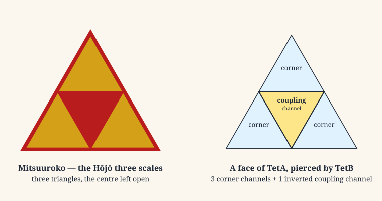
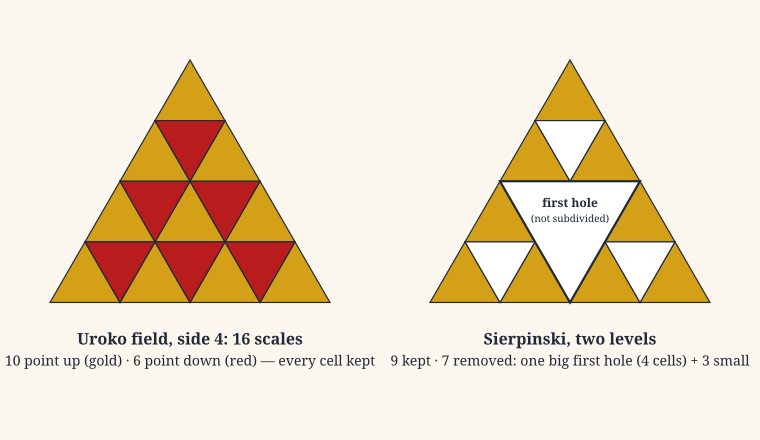

# The Three Scales

### A serpent's gift, a regent's banner, and the face of the stellated octahedron

*Exploratory essay, October 2026. Companion to the research [plan](PLAN.md).*

---

## The twenty-first night

Early in the Kamakura period, the story goes, Hōjō Tokimasa went to the island of Enoshima to pray. Tokimasa was the father-in-law of Minamoto no Yoritomo, the first shogun, and was soon to become the first of the Hōjō regents who would govern Japan for more than a century. He shut himself away for twenty-one days, asking the island's goddess for the prosperity of his descendants.

On the twenty-first night a woman appeared to him. She was dignified and beautiful, dressed in red *hakama*. She told him that in a former life he had been a monk of Hakone, who had copied the Lotus Sutra and dedicated it at sacred sites in sixty-six provinces. For that merit, she said, his descendants would rule Japan, but if they went astray their rule would not pass seven generations. Then she turned into a great serpent, some twenty *jō* long, and slipped into the sea.

Where she had been lay three large scales. Tokimasa took them and set them on his banner.

That is how the war chronicle *Taiheiki*, written in the 14th century, tells it (the research plan checks the passage against a critical edition). The chronicler had an advantage over Tokimasa: he wrote after 1333, when the last Hōjō regent died and Kamakura fell, so the seven-generation limit was a known ending rather than a prophecy. The crest, however, was real. It is the *mitsuuroko* (三つ鱗), the "three scales": three triangles set inside a larger one, with the centre left open. It flew in gold on red over the regents' armies and still stands on the gate of Engaku-ji in Kamakura, founded by the regent Hōjō Tokimune.

Most people outside Japan know it by another name. Nintendo's Triforce, the golden emblem of *The Legend of Zelda* since 1986, is widely traced to the Hōjō crest.

This essay is about the shape itself, because the same shape turns up somewhere quite unexpected: on every face of the geometry that Gravity Field Dynamics (GFD) places at the heart of the gravitational field.

## Triangles that guard

The three scales did not come from nowhere. Triangles had been guarding the Japanese dead for nearly a thousand years before Tokimasa.

Between the late 4th and 7th centuries, the builders of Japan's great burial mounds, the *kofun*, painted the inner chambers of some of them. Around 700 of these decorated tombs are known, about 200 of them in Kumamoto Prefecture on Kyushu. Their walls carry concentric circles, boats, horses and, above all, rows of repeated triangles in red, white and blue. In the Chibusan Kofun at Yamaga, built around the middle of the 6th century, the stones are "mainly painted with triangular and diamond patterns". The patterns are generally read as wards against evil, set around the dead.

The triangle stayed protective. The *uroko-mon*, the "scale pattern", is an all-over field of alternating triangles, and Japanese tradition gave it the same work:
- women in Kyoto have worn scale-patterned under-robes during their *yakudoshi*, the years of life believed to be unlucky, as a charm against harm;
- on the stage, the triangles mark the moment a woman becomes a serpent. In the Noh play *Dōjōji*, the dancer who has come to the temple's new bell is revealed as the serpent-demon of an old and terrible story. Her outer robe is folded down at the waist to show an inner robe "patterned with glittering gold triangles that represent the scales of the serpent". The kabuki *Musume Dōjōji* (1752–53) ends the same way, with the kimono peeling back to reveal the snake.

Scales, in other words, are a boundary: the surface a creature presents to the world, and the armour that keeps the world out.

## Eyes that watch

A second protective pattern belongs here too, because it comes back later. The *kagome*, "basket eyes", is the weave of an open bamboo basket: hexagons, each ringed by six triangles, so that the pattern is full of six-pointed stars. Folk belief held that baskets and sieves of many "eyes", set out at the gate, would turn away the yokai Mikari Baba. In 1951 the physicist Kôdi Husimi borrowed the name for a lattice that now fills the condensed-matter literature. On the *kagome lattice*, magnetic spins sitting on triangles can never all agree with their neighbours: the triangles keep the system permanently unsettled, a state physicists call frustration.

## The face of the stellated octahedron

Now leave Kamakura for a moment.

GFD starts from the tetrad, the local frame of four directions on which general relativity builds its coupling to matter. The four directions bound exactly two regions of space: a tetrahedron, called TetA, and its mirror image, TetB. The two interpenetrate to form a stellated octahedron, Kepler's *stella octangula*. At its exact centre, where the four body diagonals cross, is the Field Origin: the single coupling point where the two chambers meet and exchange.

Look at a single face of TetA. The opposite tetrahedron does not stop short of it. A point of TetB pushes straight through the face along a body diagonal and emerges at the face's centre. Where it passes, it cuts the face into four equal triangles:
- **three corner triangles**, pointing the same way as the face, each shared with the neighbouring faces of TetA. GFD reads these as the three spatial channels;
- **one central triangle**, pointing the other way, unique to its face. GFD reads it as the coupling channel: it leads along the body diagonal, through the Field Origin at the centre, to the partner face of the opposite chamber. It is the time direction of the 3 + 1.

The central triangle is not empty. It is precisely where the other chamber passes through: it is the base of TetB's emerging point. (A computation confirms that exactly one quarter of the face, the central triangle, lies inside TetB.) It points the other way because it belongs to the mirror-image chamber. It is not itself the Field Origin; it is the port that opens onto it. Behind it, along the body diagonal, lies the centre of the whole figure, the one point through which every face's coupling channel passes.

That is the *mitsuuroko*: three triangles pointing one way, and a fourth, inverted, at the centre, which looks like an absence and is in fact the doorway to the other side.

## The second scale

So far this is a resemblance between two simple figures. Three triangles around an inverted fourth is the first step of the most natural subdivision a triangle has, and the same figure appears in unrelated places. Italian masons laid it in the floor of Anagni Cathedral around 1104, and the nested-triangle floors of the Cosmati followed through the 12th and 13th centuries. On its own, the first step shows a shared geometry, not a shared source.

The interesting question is what happens at the **second** step, because there two traditions part ways.

- **The Sierpinski way.** Throw the centre away and subdivide only what is left. This is the famous fractal of Wacław Sierpiński (1915), and it is what the Italian floors anticipate: at the second step, 9 triangles are kept and 7 removed. The centre is treated as a hole, at every scale.
- **The scale-pattern way.** Keep every cell, and simply colour the triangles by which way they point. That is the Japanese *uroko* field. Nothing is removed. The inverted triangles are present at every scale, as the second colour.

A triangle divided into a field of side four holds sixteen scales:

**Ten point up and six point down.**

Those two numbers are where GFD's whole argument about Einstein's equation lives.

The gravitational connection, the mathematical object that says how the frame turns from point to point, has $K^3 = 64$ components. For each of the four values of its first index, the other two indices form a $4 \times 4$ grid of sixteen entries. General relativity imposes the condition that the connection be torsion-free, which keeps the symmetric part of each grid and discards the antisymmetric part: **ten kept and six discarded in every grid**, 40 and 24 in all. GFD's Letter 3 argues that the discarded 24 are not spare parts. They are the second chamber, TetB, and putting them back completes the gravitational field. The same split comes out of GFD's coupling polynomial, $f(K,s) = 1 + sK + K^2$, at its two opposite states: $(21-1)/2 = 10$ and $(13-1)/2 = 6$.

The scale field of side four shows exactly this partition: ten scales pointing one way, six the other.

This is not a coincidence, and it is better than one. The two counts are the same piece of arithmetic seen twice.
- **In the scale field**, the $k$-th row from the apex holds $k$ upward triangles and $k-1$ downward ones. Four rows give $1+2+3+4 = 10$ up and $0+1+2+3 = 6$ down.
- **In a $4 \times 4$ grid**, the symmetric part is fixed by the entries on and above the diagonal, $4+3+2+1 = 10$, and the antisymmetric part by those strictly above it, $3+2+1 = 6$.

Both are triangular numbers, and both count the same thing: ordered pairs, with and without the cases where the two members coincide. The upward scales are the symmetric, kept sector. The downward scales are the antisymmetric, discarded sector, pointing the other way, as TetB points the other way.

Subdivide once more and the field holds $64 = K^3$ scales: 36 up and 28 down. Sixty-four is the number of components of the whole connection. Twenty-eight happens to be the number of geometric elements of the stellated octahedron (8 vertices, 12 edges, 8 faces), and it is wise to note that pleasant echo only in passing, because 28 is also simply the seventh triangular number.

So the Sierpinski triangle and the scale field agree at the first step and disagree from the second step on. The disagreement is exactly the one GFD has with general relativity. One tradition treats the inverted centre as a hole and removes it at every scale. The other keeps it, as the second colour, everywhere. GFD's claim is that general relativity takes the first course with the gravitational connection: at the level of the connection it drops the inverted, TetB half. The Japanese scale field takes the second.

## Goddess and dragon

The legend has one more layer. The goddess of Enoshima is Benzaiten. In origin she is Sarasvatī, the Indian goddess of a river, who came to Japan with Buddhism and gathered to herself water, music, eloquence and serpents. The island's founding story was written down in the *Enoshima Engi* by the monk Kōkei in 1047. In it, Benzaiten raised Enoshima out of the bay in the year 552 and descended upon it amid portents. A five-headed dragon, Gozuryū, which had terrorised the coast, fell in love with her. She would not have him until he changed his ways, and when he did he lay down facing her island and became a hill, Tatsunokuchi, the Dragon's Mouth.

It is tempting to see the two-chambered geometry here: a goddess who is also a serpent, a woman in red who leaves the scales of her other form behind, two beings joined across the water. The research plan records that reading and gives it the low weight it deserves. A story is not a theorem. What the legend does show, plainly, is that in Japanese tradition the three scales were the visible trace of a being with two forms: the scale is what remains on this side when the other side withdraws.

## What the three scales do and do not show

It would be easy to say too much here, so the limits come first.

- **Nothing in this essay shows contact or transmission.** No one in Kamakura, Anagni or Kyushu knew GFD, and the programme does not claim that the Hōjō crest encodes physics.
- **The first-step figure is universal.** It is the simplest way a triangle can close upon itself, and many cultures found it. The Anagni floor is the control that keeps the comparison honest.
- **The Triforce is reception, not evidence.** It is a fine thing, but it is evidence only of how good the shape is.

What the comparison does show is narrower, and more interesting for being exact. On every face of the stellated octahedron, the opposite chamber cuts the same figure as the Hōjō crest: three triangles and an inverted fourth, the coupling channel that leads through the Field Origin to the opposite chamber. The figure's natural continuation, the scale field that keeps every cell and colours it by orientation, partitions a side-four field into **10 and 6**. That is the same arithmetic that partitions each slice of the gravitational connection into its kept and discarded halves, and that GFD's polynomial produces at its two opposite states. The Sierpinski continuation does not: it gives 9 and 7.

The question the research plan sets for the archives follows directly. It is a question of depth: does any dated Japanese object subdivide the centre too, keeping it as a cell of its own, or is the scale field a plain lattice that only happens to keep it? Either answer will be recorded.

Meanwhile, the gold-on-red banner of the regents carries, in its four triangles, the simplest picture there is of how one chamber of a field meets the other. The empty triangle at its heart was never empty. It was where the other side shows through.

---

## Sources

**The legend and the crest**
- Tokimasa's retreat at Enoshima, after the *Taiheiki*: [note.com, "Why is the Hōjō family crest the 'Three Scales'?"](https://note.com/takatoki_hojo/n/n846dc6e90e76?hl=en); [Guidoor, "Hōjō Tokimasa: The Legend of the Three Scales"](https://www.guidoor.jp/en/spots/374); [Wikipedia, Enoshima Shrine](https://en.wikipedia.org/wiki/Enoshima_Shrine)
- The Hōjō banner: [Flags of the World](https://crwflags.com/FOTW/FLAGS/jp-d_hs.html); the crest at Engaku-ji: [Muza-chan's Gate to Japan](https://muza-chan.net/japan/index.php/blog/kamon-hojo-clan)
- The *Enoshima Engi* (1047): [Wikipedia, Enoshima Engi](https://en.wikipedia.org/wiki/Enoshima_Engi); [D. Kimball, "The Legend of Enoshima"](https://donnykimball.com/enoshima-2f4a58d547ce)
- The crest and the Triforce: [Zelda Dungeon](https://zeldadungeon.net/the-real-history-of-the-triforce); [Zelda Universe, "Of Samurais and Dragons"](https://zeldauniverse.net/2010/11/15/of-samurais-and-dragons-origins-of-the-triforce-part-1/)

**Triangles that guard**
- Decorated *kofun*: [Kumamoto Prefectural Ancient Burial Mound Museum](https://kofunkan.pref.kumamoto.jp/en/); [Wikipedia, Chibusan-Obusan Kofun](https://en.wikipedia.org/wiki/Chibusan-Obusan_Kofun)
- The scale pattern and *yakudoshi*: [Tokyo Weekender, "Wagara: Japanese Patterns and What They Mean"](https://www.tokyoweekender.com/art_and_culture/japanese-culture/wagara-japanese-patterns-and-what-they-mean/)
- *Dōjōji*: [The Metropolitan Museum of Art, "Noh Costume"](https://www.metmuseum.org/pt/essays/noh-costume); [Wikipedia, Musume Dōjōji](https://en.wikipedia.org/wiki/Musume_D%C5%8Dj%C5%8Dji)

**Eyes that watch**
- The *kagome* weave and lattice: [Wikipedia, Trihexagonal tiling](https://en.wikipedia.org/wiki/Trihexagonal_tiling); baskets against Mikari Baba: [Yokai.jp](https://yokai.jp/en/yokai/mikari-baba)

**The control**
- The Anagni floor (c. 1104): [Self-similar structures](https://www.let.rug.nl/koster/dolls.htm); [Wikipedia, Cosmati](https://en.wikipedia.org/wiki/Cosmati)

**The geometry and the physics**
- The face subdivision: [`docs/01-foundations/08-face-structure-and-spin.md`](../../../docs/01-foundations/08-face-structure-and-spin.md); [`docs/01-foundations/10-stellated-octahedron.md`](../../../docs/01-foundations/10-stellated-octahedron.md)
- The 40/24 split and its polynomial: [`EINSTEIN_TETA_PARTITION.md`](../../../EINSTEIN_TETA_PARTITION.md); [`proof_polynomial_40_24.tex`](../../../papers/letter-3-field-closure-of-tetrad-frame/Supplementary/proof_polynomial_40_24.tex)
