# The Great Pyramid: A Stargate Hypothesis

### Two worlds. One field. A resonant interface between them.

*Gravity Field Dynamics (GFD) · Exploratory research programme*


*Concept illustration — not an observation of another pyramid or an established transport channel. Each world has its own local dual-tetrad closure; the proposed link is through the TetB sector.*

> “The design of the level of the King's Chamber was the halving of the vertical area of the Pyramid.”  
> — W. M. Flinders Petrie, *The Pyramids and Temples of Gizeh* (1883), §148

What if the Great Pyramid is one terminal of an addressable resonant system — a structure designed not simply to radiate into space, but to couple two distant field closures through a common dual sector?

The starting point is a geometrical result. The GFD bounded-closure model locates the local Field Origin at **29.289% of the pyramid's height**. The numerical model places its half-flux plane **0.82 inches (2.08 cm) below the measured mean floor of the King's Chamber**, in a monument originally about 146.7 metres high. That is a remarkable architectural correspondence, though the survey and reconstructed height have larger uncertainties and the half-flux geometry is not unique to GFD.

The Stargate hypothesis builds on this result. If the Field Origin is the interface between the observable TetA sector and its dual TetB sector, and if a physical resonator can coherently drive that interface, then two mirror-matched structures might act as transmitter and receiver. In this picture, distance in ordinary space and matching in the proposed closure address space are distinct variables. The latter is not yet a demonstrated physical channel.

The programme has three linked questions: **where is the interface, how does it operate, and can it be addressed?** The geometry answers the first within the bounded-closure model; the graded algebra gives a candidate architecture for the second; the portal hypothesis turns the third into a testable research objective.

| Research anchor | Result |
|---|---|
| Location | 0.82-inch reported half-flux residual |
| Local coupling signatures | TetB 13 · Field Origin 17 · TetA 21 |
| Recursive matching | 21 at the K=4 upper band equals 21 at the K=5 lower band |
| Proposed remote operation | Mirror geometry, opposite chirality, phase lock and a physical cross-sector interaction |

## 1. A chamber within one inch of the Field Origin target

For a self-similarly tapering pyramid, the horizontal cross-sectional area at height $z$ above the base is

$$A(z)=A_0\left(1-\frac{z}{h}\right)^2.$$

In the GFD bounded-closure construction, a uniform axial closure current gives the structural partition

$$\mu_B(z)=\frac{A(z)}{A_0}.$$

At the local balance plane, $\mu_B=1/2$. Therefore

$$\boxed{\frac{z^*}{h}=1-\frac{1}{\sqrt{2}}=0.292893218\ldots}$$

The same height divides the vertical triangular section into two equal areas. It does **not** divide the pyramid into two equal volumes.

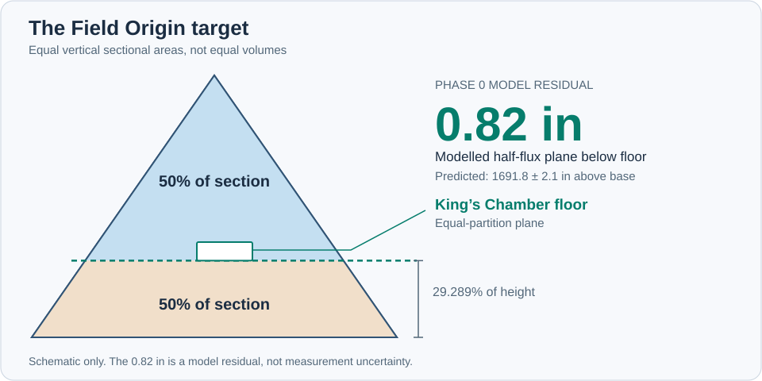

| Quantity | Result |
|---|---:|
| Reconstructed original pyramid height (Petrie, §144) | 5776.0 ± 7.0 in |
| Analytical Field Origin target | 1691.8 ± 2.1 in above base |
| King's Chamber floor (Petrie, §148) | 1691.4–1693.7 ± 0.6 in |
| Phase 0 modelled half-flux plane | 42.970 m above base |
| **Modelled residual relative to chamber floor** | **0.82 in (2.1 cm)** |

The model's prespecified confirmation window was ±3 inches, with falsification beyond 10 inches. The reported result falls inside the confirmation window. The 0.82-inch figure is a **model residual**, not an assertion of sub-inch absolute survey accuracy; the reconstructed height alone contributes roughly ±2.1 inches to the analytical target.

### Why the location follows from the field model

The scalar sector of the GFD action gives the closure current

$$\mathbf J=\frac{\mu(|\nabla\Phi|/a_0)\nabla\Phi}{4\pi G}.$$

For the source-free driven component, the divergence theorem gives

$$\Phi_{\rm base}=\Phi_{\rm axial}(z)+\Phi_{\rm lateral}(0,z).$$

The bounded-closure model identifies the axial and lateral shares with the two closure sectors. When the axial current density is approximately uniform,

$$\mu_B(z)=\frac{\Phi_{\rm axial}(z)}{\Phi_{\rm base}}\simeq\frac{A(z)}{A_0}.$$

Phase 0 includes the Earth's gravitational background, its gradient and the pyramid's self-gravity in its closure-current calculation. It reports axial uniformity at roughly $5\times10^{-5}$, sufficient for the half-area approximation.

A useful distinction: the gravitational current locates the proposed structural Field Origin, whereas the modelled atmospheric electric flux balances around 61 m, approximately 18 m higher. The field that locates the chamber is not necessarily the field that would energise it.

**The remaining theoretical bridge:** the structural flux fraction $\mu_B$ is not automatically the local constitutive response $\mu(g/a_0)$. The sector identification must be derived dynamically if the geometrical plane is to be understood as a physical TetA/TetB exchange point rather than only a flux-balance surface.

Read: [Local Field Origin theorem](pyramid_portal_research/01_framework_foundations/01.6_local_field_origin_theorem.md) · [Areal closure from the action](pyramid_portal_research/01_framework_foundations/01.7_areal_closure_from_action.md) · [Phase 0 results](pyramid_portal_research/phase0/P0.1_field_model_results.md) · [King's Chamber Field Origin](pyramid_portal_research/FIELD_ORIGIN_KINGS_CHAMBER.md).

## 2. The Stargate principle: one operation, three regimes

GFD proposes a dual-tetrad field geometry: TetA is the observable sector; TetB is its proposed dual sector. Their exchange is represented by a local Field Origin. In the exploratory model, the interaction is universal; an apparatus would not create it, but condition its coherence.

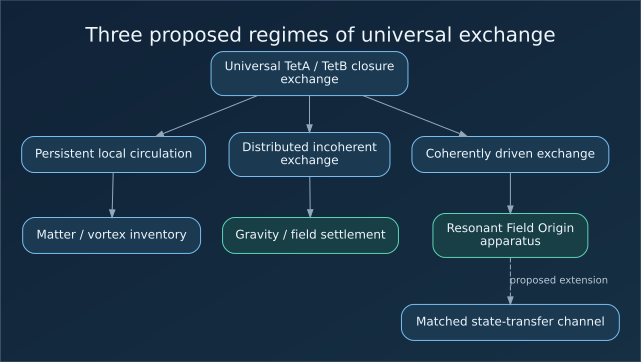

These are proposed regimes of one underlying operation, not three independently established mechanisms. The research challenge is to derive all three from the same dynamics.

A laser offers the right architectural analogy, not a proof: a laser organises existing microscopic transitions into a coherent mode. A Stargate in the GFD sense would organise field closure rather than manufacture a new field. The critical leap is from local coherence to a *physical interaction between two independently addressable sites*. A coherent local cavity alone cannot make that leap.

Read: [Universal vertex reframe](pyramid_portal_research/01_framework_foundations/01.5_universal_vertex_reframe.md) · [Universal vertex operator](pyramid_portal_research/06_master_equations/06.1_universal_vertex_operator.md).

## 3. The algebraic heart: 13, 17 and 21

The coupling polynomial is

$$f(K,s)=1+sK+K^2,$$

with the three discrete characters

$$\begin{aligned}
C_K&=f(K,-1)=K^2-K+1=\Phi_6(K),\\
E_K&=f(K,0)=K^2+1=\Phi_4(K),\\
U_K&=f(K,+1)=K^2+K+1=\Phi_3(K).
\end{aligned}$$

At $K=4$, these give $13,17,21$. The graded representation

$$\mathcal T_K=\mathbf1\oplus V\oplus(V\otimes V),\qquad \dim V=K,$$

has even dimension $K^2+1$, odd dimension $K$, total dimension $K^2+K+1$ and superdimension $K^2-K+1$. Thus the same integers arise as a graded character and as degree-two cyclotomic evaluations. The polynomial also admits the norm form $f(K,s)=|K+e^{i\theta}|^2$ when $s=2\cos\theta$.

### The physical signatures: 17 is the neutral Field Origin

The primary dual-tetrad interpretation is the graded operator of [01.3](pyramid_portal_research/01_framework_foundations/01.3_graded_identity_operator.md), not a Venn diagram of two equal chambers. Let $P_0,P_1,P_2$ be the orthogonal projectors onto the respective $1,K,K^2$ components of $\mathcal T_K$. Write

$$P_{\rm even}=P_0+P_2,\qquad P_{\rm odd}=P_1,\qquad J=P_{\rm even}-P_{\rm odd}.$$

The three signatures are three reads of the same representation:

$$\boxed{\mathbb I_s=P_{\rm even}+sP_{\rm odd},\qquad \operatorname{Tr}(\mathbb I_s)=17+4s\quad(K=4).}$$

| Signature | Operator | Invariant contribution | Signed contribution | Trace |
|---|---|---:|---:|---:|
| **TetA** ($s=+1$) | $I=P_{\rm even}+P_{\rm odd}$ | 17 | +4 | **21** |
| **Field Origin** ($s=0$) | $P_{\rm even}$ | 17 | 0 | **17** |
| **TetB** ($s=-1$) | $J=P_{\rm even}-P_{\rm odd}$ | 17 | −4 | **13** |

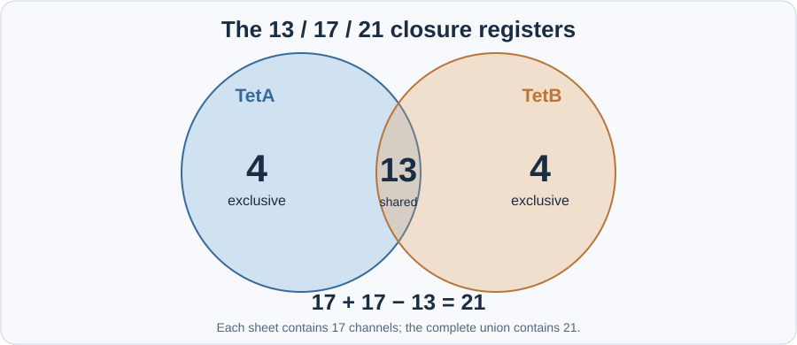

The Field Origin is not merely the arithmetic midpoint. In this graded model it is exactly the parity-even projection of the two sector reads:

$$\boxed{P_{\rm FO}=\frac{I+J}{2},\qquad P_{\rm odd}=\frac{I-J}{2}.}$$

The invariant part has rank 17 and the signed sector has rank four. TetA retains the latter with positive sign, TetB reverses its sign, and the Field Origin projects it out. TetB's value 13 is a **signed trace**, not the rank of a 13-dimensional chamber: $J$ has full rank 21. The parity-even projection is an algebraic result; physical realization by the chamber is a hypothesis, not implied by the trace identity.

The operator construction can also be expressed without choosing a basis. Since $J^2=I$, its spectrum is $\{+1,-1\}$. If $\operatorname{Tr}I=21$ and $\operatorname{Tr}J=13$, the multiplicities are uniquely determined:

$$m_++m_-=21,\qquad m_+-m_-=13\quad\Longrightarrow\quad(m_+,m_-)=(17,4).$$

For any $\alpha>0$, $\det(\alpha^{\mathbb I_s})=\exp(\log\alpha\,\operatorname{Tr}\mathbb I_s)=\alpha^{17+4s}$. Thus the three characters also determine the formal determinant factors $\alpha^{21},\alpha^{17},\alpha^{13}$. This is an operator identity, not a derivation of the physical choice of microscopic gain or of the observable that measures that determinant.

For the pyramid, this places the King's Chamber, at the proposed half-flux plane, at the **neutral signature 17**. The reported 0.82-inch geometrical residual tests the plane's location; it does not independently measure the coupling signature or establish a physical parity filter.

### A separate construction: recursive register growth

The **parity pushout** of Active Work 14 gives another realization of the same three integers. Construct two abstract sheets $A_K,B_K$ with a common core of size $C_K$ and $K$ exclusive elements each. These sheets are combinatorial bookkeeping objects, not the physical TetA and TetB coupling signatures:

$$|A_K|=|B_K|=E_K,\qquad |A_K\cup B_K|=U_K.$$

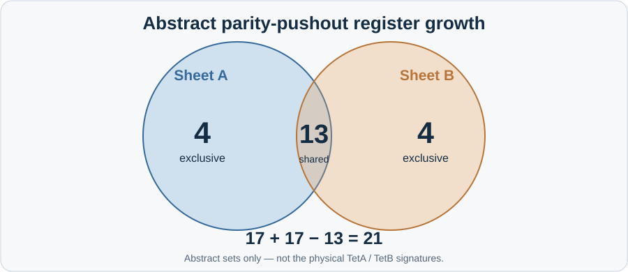

An explicit register realization makes the construction tangible. The shared core consists of a distinguished closure element and the $K(K-1)$ directed off-diagonal interactions of $K$ labelled frame vertices. Add two $K$-element sets of incoming and outgoing channels.

| Register at K=4 | Count |
|---|---:|
| Distinguished closure / orientation element | 1 |
| Ordered off-diagonal frame interactions | 12 |
| First exclusive register | 4 |
| Second exclusive register | 4 |
| **Complete closure register** | **21** |

This is a combinatorial realization of the pushout, not yet a unique physical identification of every channel. Neither 17-element sheet is to be identified with a physical tetrad, and the 13-element shared core is not the neutral Field Origin. In particular, the 13-dimensional overlap in this realization must not be confused with the 13-valued supertrace of the graded representation: their numerical equality is exact, while a dynamical correspondence requires a map.

Together these constructions motivate the interpretation that the coupling polynomial describes not only a coupling strength, but the **organization of information being registered, reconciled and settled during closure**. The signed operator governs the three coupling signatures; the pushout models how a register can grow between levels. Their numerical agreement does not identify their operators.

Read: [Closure-read representation](pyramid_portal_research/01_framework_foundations/01.2_closure_read_representation.md) · [Graded identity](pyramid_portal_research/01_framework_foundations/01.3_graded_identity_operator.md) · [Parity-pushout recursion](pyramid_portal_research/active_work/14_parity_pushout_recursion.md) · [Engineering synthesis](pyramid_portal_research/99_appendices/I_coupling_polynomial_engineering_synthesis.md).

## 4. The hinge: when one closure becomes the next shared core

The adjacent-shell identity is exact for every integer $K$:

$$\boxed{\Phi_3(K)=\Phi_6(K+1)}.$$

The following table refers to the **abstract pushout cardinalities**, not physical chamber dimensions.

| Shell | Shared core | Each abstract sheet | Complete union |
|---|---:|---:|---:|
| K=1 | 1 | 2 | 3 |
| K=2 | 3 | 5 | 7 |
| K=3 | 7 | 10 | 13 |
| **K=4** | **13** | **17** | **21** |
| **K=5** | **21** | **26** | **31** |

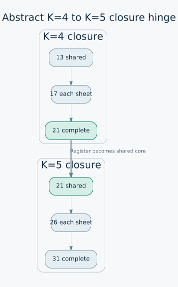

There is a constructive explanation. Four vertices have 12 directed edges. Adding a fifth vertex contributes exactly four incoming and four outgoing edges. Including the distinguished element gives

$$1+4(4-1)+4+4=1+5(5-1)=21.$$

Equivalently, the next shared core is the previous union:

$$C_{K+1}=A_K\cup_{C_K}B_K,\qquad |C_{K+1}|=|C_K|+2K.$$

This is a model of **hierarchical registration**. Previously exclusive content becomes part of a shared register at the next level. It offers a possible algebraic basis for recursive settlement without recounting every microscopic constituent of a larger structure.

The portal research formalizes the $K=4\rightarrow5$ hinge as the partial isometry

$$J_4=|5,-\rangle\langle4,+|,\qquad H_5J_4=J_4H_4=21J_4,$$

where the shell operators have the chosen cyclotomic eigenvalues. This is an exact intertwining relation in that abstract model. The equality is dimensionless; it does not determine a physical transition frequency or prove that the two shells couple in nature.

**The K=5 shell can initially be read as an extended closure register**, with the pentachoron supplying a candidate geometry, rather than an assertion of a fifth physical spatial dimension.

Read: [Shift identity](pyramid_portal_research/01_framework_foundations/01.4_shift_identity_proof.md) · [Interlevel hinge](pyramid_portal_research/03_portal_topology/03.1_K4_to_K5_hinge.md) · [Pentachoron edge network](pyramid_portal_research/03_portal_topology/03.2_pentachoron_edge_network.md).

## 5. The spectral engine: cube outside, hexagon inside

The primitive node has eight binary states, carried by the vertices of a cube. The parity character partitions them into the two tetrahedra of the stella octangula. The Walsh basis of the three-cube has the grade counts $1+3+3+1$, also the dimensions of the graded Clifford basis in three dimensions.

Projecting the cube along a body diagonal gives two axial vertices and a hexagon of six remaining vertices. The closure-core construction organizes the eight channels as two axial components and three Eisenstein pairs:

$$\mathcal A_3=\langle1,I\rangle\oplus\mathbb Z[\omega]^3,\qquad \omega=e^{2\pi i/3}.$$

Here the notation denotes an additive channel decomposition with the multiplication and rotation specified in the closure-algebra model. The geometric projection and algebraic pairing are distinct constructions linked by the proposed representation.

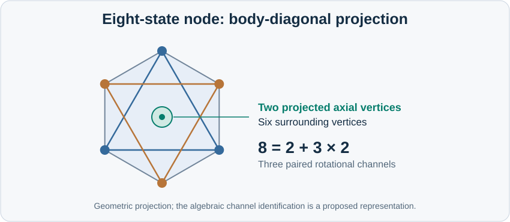

The temporal closure rotation satisfies $\Omega^3=\mathrm{Id}$. The three-phase projector is

$$P_\Omega=\frac{\mathrm{Id}+\Omega+\Omega^2}{3}.$$

For each nontrivial cubic phase, $1+\omega+\omega^2=0$. The projector preserves the invariant component and cancels the nontrivial phase sectors. The closure product is defined by $a\star b=P_\Omega(ab)$, with $ab$ the chosen Clifford product. Its associator is

$$R(a,b,c)=(a\star b)\star c-a\star(b\star c).$$

The model places its output in the axial invariant sector. Active Work 12 uses the projected associator as a time-dependent complex readout for the proposed cross-sheet order parameter, rather than inserting an arbitrary amplitude.

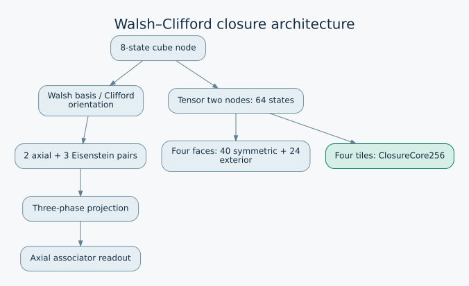

The proposed architecture scales from 8 states to a 64-state tensor tile, and then to four tiles (256 state coordinates). Per face, the rank-two decomposition of a four-dimensional frame is $16=10+6$; four faces give $64=40+24$. The dimensional agreement supplies a candidate link to the GFD symmetric/contorsion sector decomposition. An isomorphism that respects the dynamics would establish more than agreement of counts.

The same construction contains the scale-fusion identity

$$\Phi_3(K)\Phi_6(K)=\Phi_3(K^2),\qquad21\cdot13=273=1+16+256.$$

At $K=4$, 273 is also the point count of $\mathbb P^2(\mathbb F_{16})$. This offers a precise mathematical link between parity fusion, projective geometry and the recursive operator architecture; the choice of physical readout still needs justification.

Read: [Walsh-spectral synthesis](pyramid_portal_research/99_appendices/F_walsh_spectral_compute_synthesis.md) · [Closure algebra pipeline](pyramid_portal_research/99_appendices/G_closure_algebra_pipeline.md) · [ClosureCore256](pyramid_portal_research/99_appendices/H_closure_core_architecture.md) · [Closure-core integration](pyramid_portal_research/active_work/12_closure_core_integration.md) · [Cyclotomic-12 advancement](pyramid_portal_research/99_appendices/J_closure_algebra_advancement.md).

## 6. A pyramid as a spectral apparatus

If a coherent local Field Origin could be realised physically, the pyramid's architecture invites a functional interpretation. The following is a candidate circuit, not an established description of how the building operated.

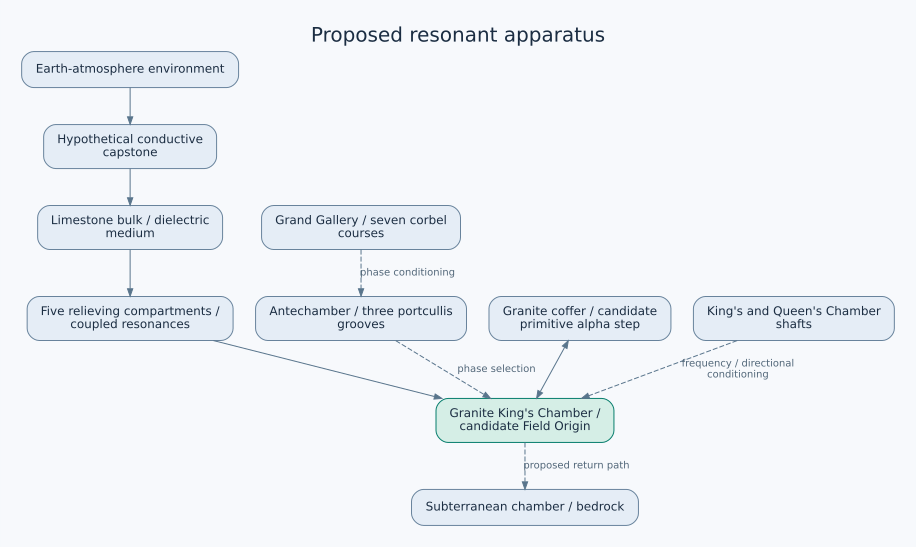

| Architectural element | Proposed function | Concrete investigation |
|---|---|---|
| Conductive apex (gold/electrum hypothesis) | Environmental electric-field input | Field enhancement; conductive path; material traces |
| Limestone body | Passive dielectric propagation medium | Permittivity, attenuation, global modes |
| Granite King's Chamber | Electromechanical resonator at the balance plane | Elastic/acoustic/EM modes; Q; transduction |
| Granite coffer | Primitive coupling element | Exterior/chamber volume ratio; loaded cavity response |
| Five relieving chambers | Coupled cavities / candidate K=5 network | Measured mode coupling and compartment dimensions |
| Grand Gallery, seven corbel courses | Seven-stage spectral conditioning | Transfer function and mode shapes |
| Antechamber, three portcullis grooves | Three-phase selection | Phase-dependent transmission |
| Open King's Chamber shafts | Directional waveguides | Cutoff near 0.68 GHz for ideal 22 cm air-filled square guides |
| Sealed Queen's Chamber shafts | Candidate resonant stubs | Surveyed lengths, boundaries and mode structure |
| Subterranean chamber | Candidate ground return | Conductivity and electrical continuity |

### Geometry, material and frequency

The King's Chamber's idealized cubit proportions are $20:10:5\sqrt5$, yielding the space diagonal

$$\sqrt{20^2+10^2+(5\sqrt5)^2}=25=5^2.$$

The two equal squares in its floor plan suggest a dual-register geometry. The coffer breaks that symmetry. Petrie's measured exterior coffer volume and floor-to-ceiling chamber volume give a ratio near $1/\alpha$:

$$\frac{V_{\rm KC}}{V_{\rm coffer,ext}}\simeq137.17,\qquad\alpha^{-1}\simeq137.036.$$

The difference is approximately 0.10%, but depends on the height convention: the base-of-walls convention gives about 140.2. This correspondence deserves a modern independent measurement rather than a stronger claim of precision. The coffer's interior and stone volumes are also approximately equal (72,000 and 70,500 cubic inches in Petrie's account).

The seven corbels and three grooves suggest a 21-sector phase architecture through the exact group identity

$$\mathbb Z_3\times\mathbb Z_7\cong\mathbb Z_{21}.$$

The five relieving compartments suggest a five-vertex network of 20 directed interactions. If each directed link contributes a primitive factor $\alpha$, phase closure on those links and one additional primitive step give $\alpha^{20}\alpha=\alpha^{21}$. This is a proposed physical realization of the attenuation, not a consequence of the chamber count alone.

The materials are relevant: calcite is centrosymmetric and non-piezoelectric, while quartz is piezoelectric. Granite contains quartz, but its bulk electromechanical response depends on grain orientation, material structure and boundary conditions; it must be measured rather than inferred from pure quartz.

An independent electromagnetic study by Balezin et al. (2018) found internal field concentration under radio-wave illumination at wavelengths of 200–600 m. This establishes that the monument can be modelled as a classical resonant structure; it does not establish a gravitational coupling or ancient technological intent.

Phase 0 estimates that an earthed, capstone-equipped model can collect approximately 0.22 μA of fair-weather atmospheric current. This is a conditional model result, not a measurement of present operation. Electrical continuity, usable voltage, coupling and dissipation remain to be demonstrated. A static geomagnetic field by itself is not a sustained energy source; time-varying fields or another driven mechanism would be required for continuous work.

Read: [Antenna theory letter](great_pyramid_antenna_theory.md) · [Apparatus engineering](pyramid_portal_research/04_apparatus_engineering/) · [Cavity operation](pyramid_portal_research/05_cavity_QED_operation/) · [Petrie measurements](pyramid_portal_research/99_appendices/E_petrie_measurements.md).

## 7. Gravity, resonance and the π-walk

The GFD gravity expression developed in the compendium is

$$\alpha_G=\frac{Gm_e^2}{\hbar c}=\frac{17}{13}\alpha^{21}\frac{g_e}{2}.$$

Here 21 is the full closure character (TetA), 17 the even character (Field Origin), and 13 the signed supercharacter (TetB). The numerical agreement with measured gravity is interesting; it does not by itself establish the choice of determinant attenuation, ratio normalization, or electron spin correction as a unique physical consequence. The expression uses the fine-structure constant, electron mass and electron magnetic moment as dimensional or numerical inputs.

Active Work 17 supplies a potentially deeper connection: it separates the spatial order-three symmetry of the node from the temporal advancement of its closure phase. The π-walk research investigates the ordered read of the stellated-octahedron's spectral state.

The working hypothesis is that standing waves and vortices hold the inventory, while a π-driven traversal schedules its read and settlement. Three sweeps through 13 → 21, each resetting directly to 13, are a candidate schedule. The I Ching computation reports 332 transitions (333 indexed positions including the initial position); it does not show that these transitions implement the Walsh read or divide into three physical sweeps. Indeed, the later hexagram note distinguishes the π traversal from the XOR rotation. The three-snapshot theorem separately requires three independently variable snapshots to span the generic 21-dimensional fixed-trace density register; three copies or three transform passes on the same snapshot do not suffice.

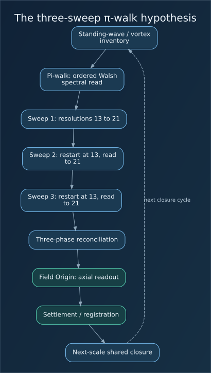

This suggests a research direction more fundamental than finding an acoustic resonance. The apparatus would have to condition the **phase of the read operation**, not simply reproduce the microscopic traversal rate. A macroscopic acoustic or electromagnetic carrier could only act on that read operation if a definite coupling mechanism and its dimensional scale are derived.

The 333-step proposal should not be confused with the separate 21-channel register or with the group $\mathbb Z_{21}$. Establishing their operator-level relation is precisely the task.

Read: [Vortex calibration](pyramid_portal_research/active_work/17_vortex_calibration.md) · [Gravity equation](pyramid_portal_research/02_gravity_derivation/02.1_gravity_equation.md) · [I Ching and closure-read explorations](../i-ching/).

## 8. A new distinction: registration is not coherence

The existing Field Origin model introduces a complex cross-sheet order parameter $\Psi=\rho e^{i\theta}$ and a candidate 21-fold phase potential. At fixed amplitude its angular term is

$$V_{\rm lock}=-2h_{21}\rho^{21}\cos(21\theta).$$

For positive $h_{21}$, its 21 angular minima are $\theta_n=2\pi n/21$. A full amplitude-dependent energy functional would also require stabilization at large $\rho$; a positive quartic alone cannot stabilize a negative degree-21 term.

There is a useful new algebraic distinction. Define

$$C_1=|\langle e^{i\theta}\rangle|,\qquad C_{21}=|\langle e^{21i\theta}\rangle|.$$

For a uniform distribution over the 21 roots of unity,

$$\frac1{21}\sum_{n=0}^{20}e^{2\pi i n/21}=0,\qquad\frac1{21}\sum_{n=0}^{20}e^{21(2\pi i n/21)}=1.$$

Thus a population may be completely registered into the permitted phase sectors while possessing no net first-harmonic coherence.

| Ideal phase ensemble | Registration $C_{21}$ | Coherence $C_1$ |
|---|---:|---:|
| Uniform continuous phase | 0 | 0 |
| Uniform population of the 21 permitted phases | 1 | 0 |
| Single occupied permitted phase | 1 | 1 |

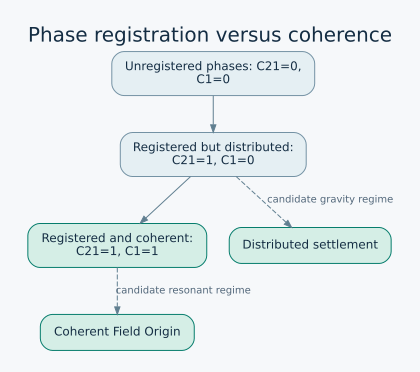

These are ideal mathematical ensembles. Mapping them to gravitational and apparatus states is a new proposed interpretation, not an established result. Also, a single arbitrary phase has unit *magnitudes* for both observables; registration to a fixed external reference must additionally check the phase of $\langle e^{21i\theta}\rangle$.

This distinction may be the key to the whole programme: the closure mechanism need not change between distributed and coherent operation. The phase distribution of its output changes.

A useful next derivation is to obtain the phase dynamics and the two order parameters from the same three-sweep spectral update, with an energy-conserving coupling to a physical resonator. The existing code implements pieces of that chain, but does not yet derive the complete feedback or coupling.

Read: [King's Chamber vertex model](pyramid_portal_research/active_work/11_kings_chamber_field_origin.md) · [Closure-core integration](pyramid_portal_research/active_work/12_closure_core_integration.md).

## 9. Two pyramids, one address: the Stargate hypothesis

Imagine the Great Pyramid at site $x$ on Earth and a mirror-matched resonator at site $y$ on another world. In the proposed architecture, the local TetA interface registers the state, the local Field Origin provides a parity-even coupling point, and the complementary TetB sector mediates a candidate shared address. The destination is not literally the same local TetB tetrahedron relocated to another planet. Each apparatus has its own local dual-tetrad structure. A remote apparatus would be a complementary **address partner**.

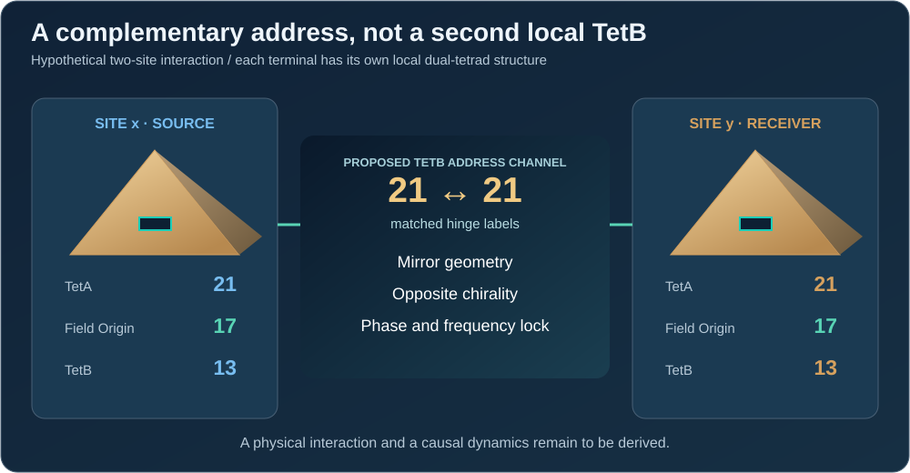

### The transfer operator

The research compendium proposes the formal composition

$$\boxed{\mathcal P_{y\leftarrow x}=\mathsf A_y^\dagger J_{4,y}^\dagger\,\mathcal M(U_x,V_y)\,\alpha_G J_{4,x}\mathsf A_x.}$$

The source apparatus $\mathsf A_x$ conditions a state; the hinge $J_{4,x}$ lifts its label from the $K=4$ upper band to the $K=5$ lower band. The corresponding labels match exactly at 21. A mirror-address map $\mathcal M$ would then connect the source and receiver registers. The inverse hinge and the receiver apparatus recover a local state. If the addresses are represented in separate Hilbert spaces, the middle factor must be a genuine map between them: a scalar overlap alone cannot transport a state.

The key identity is

$$\Phi_3(4)=21=\Phi_6(5).$$

It removes a mismatch in the chosen dimensionless shell model. It does **not** establish a frequency in hertz, a nonlocal interaction or a new spatial dimension. A physical Hamiltonian must supply those.

### Addressing the receiver

The compendium's mirror selector uses a triad Gram matrix $G$, a chirality $\chi$ and an accumulated phase $\Theta$. Its proposed match conditions are

$$G_x=P^T G_y P,\qquad \chi_x=-\chi_y,\qquad \Theta_x-\Theta_y=0\pmod{2\pi},$$

for a consistently ordered permutation $P$. Gram equivalence specifies intrinsic shape, not absolute orientation. A nondegenerate oriented triad and a physical phase reference must be established separately; different planets cannot simply be assumed to share an oscillator clock. The raw permutation sum in the compendium can exceed one, so a normalized overlap is needed before interpreting it as an amplitude.

A useful bounded candidate, explicitly introduced here as a test model rather than a derived law, is

$$M_{xy}=\exp[-d_G^2/(2\epsilon^2)]\,\frac{1-\chi_x\chi_y}{2}\,\cos^2[(\Theta_x-\Theta_y)/2],$$

with $d_G$ the minimum Gram mismatch over admissible permutations. This lies in $[0,1]$, equals one at exact complementary lock, and separates measurable matching tolerances from overall coupling strength. For an ideal discrete phase address $a\in\mathbb Z_{21}$, the normalized character sum gives the sharper exact selector

$$\frac1{21}\sum_{k=0}^{20}e^{2\pi i k(a-b)/21}=\delta_{ab}.$$

The integer 21 provides a candidate address vocabulary, not evidence that the universe implements it. A filtered 14-character sum generally has sidelobes and is not the same Kronecker delta.

### From formal matching to actual dynamics

To make the Stargate hypothesis falsifiable, introduce a minimal two-site, single-excitation Hamiltonian. This is an illustrative extension of the portal programme, not a derived native GFD action:

$$\frac{H}{\hbar}=\begin{pmatrix}\omega_x&\kappa\\\bar\kappa&\omega_y\end{pmatrix},\qquad \kappa=\kappa_0 M_{xy},\qquad \Delta=\omega_x-\omega_y.$$

Here $\kappa_0$ has units of angular frequency. The dimensionless $\alpha_G$ cannot by itself set that timescale. For an initially localized excitation at $x$, the lossless two-mode model yields

$$P_{x\to y}(t)=\frac{4|\kappa|^2}{\Delta^2+4|\kappa|^2}\sin^2\!\left(\frac{t}{2}\sqrt{\Delta^2+4|\kappa|^2}\right).$$

At exact frequency lock and nonzero coupling, $P_{x\to y}(t)=\sin^2(|\kappa|t)$, and the first complete transfer occurs at $t=\pi/(2|\kappa|)$. At strong detuning, the maximum transfer is suppressed by approximately $4|\kappa|^2/\Delta^2$. Real loss and decoherence reduce the efficiency further.

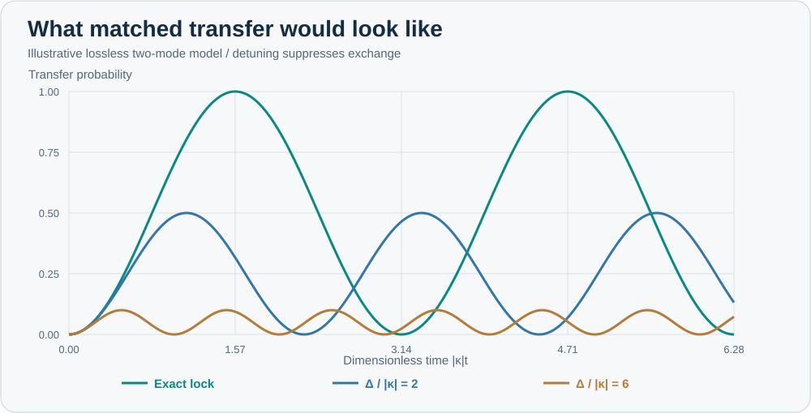

This elementary result isolates the real burden of the research. **Resonance selects a channel; it does not create the channel.** A measured nonzero $\kappa_0$ after conventional electromagnetic, acoustic, seismic and electronic paths are excluded would be the relevant anomaly. The two-mode Hamiltonian assumes a coupling and does not derive a mechanism that evades relativistic causality. Any proposed distance-independent or faster-than-light interaction requires a covariant theory and a demonstration of causal consistency.

### Signal before passage

The antenna letter proposes a threshold $1/\varphi^2\approx0.382$ for a bimetric-lock transition from signal to transport. This is a candidate threshold, not a measured property. The first credible milestone is reproducible remote excitation or information transfer, not passage of matter. A quantum state-transfer claim requires a complete channel and conservation accounting; a macroscopic transport claim requires a much stronger dynamical and energetic theory. Neither is established by the pyramid's location, acoustic modes or formal address match.

| Necessary test | Matched prediction | Control |
|---|---|---|
| Frequency sweep | A reproducible peak at a preregistered mode | Detune the receiver |
| Chirality reversal | Change specific to the predicted handedness | Same chirality, randomized orientation |
| Phase sweep | A reproducible dependence on relative phase | Randomized phase and blinded drive |
| Separation and shielding | Residual response beyond calibrated conventional channels | Independent clocks, isolated electronics, sham runs |
| Conservation | Input/output energy and timing consistent with a physical action | Full power and instrument accounting |

The apparatus need not be an ancient monument to test the hypothesis. Two well-characterized laboratory resonators are the appropriate first experiment. A positive conventional resonance result would establish an engineering baseline; only a residual that survives these controls could support a novel interaction.

Read: [Portal topology](pyramid_portal_research/03_portal_topology/) · [Transfer operator](pyramid_portal_research/06_master_equations/06.2_portal_operator.md) · [Mirror address functional](pyramid_portal_research/06_master_equations/06.3_mirror_address_functional.md) · [Two-mode operation](pyramid_portal_research/06_master_equations/06.4_two_mode_operation.md) · [Energy budget](pyramid_portal_research/08_open_questions/08.4_energy_budget.md).

## 10. The three-pyramid array and the wider algebraic programme

Active Work 24–30 explores the three Giza pyramids as a possible multi-scale resonant array. The nominal base ratios relative to Khufu are approximately $1:15/16:8/17$. If analogous chambers scaled linearly with those ratios and had the same wave speed, the fundamental frequency ratios would be $1:16/15:17/8$.

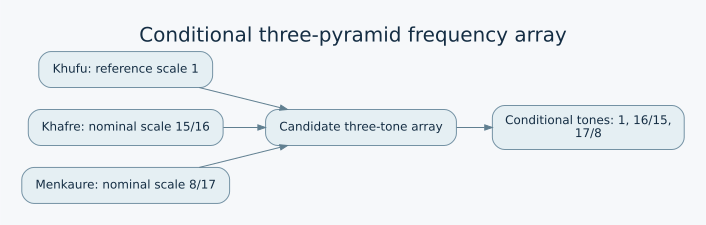

The resulting ideal air-acoustic estimates are around 46.9, 50.0 and 99.7 Hz. The assumed chamber scaling is not an independently measured property of the three monuments. The true cavity geometries, boundary conditions and coupling must be used before the array interpretation can be evaluated.

The same active-work sequence explores dimensionless expressions for the fine-structure constant, the electron/proton mass ratio, electroweak mixing and cosmological quantities. These numerical constructions are useful as hypotheses for further derivation; they are not independent confirmations of the pyramid mechanism. Many use shared inputs, and successively adjusted expressions require an explicit accounting of candidate selection and out-of-sample tests.

Read: [Three-pyramid scaling](pyramid_portal_research/active_work/24_three_pyramid_scaling.md) · [Frequency comb](pyramid_portal_research/active_work/26_three_pyramid_frequency_comb.md) · [Algebraic pipeline](pyramid_portal_research/active_work/30_complete_algebraic_pipeline_K4_uniqueness.md) · [Gravity tile and electron vortex](pyramid_portal_research/active_work/31_gravity_tile_electron_vortex.md) · [Complete active-work archive](pyramid_portal_research/active_work/).

## 11. What is exact, what is measured, and what must be tested

The programme deliberately separates mathematical identities, surveyed geometry, model output and physical inference.

| Finding | Present status |
|---|---|
| Graded character and cyclotomic identities | Exact in the defined representations |
| Graded coupling signatures: TetA 21, Field Origin 17, TetB 13 | Exact trace and projection identities in the graded representation |
| Parity-pushout recursion and 21-channel extension | Separate explicit combinatorial construction; not physical chamber sizes |
| Three-phase projector and registration/coherence distinction | Exact mathematical statements |
| King's Chamber half-area position | Survey-based geometric correspondence |
| Phase 0 half-flux plane within 0.82 in of floor | Reported numerical model result, conditional on the sector identification |
| Coffer volume ratio near $\alpha$ | Approximate measured correspondence; height-convention sensitive |
| Classical resonant response | Supported by electromagnetic modelling; specific phase architecture unverified |
| Chamber's 21-mode / 14-active / 7-suppressed selection | Unverified; requires independent spectral predictions and measurements |
| Five relieving chamber volumes proportional to $5\alpha V_{\rm KC}$ | Existing prediction failed by roughly a factor of ten |
| Chamber polarization sums equal 13/17/21 | Retracted in Active Work 21 |
| Coherent TetA/TetB transfer and geomagnetic strong coupling | Proposed, not empirically established; interaction and energy budget open |
| Portal transport | Unverified hypothesis |

The retractions are important: the research should retain failed predictions, not reinterpret approximate integers as exact matches. A passing regression suite verifies the stated mathematical or numerical implementation; it does not substitute for an experiment.

### The decisive research path

| Test | Question |
|---|---|
| H1 · Coffer and chamber metrology | Does the ratio survive a fixed height convention and modern survey? |
| H2–H3 · Acoustic spectrum and Q | Does the cavity exhibit an independently predicted phase-selection structure beyond standard acoustics? |
| H4 · Apex material evidence | Is there evidence for a historical conductive capstone? |
| H5–H6 · Field and transduction | Are there measurable environment-dependent electromechanical effects beyond controls? |
| H7 · Precision gravimetry | Is there a reproducible residual after ordinary mass, environmental and instrument modelling? |
| H8 · Shaft survey | Does the measured three-dimensional geometry support a nondegenerate address construction? |
| H9 · Materials analysis | What do the stone fabrication and physical properties imply for the model? |

The priority is a complete coupled elastic/electromagnetic transfer model, with physically measured material properties and independent control cavities. From that baseline, the framework must specify a quantitative anomalous observable. Test any additional phase-locking or gravitational prediction against that baseline, with thresholds fixed before data collection. All fieldwork must respect the monument and require appropriate permissions; scale models are preferable for invasive or active tests.

Read: [Programme and pre-registered tests](pyramid_portal_research/PROGRAMME.md) · [Prediction archive](pyramid_portal_research/07_predictions_and_tests/) · [Open questions](pyramid_portal_research/08_open_questions/).

## 12. Where the research is going

The most productive question is no longer whether a particular pyramid dimension can be matched to a fundamental integer. The algebra offers a more precise target: derive one dynamical operator that connects the vortex inventory to the spectral read, the three-sweep reconciliation, the axial settlement and the next closure register.

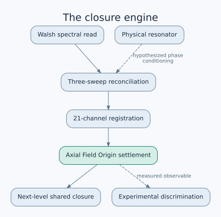

The necessary steps are an explicit π-walk/FWHT schedule, a proof of its equivalence to the closure update, a physical phase and time normalization, and a derived coupling to measurable acoustic or electromagnetic modes. The bridge from the structural flux balance to the constitutive field, and the normalization of the gravity read, must remain explicit.

If the operator can be established, it advances the theory independently of the historical interpretation of the pyramid. If a resonator can also drive the operator coherently, it becomes a laboratory question rather than an archaeological speculation.

**The Stargate is the hypothesis. The Field Origin is the interface. The closure engine is the research.**

## Reading guide and reproduction

| Resource | Purpose |
|---|---|
| [Research compendium](pyramid_portal_research/) | Full theoretical programme, engineering studies and references |
| [Executive summary](pyramid_portal_research/00_executive_summary.md) | Original unified portal model |
| [Programme definition](pyramid_portal_research/PROGRAMME.md) | Scope, methods, evidence and tests |
| [Field Origin at the King's Chamber](pyramid_portal_research/FIELD_ORIGIN_KINGS_CHAMBER.md) | The geometric and physical thesis |
| [Phase 0](pyramid_portal_research/phase0/P0.1_field_model_results.md) | Numerical half-flux plane and atmospheric input |
| [Antenna letter](great_pyramid_antenna_theory.md) | Companion dual-tetrad resonant antenna proposal |
| [Active work](pyramid_portal_research/active_work/) | The evolving algebraic investigations, including retractions |
| [Closure geometry tests](field_origin_geometry/) | Centrality, subdivision and geometric symmetry |
| [Historical binary-system test](test_historical_binary_system.py) | Cube parity and vertex encoding |
| [Python implementation and tests](pyramid_portal_research/python/) | Executable models and regression tests |
| [Related I Ching / closure research](../i-ching/) | Spectral closure read and finite-field investigations |

```bash
cd research/exploratory/great-pyramid/pyramid_portal_research
python -m pytest python/tests
python -m python.phase0_field_model
```

### Sources

- W. M. Flinders Petrie (1883), *The Pyramids and Temples of Gizeh*, especially §§144, 148, 155–156. [Survey text](https://www.ronaldbirdsall.com/gizeh/petrie/).
- M. Balezin, K. V. Baryshnikova, P. Kapitanova and A. B. Evlyukhin (2018), “Electromagnetic properties of the Great Pyramid: First multipole resonances and energy concentration,” *Journal of Applied Physics* **124**, 034903. [Article record](https://ui.adsabs.harvard.edu/abs/2018JAP...124c4903B/abstract).
- *International Tables for Crystallography*, Vol. D, §1.1.4.4. [Crystal symmetry and piezoelectricity](https://it.iucr.org/Da/ch1o1v0001/sec1o1o4o4/).
- Z. Hawass and M. Verner (1996), on gilded pyramidion imagery in Sahure's causeway reliefs; see the [materials study](pyramid_portal_research/05_cavity_QED_operation/05.2_material_specification.md) and programme bibliography. This is historical context, not direct evidence of Khufu's capstone material.

---

*Scope: This is exploratory theoretical and computational research, not an assertion that the historical purpose of the Great Pyramid has been established. It proposes an experimentally discriminable physical interpretation and preserves the distinction between exact algebra, numerical correspondence and unverified mechanism.*
