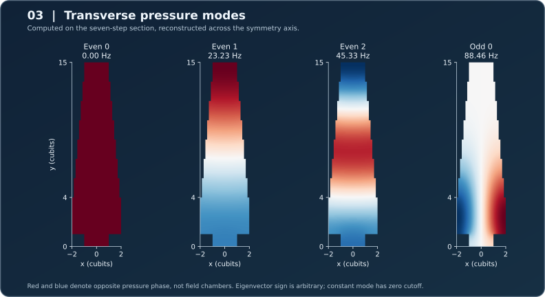

# Great Pyramid · Core Framework Proofs

*Nine proofs that fix what is exact in the Great Pyramid programme, what it rests on, and what it cannot claim · Gravity Field Dynamics (GFD), exploratory*

[](../../../../LICENSE) [](#at-a-glance) [](run_all.py) [](#lean) [](make_figures.py) [](../CORE_FRAMEWORK.md)

Each folder holds:
- a README (statement, proof, premises, necessity, scope, figures);
- a verification script that prints PASS or FAIL for every step, with its output;
- for GP-1 to GP-5, a Lean 4 formalisation of the algebraic and finite statements, with a `LEAN_AUDIT.md`.

The framework these proofs belong to is described in [`../CORE_FRAMEWORK.md`](../CORE_FRAMEWORK.md). Every monument dimension they use is a verified row of [`../metrics/`](../metrics/).

| Proof | Result | Checks | Lean |
|---|---|:-:|:-:|
| [GP-1](gp1-half-section-balance-plane/) | **The half-section theorem.** In any cone with a measurable base of any shape, slope or tilt, a uniform current with $J_z \ne 0$ has structural share $\mu_B = (1-u)^{D-1}$ and a unique balance level $u^* = 1 - 2^{-1/(D-1)}$. In $D = 3$ this is $1 - 1/\sqrt2$. Only in $D = 3$ does it coincide with the halving of the meridional ("vertical") area. A graded operator $A_B(u)$ realises the 21 → 17 → 13 labelling (conditional). [O] Petrie's King's Chamber floor is $+0.80$ in from the level, inside a ±3.80 in allowance. | 57 | 9 |
| [GP-2](gp2-balance-plane-robustness/) | **Robustness, and what the constitutive law says at Giza.** For affine $\mathbf J$, $\mu_B = (1-u)^2(1+bu)$, and the level is unique for **every real** $b$. Its shift is $\frac{\sqrt2-1}{4}bh$. Any non-uniformity ε confines it to a sharp interval, with normalised witnesses. Earth's gravity and the pyramid's own gravity together move it at most **0.163 in**. The constitutive share is $\mu_g = 1$ at Giza, so $\mu_B$ is not the TetA/TetB partition. | 52 | 11 |
| [GP-3](gp3-coupling-signatures-and-hinge/) | **The signatures are forced; the hinge is unique.** 13, 17, 21 are the only irreducible norm forms. The hinge $f(K,+1) = f(K+1,-1)$ is the only coincidence between levels. **Every** exact intertwiner lives on the hinge block, and the zero map is always one. The 17 + 4 grading is rigid. The whole fusion tower is pairwise coprime. | 47 | 24 |
| [GP-4](gp4-registration-and-coherence/) | **Registration and coherence.** Full registration allows any coherence. Coherence forces registration, with a sharp $N^2$ bound. Approximate locking at 3 and 7 forces coherence: 99% per stage gives ≥ 91%. The 14-character filter separates a match from an alias but not the two aliases from each other; coherently recombined with its 7-character complement it is an exact selector. | 44 | 9 |
| [GP-5](gp5-two-site-transfer-bound/) | **Resonance selects, it does not create.** For any drive, $\lvert c_y\rvert \le \sin\min(\int\lvert\kappa\rvert, \pi/2)$, with equality up to the first full transfer. A coupling can be **derived** from an intermediate sector (Schur complement); a zero-channel countermodel shows matching alone gives nothing. The chirality test must sit inside the relabelling. Optimum under loss, $t_{\rm opt} = \arctan(2k/\gamma)/k$. Inverse bound for experiments. | 33 | 12 |
| [GP-6](gp6-structural-boundary-response/) | **Structural boundary response.** Varying the action gives the sourced balance $F_z + L_z = F_0 + M(z)$; equal outgoing flux is $2F_z = F_0 + M$, not the source-free half-section. At Giza the two root definitions differ by only −0.013 in. The linear response $K = \mu I + x\mu' ee^T$ is positive, the boundary map is reciprocal and positive definite (no automatic 4-dimensional kernel), and a geometric cut is not a material interface. | 9 | — |
| [GP-7](gp7-chamber-spectral-selection/) | **Chamber spectral selection.** The complete rigid-wall spectrum of the surveyed King's Chamber has 89 modes below 120 Hz (14 axial, 43 tangential, 32 oblique). Floor-ratio degeneracies survive the survey; the height-ratio pair splits by 63.3 mHz. Reflection parity is a real selection rule, and the box has no 3-, 7- or 21-fold symmetry, so geometry alone cannot force GP-4's cyclic action. | 9 | — |
| [GP-8](gp8-reciprocal-resonator-matching/) | **Reciprocal resonator matching.** Through a named field the coupling kernel is reciprocal, $C_{ij} = C_{ji}$, and bounded by $\lVert q_x\rVert_1\lVert q_y\rVert_1/4\pi(R - a - b)$. Opposite parity forbids the channel exactly. The mediator obeys a Cauchy–Schwarz overlap bound, and the retarded response arrives no sooner than $(R - a - b)/c$. Matching is necessary for large exchange, never sufficient. | 6 | — |
| [GP-9](gp9-grand-gallery-spectral-selection/) | **Grand Gallery spectral selection.** Reflection splits the gallery's transverse modes into even and odd sectors. Analytically, every frequency between 25.64 and 81.81 Hz propagates at least two even modes and no odd mode. The slot array obeys an exact finite-array law but sits in a multimode regime, and as empty compliances the slots reflect at most 0.0123% at 20 Hz wherever they are placed. The network is reciprocal and passive (no gain, no frequency conversion). A smooth equal-area roof matches the steps at low order, so seven corbels are not a Z₇ processor. 100 regression tests run as the last check. | 17 | — |
| | **Total** | **274** | **65** |

```bash
python run_all.py        # all nine verifiers, ~1 min; requires sympy, mpmath, numpy, scipy, pytest
python make_figures.py   # regenerates the GP-1 to GP-8 figures from the verified formulas (needs matplotlib)
# GP-9's figures come from gp9-grand-gallery-spectral-selection/generate_figures.py
```

## At a glance

| | |
|:-:|:-:|
|  |  |
| **GP-1** Three distinct halving levels of one cone; the King's Chamber floor sits on the area level | **GP-2** Gravity moves the level < 0.17 in; the 0.80 in residual is survey-limited |
|  |  |
| **GP-3** The only coincidences between levels are the hinges | **GP-4** 14 + 7 characters recombine into the exact 21-address selector |
|  |  |
| **GP-5** No drive beats the coupling budget | **GP-5** A coupling induced through an intermediate sector |
|  |  |
| **GP-9** The seven-step gallery section against its smooth and rectangular controls | **GP-9** Even and odd pressure modes of the gallery cross-section |

**Status tags** follow the repository (llms.txt, Rule 11): **[T]** theorem, **[D]** derived, **[E]** exploratory, **[O]** observational.

## Lean

65 theorems across the five `lean/` folders (Lean 4 / Mathlib v4.36.0): GP-1 9, GP-2 11, GP-3 24, GP-4 9, GP-5 12. There is no `sorry`, and every theorem uses only the standard axioms. GitHub Actions builds each one and audits its axioms on every change (`.github/workflows/lean-great-pyramid-gp*.yml`). Each `LEAN_AUDIT.md` lists what is formalised and what is checked only by script.

## Open tasks for GP-6 to GP-9

GP-6 extends GP-1 and GP-2 and separates a geometric cut from a material response. GP-7 uses the actual chamber dimensions, not a predetermined 21-mode truncation, and constrains how GP-3 and GP-4 can be applied. GP-8 uses GP-5 and the response theory of GP-6 and GP-7, with a named conventional field rather than an assumed hidden channel. GP-9 applies GP-6 to GP-8 to the Grand Gallery in ordinary acoustics, deriving its modes from the surveyed proportions rather than assigning phases to the seven corbels. Any physical interpretation stays **[E]** until it is derived and experimentally supported.

- [ ] Lean formalisation of GP-6 to GP-9.
- [ ] GP-6: a survey-based 3D material and source model with measured boundary conditions.
- [ ] GP-7: measured complex impedance, the coffer, shafts and entrance geometry, and measured chamber spectra.
- [ ] GP-8: a calibrated two-resonator experiment that accounts for ordinary coupling, phase, delay and loss.
- [ ] GP-9: digitised corbel boundaries and slot centres, measured aperture and terminal impedances, a multimode or 3D model of the gallery–antechamber junction, compared with impulse-response measurements.
