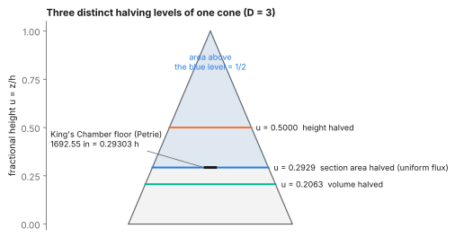
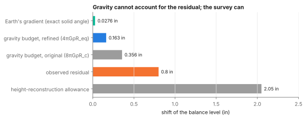
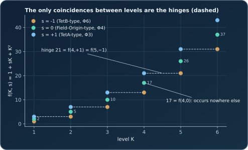
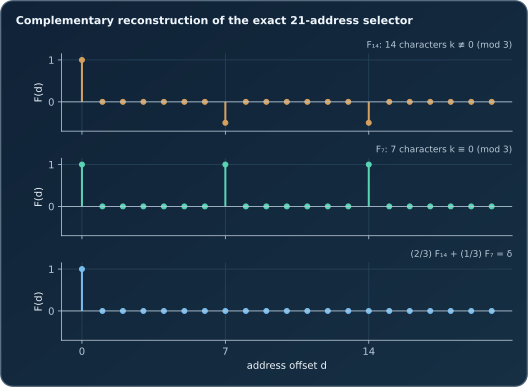
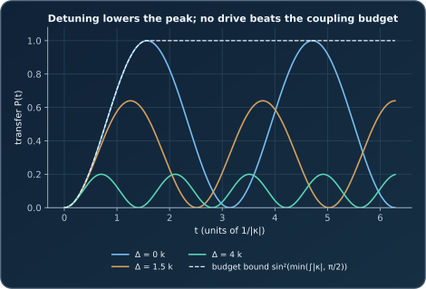
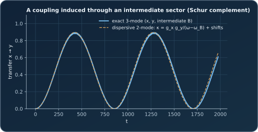

# Great Pyramid · Core Framework Proofs

*Five proofs that fix what is exact in the Great Pyramid programme, what it rests on, and what it cannot claim · Gravity Field Dynamics (GFD), exploratory*

[](../../../../LICENSE) [](#at-a-glance) [](run_all.py) [](#lean) [](make_figures.py) [](../CORE_FRAMEWORK.md)

Each folder holds:
- a README (statement, proof, premises, necessity, scope, figures);
- a verification script that prints PASS or FAIL for every step, with its output;
- a Lean 4 formalisation of the algebraic and finite statements, with a `LEAN_AUDIT.md`.

The framework these proofs belong to is described in [`../CORE_FRAMEWORK.md`](../CORE_FRAMEWORK.md). Every monument dimension they use is a verified row of [`../metrics/`](../metrics/).

| Proof | Result | Checks | Lean |
|---|---|:-:|:-:|
| [GP-1](gp1-half-section-balance-plane/) | **The half-section theorem.** In any cone with a measurable base of any shape, slope or tilt, a uniform current with $J_z \ne 0$ has structural share $\mu_B = (1-u)^{D-1}$ and a unique balance level $u^* = 1 - 2^{-1/(D-1)}$. In $D = 3$ this is $1 - 1/\sqrt2$. Only in $D = 3$ does it coincide with the halving of the meridional ("vertical") area. A graded operator $A_B(u)$ realises the 21 → 17 → 13 labelling (conditional). [O] Petrie's King's Chamber floor is $+0.80$ in from the level, inside a ±3.80 in allowance. | 57 | 9 |
| [GP-2](gp2-balance-plane-robustness/) | **Robustness, and what the constitutive law says at Giza.** For affine $\mathbf J$, $\mu_B = (1-u)^2(1+bu)$, and the level is unique for **every real** $b$. Its shift is $\frac{\sqrt2-1}{4}bh$. Any non-uniformity ε confines it to a sharp interval, with normalised witnesses. Earth's gravity and the pyramid's own gravity together move it at most **0.163 in**. The constitutive share is $\mu_g = 1$ at Giza, so $\mu_B$ is not the TetA/TetB partition. | 52 | 11 |
| [GP-3](gp3-coupling-signatures-and-hinge/) | **The signatures are forced; the hinge is unique.** 13, 17, 21 are the only irreducible norm forms. The hinge $f(K,+1) = f(K+1,-1)$ is the only coincidence between levels. **Every** exact intertwiner lives on the hinge block, and the zero map is always one. The 17 + 4 grading is rigid. The whole fusion tower is pairwise coprime. | 47 | 24 |
| [GP-4](gp4-registration-and-coherence/) | **Registration and coherence.** Full registration allows any coherence. Coherence forces registration, with a sharp $N^2$ bound. Approximate locking at 3 and 7 forces coherence: 99% per stage gives ≥ 91%. The 14-character filter separates a match from an alias but not the two aliases from each other; coherently recombined with its 7-character complement it is an exact selector. | 44 | 9 |
| [GP-5](gp5-two-site-transfer-bound/) | **Resonance selects, it does not create.** For any drive, $\lvert c_y\rvert \le \sin\min(\int\lvert\kappa\rvert, \pi/2)$, with equality up to the first full transfer. A coupling can be **derived** from an intermediate sector (Schur complement); a zero-channel countermodel shows matching alone gives nothing. The chirality test must sit inside the relabelling. Optimum under loss, $t_{\rm opt} = \arctan(2k/\gamma)/k$. Inverse bound for experiments. | 33 | 12 |
| | **Total** | **233** | **65** |

```bash
python run_all.py        # all five verifiers, ~1 min; requires sympy, mpmath, numpy, scipy
python make_figures.py   # regenerates every figure from the verified formulas (needs matplotlib)
```

## At a glance

| | |
|:-:|:-:|
|  |  |
| **GP-1** Three distinct halving levels of one cone; the King's Chamber floor sits on the area level | **GP-2** Gravity moves the level < 0.17 in; the 0.80 in residual is survey-limited |
|  |  |
| **GP-3** The only coincidences between levels are the hinges | **GP-4** 14 + 7 characters recombine into the exact 21-address selector |
|  |  |
| **GP-5** No drive beats the coupling budget | **GP-5** A coupling induced through an intermediate sector |

**Status tags** follow the repository (llms.txt, Rule 11): **[T]** theorem, **[D]** derived, **[E]** exploratory, **[O]** observational.

## Lean

65 theorems across the five `lean/` folders (Lean 4 / Mathlib v4.36.0): GP-1 9, GP-2 11, GP-3 24, GP-4 9, GP-5 12. There is no `sorry`, and every theorem uses only the standard axioms. GitHub Actions builds each one and audits its axioms on every change (`.github/workflows/lean-great-pyramid-gp*.yml`). Each `LEAN_AUDIT.md` lists what is formalised and what is checked only by script.
