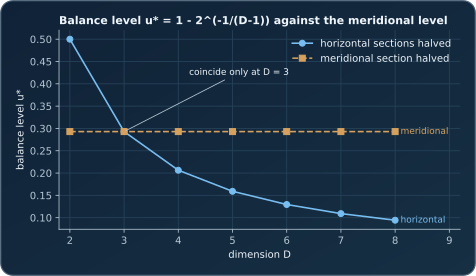
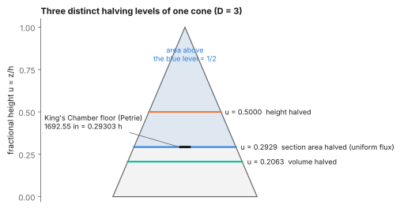
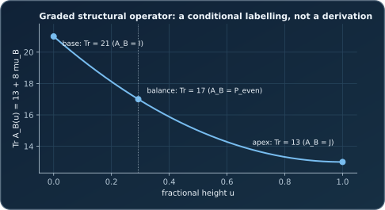
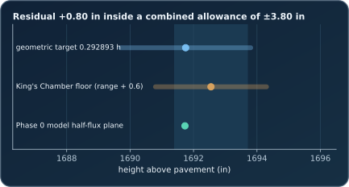

# GP-1 · The Half-Section Theorem: the Balance Plane of a Cone

*Where a uniform flux through a tapering body divides into two equal shares, why that level does not depend on size, shape, slope or tilt, and why its horizontal and vertical readings agree only in three dimensions · Great Pyramid core framework · Gravity Field Dynamics (GFD), exploratory*

`geometry` `flux` `divergence-theorem` `balance-plane` `D=3` `proof`

[](https://github.com/fielddynamics/research/actions/workflows/lean-great-pyramid-gp1.yml)

**Lean.** 9 statements machine-checked in Lean 4 / Mathlib ([`lean/`](lean/), [audit](LEAN_AUDIT.md)).

**Status.** Theorems 1–5 are **[T]**: proved below, with every step checked by [`verify_gp1_half_section.py`](verify_gp1_half_section.py) (57 exact checks, [output](verify_output.txt)). Proposition 6 is a labelling, and Proposition 6b an exact but **conditional** operator realisation of it; neither is a derivation of physics. Observation 7 is **[O]**. Calling the balance plane a "local Field Origin" is **[E]** (see *Naming* below).

**Revision 2 (27 Nov 2026, after the [referee audit](../referee-audit/)).** Regularity hypotheses stated; the survey comparison now uses bounded allowance intervals instead of a pseudo-σ; the look-elsewhere window is corrected; Proposition 6b (graded operator) added; figures added. The point-by-point response is in [`../REFEREE_RESPONSE.md`](../REFEREE_RESPONSE.md).

---

## The question

The research notes [`01.6`](../../pyramid_portal_research/01_framework_foundations/01.6_local_field_origin_theorem.md) and [`01.7`](../../pyramid_portal_research/01_framework_foundations/01.7_areal_closure_from_action.md) put a balance plane at $z^*/h = 1 - 1/\sqrt2$ in an apex body. They assume a right, homothetic body and a uniform axial current. This proof states the result in its natural generality. It also separates what geometry alone proves from what is read into it.

## Setting

Let $D \ge 2$. Take a compact, Lebesgue-measurable base $\Sigma_0 \subset \{z = 0\} \cong \mathbb R^{D-1}$ of positive $(D-1)$-volume $A_0$ and centroid $c_0$. Take an apex $a = (a_\perp, h)$ with $h > 0$. The apex need **not** lie above the base (an oblique cone is allowed). The **cone** is

$$B = \{(1-t)\,p + t\,a \;:\; p \in \Sigma_0,\ t \in [0,1]\}.$$

Write $u = z/h \in [0,1]$ for the fractional height. $\Sigma(z)$ is the horizontal section at height $z$, and $A(z)$ is its $(D-1)$-volume. For a vector field $\mathbf J$ write $\Phi_\Sigma(z) = \int_{\Sigma(z)} J_z\,dA$, the flux carried up through the section. The **structural share** is

$$\mu_B(z) = \frac{\Phi_\Sigma(z)}{\Phi_\Sigma(0)}$$

whenever $\Phi_\Sigma(0) \ne 0$.

## Theorem 1 (homothetic sections)

$\Sigma(z) = (1-u)\,\Sigma_0 + u\,a_\perp$. Hence

$$A(z) = A_0\,(1-u)^{D-1},$$

and the centroid of $\Sigma(z)$ is $(1-u)\,c_0 + u\,a_\perp$.

*Proof.* A point of $B$ at height $z$ has $t = u$, so the section is the image of $\Sigma_0$ under the homothety $p \mapsto (1-u)p + u\,a_\perp$. Lebesgue measure in $\mathbb R^{D-1}$ scales by $(1-u)^{D-1}$ under a homothety of ratio $1-u$. An affine map commutes with taking centroids. At the apex ($u = 1$) the section is a single point of measure zero; its "centroid" is the continuous extension. $\square$

## Theorem 2 (uniform flux partition)

Let $\mathbf J$ be constant with $J_z \ne 0$. Then for every $z \in [0, h]$:

$$\mu_B(z) = (1-u)^{D-1},$$

and the flux leaving through the lateral surface of the frustum $V(z)$ between $\Sigma_0$ and $\Sigma(z)$ is exactly $J_z\,(A_0 - A(z))$. This holds whatever the direction of $\mathbf J$, the base shape, the apex offset and the height.

*Proof.* $\Phi_\Sigma(z) = J_z A(z)$, so $\mu_B = A(z)/A_0$, and Theorem 1 applies; this part needs only measurability. For the lateral statement, take the frustum to be a Lipschitz domain (e.g. a polygonal or convex base), or more generally a set of finite perimeter, where the Gauss–Green theorem holds with the measure-theoretic normal. Then, since $\nabla\cdot\mathbf J = 0$, the net **signed** outward flux vanishes (individual lateral faces may carry flux either way):

$$-J_zA_0 + J_zA(z) + \Phi_{\rm lat} = 0.$$

If $J_z = 0$ the base flux vanishes and no share is defined. $\square$

The script also checks the balance face by face, without the divergence theorem. It builds the exact vector area of every lateral quadrilateral of oblique cones over random rational polygons, with randomly tilted $\mathbf J$.

## Theorem 3 (the balance level)

$\mu_B$ is strictly decreasing on $[0,1]$, from 1 to 0. So it takes the value $\tfrac12$ at exactly one level:

$$\boxed{\;u^*_D = 1 - 2^{-1/(D-1)}\;},\qquad u^*_3 = 1 - \frac1{\sqrt2} = 0.292\,893\,219\ldots$$

## Theorem 4 (the meridional reading, and why it singles out $D = 3$)

Take any 2-plane $\Pi$ through the apex that is not parallel to the base and cuts $B$ in a set of **positive area** (a tangent slice defines no fraction). $\Pi$ meets the base hyperplane in a line $\ell$. It cuts $B$ in the planar cone over $\Sigma_0 \cap \ell$: one triangle with vertex $a$ when the base is convex, otherwise a union of such triangles. Each triangle's part above level $u$ is a similar triangle of ratio $1-u$, so the area fraction above level $u$ is $(1-u)^2$, **in every dimension**. So:

- the meridional section is halved at $u = 1 - 1/\sqrt2$ for every $D$;
- the horizontal sections are halved at $u^*_D = 1 - 2^{-1/(D-1)}$;
- the two halvings coincide **if and only if $D = 3$**, since $1/(D-1) = 1/2$.

Petrie's sentence, "the design of the level of the King's Chamber was the halving of the vertical area of the Pyramid", therefore names the same plane as the half-flux reading. That is a fact about three-dimensional space, not about pyramids.



## Theorem 5 (the three canonical halving levels)

The $k$-dimensional content above level $u$ of a cone in $D = 3$ scales as $(1-u)^k$. This gives three distinct halving levels:

| Measure halved | $k$ | Level $u$ | Great Pyramid ($h = 5776$ in) |
|---|:-:|:-:|:-:|
| height (distance to apex) | 1 | $1/2$ | 2888.0 in |
| section area, meridional area, uniform flux | 2 | $1 - 2^{-1/2} = 0.2929$ | 1691.8 in |
| volume (equal volume above and below) | 3 | $1 - 2^{-1/3} = 0.2063$ | 1191.6 in |

At the area-balance plane, the volume above is $2^{-3/2} = 0.354$ of the total, not one half. The volume of the cone is $A_0h/D$, which the script checks by integrating the sections of an oblique cone.



## Proposition 6 (share labelling; a labelling, not a derivation)

Write $\sigma_B = 2\mu_B - 1$ and $f_B = 17 + 4\sigma_B = 13 + 8\mu_B$. Then $f_B$ runs $21 \to 17 \to 13$ from base to balance plane to apex. The reflection $\mu_B \mapsto 1 - \mu_B$ fixes exactly the balance level. This shows the coupling polynomial's three values can be *attached* to the body. It does not show that the body *carries* those couplings.

## Proposition 6b (graded structural operator; exact given the definition, conditional as physics)

Using GP-3's grading (orthogonal projectors $P_{\rm even}$ of rank 17 and $P_{\rm odd}$ of rank 4 on a 21-dimensional space), define

$$A_B(u) = P_{\rm even} + \bigl[2(1-u)^2 - 1\bigr]P_{\rm odd}.$$

Then $\operatorname{Tr}A_B(u) = 13 + 8\mu_B(u)$. Also $A_B(0) = I$ (trace 21), $A_B(u^*) = P_{\rm even}$ (trace 17) and $A_B(1) = J = P_{\rm even} - P_{\rm odd}$ (trace 13). At the balance level the four-dimensional signed sector is exactly suppressed: $A_B(u^*)P_{\rm odd} = 0$. This upgrades the labelling of Proposition 6 to an operator that singles out a sector, and it was suggested by the referee. The algebra is exact. Whether any material or field dynamics realises this operator is **[E]**: it does not identify the half-flux plane with the native Field Origin, and it does not equate $\mu_B$ with the gravitational share $\mu_g$ (GP-2, Theorem 8).



## Observation 7 [O]: the Great Pyramid

Petrie's (1883) values, each a verified row of [`../../metrics/`](../../metrics/):

| Quantity | Value |
|---|---|
| Reconstructed height | $5776.0 \pm 7.0$ in |
| Area-balance target $0.292893\,h$ | $1691.75$ in, allowance $\pm 2.05$ in (from the height) |
| King's Chamber floor | 1691.4–1693.7 in; midpoint 1692.55 in, allowance $\pm 1.75$ in (half-range + 0.6) |
| Residual, floor − target | $+0.80$ in, inside the combined allowance $\pm 3.80$ in |
| Phase 0 field-model half-flux residual | $+0.82$ in (a model output, not an uncertainty) |
| Volume-balance level | 1191.6 in, 501 in (132 allowances) from the floor |
| Height-balance level | 2888.0 in, 1195 in (315 allowances) from the floor |

The allowances are **bounds added linearly**, not independent Gaussian standard deviations. The earlier version combined them into a "σ" and quoted 186σ and 443σ exclusions; those were not justified statistical claims and are withdrawn. The defensible statement is: **the nominal half-flux prediction lies within one inch of the King's Chamber floor, well inside the reconstructed survey uncertainty.**



**Look-elsewhere (illustrative null).** Place a floor uniformly on $[0, h/2]$. A window of radius $\delta$ about a level has probability equal to its length inside $[0, h/2]$, divided by $h/2$. The height level sits at the boundary $h/2$, so its window counts $\delta$, not $2\delta$. For the three canonical levels the chance is therefore $5\delta/(h/2)$: **0.66%** at $\delta = 3.80$ in (0.47% at 2.70 in). This is not a calibrated archaeological p-value. A real test needs a preregistered ensemble of monuments, room-selection rules, base and height definitions and candidate ratios, with every mismatch reported.

## Naming (read before citing this proof)

The repository's naming rules (llms.txt, Naming; Rules 3, 11 and 16) apply:

- The balance plane is where the **structural share** $\mu_B$ equals $\tfrac12$. It is the analogue of $\sigma = 0$, which llms.txt calls "the ring $x = 1$, not the Field Origin". Calling it the pyramid's "local Field Origin" is an **[E]** identification. Nothing in Theorems 1–5 depends on it.
- $\mu_B$ is a ratio of fluxes fixed by geometry. It is **not** the constitutive law $\mu(x) = x/(x+1)$. [GP-2](../gp2-balance-plane-robustness/) shows that at Giza the constitutive share is $\mu = 1$ exactly (net-field rule), while $\mu_B$ runs over all of $[0,1]$ inside the stone.

## Premises, and what each is needed for

| Premise | Used in | If dropped |
|---|---|---|
| Cone (sections homothetic, shrinking to an apex) | T1–T5 | A frustum with a flat top, or a curved profile, gives $A(z)$ not of the form $(1-u)^{D-1}$, and the level moves. |
| $\nabla\cdot\mathbf J = 0$ in the frustum | lateral-flux statement of T2 | The defect is $\int_V \nabla\cdot\mathbf J$ (GP-2, T2b). $\mu_B$ as defined by section fluxes still exists. |
| $\mathbf J$ uniform | the value $(1-u)^{D-1}$ | GP-2 gives the exact law for affine $\mathbf J$ and a sharp interval for any bounded non-uniformity. |
| $J_z \neq 0$ | T2–T3 | No base flux, so no share is defined. |

## What this does not show

It does not show that any physical current in the Great Pyramid is uniform, that the chamber was placed for this reason, or that the plane is a TetA/TetB interface. The observation is a correspondence between a theorem of geometry and a surveyed height.

## Verification

```bash
python verify_gp1_half_section.py    # 57 checks, exact rational/radical arithmetic
```
