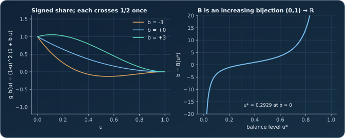
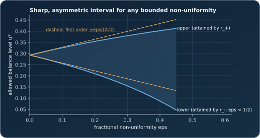
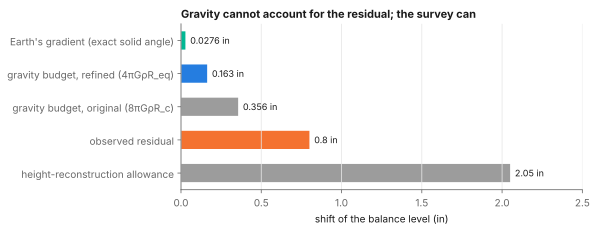

# GP-2 · Robustness of the Balance Plane, and the Constitutive Share at Giza

*How far a real, non-uniform field can move the half-flux level of a cone; why the Earth's own gravity moves it by less than a millimetre; and why the structural share is not the constitutive law · Great Pyramid core framework · Gravity Field Dynamics (GFD), exploratory*

`flux` `centroid` `perturbation-bound` `net-field-rule` `proof`

[](https://github.com/fielddynamics/research/actions/workflows/lean-great-pyramid-gp2.yml) [](verify_output.txt) [](LEAN_AUDIT.md) [](figures/) [](../../CORE_FRAMEWORK.md)

**Status.** Theorems 1–7 are **[T]**: proved below, with every step checked by [`verify_gp2_robustness.py`](verify_gp2_robustness.py) (52 checks, [output](verify_output.txt)). Theorems 1–4 are checked exactly; T5–T7 use 40-digit numerics. Theorem 8 is **[T]** given the net-field rule, which is itself **[T+L]** in [`proofs/net-field-rule/`](../../../../../proofs/net-field-rule/).

---

## The question

[GP-1](../gp1-half-section-balance-plane/) puts the half-flux level of a cone at $u^* = 1 - 1/\sqrt2$ for a *uniform* current. Note [`01.7`](../../pyramid_portal_research/01_framework_foundations/01.7_areal_closure_from_action.md) estimates numerically that a strained field shifts the level by about 599 in per unit fractional gradient. From that it infers that the driving field must be uniform to 0.1%. This proof answers four questions in closed form:

1. What is the exact law for a non-uniform field?
2. How far can any bounded non-uniformity move the level?
3. What do the Earth's field and the pyramid's own gravity actually do?
4. Does the structural share $\mu_B$ coincide with GFD's constitutive share $\mu$ at Giza?

Notation as in GP-1: $u = z/h$, $\mu_B(z) = \Phi_\Sigma(z)/\Phi_\Sigma(0)$, and $\Phi_\Sigma(z) = \int_{\Sigma(z)}J_z\,dA$.

## Theorem 1 (centroid identity)

If $\mathbf J(\mathbf r) = \mathbf J_0 + M\mathbf r$ is affine, then for every planar section $S$:

$$\int_S J_z\,dA = |S|\;J_z(c_S),$$

where $c_S$ is the centroid of $S$. *Proof:* the mean of an affine function over a region is its value at the centroid. $\square$

## Theorem 2 (exact law in a cone)

For affine $\mathbf J$ with $J_z(c_0) \ne 0$:

$$\boxed{\;\mu_B(u) = (1-u)^2\,(1 + b\,u),\qquad b = \frac{J_z(\text{apex})}{J_z(\text{base centroid})} - 1.\;}$$

*Proof.* By GP-1 Theorem 1 the section centroid moves on the segment from $c_0$ to the apex, so $J_z$ evaluated there is affine in $u$. Combine Theorem 1 here with $A = A_0(1-u)^2$. $\square$

So the whole effect of an affine background is **one number**: the fractional change of $J_z$ from the base centroid to the apex. The tilt, the horizontal gradients and the shear off the centroid line drop out.

**(b) Frustum balance.** The net outward flux of the frustum is $\operatorname{tr}(M)\cdot\mathrm{Vol}$. So the split "base in = section out + lateral out" holds exactly when $\nabla\cdot\mathbf J = \operatorname{tr}M = 0$. The script checks both cases face by face, with exact rational vector areas.

## Theorem 3 (the balance level is unique for every real $b$)

Let $g_b(u) = (1-u)^2(1+bu)$, the **signed** normalised section flux. For **every** $b \in \mathbb R$ there is exactly one $u \in (0,1)$ with $g_b(u) = \tfrac12$.

*Proof (verified exactly by script).* Solving $g_b(u) = \tfrac12$ for $b$ gives

$$b = B(u) = \frac{1/[2(1-u)^2] - 1}{u},\qquad B'(u) = \frac{(1-u)^3 + u^2(3-u)}{2u^2(1-u)^3} > 0 \ \text{on } (0,1),$$

with $B(0^+) = -\infty$ and $B(1^-) = +\infty$. So $B$ is an increasing bijection $(0,1) \to \mathbb R$, and each $b$ has exactly one balance level. $\square$

The ratio stays defined for $b \le -1$: the base flux is nonzero, and $J_z$ merely changes sign on the axis (e.g. $g_{-2}(3/4) = -1/32$). A restriction to $b > -1$ is needed only if one also wants $g_b$ to be a **positive share** in $[0,1]$, which requires $b \ge -1$ (and $g_b$ exceeds 1 somewhere when $b > 2$). The Lean file proves strict monotonicity for $-1 < b \le 2$; the all-$b$ statement is checked exactly by script.



## Theorem 4 (the shift, in closed form)

$$\left.\frac{du^*}{db}\right|_{b=0} = \frac{\sqrt2 - 1}{4} = 0.103\,553,\qquad \left.\frac{d^2u^*}{db^2}\right|_{b=0} = 1 - \frac{11\sqrt2}{16} = 0.027\,728 .$$

For $h = 5776$ in the first coefficient is **598.1 in per unit $b$**. This reproduces `01.7`'s numerical 599 in exactly, and identifies its strained field's $\varepsilon$ as $b$.

## Theorem 5 (any bounded non-uniformity)

Let $\mathbf J$ be **any** field, not necessarily affine or divergence-free. Suppose its normalised mean axial density $r(u) = \bar\jmath(u)/\bar\jmath(0)$ (with $\bar\jmath = \Phi_\Sigma/A$) satisfies $|r(u) - 1| \le \varepsilon < 1$ on $[0,1]$. Then every balance level satisfies

$$1 - \frac{1}{\sqrt{2(1-\varepsilon)}} \;\le\; u^* \;\le\; 1 - \frac{1}{\sqrt{2(1+\varepsilon)}},$$

intersected with $[0,1]$. The half-width is $\varepsilon/(2\sqrt2) + O(\varepsilon^2)$, and for finite $\varepsilon$ the interval is asymmetric.

*Proof.* At a root, $(1-u)^2 = \tfrac12/r(u)$, and $1/r(u) \in [1/(1+\varepsilon), 1/(1-\varepsilon)]$. No monotonicity is needed. $\square$

**Existence and uniqueness (hypotheses made explicit).** If the normalised section flux $(1-u)^2 r(u)$ is continuous, it runs from 1 at the base to 0 at the apex, so a root exists by the intermediate value theorem. If $r$ is differentiable and positive with $r'/r < 2/(1-u)$, then $(1-u)^2 r$ is strictly decreasing and the root is unique.

**Sharpness, with normalised witnesses.** Constant ratios $1 \pm \varepsilon$ would violate $r(0) = 1$. The witnesses are

$$r_\pm(u) = 1 \pm \varepsilon\,\min(u/u_\pm, 1),$$

with $u_\pm$ the corresponding endpoint. They satisfy $r(0) = 1$ and $|r - 1| \le \varepsilon$, and each puts a root exactly at its endpoint. The lower endpoint is positive, and so attainable, only for $\varepsilon < 1/2$.



With Phase 0's reported uniformity, $\varepsilon = 5\times10^{-5}$, the level is confined to **±0.10 in**.

## Theorem 6 (the Earth's field)

Treat the Earth as a monopole at depth $R = 6.371\times10^6$ m below the base. Its flux through a horizontal square of side $a$ at distance $d$ is $-GM$ times the solid angle

$$\Omega_\square = 4\arctan\!\left(\frac{a^2}{4d\sqrt{d^2 + a^2/2}}\right),$$

which is exact. Solving $\mu_B = \tfrac12$ with Petrie's base of 9068.8 in and height of 5776 in:

- **the balance level moves down by 0.70 mm** (0.028 in);
- the affine prediction $\frac{\sqrt2-1}{4}\,b\,h$ with $b = (R/(R+h))^2 - 1 = -4.6\times10^{-5}$ agrees to better than 1%;
- the exterior field is divergence-free, so the frustum balance is exact.

## Theorem 7 (the pyramid's self-gravity)

The self-field is *sourced* ($\nabla\cdot\mathbf J = \rho \ne 0$ inside the stone, in the normalisation $\mathbf J = \mu\nabla\Phi/4\pi G$), so the frustum balance does not hold for it: the enclosed source must be accounted for. $\mu_B$ as a ratio of section fluxes is still defined, and Theorem 5 applies.

**Bound by rearrangement.** For mass of density at most $\rho$ filling a volume $V$, the integral $\int_B |x-y|^{-2}dy$ is largest when $B$ is the ball of equal volume centred at $x$, because the kernel decreases with distance. Hence

$$|\mathbf g_{\rm self}(x)| \le 4\pi G\rho R_{\rm eq},\qquad R_{\rm eq} = (3V/4\pi)^{1/3}.$$

With $V = a^2h/3$ (Petrie's $a = 230.348$ m, $h = 146.710$ m), $R_{\rm eq} = 85.25$ m and, for $\rho = 2300$ kg m⁻³, $|\mathbf g_{\rm self}| \le 1.64\times10^{-4}$ m s⁻². Combine it with the Earth's fractional variation $\varepsilon_E = 4.61\times10^{-5}$ conservatively, normalising by the smallest possible base density:

$$\varepsilon_{\rm total} \le \frac{g_0\varepsilon_E + 2g_{\rm self}}{g_0 - g_{\rm self}} = 7.96\times10^{-5}.$$

Theorem 5, taking the larger endpoint, then puts **the gravitational balance level within 0.163 in of $0.292893\,h$**. (The cruder bound $8\pi G\rho R_c$, using a ball of twice the circumradius, gives 0.36 in.)



So gravity locates the plane to about a sixth of an inch. The 0.80 in residual of GP-1 Observation 7 is survey-level: the height reconstruction alone contributes ±2.05 in. No field effect is needed to explain it, and the residual cannot be used to measure one. These figures are conditional on the adopted density and the monopole Earth model.

## Theorem 8 (the structural share is not the constitutive share)

At the Earth's surface $x = g/a_0 = 8.2\times10^{10}$.

1. **Net-field rule** ([T+L], [`proofs/net-field-rule/`](../../../../../proofs/net-field-rule/)): the solar system is drainless. Inside it gravity is pure TetA, so $\mu = 1$ **exactly** and the TetB share is zero (llms.txt, Rule 16).
2. Even if the law were applied per mass, which the rule forbids, the TetB share would be $1/(1+x) = 1.2\times10^{-11}$.
3. The constitutive law reaches $\mu = \tfrac12$ only at $g = a_0$, a field $8\times10^{10}$ times weaker than Giza's.

**Three different quantities, three names.** $\mu_g$ is the constitutive (gravitational) share, $\mu_B$ the structural flux share of GP-1, and $s_{\rm reg}$ a candidate registration signature for a driven apparatus. A proposed transduction law would read $s_{\rm reg} = 2\mu_B - 1$. It must never be written $\mu_g = \mu_B$.

At the balance plane $\mu_B = \tfrac12$ while $\mu_g = 1$. So **$\mu_B$ is a property of geometry and of whatever divergence-free field passes through the body. It is not the TetA/TetB partition of the gravitational field.**

This corrects assumption A3 of `01.7`, which identifies the axial and lateral flux shares with TetA and TetB and calls that "part of GFD itself". For the gravitational field, A3 contradicts the net-field rule. For a *driven* non-gravitational field (electromagnetic, acoustic), the sector identification is a hypothesis **[E]**, to be stated as such.

## What this proves, in one paragraph

The half-flux level of a cone is set by geometry to $1 - 1/\sqrt2$. The level is stable:

- an affine background moves it by $0.1036\,b\,h$;
- any non-uniformity of fractional size $\varepsilon$ moves it by at most $\approx0.354\,\varepsilon\,h$;
- the level is unique for every real affine gradient;
- the Earth's gravity and the pyramid's own gravity together move it by at most 0.163 in.

The level is a geometric and kinematic fact about the stone and its surroundings. It is not where GFD's constitutive law changes hands: at Giza that law is pure TetA.

## Premises

| Premise | Used in |
|---|---|
| Cone geometry (GP-1) | T2–T7 |
| Affine $\mathbf J$ | T1–T4 |
| Bounded mean axial density, ratio within $1 \pm \varepsilon$ | T5, T7 |
| Earth a monopole; Petrie's base and height | T6 |
| Uniform density $\le 2300$ kg m⁻³ | T7 (an upper-end value; a lower density tightens the bound) |
| Net-field rule ([T+L]) | T8 |

## Verification

```bash
python verify_gp2_robustness.py    # 52 checks; ~5 s
```
